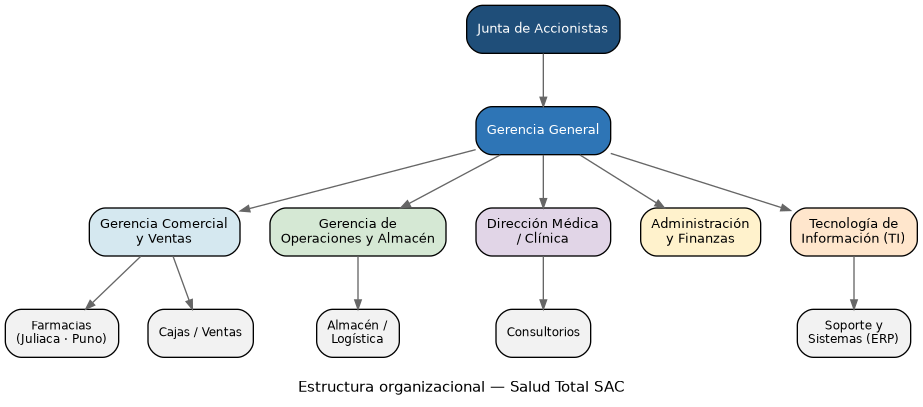
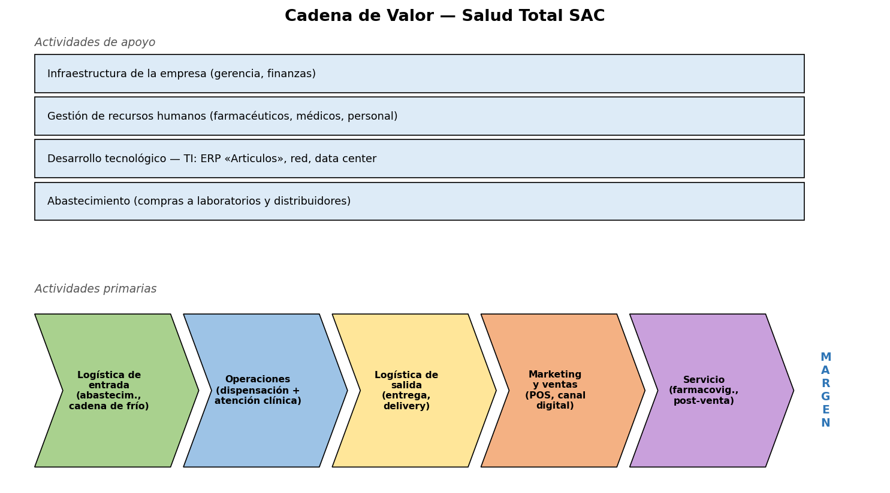
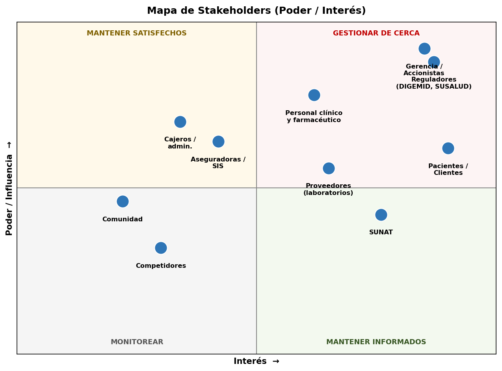
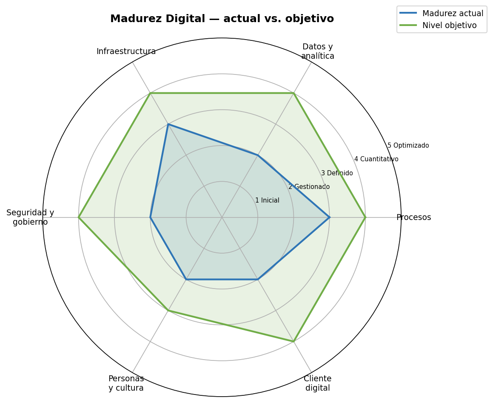
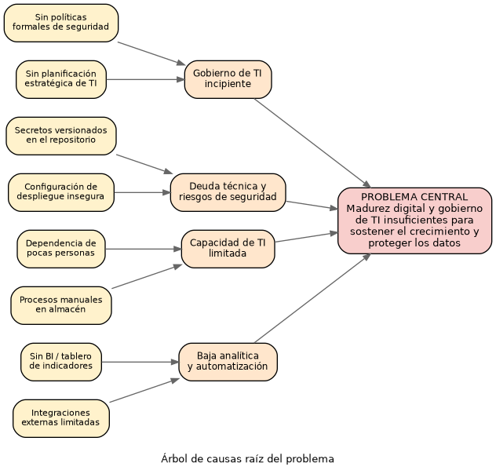
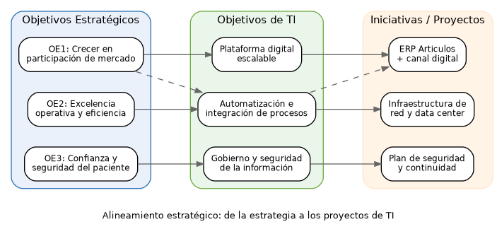
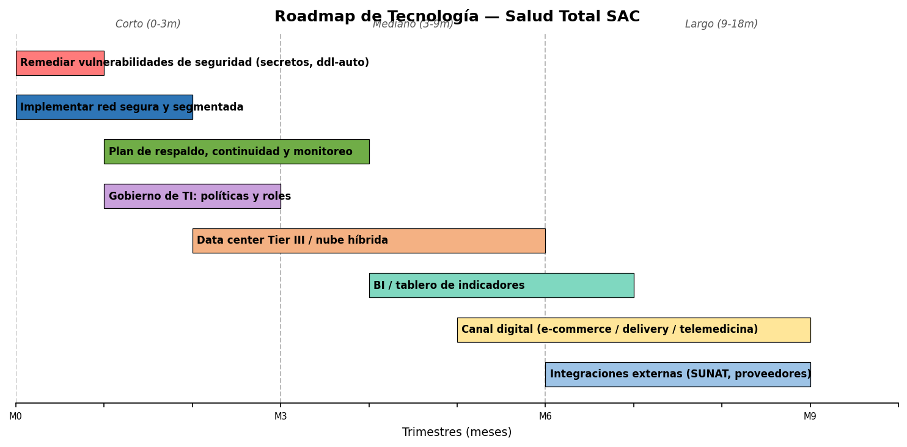
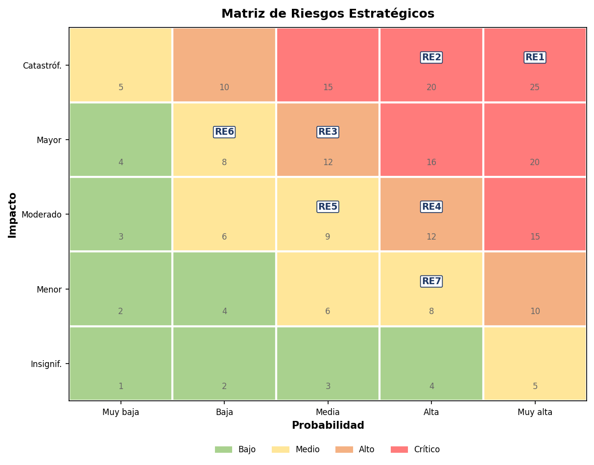

# CE0111-CE0115 - E1: Diagnóstico Organizacional

**UNIVERSIDAD PERUANA UNIÓN**

**FACULTAD DE INGENIERÍA Y ARQUITECTURA**

**Escuela Académico Profesional de Ingeniería de Sistemas**

ENTREGABLE 1: Diagnóstico Organizacional y Alineamiento Estratégico

Curso: EPE

RESPONSABLES:

Jhosef Anthony Quispe Huarilloclla

Jose Samuel Turpo Cauna

Yesenia Alejandra Gutierrez Anco

Juliaca – 2026

## Resumen Ejecutivo

Este documento presenta el diagnóstico organizacional y el alineamiento estratégico de «Salud Total SAC», una cadena de farmacias con servicios de clínica ambulatoria que opera una sede central en Juliaca y una sucursal en Puno. El objetivo es evaluar la situación actual de la organización —su contexto, su estrategia y su madurez digital— para identificar las brechas estratégicas, operativas y tecnológicas que fundamentan la necesidad de modernizar su plataforma y su gobierno de TI.

El análisis evidencia que Salud Total SAC posee una fortaleza diferenciadora: un sistema ERP propio («Artículos») que integra ventas, inventario, compras, caja, atención clínica y notificaciones. Sin embargo, su madurez digital es intermedia y presenta brechas relevantes en gobierno y seguridad de la información, analítica de datos, automatización y continuidad operativa. En particular, se identificaron debilidades concretas de seguridad (credenciales y llaves criptográficas versionadas en el repositorio y una configuración de despliegue que puede destruir datos) que representan un riesgo estratégico para una organización que custodia datos clínicos y financieros.

El problema central se define como una insuficiente madurez digital y gobierno de TI para sostener el crecimiento de la organización y proteger sus datos, lo que limita su competitividad frente a las grandes cadenas farmacéuticas. El documento alinea la intervención propuesta con los objetivos estratégicos institucionales, presenta un caso de negocio, una hoja de ruta tecnológica y una matriz de riesgos estratégicos, conformando la base para los proyectos de infraestructura, seguridad y datos que dan respuesta a las brechas identificadas.

## 1. Contexto Organizacional

### 1.1 Sector y Entorno Competitivo

Salud Total SAC opera en el sector del retail farmacéutico y los servicios de salud ambulatoria, un mercado caracterizado en el Perú por una fuerte concentración: las grandes cadenas nacionales (con cientos de locales y poder de negociación sobre los laboratorios) dominan la participación de mercado, mientras que las boticas independientes y las cadenas regionales como Salud Total compiten por cercanía, servicio personalizado y precio. La integración de la dispensación de medicamentos con servicios clínicos (consultorios) constituye un diferenciador frente a la farmacia tradicional.

El entorno es altamente regulado (DIGEMID para la comercialización de medicamentos, SUSALUD para los servicios de salud, SUNAT para la facturación electrónica) y sensible a la confianza del cliente, especialmente en el manejo de datos de salud. Las tendencias de digitalización —venta en línea, delivery de medicamentos y telemedicina— están transformando el sector y abren oportunidades para los actores capaces de adoptar tecnología con agilidad.

Aplicando el marco de las cinco fuerzas de Porter de forma sintética: la rivalidad entre competidores es alta (cadenas grandes y boticas locales); el poder de negociación de los proveedores (laboratorios y distribuidores) es alto; el poder de los clientes crece con la transparencia de precios y los canales digitales; la amenaza de nuevos entrantes es moderada (barreras regulatorias y de capital); y la amenaza de sustitutos es baja-moderada. En este escenario, la diferenciación por servicio integrado y la eficiencia habilitada por la tecnología son palancas competitivas decisivas.

### 1.2 Estructura Organizacional

La organización presenta una estructura funcional encabezada por la Gerencia General, de la que dependen las áreas comerciales y de ventas, operaciones y almacén, dirección médica/clínica, administración y finanzas, y tecnología de información. Las farmacias de Juliaca y Puno operan bajo la gerencia comercial, mientras que el área de TI da soporte transversal al ERP «Artículos» y a la infraestructura.

*Figura 1.1 — Estructura organizacional de Salud Total SAC.*

### 1.3 Cadena de Valor

La cadena de valor de Porter permite visualizar cómo la organización genera valor. Las actividades primarias abarcan la logística de entrada (abastecimiento de medicamentos y cadena de frío), las operaciones (dispensación y atención clínica), la logística de salida (entrega y delivery), el marketing y las ventas (puntos de venta y canal digital) y el servicio (farmacovigilancia y postventa). Las actividades de apoyo —infraestructura de la empresa, recursos humanos, desarrollo tecnológico (TI) y abastecimiento— sostienen a las primarias. El área de TI, con el ERP «Artículos», atraviesa toda la cadena y es clave para la eficiencia y la diferenciación.

*Figura 1.2 — Cadena de valor de Salud Total SAC.*

### 1.4 Mapa de Stakeholders

El mapa de poder/interés clasifica a los grupos de interés para priorizar su gestión. En el cuadrante de mayor poder e interés (gestionar de cerca) se ubican la gerencia y los accionistas, los reguladores (DIGEMID, SUSALUD) y los pacientes/clientes; el personal clínico y farmacéutico y los proveedores combinan poder e interés relevantes; y otros actores (comunidad, competidores) se monitorean. La protección de los datos de los pacientes y el cumplimiento regulatorio son expectativas críticas de los stakeholders de mayor influencia.

*Figura 1.3 — Mapa de stakeholders (poder / interés).*

## 2. Análisis Estratégico

### 2.1 Misión, Visión y Objetivos Estratégicos

| **Elemento** | **Enunciado**                                                                                                                                                                            |
|--------------|------------------------------------------------------------------------------------------------------------------------------------------------------------------------------------------|
| **Misión**   | Mejorar la salud y el bienestar de las comunidades de la región Puno, ofreciendo medicamentos y servicios clínicos accesibles, seguros y de calidad, con atención cercana y responsable. |
| **Visión**   | Ser la cadena de farmacias y servicios de salud de referencia en el sur del Perú, reconocida por su confiabilidad, su servicio integrado y su capacidad digital.                         |

De estas declaraciones se derivan los objetivos estratégicos institucionales:

- OE1 — Incrementar la participación de mercado y expandir la cobertura (nuevas sucursales y canales).

- OE2 — Alcanzar la excelencia operativa y la eficiencia en costos a lo largo de la cadena de valor.

- OE3 — Fortalecer la confianza y la seguridad del paciente, garantizando la protección de sus datos.

- OE4 — Desarrollar las capacidades digitales que habiliten el crecimiento y la innovación.

### 2.2 Análisis FODA

El análisis FODA sintetiza los factores internos (fortalezas y debilidades) y externos (oportunidades y amenazas) que condicionan la estrategia:

<table>
<colgroup>
<col style="width: 50%" />
<col style="width: 50%" />
</colgroup>
<thead>
<tr class="header">
<th>
<strong>Fortalezas (F)</strong>

<ul>
<li>
ERP propio «Artículos» que integra ventas, inventario, compras, caja y atención clínica.
</li>
<li>
Modelo diferenciado: farmacia + servicios clínicos.
</li>
<li>
Presencia y conocimiento del mercado local (Juliaca, Puno).
</li>
<li>
Atención personalizada y cercanía con el cliente.
</li>
</ul></th>
<th>
<strong>Debilidades (D)</strong>

<ul>
<li>
Madurez digital intermedia; gobierno de TI incipiente.
</li>
<li>
Deuda técnica y vulnerabilidades de seguridad (secretos en el repositorio, despliegue inseguro).
</li>
<li>
Dependencia de pocas personas para la operación de TI.
</li>
<li>
Procesos manuales en almacén; analítica de datos limitada.
</li>
</ul></th>
</tr>
</thead>
<tbody>
<tr class="odd">
<td>
<strong>Oportunidades (O)</strong>

<ul>
<li>
Crecimiento de la demanda de salud y medicamentos en la región.
</li>
<li>
Canales digitales: e-commerce, delivery y telemedicina.
</li>
<li>
Expansión a nuevas sucursales.
</li>
<li>
Digitalización de procesos e integración con entes externos (SUNAT, proveedores).
</li>
</ul></td>
<td>
<strong>Amenazas (A)</strong>

<ul>
<li>
Competencia de grandes cadenas con mayor escala y poder de negociación.
</li>
<li>
Cambios regulatorios (DIGEMID, SUSALUD, protección de datos).
</li>
<li>
Riesgos de ciberseguridad y fuga de datos clínicos.
</li>
<li>
Presión sobre márgenes y poder de los proveedores.
</li>
</ul></td>
</tr>
</tbody>
</table>

El cruce FODA sugiere estrategias de tipo FO (aprovechar el ERP propio para habilitar canales digitales), DO (cerrar las brechas de seguridad y gobierno para sostener el crecimiento), FA (usar la diferenciación de servicio frente a la competencia) y DA (mitigar el riesgo regulatorio y de ciberseguridad mediante un plan de seguridad).

### 2.3 Análisis PESTEL

| **Factor**  | **Implicación para Salud Total SAC**                                                                     |
|-------------|----------------------------------------------------------------------------------------------------------|
| Político    | Políticas de salud pública y fiscalización sanitaria; estabilidad regulatoria del sector farmacéutico.   |
| Económico   | Poder adquisitivo regional, inflación de medicamentos y sensibilidad al precio del cliente.              |
| Social      | Envejecimiento poblacional, mayor demanda de salud y adopción creciente de canales digitales.            |
| Tecnológico | Telemedicina, farmacia electrónica, analítica de datos e inteligencia artificial aplicada a salud.       |
| Ecológico   | Gestión de residuos farmacéuticos y cadena de frío; sostenibilidad de la operación.                      |
| Legal       | Ley N.° 29733 de Protección de Datos Personales; normativa de DIGEMID y facturación electrónica (SUNAT). |

### 2.4 Factores Críticos de Éxito

- Disponibilidad de stock y gestión eficiente del inventario (evitar quiebres y vencimientos).

- Cumplimiento regulatorio y trazabilidad de medicamentos y datos clínicos.

- Confianza y seguridad de la información del paciente.

- Eficiencia operativa y control de costos en toda la cadena.

- Experiencia del cliente y capacidad de atención multicanal.

- Capacidad digital y de innovación habilitada por una plataforma tecnológica sólida.

## 3. Diagnóstico Digital / TI

### 3.1 Inventario de Sistemas de Información

El núcleo tecnológico de Salud Total SAC es el ERP propio «Artículos», una plataforma web modular que soporta los procesos clave del negocio. Su inventario es:

| **Sistema / Componente**    | **Función**                              | **Tecnología**       |
|-----------------------------|------------------------------------------|----------------------|
| ERP Articulos — Backend     | Lógica de negocio y API REST             | Spring Boot / Java   |
| ERP Articulos — Frontend    | Interfaz de usuario (web)                | Angular              |
| Módulo de Ventas/Caja       | Facturación y cobro en el punto de venta | Articulos            |
| Módulo de Inventario/Kardex | Control de stock y movimientos           | Articulos            |
| Módulo de Compras           | Abastecimiento a proveedores             | Articulos            |
| Módulo Clínico              | Atención y datos de pacientes            | Articulos            |
| Servicio de Notificaciones  | Avisos en tiempo real                    | Kafka + WebSocket    |
| Base de datos               | Persistencia transaccional               | AWS RDS (PostgreSQL) |

La existencia de un ERP propio e integrado es una fortaleza poco común en organizaciones de este tamaño; constituye el activo digital central sobre el que se apoya la operación.

### 3.2 Nivel de Madurez Digital

Se evaluó la madurez digital en seis dimensiones, sobre una escala de cinco niveles (1 Inicial, 2 Gestionado, 3 Definido, 4 Cuantitativo, 5 Optimizado). El resultado sitúa a la organización en un nivel intermedio (≈ 2,3 promedio), con un contraste marcado: relativamente sólida en procesos e infraestructura gracias al ERP, pero rezagada en datos/analítica, seguridad/gobierno, cultura digital y canal digital con el cliente.

*Figura 3.1 — Madurez digital: nivel actual vs. objetivo.*

| **Dimensión**        | **Actual** | **Objetivo** | **Brecha principal**                            |
|----------------------|------------|--------------|-------------------------------------------------|
| Procesos             | 3          | 4            | Automatización de procesos manuales (almacén)   |
| Datos y analítica    | 2          | 4            | Ausencia de BI / tablero de indicadores         |
| Infraestructura      | 3          | 4            | Continuidad y recuperación ante desastres       |
| Seguridad y gobierno | 2          | 4            | Sin políticas formales; vulnerabilidades reales |
| Personas y cultura   | 2          | 3            | Dependencia de pocas personas en TI             |
| Cliente digital      | 2          | 4            | Sin canal digital (e-commerce/telemedicina)     |

### 3.3 Brechas Tecnológicas

- Gobierno y seguridad de la información: ausencia de políticas formales y existencia de vulnerabilidades concretas (credenciales y llaves criptográficas versionadas en el repositorio, configuración de despliegue que puede destruir datos).

- Analítica de datos: no existe una capa de inteligencia de negocio (BI) ni tableros que conviertan los datos del ERP en decisiones.

- Continuidad y recuperación: madurez limitada en respaldo, alta disponibilidad y recuperación ante desastres.

- Automatización e integración: procesos manuales en almacén e integraciones externas limitadas (SUNAT, proveedores).

- Canal digital: inexistencia de un canal de e-commerce, delivery o telemedicina que capture la tendencia del sector.

### 3.4 Problemas Operativos Asociados a TI

Las brechas anteriores se traducen en problemas operativos concretos:

| **Problema operativo**                      | **Consecuencia**                                               |
|---------------------------------------------|----------------------------------------------------------------|
| Secretos versionados en el repositorio      | Riesgo de acceso no autorizado total al sistema y a los datos. |
| Configuración ddl-auto=create en despliegue | Posible pérdida o destrucción de datos al desplegar.           |
| Ausencia de tableros de indicadores         | Decisiones basadas en intuición y no en datos.                 |
| Procesos manuales en almacén                | Errores de stock, quiebres y vencimientos.                     |
| Dependencia de pocas personas en TI         | Riesgo de continuidad ante ausencias; cuellos de botella.      |

## 4. Identificación del Problema

### 4.1 Definición Estructurada del Problema

**Problema central:** «Salud Total SAC cuenta con un ERP propio y funcional, pero su madurez digital y su gobierno de TI son insuficientes para sostener el crecimiento de la organización y para garantizar la seguridad y la disponibilidad de sus datos clínicos y financieros, lo que limita su eficiencia operativa y su competitividad frente a las grandes cadenas farmacéuticas.»

| **Dimensión**    | **Descripción**                                                                                           |
|------------------|-----------------------------------------------------------------------------------------------------------|
| ¿Qué ocurre?     | La capacidad digital y el gobierno de TI no acompañan el potencial del ERP ni las exigencias del entorno. |
| ¿A quién afecta? | A la organización, a sus pacientes (riesgo sobre sus datos) y a su posición competitiva.                  |
| ¿Dónde?          | En toda la operación (sede central y sucursal), con foco en seguridad, datos y continuidad.               |
| ¿Desde cuándo?   | Acumulado por el crecimiento sin una estrategia formal de TI.                                             |
| Magnitud         | Riesgo crítico de seguridad y brechas de madurez en 4 de 6 dimensiones.                                   |

### 4.2 Análisis de Causas Raíz

El árbol de causas identifica cuatro causas raíz que originan el problema central: un gobierno de TI incipiente (sin políticas ni planificación estratégica), la deuda técnica y los riesgos de seguridad, la capacidad limitada del área de TI, y la baja analítica y automatización.

*Figura 4.1 — Árbol de causas raíz del problema.*

### 4.3 Impacto Estratégico

- Riesgo legal y reputacional: una fuga de datos clínicos vulneraría la Ley N.° 29733 y la confianza del paciente, con sanciones y daño de imagen.

- Pérdida de competitividad: la falta de capacidades digitales (canal digital, analítica) cede terreno frente a las cadenas grandes.

- Ineficiencia operativa: los procesos manuales y la falta de indicadores elevan costos y errores.

- Riesgo de continuidad: la baja madurez en respaldo y recuperación amenaza la operación ante incidentes.

### 4.4 Justificación de la Intervención

La intervención se justifica porque atiende directamente los factores críticos de éxito y los objetivos estratégicos de la organización: protege los datos del paciente (OE3), habilita la eficiencia operativa (OE2), sienta las bases para el crecimiento y el canal digital (OE1, OE4) y mitiga riesgos legales y de continuidad. Además, varias de las brechas detectadas son remediables con proyectos acotados y de alto impacto (seguridad, red, data center, datos), lo que ofrece una relación beneficio/costo favorable. No intervenir mantendría a la organización expuesta a un riesgo crítico de seguridad y la rezagaría competitivamente.

## 5. Alineamiento Estratégico y Hoja de Ruta

### 5.1 Alineamiento Estratégico

El alineamiento estratégico asegura que cada iniciativa de TI responda a un objetivo de negocio. La cascada estrategia → objetivos de TI → proyectos vincula los objetivos estratégicos institucionales con los objetivos de TI y con los proyectos concretos que dan respuesta a las brechas diagnosticadas.

*Figura 5.1 — Alineamiento estratégico de los proyectos de TI.*

| **Objetivo estratégico**    | **Objetivo de TI**                     | **Proyecto / Iniciativa**                |
|-----------------------------|----------------------------------------|------------------------------------------|
| OE1 — Crecer en el mercado  | Plataforma digital escalable           | ERP Articulos + canal digital            |
| OE2 — Excelencia operativa  | Automatización e integración           | Infraestructura de red y data center; BI |
| OE3 — Confianza y seguridad | Gobierno y seguridad de la información | Plan de seguridad y continuidad          |
| OE4 — Capacidades digitales | Innovación habilitada por datos        | Analítica (BI) y nuevos canales          |

### 5.2 Caso de Negocio (Síntesis)

La modernización de la plataforma y el gobierno de TI se sustenta en un caso de negocio cuyos beneficios superan ampliamente la inversión requerida, dado que varias iniciativas son de bajo costo y alto impacto (especialmente la remediación de seguridad):

| **Componente**           | **Descripción**                                                                                                              |
|--------------------------|------------------------------------------------------------------------------------------------------------------------------|
| Beneficios cualitativos  | Reducción del riesgo legal/reputacional; protección de datos clínicos; mejora de eficiencia y de la experiencia del cliente. |
| Beneficios cuantitativos | Menos quiebres y vencimientos de stock; reducción de tiempos operativos; evitación de pérdidas por incidentes de seguridad.  |
| Inversión                | Acotada: priorización de quick wins (seguridad), infraestructura incremental y aprovechamiento de la nube híbrida.           |
| Riesgo de no invertir    | Exposición a sanciones (Ley 29733), pérdida de datos y rezago competitivo.                                                   |
| Recomendación            | Aprobar la intervención por etapas, iniciando por la remediación de seguridad (mayor riesgo, menor costo).                   |

### 5.3 Roadmap de Tecnología

La hoja de ruta organiza las iniciativas en tres horizontes —corto, mediano y largo plazo— priorizando primero la mitigación de los riesgos críticos de seguridad y la base de infraestructura, y avanzando luego hacia la analítica y los nuevos canales digitales.

*Figura 5.2 — Roadmap de tecnología por horizontes.*

### 5.4 Matriz de Riesgos Estratégicos

Los riesgos estratégicos que podrían comprometer los objetivos de la organización se evalúan por probabilidad e impacto. Los de mayor criticidad son la ciberseguridad y la pérdida de datos, dada la evidencia de vulnerabilidades reales y la sensibilidad de los datos clínicos.

*Figura 5.3 — Matriz de riesgos estratégicos.*

| **ID** | **Riesgo estratégico**                            | **Nivel** | **Respuesta**                               |
|--------|---------------------------------------------------|-----------|---------------------------------------------|
| RE1    | Brecha de ciberseguridad / fuga de datos clínicos | Crítico   | Plan de seguridad y continuidad             |
| RE2    | Pérdida de datos por despliegue inseguro          | Crítico   | Gestión de cambios; migraciones controladas |
| RE3    | Incumplimiento regulatorio (Ley 29733, DIGEMID)   | Alto      | Cumplimiento y auditoría                    |
| RE4    | Pérdida de competitividad por rezago digital      | Alto      | Roadmap digital; nuevos canales             |
| RE5    | Dependencia tecnológica de pocas personas         | Medio     | Documentación; gobierno de TI               |
| RE6    | Interrupción operativa por fallo de TI            | Alto      | Redundancia; respaldo y DR                  |
| RE7    | Presión competitiva de grandes cadenas            | Medio     | Diferenciación por servicio integrado       |

## 6. Conclusiones

El diagnóstico organizacional de Salud Total SAC revela una organización con una base tecnológica diferenciadora —un ERP propio e integrado— pero con una madurez digital intermedia y un gobierno de TI incipiente. Esta combinación genera brechas estratégicas, operativas y tecnológicas que, de no atenderse, limitan el crecimiento y exponen a la organización a riesgos críticos, especialmente en la seguridad de los datos clínicos y financieros.

El problema central queda fundamentado con evidencia objetiva (madurez por dimensiones, vulnerabilidades concretas y problemas operativos) y se vincula de forma coherente con los objetivos estratégicos institucionales. El alineamiento estratégico, el caso de negocio, la hoja de ruta y la matriz de riesgos estratégicos conforman un marco que justifica la intervención y orienta su priorización, comenzando por la remediación de seguridad —de mayor riesgo y menor costo— y avanzando hacia la infraestructura, la continuidad, la analítica y los nuevos canales digitales.

En conclusión, la modernización de la plataforma y del gobierno de TI no es un fin en sí mismo, sino un habilitador directo de la estrategia de Salud Total SAC: protege al paciente, mejora la eficiencia, sostiene el crecimiento y refuerza la competitividad de la organización en un sector en transformación.

---

### Archivos del entregable

- [:material-file-word: Descargar documento original (.docx)](Entregable_Diagnostico_Organizacional.docx)
