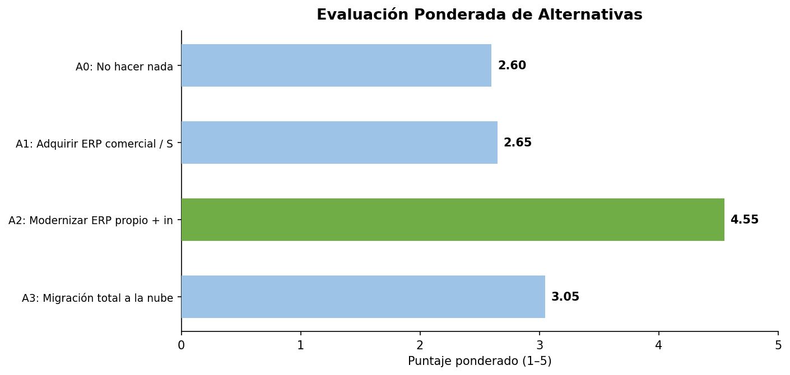
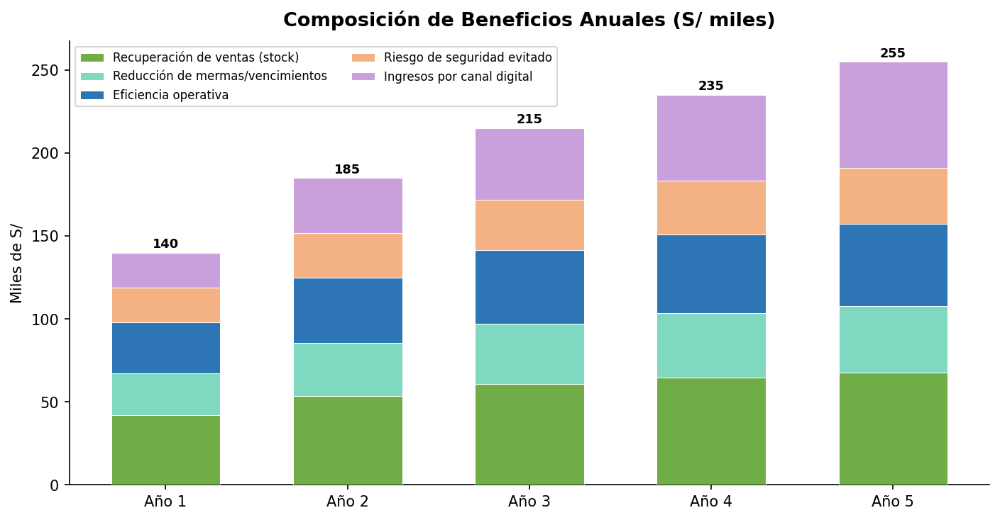
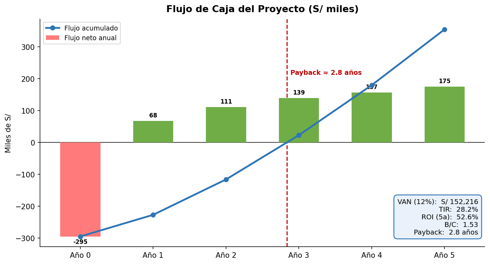

# CE0113 - E2: Business Case del Proyecto

**UNIVERSIDAD PERUANA UNIÓN**

**FACULTAD DE INGENIERÍA Y ARQUITECTURA**

**Escuela Académico Profesional de Ingeniería de Sistemas**

ENTREGABLE 2: Business Case del Proyecto

Curso: EPE

RESPONSABLES:

Jhosef Anthony Quispe Huarilloclla

Jose Samuel Turpo Cauna

Yesenia Alejandra Gutierrez Anco

Juliaca – 2026

## Resumen Ejecutivo

Este Business Case justifica la viabilidad y la conveniencia del proyecto de modernización de la plataforma y el gobierno de TI de «Salud Total SAC». Partiendo del problema identificado en el diagnóstico organizacional —una madurez digital intermedia y un gobierno de TI incipiente que exponen a la organización a riesgos críticos de seguridad y limitan su competitividad—, el proyecto propone fortalecer la seguridad, la infraestructura (red y centro de datos), la continuidad y las capacidades digitales y de datos, aprovechando el ERP propio «Articulos» ya existente.

Se evaluaron cuatro alternativas tecnológicas mediante una matriz de decisión ponderada; la opción seleccionada —modernizar el ERP propio sobre una infraestructura híbrida— obtuvo el mayor puntaje por su alineamiento estratégico, su seguridad y su aprovechamiento de los activos existentes.

**El análisis económico confirma la viabilidad financiera del proyecto.** Con una inversión inicial de S/ 295,000 y un horizonte de cinco años, el proyecto presenta un Valor Actual Neto (VAN) de S/ 152,216 a una tasa de descuento del 12 %, una Tasa Interna de Retorno (TIR) del 28.2 % —muy superior al costo de capital—, un retorno de la inversión (ROI) del 53 % y un período de recuperación (payback) de 2.8 años. La relación beneficio/costo es de 1.53. Estos indicadores, sumados a los beneficios cualitativos (protección de datos clínicos, cumplimiento y reputación), sustentan la recomendación de aprobar la iniciativa.

## 1. Justificación del Proyecto

### 1.1 Problema que se Resuelve

El diagnóstico organizacional evidenció que Salud Total SAC, pese a contar con un ERP propio y funcional, presenta una madurez digital intermedia y un gobierno de TI incipiente. Esto se traduce en riesgos críticos —credenciales y llaves criptográficas expuestas en el repositorio de código y una configuración de despliegue que puede destruir datos—, en brechas de continuidad y analítica, y en procesos manuales que elevan costos y errores. El problema central es que estas debilidades limitan el crecimiento de la organización y comprometen la seguridad y la disponibilidad de sus datos clínicos y financieros, restando competitividad frente a las grandes cadenas.

El proyecto resuelve este problema mediante una intervención por etapas que remedia los riesgos de seguridad, moderniza la infraestructura, asegura la continuidad y habilita capacidades de datos y canal digital.

### 1.2 Objetivos del Proyecto (SMART)

Los objetivos del proyecto se formulan bajo el criterio SMART (específicos, medibles, alcanzables, relevantes y temporales):

| **ID** | **Objetivo SMART**                                                                                                         | **Meta / Plazo**     |
|--------|----------------------------------------------------------------------------------------------------------------------------|----------------------|
| O1     | Remediar el 100 % de las vulnerabilidades críticas de seguridad identificadas (secretos versionados, despliegue inseguro). | 100 % en 3 meses     |
| O2     | Implementar una infraestructura de red segmentada y segura, y un centro de datos con redundancia.                          | Operativa en 9 meses |
| O3     | Alcanzar una disponibilidad del servicio ≥ 99,9 % con respaldo y recuperación probados.                                    | ≥ 99,9 % en 12 meses |
| O4     | Elevar la madurez digital promedio de 2,3 a 3,5 (de 5).                                                                    | +1,2 en 18 meses     |
| O5     | Habilitar un tablero de indicadores (BI) y un canal digital (MVP).                                                         | En 18 meses          |

### 1.3 Beneficios Esperados

- Reducción del riesgo legal y reputacional asociado a la fuga de datos clínicos.

- Mejora de la eficiencia operativa y reducción de quiebres y mermas de inventario.

- Mayor disponibilidad y continuidad del servicio.

- Generación de nuevos ingresos mediante el canal digital.

- Decisiones basadas en datos gracias a la analítica de negocio.

- Base tecnológica escalable para el crecimiento y la apertura de nuevas sucursales.

## 2. Análisis de Alternativas

### 2.1 Alternativas Tecnológicas Consideradas

| **Alternativa**                                         | **Descripción**                                                                                                                         |
|---------------------------------------------------------|-----------------------------------------------------------------------------------------------------------------------------------------|
| A0 — Statu quo                                          | No invertir y mantener la situación actual; mínimo costo inmediato, pero conserva los riesgos críticos.                                 |
| A1 — ERP comercial / SaaS                               | Reemplazar «Articulos» por un ERP farmacéutico comercial; alto costo y pérdida de la diferenciación y del activo propio.                |
| A2 — Modernizar el ERP propio + infraestructura híbrida | Mantener y fortalecer «Articulos», implementando red, centro de datos, seguridad y nube híbrida (propuesta).                            |
| A3 — Migración total a la nube (SaaS)                   | Llevar toda la operación a servicios en la nube; flexible, pero con costo recurrente y consideraciones de residencia de datos clínicos. |

### 2.2 Criterios de Evaluación

Las alternativas se evaluaron con siete criterios ponderados según su relevancia estratégica para la organización:

| **Criterio**                            | **Peso** |
|-----------------------------------------|----------|
| Alineamiento estratégico                | 20 %     |
| Seguridad y cumplimiento                | 20 %     |
| Costo total (TCO)                       | 15 %     |
| Aprovechamiento de activos (ERP propio) | 15 %     |
| Escalabilidad y flexibilidad            | 10 %     |
| Tiempo de implementación                | 10 %     |
| Riesgo de la alternativa                | 10 %     |

### 2.3 Matriz Comparativa

Cada alternativa se calificó en una escala de 1 a 5 por criterio; el puntaje ponderado se obtiene multiplicando cada calificación por el peso del criterio. La alternativa A2 obtuvo el mayor puntaje.

| **Criterio (peso)**                           | **A0**   | **A1**   | **A2**   | **A3**   |
|-----------------------------------------------|----------|----------|----------|----------|
| Alineamiento estratégico (20%)                | 1        | 3        | 5        | 3        |
| Seguridad y cumplimiento (20%)                | 1        | 4        | 5        | 3        |
| Costo total (TCO) (15%)                       | 5        | 2        | 4        | 3        |
| Aprovechamiento de activos (ERP propio) (15%) | 5        | 1        | 5        | 2        |
| Escalabilidad y flexibilidad (10%)            | 1        | 4        | 4        | 5        |
| Tiempo de implementación (10%)                | 5        | 2        | 4        | 3        |
| Riesgo de la alternativa (10%)                | 1        | 2        | 4        | 3        |
| **Puntaje ponderado**                         | **2.60** | **2.65** | **4.55** | **3.05** |

*Figura 2.1 — Evaluación ponderada de alternativas.*

**Solución seleccionada:** A2 — Modernizar el ERP propio sobre una infraestructura híbrida. Es la alternativa con mejor alineamiento estratégico, mayor seguridad y cumplimiento, y la que mejor aprovecha el activo digital existente (el ERP «Articulos»), con un costo y un riesgo equilibrados.

## 3. Evaluación de Beneficios

### 3.1 Beneficios Cuantificables

Se estiman los beneficios económicos anuales del proyecto, derivados de la mejora operativa, la recuperación de ventas, la reducción de pérdidas y los nuevos ingresos digitales. Los valores reflejan una curva de adopción creciente:

| **Beneficio (S/ miles)**                     | **Año 1** | **Año 2** | **Año 3** | **Año 4** | **Año 5** |
|----------------------------------------------|-----------|-----------|-----------|-----------|-----------|
| Recuperación de ventas (menos quiebres)      | 42        | 56        | 65        | 71        | 77        |
| Reducción de mermas y vencimientos           | 25        | 33        | 39        | 42        | 46        |
| Eficiencia operativa (ahorro de horas)       | 31        | 41        | 47        | 52        | 56        |
| Riesgo de seguridad evitado (valor esperado) | 21        | 28        | 32        | 35        | 38        |
| Ingresos por canal digital                   | 21        | 27        | 32        | 35        | 38        |
| **Total beneficios**                         | **140**   | **185**   | **215**   | **235**   | **255**   |

*Figura 3.1 — Composición de beneficios anuales.*

### 3.2 Beneficios Cualitativos

- Protección de la privacidad y la confidencialidad de los datos clínicos de los pacientes.

- Cumplimiento de la normativa (Ley N.° 29733, DIGEMID) y reducción del riesgo de sanciones.

- Fortalecimiento de la reputación y la confianza de los clientes y reguladores.

- Mejora de la experiencia del cliente (atención multicanal, delivery).

- Mayor capacidad de decisión basada en datos para la gerencia.

- Cultura digital y reducción de la dependencia de personas clave.

### 3.3 Indicadores de Valor

| **Indicador de valor**                    | **Línea base** | **Meta** |
|-------------------------------------------|----------------|----------|
| Madurez digital promedio (1–5)            | 2,3            | 3,5      |
| Disponibilidad del servicio               | —              | ≥ 99,9 % |
| Vulnerabilidades críticas abiertas        | 2              | 0        |
| Quiebres de stock                         | Alto           | −40 %    |
| Participación del canal digital en ventas | 0 %            | 8–10 %   |

## 4. Estimación de Costos

### 4.1 Inversión Inicial (CAPEX)

La inversión inicial requerida para el proyecto asciende a S/ 295,000, distribuida de la siguiente manera:

| **Concepto**                                                     | **Monto (S/)** |
|------------------------------------------------------------------|----------------|
| Infraestructura de servidores y almacenamiento (clúster, SAN)    | 85,000         |
| Equipos de red y seguridad perimetral (firewalls, switches, APs) | 48,000         |
| Energía, climatización y adecuación física del data center       | 32,000         |
| Licencias de software (virtualización, SO/AD, BD, monitoreo)     | 28,000         |
| Desarrollo: remediación de seguridad + BI + canal digital (MVP)  | 55,000         |
| Implementación, migración y capacitación                         | 32,000         |
| Contingencia (5 %)                                               | 15,000         |
| **Total inversión inicial (CAPEX)**                              | **295,000**    |

### 4.2 Costos Operativos y de Mantenimiento (OPEX)

Los costos operativos anuales recurrentes (servicios en la nube, conectividad, energía, soporte y mantenimiento) se estiman con un ligero incremento anual:

| **Concepto (S/ miles)**                       | **Año 1** | **Año 2** | **Año 3** | **Año 4** | **Año 5** |
|-----------------------------------------------|-----------|-----------|-----------|-----------|-----------|
| Servicios en la nube (DR, respaldo)           | 12        | 12        | 13        | 13        | 14        |
| Conectividad (doble ISP + WAN)                | 18        | 18        | 19        | 19        | 20        |
| Energía del centro de datos                   | 8         | 8         | 8         | 9         | 9         |
| Soporte y mantenimiento de hardware/licencias | 14        | 15        | 15        | 16        | 16        |
| Servicios de TI / gestión                     | 20        | 21        | 21        | 21        | 21        |
| **Total OPEX**                                | **72**    | **74**    | **76**    | **78**    | **80**    |

El costo total de propiedad (TCO) a cinco años, sumando la inversión inicial y los costos operativos, asciende a S/ 675,000.

## 5. Evaluación Económica y Financiera

A partir de los beneficios y los costos estimados se construye el flujo de caja del proyecto a cinco años y se calculan los indicadores de rentabilidad, empleando una tasa de descuento (costo de oportunidad del capital) del 12 %.

### 5.1 Flujo de Caja

| **S/ miles**     | **Año 0** | **Año 1** | **Año 2** | **Año 3** | **Año 4** | **Año 5** |
|------------------|-----------|-----------|-----------|-----------|-----------|-----------|
| Beneficios       | —         | 140       | 185       | 215       | 235       | 255       |
| Inversión + OPEX | \(295\)   | \(72\)    | \(74\)    | \(76\)    | \(78\)    | \(80\)    |
| **Flujo neto**   | **(295)** | **68**    | **111**   | **139**   | **157**   | **175**   |
| Flujo acumulado  | \(295\)   | \(227\)   | \(116\)   | 23        | 180       | 355       |

*Figura 5.1 — Flujo de caja del proyecto e indicadores financieros.*

### 5.2 Indicadores de Rentabilidad

| **Indicador**                 | **Resultado**  | **Interpretación**               |
|-------------------------------|----------------|----------------------------------|
| VAN (Valor Actual Neto)       | **S/ 152,216** | \> 0 → el proyecto crea valor    |
| TIR (Tasa Interna de Retorno) | **28.2 %**     | \> COK (12 %) → rentable         |
| ROI (5 años)                  | **53 %**       | Retorno sobre la inversión       |
| Relación Beneficio/Costo      | **1.53**       | \> 1 → beneficios superan costos |
| Payback (simple)              | **2.8 años**   | ≈ 34 meses                       |
| Payback (descontado)          | **3.3 años**   | Recuperación con descuento       |

**Conclusión financiera.** Todos los indicadores son favorables: el VAN es positivo (S/ 152,216), la TIR (28.2 %) supera ampliamente el costo de capital, y la inversión se recupera en 2.8 años. El proyecto es financieramente viable y conveniente.

### 5.3 Análisis de Sensibilidad

Para evaluar la robustez del resultado se analizan escenarios pesimista (beneficios −20 %) y optimista (beneficios +15 %):

| **Escenario**                | **VAN aprox.** | **Conclusión**                    |
|------------------------------|----------------|-----------------------------------|
| Pesimista (beneficios −20 %) | ≈ S/ 18,000    | Aún positivo: el proyecto resiste |
| Base                         | **S/ 152,216** | Viable                            |
| Optimista (beneficios +15 %) | ≈ S/ 253,000   | Altamente rentable                |

Incluso en el escenario pesimista el VAN se mantiene positivo, lo que confirma la solidez de la decisión de inversión.

## 6. Riesgos Iniciales del Proyecto

Se identifican los riesgos estratégicos del proyecto, con su evaluación preliminar de impacto y probabilidad, y las estrategias de mitigación:

| **ID** | **Riesgo**                                   | **Prob.** | **Impacto** | **Estrategia de mitigación**                                 |
|--------|----------------------------------------------|-----------|-------------|--------------------------------------------------------------|
| R1     | Desviación de presupuesto y plazos           | Media     | Alto        | Gestión por etapas; quick wins primero; contingencia.        |
| R2     | Resistencia al cambio del personal           | Media     | Medio       | Capacitación y gestión del cambio; involucramiento temprano. |
| R3     | Subestimación de beneficios (adopción lenta) | Media     | Alto        | Curva de adopción conservadora; metas por hitos.             |
| R4     | Brecha de seguridad durante la transición    | Baja      | Crítico     | Remediación prioritaria; despliegue controlado.              |
| R5     | Dependencia de proveedores (nube/licencias)  | Media     | Medio       | Estándares abiertos; portabilidad; multi-proveedor.          |
| R6     | Indisponibilidad por migración               | Baja      | Alto        | Migración en ventanas; respaldo y plan de reversión.         |
| R7     | Incumplimiento regulatorio en datos          | Baja      | Crítico     | Cifrado, controles y auditoría; asesoría legal.              |

Los riesgos de mayor severidad (R4 y R7, de impacto crítico) se mitigan priorizando la remediación de seguridad y los controles de protección de datos desde el inicio del proyecto, lo que además explica la secuencia de la hoja de ruta.

## 7. Conclusión y Recomendación

El presente Business Case demuestra que el proyecto de modernización de la plataforma y el gobierno de TI de Salud Total SAC es viable, conveniente y estratégicamente alineado. La alternativa seleccionada —modernizar el ERP propio sobre una infraestructura híbrida— es la mejor evaluada por su alineamiento, seguridad y aprovechamiento de los activos existentes.

Desde la perspectiva económica, el proyecto presenta un VAN positivo de **S/ 152,216**, una TIR de 28.2 %, un ROI de 53 % y un payback de 2.8 años, con una relación beneficio/costo de 1.53. El análisis de sensibilidad confirma que la inversión es robusta incluso en escenarios conservadores. A ello se suman beneficios cualitativos decisivos: la protección de los datos clínicos, el cumplimiento normativo y el fortalecimiento de la reputación.

**Recomendación:** se recomienda aprobar el proyecto y ejecutarlo por etapas, iniciando por la remediación de las vulnerabilidades críticas de seguridad —de máximo riesgo y mínimo costo— y avanzando según la hoja de ruta hacia la infraestructura, la continuidad, la analítica y el canal digital.

## Anexo: Supuestos del Modelo

- Horizonte de evaluación: 5 años. Tasa de descuento (COK): 12 %.

- Inversión inicial: S/ 295,000 (CAPEX, año 0).

- Beneficios con curva de adopción creciente; costos operativos con incremento anual leve.

- Beneficios totales (5 años): S/ 1,030,000; costos totales (TCO): S/ 675,000.

- Valores en soles (S/); cifras redondeadas. Indicadores calculados sobre el flujo de caja neto.

---

### Archivos del entregable

- [:material-file-word: Descargar documento original (.docx)](Entregable_Business_Case.docx)
