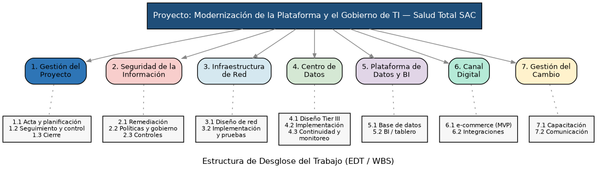
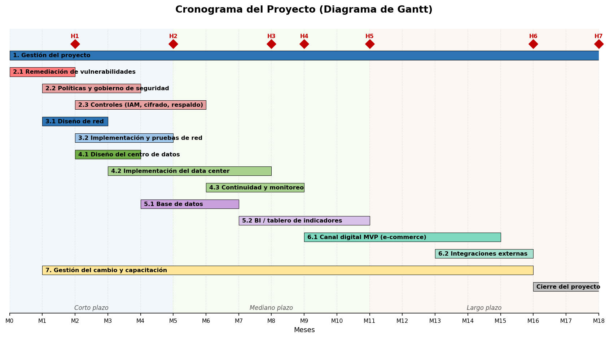
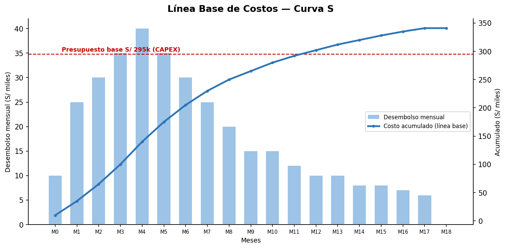
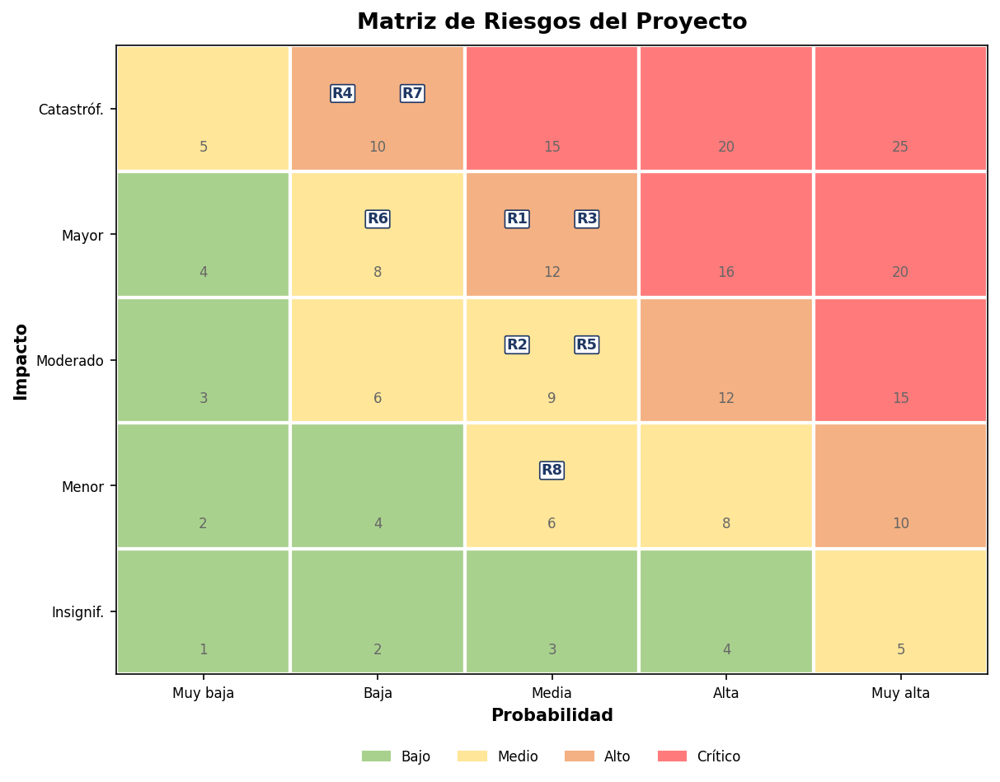
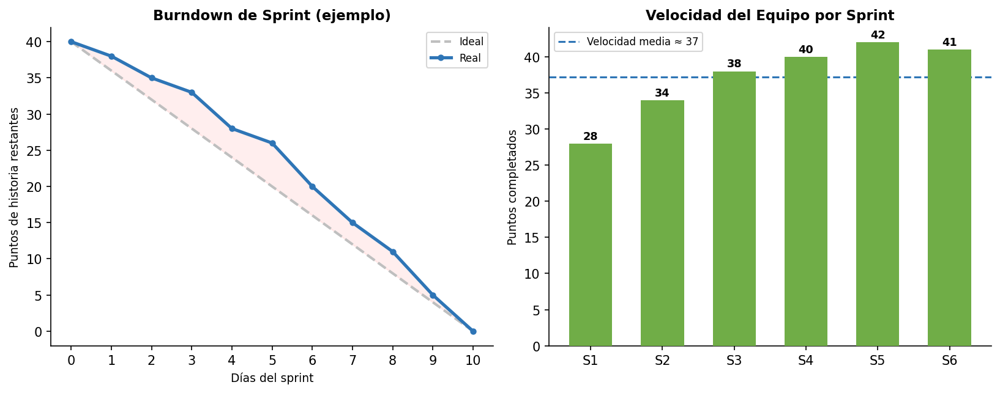

# CE0121-CE0125 - E3: Plan de Gestión del Proyecto

**UNIVERSIDAD PERUANA UNIÓN**

**FACULTAD DE INGENIERÍA Y ARQUITECTURA**

**Escuela Académico Profesional de Ingeniería de Sistemas**

ENTREGABLE 3: Plan de Gestión del Proyecto

Curso: EPE

RESPONSABLES:

Jhosef Anthony Quispe Huarilloclla

Jose Samuel Turpo Cauna

Yesenia Alejandra Gutierrez Anco

Juliaca – 2026

## Resumen Ejecutivo

Este Plan de Gestión del Proyecto define cómo se planificará, ejecutará, monitoreará y controlará el proyecto de modernización de la plataforma y el gobierno de TI de «Salud Total SAC», justificado y aprobado en el Business Case previo. El plan integra la definición del alcance, el cronograma, el presupuesto, la gestión de riesgos, la gestión de interesados y los mecanismos de control.

Dada la naturaleza mixta del proyecto —con componentes de infraestructura, más predecibles, y componentes de software (analítica de negocio y canal digital), más cambiantes— se adopta un enfoque híbrido: buenas prácticas predictivas del PMI (PMBOK®) para la infraestructura y la gobernanza, y prácticas ágiles (Scrum) para el desarrollo de software. El proyecto se ejecuta en 18 meses, con una inversión de S/ 295 000, y prioriza la remediación de los riesgos críticos de seguridad como primer entregable.

El documento presenta el acta de constitución con objetivos SMART y criterios de éxito, la estructura de desglose del trabajo (EDT) con su diccionario, el cronograma con hitos y dependencias, la línea base de costos, la matriz de riesgos con su plan de respuesta, la gestión de interesados y el marco ágil con su product backlog y su planificación de sprints, asegurando disciplina metodológica y trazabilidad de resultados.

## 1. Acta de Constitución (Project Charter)

El acta de constitución autoriza formalmente el proyecto, designa a sus responsables y establece sus objetivos, su alcance de alto nivel y sus criterios de éxito.

| **Elemento**              | **Detalle**                                                                                                                                                         |
|---------------------------|---------------------------------------------------------------------------------------------------------------------------------------------------------------------|
| Nombre del proyecto       | Modernización de la Plataforma y el Gobierno de TI de Salud Total SAC                                                                                               |
| Sponsor (patrocinador)    | Gerencia General de Salud Total SAC                                                                                                                                 |
| Director de proyecto (PM) | \[Completar: nombre del responsable de TI\]                                                                                                                         |
| Justificación estratégica | Cerrar las brechas de madurez digital y gobierno de TI identificadas en el diagnóstico; proteger los datos clínicos y sostener el crecimiento (alineado a OE1–OE4). |
| Presupuesto autorizado    | S/ 295 000 (inversión) + costos operativos según Business Case                                                                                                      |
| Duración estimada         | 18 meses                                                                                                                                                            |

### 1.1 Objetivos del Proyecto (SMART)

| **ID** | **Objetivo**                                                     | **Meta / Plazo**         |
|--------|------------------------------------------------------------------|--------------------------|
| O1     | Remediar el 100 % de las vulnerabilidades críticas de seguridad. | 100 % — 3 meses          |
| O2     | Implementar red segmentada y centro de datos con redundancia.    | Operativo — 9 meses      |
| O3     | Alcanzar disponibilidad ≥ 99,9 % con respaldo y DR probados.     | ≥ 99,9 % — 12 meses      |
| O4     | Elevar la madurez digital de 2,3 a 3,5 (de 5).                   | +1,2 — 18 meses          |
| O5     | Habilitar BI y canal digital (MVP).                              | En producción — 18 meses |

### 1.2 Alcance Preliminar

**Incluye:** remediación de seguridad y gobierno; infraestructura de red segura; centro de datos (virtualización, almacenamiento, continuidad); plataforma de datos y BI; canal digital (MVP); y gestión del cambio y capacitación.

**Excluye:** la apertura física de nuevas sucursales, la reingeniería total del ERP «Articulos» (se moderniza, no se reemplaza) y la operación posterior al cierre del proyecto (pasa a operación continua).

### 1.3 Interesados Clave y Criterios de Éxito

Interesados clave: Gerencia General (sponsor), área de TI, personal clínico y farmacéutico, pacientes/clientes, proveedores y entes reguladores (DIGEMID, SUSALUD). Criterios de éxito: cumplimiento de los objetivos SMART dentro del presupuesto y el plazo, cero vulnerabilidades críticas abiertas, y aceptación de los entregables por el sponsor.

### 1.4 Restricciones y Supuestos

| **Restricciones**                                            | **Supuestos**                                              |
|--------------------------------------------------------------|------------------------------------------------------------|
| Presupuesto de S/ 295 000 (inversión).                       | La gerencia mantiene el patrocinio y los recursos.         |
| Plazo de 18 meses.                                           | Disponibilidad del personal de TI y de los usuarios clave. |
| Operación continua del negocio (sin interrupciones mayores). | El ERP «Articulos» se conserva como base tecnológica.      |
| Cumplimiento normativo (Ley 29733, DIGEMID).                 | Los proveedores cumplen los plazos de entrega.             |

## 2. Gestión del Alcance

### 2.1 Estructura de Desglose del Trabajo (EDT / WBS)

El alcance se descompone en siete paquetes de trabajo principales, alineados con los proyectos técnicos que dan respuesta a las brechas diagnosticadas. La EDT organiza el trabajo en entregables gestionables.

*Figura 2.1 — Estructura de Desglose del Trabajo (EDT / WBS).*

### 2.2 Diccionario de la EDT

El diccionario describe cada paquete de trabajo, su entregable principal y su responsable:

| **EDT** | **Paquete de trabajo**      | **Entregable principal**                          | **Responsable**          |
|---------|-----------------------------|---------------------------------------------------|--------------------------|
| 1       | Gestión del proyecto        | Plan y actas; informes de avance                  | Director de proyecto     |
| 2       | Seguridad de la información | Vulnerabilidades remediadas; políticas; controles | Líder de seguridad       |
| 3       | Infraestructura de red      | Red segmentada y probada                          | Líder de redes           |
| 4       | Centro de datos             | Data center en producción; DR probado             | Líder de infraestructura |
| 5       | Plataforma de datos y BI    | Base de datos optimizada; tablero de BI           | Líder de datos           |
| 6       | Canal digital               | MVP de e-commerce/delivery                        | Product Owner            |
| 7       | Gestión del cambio          | Personal capacitado; comunicación                 | Líder de RR. HH.         |

### 2.3 Control de Cambios del Alcance

Todo cambio al alcance se gestiona mediante una solicitud formal de cambio, evaluada por un Comité de Control de Cambios (sponsor, PM y líderes) que analiza su impacto en el cronograma, el costo y el riesgo antes de aprobarlo o rechazarlo. Los cambios aprobados actualizan la línea base y se comunican a los interesados, garantizando la trazabilidad.

## 3. Gestión del Cronograma

### 3.1 Lista de Actividades y Dependencias

Las actividades se derivan de la EDT y se secuencian según sus dependencias. La siguiente tabla resume las principales:

| **ID** | **Actividad**                     | **Duración** | **Predecesora** | **Paquete EDT** |
|--------|-----------------------------------|--------------|-----------------|-----------------|
| A1     | Acta y planificación del proyecto | 1 mes        | —               | 1               |
| A2     | Remediación de vulnerabilidades   | 2 meses      | A1              | 2               |
| A3     | Políticas y gobierno de seguridad | 3 meses      | A2 (SS)         | 2               |
| A4     | Diseño de red                     | 2 meses      | A1              | 3               |
| A5     | Implementación y pruebas de red   | 3 meses      | A4              | 3               |
| A6     | Diseño del centro de datos        | 2 meses      | A4              | 4               |
| A7     | Implementación del data center    | 5 meses      | A6              | 4               |
| A8     | Continuidad y monitoreo           | 3 meses      | A7 (SS)         | 4               |
| A9     | Base de datos                     | 3 meses      | A5              | 5               |
| A10    | BI / tablero de indicadores       | 4 meses      | A9              | 5               |
| A11    | Canal digital MVP                 | 6 meses      | A10 (SS)        | 6               |
| A12    | Integraciones externas            | 3 meses      | A11             | 6               |
| A13    | Gestión del cambio y capacitación | 15 meses     | A1              | 7               |
| A14    | Cierre del proyecto               | 2 meses      | A12             | 1               |

Nota: «SS» indica dependencia inicio-a-inicio (las actividades pueden solaparse).

### 3.2 Diagrama de Gantt

*Figura 3.1 — Cronograma del proyecto (diagrama de Gantt con hitos).*

### 3.3 Hitos Principales

| **Hito** | **Descripción**                      | **Fecha objetivo** |
|----------|--------------------------------------|--------------------|
| H1       | Vulnerabilidades críticas remediadas | Fin del mes 2      |
| H2       | Red segura operativa                 | Fin del mes 5      |
| H3       | Centro de datos en producción        | Fin del mes 8      |
| H4       | Continuidad probada / SLA ≥ 99,9 %   | Fin del mes 9      |
| H5       | BI en producción                     | Fin del mes 11     |
| H6       | Canal digital MVP lanzado            | Fin del mes 16     |
| H7       | Cierre del proyecto                  | Fin del mes 18     |

## 4. Gestión de Costos

### 4.1 Presupuesto Detallado por Paquete de Trabajo

El presupuesto se distribuye entre los paquetes de la EDT, sumando la inversión total autorizada de S/ 295 000:

| **EDT**                          | **Paquete de trabajo**      | **Costo (S/)** |
|----------------------------------|-----------------------------|----------------|
| 1                                | Gestión del proyecto        | 22,000         |
| 2                                | Seguridad de la información | 38,000         |
| 3                                | Infraestructura de red      | 48,000         |
| 4                                | Centro de datos             | 97,000         |
| 5                                | Plataforma de datos y BI    | 35,000         |
| 6                                | Canal digital               | 35,000         |
| 7                                | Gestión del cambio          | 20,000         |
| **Total inversión (línea base)** |                             | **295,000**    |

### 4.2 Línea Base de Costos (Curva S)

La línea base de costos distribuye el presupuesto a lo largo del cronograma, concentrando el desembolso en las fases de infraestructura. La curva S acumulada sirve de referencia para el control del valor ganado.

*Figura 4.1 — Línea base de costos (curva S).*

### 4.3 Control Presupuestal (Valor Ganado)

El control de costos se realiza mediante la gestión del valor ganado (EVM), comparando el valor planificado (PV), el valor ganado (EV) y el costo real (AC). Se monitorean los índices de desempeño de costos (CPI = EV/AC) y de cronograma (SPI = EV/PV); valores inferiores a 1 disparan acciones correctivas. Se establece un umbral de control de ±10 % sobre la línea base.

## 5. Gestión de Riesgos

### 5.1 Identificación y Análisis Cualitativo

Se identifican los riesgos del proyecto y se evalúan cualitativamente por su probabilidad e impacto, obteniendo su nivel de exposición (P × I). La matriz siguiente los posiciona:

*Figura 5.1 — Matriz de riesgos del proyecto.*

### 5.2 Registro de Riesgos y Plan de Respuesta

| **ID** | **Riesgo**                           | **Nivel** | **Estrategia** | **Plan de respuesta**                              |
|--------|--------------------------------------|-----------|----------------|----------------------------------------------------|
| R1     | Desviación de presupuesto/plazos     | Alto      | Mitigar        | Ejecución por etapas; contingencia; control EVM.   |
| R2     | Resistencia al cambio del personal   | Medio     | Mitigar        | Capacitación y comunicación temprana.              |
| R3     | Adopción lenta (beneficios tardíos)  | Alto      | Mitigar        | Metas por hitos; curva conservadora.               |
| R4     | Brecha de seguridad en la transición | Crítico   | Evitar         | Remediar seguridad primero; despliegue controlado. |
| R5     | Dependencia de personas clave en TI  | Medio     | Mitigar        | Documentación; roles de respaldo.                  |
| R6     | Indisponibilidad por migración       | Alto      | Mitigar        | Ventanas de mantenimiento; plan de reversión.      |
| R7     | Incumplimiento regulatorio de datos  | Crítico   | Evitar         | Cifrado, controles y auditoría; asesoría legal.    |
| R8     | Retrasos de proveedores              | Medio     | Transferir     | Cláusulas contractuales; multi-proveedor.          |

Los riesgos se revisan periódicamente en las reuniones de seguimiento; los de nivel crítico (R4, R7) cuentan con planes de respuesta activados desde el inicio y con un responsable (risk owner) asignado.

## 6. Gestión de Interesados y Comunicaciones

La gestión de interesados asegura su involucramiento y la comunicación oportuna. Se define el nivel de participación esperado y la estrategia para cada grupo:

| **Interesado**                  | **Poder/Interés** | **Estrategia de gestión**                          |
|---------------------------------|-------------------|----------------------------------------------------|
| Gerencia General (sponsor)      | Alto / Alto       | Gestionar de cerca; informes ejecutivos mensuales. |
| Área de TI                      | Alto / Alto       | Involucramiento directo; parte del equipo.         |
| Personal clínico y farmacéutico | Medio / Alto      | Capacitación; comunicación de cambios.             |
| Pacientes / clientes            | Bajo / Alto       | Mantener informados; comunicación de mejoras.      |
| Reguladores (DIGEMID, SUSALUD)  | Alto / Medio      | Cumplimiento y reportes formales.                  |
| Proveedores                     | Medio / Medio     | Coordinación contractual y seguimiento.            |

### 6.1 Plan de Comunicaciones

| **Comunicación**                  | **Frecuencia**     | **Responsable**      | **Medio**           |
|-----------------------------------|--------------------|----------------------|---------------------|
| Informe de avance ejecutivo       | Mensual            | Director de proyecto | Reunión / documento |
| Reunión de equipo (seguimiento)   | Semanal            | Director de proyecto | Reunión             |
| Daily / revisión de sprint (ágil) | Diaria / quincenal | Scrum Master         | Reunión             |
| Reporte de riesgos e incidentes   | Según evento       | Risk owner           | Documento           |

## 7. Gestión Ágil (Enfoque Híbrido)

Los componentes de software del proyecto —la plataforma de datos/BI y el canal digital— se desarrollan con el marco Scrum, mientras que la infraestructura sigue un enfoque predictivo. Esta combinación (híbrida) permite adaptar el desarrollo a los cambios sin perder el control global del proyecto. Se trabaja en sprints de dos semanas, con roles de Product Owner, Scrum Master y equipo de desarrollo.

### 7.1 Product Backlog (Priorizado)

| **ID** | **Historia de usuario**                                                    | **Prioridad** | **Puntos** | **Sprint** |
|--------|----------------------------------------------------------------------------|---------------|------------|------------|
| HU1    | Como gerente, quiero un tablero de ventas por sede para decidir con datos. | Alta          | 8          | S1–S2      |
| HU2    | Como jefe de almacén, quiero alertas de stock y vencimientos.              | Alta          | 5          | S2         |
| HU3    | Como analista, quiero reportes de kardex y márgenes.                       | Media         | 5          | S3         |
| HU4    | Como cliente, quiero comprar en línea y elegir delivery.                   | Alta          | 13         | S4–S6      |
| HU5    | Como cliente, quiero consultar disponibilidad de un producto.              | Media         | 8          | S4         |
| HU6    | Como cajero, quiero que la venta en línea descuente stock.                 | Alta          | 8          | S5         |
| HU7    | Como paciente, quiero agendar una teleconsulta.                            | Baja          | 13         | Backlog    |

### 7.2 Sprint Planning e Incrementos

Cada sprint entrega un incremento potencialmente utilizable. La planificación inicial de los primeros sprints es:

| **Sprint** | **Objetivo del sprint (incremento)**  | **Historias** | **Puntos** |
|------------|---------------------------------------|---------------|------------|
| S1         | Tablero de ventas básico (BI)         | HU1           | 8          |
| S2         | Alertas de inventario + tablero       | HU1, HU2      | 10         |
| S3         | Reportes de kardex y márgenes         | HU3           | 5          |
| S4         | Catálogo en línea + consulta de stock | HU4, HU5      | 12         |
| S5         | Carrito y descuento de stock          | HU4, HU6      | 10         |
| S6         | Checkout y delivery (MVP)             | HU4           | 8          |

### 7.3 Criterios de Aceptación y Métricas de Seguimiento

Cada historia incluye criterios de aceptación (Definition of Done): funcionalidad probada, revisada, documentada e integrada sin romper lo existente. El avance se mide con métricas ágiles: el gráfico de burndown (trabajo restante en el sprint) y la velocidad del equipo (puntos completados por sprint), que permiten estimar la fecha de término y detectar desviaciones.

*Figura 7.1 — Burndown de sprint y velocidad del equipo.*

## 8. Monitoreo, Control y Cierre

El proyecto se monitorea y controla de forma continua para asegurar el cumplimiento de las líneas base de alcance, cronograma y costo:

- Control integrado de cambios: toda modificación se evalúa y aprueba formalmente antes de actualizar las líneas base.

- Control de cronograma y costos: seguimiento por hitos y gestión del valor ganado (CPI, SPI) con umbrales de ±10 %.

- Control de calidad: criterios de aceptación por entregable y pruebas (funcionales, de seguridad y de recuperación).

- Control de riesgos: revisión periódica del registro de riesgos y activación de los planes de respuesta.

- Cierre: aceptación formal de los entregables por el sponsor, transferencia a operación y registro de lecciones aprendidas.

En conjunto, el plan asegura disciplina metodológica y trazabilidad de resultados, combinando el control del enfoque predictivo del PMI con la adaptabilidad del enfoque ágil, de modo que el proyecto entregue el valor comprometido en el Business Case dentro del alcance, el plazo y el presupuesto definidos.

---

### Archivos del entregable

- [:material-file-word: Descargar documento original (.docx)](Entregable_Plan_Gestion_Proyecto.docx)
