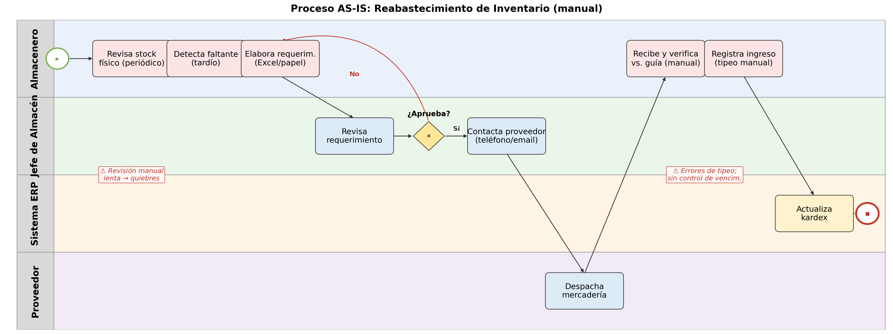
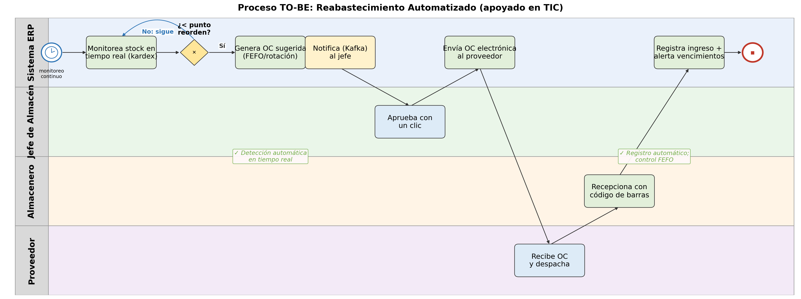
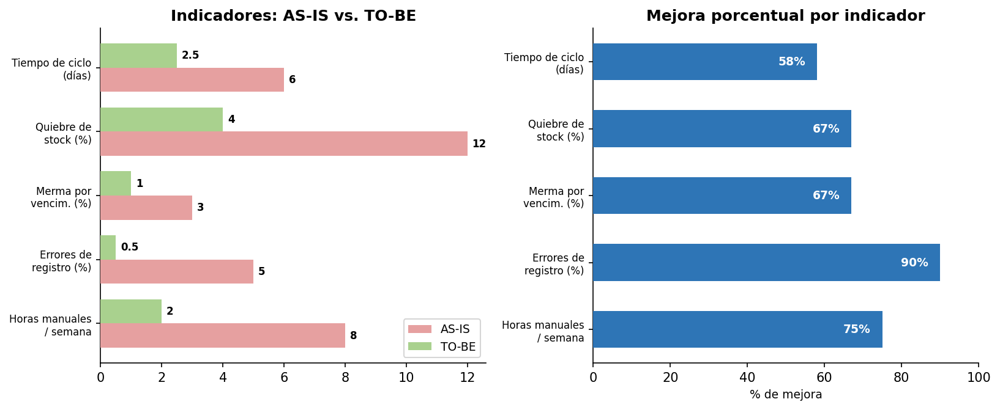

# CE0131-CE0135 - E4: Modelado de Procesos AS-IS / TO-BE

**dUNIVERSIDAD PERUANA UNIÓN**

**FACULTAD DE INGENIERÍA Y ARQUITECTURA**

**Escuela Académico Profesional de Ingeniería de Sistemas**

ENTREGABLE 4: Modelado de Procesos AS-IS / TO-BE

Curso: EPE

RESPONSABLES:

Jhosef Anthony Quispe Huarilloclla

Jose Samuel Turpo Cauna

Yesenia Alejandra Gutierrez Anco

Juliaca – 2026

## Resumen Ejecutivo

Este documento modela el proceso de reabastecimiento de inventario de «Salud Total SAC» en su situación actual (AS-IS) y en su rediseño propuesto (TO-BE), con el fin de visualizar sus ineficiencias y proponer mejoras mediante la automatización apoyada en las TIC. Se eligió este proceso porque el diagnóstico organizacional identificó en él problemas concretos —procesos manuales en almacén, quiebres de stock y mermas por vencimiento— que afectan directamente la eficiencia operativa y la rentabilidad del negocio.

El proceso actual es reactivo y manual: el personal revisa el stock físicamente de forma periódica, detecta las faltantes tardes, elabora los requerimientos en hojas de cálculo y registra los ingresos por tipeo, sin control automatizado de vencimientos. El rediseño propuesto aprovecha las capacidades del ERP «Articulos» —el kardex en tiempo real y el servicio de notificaciones (Kafka)— para monitorear el stock continuamente, generar órdenes de compra sugeridas automáticamente, aprobar con un clic, enviar la orden electrónicamente y registrar la recepción mediante lectura de código de barras, con alertas proactivas de vencimiento (FEFO).

**Resultados esperados.** El rediseño reduce el tiempo de ciclo de reabastecimiento en un 58 %, los quiebres de stock en un 67 %, la merma por vencimiento en un 67 % y las horas de trabajo manual en un 75 %, con una mejora sustancial en la calidad y la trazabilidad del proceso.

## 1. Proceso Seleccionado

El proceso seleccionado para el modelado es el reabastecimiento de inventario (compras/almacén), que abarca desde la detección de la necesidad de reposición de un producto hasta su recepción y registro en el sistema. Es un proceso crítico para una cadena de farmacias, porque de él dependen la disponibilidad de medicamentos (evitar quiebres), el control de vencimientos (evitar mermas) y la eficiencia del capital de trabajo.

Los actores (roles) que participan son: el almacenero (revisión y recepción), el jefe de almacén (aprobación), el sistema ERP «Articulos» (registro y control) y el proveedor (despacho). El modelado se realiza con la notación BPMN (Business Process Model and Notation), que representa el flujo mediante carriles (lanes) por rol, eventos, actividades y compuertas de decisión.

## 2. Proceso Actual (AS-IS)

### 2.1 Descripción Narrativa

En la situación actual, el reabastecimiento se inicia de forma reactiva. El almacenero revisa periódicamente el stock de manera física (o consultando reportes desactualizados) y, cuando detecta un faltante —con frecuencia tarde—, elabora un requerimiento de compra en una hoja de cálculo o en papel. El jefe de almacén revisa y aprueba el requerimiento; si lo observa, lo devuelve para corrección. Una vez aprobado, contacta al proveedor por teléfono o correo. El proveedor despacha la mercadería, que el almacenero recibe y verifica manualmente contra la guía de remisión. Finalmente, el almacenero registra el ingreso en el ERP mediante tipeo manual y el sistema actualiza el kardex.

### 2.2 Diagrama BPMN (AS-IS)

El diagrama BPMN de la página siguiente (horizontal) representa el flujo actual del proceso mediante carriles por rol.

*Figura 2.1 — Diagrama BPMN del proceso actual (AS-IS).*

### 2.3 Indicadores Actuales

La medición del proceso actual arroja los siguientes indicadores de desempeño:

| **Indicador**                       | **Valor actual** | **Unidad**       |
|-------------------------------------|------------------|------------------|
| Tiempo de ciclo de reabastecimiento | 5 – 7            | días             |
| Tasa de quiebre de stock            | 12               | %                |
| Merma por vencimiento               | 3                | % del inventario |
| Errores de registro (tipeo)         | 5                | %                |
| Tiempo de trabajo manual (revisión) | 8                | horas/semana     |

### 2.4 Problemas Detectados

- Proceso reactivo: la detección de faltantes es tardía y depende de revisiones manuales, lo que provoca quiebres de stock y ventas perdidas.

- Trabajo manual intensivo: la elaboración de requerimientos y el registro de ingresos por tipeo consumen tiempo y generan errores.

- Ausencia de control de vencimientos: no hay un manejo sistemático FEFO (primero en vencer, primero en salir), lo que causa mermas.

- Comunicación informal con proveedores (teléfono/correo), sin trazabilidad ni tiempos garantizados.

- Falta de visibilidad en tiempo real del inventario para la toma de decisiones.

## 3. Proceso Propuesto (TO-BE)

### 3.1 Rediseño del Flujo

El proceso rediseñado transforma el reabastecimiento de reactivo a proactivo y automatizado. El sistema ERP «Articulos» monitorea el stock en tiempo real a partir del kardex; cuando el nivel de un producto cae por debajo de su punto de reorden, el sistema genera automáticamente una orden de compra sugerida —considerando la rotación y las fechas de vencimiento (FEFO)— y notifica al jefe de almacén mediante el servicio de notificaciones (Kafka). El jefe aprueba con un clic desde el sistema, que envía la orden electrónicamente al proveedor. Al recibir la mercadería, el almacenero la registra mediante lectura de código de barras, y el ERP actualiza el kardex automáticamente y activa las alertas de vencimiento. El rol del personal pasa de ejecutar tareas manuales a supervisar y decidir.

### 3.2 Diagrama BPMN (TO-BE)

El diagrama BPMN de la página siguiente (horizontal) representa el flujo rediseñado y automatizado.

*Figura 3.1 — Diagrama BPMN del proceso propuesto (TO-BE).*

### 3.3 Automatizaciones Propuestas (apoyadas en TIC)

| **Automatización**                     | **Tecnología (ERP «Articulos»)**  | **Beneficio**                    |
|----------------------------------------|-----------------------------------|----------------------------------|
| Monitoreo de stock en tiempo real      | Kardex + puntos de reorden        | Detección inmediata de faltantes |
| Generación de orden de compra sugerida | Reglas de rotación y FEFO         | Elimina el requerimiento manual  |
| Alerta y aprobación digital            | Notificaciones (Kafka) + workflow | Aprobación con un clic; trazable |
| Envío electrónico de la orden          | Integración / correo automático   | Reduce tiempos y errores         |
| Recepción con código de barras         | Lectura y registro automático     | Elimina el tipeo manual          |
| Control de vencimientos (FEFO)         | Alertas proactivas del sistema    | Reduce mermas por vencimiento    |

### 3.4 Nuevos Indicadores (esperados)

| **Indicador**                       | **Valor TO-BE** | **Unidad**       |
|-------------------------------------|-----------------|------------------|
| Tiempo de ciclo de reabastecimiento | 2 – 3           | días             |
| Tasa de quiebre de stock            | 4               | %                |
| Merma por vencimiento               | 1               | % del inventario |
| Errores de registro                 | \< 1            | %                |
| Tiempo de trabajo manual (revisión) | 2               | horas/semana     |

### 3.5 Mejora Estimada en Eficiencia

La automatización elimina las actividades manuales de mayor consumo de tiempo (revisión física, elaboración de requerimientos y registro por tipeo) y convierte la detección de faltantes en un evento automático. Esto reduce el tiempo de ciclo a menos de la mitad y libera al personal para tareas de mayor valor, además de mejorar la exactitud y la trazabilidad del proceso.

## 4. Análisis Comparativo

La comparación entre el proceso actual y el propuesto evidencia mejoras cuantificables en tiempo, costo y calidad:

*Figura 4.1 — Comparación de indicadores AS-IS vs. TO-BE y mejora porcentual.*

### 4.1 Reducción de Tiempos

| **Indicador de tiempo**             | **AS-IS**     | **TO-BE** | **Mejora**  |
|-------------------------------------|---------------|-----------|-------------|
| Tiempo de ciclo de reabastecimiento | 6 días        | 2,5 días  | −58 %       |
| Tiempo de trabajo manual semanal    | 8 h           | 2 h       | −75 %       |
| Detección de faltante               | Días (tardía) | Inmediata | Tiempo real |

### 4.2 Reducción de Costos

La reducción de quiebres recupera ventas perdidas, el control FEFO disminuye las mermas por vencimiento y la automatización reduce el costo de horas-hombre. Estimando sobre la operación de las dos sedes, el impacto económico anual aproximado es:

| **Fuente de ahorro / ingreso**          | **Estimación anual**  | **Origen de la mejora** |
|-----------------------------------------|-----------------------|-------------------------|
| Recuperación de ventas (menos quiebres) | S/ 42 000             | Quiebre 12 % → 4 %      |
| Reducción de mermas por vencimiento     | S/ 25 000             | Merma 3 % → 1 % (FEFO)  |
| Ahorro de horas-hombre                  | S/ 14 000             | 6 h/sem liberadas       |
| **Impacto económico aproximado**        | **≈ S/ 81 000 / año** |                         |

Estos valores son coherentes con los beneficios estimados en el Business Case del proyecto, del cual este rediseño de proceso forma parte.

### 4.3 Mejora en Calidad

- Exactitud: el registro automático (código de barras) reduce los errores de tipeo de 5 % a menos de 1 %.

- Trazabilidad: cada orden queda registrada digitalmente, con su aprobación y su estado, frente a la comunicación informal previa.

- Disponibilidad: menos quiebres de stock mejoran el nivel de servicio al cliente (medicamento disponible cuando se necesita).

- Seguridad del paciente: el control proactivo de vencimientos (FEFO) evita la dispensación de productos vencidos.

- Decisiones: la visibilidad en tiempo real del inventario habilita decisiones basadas en datos.

## 5. Conclusiones

El modelado AS-IS / TO-BE del proceso de reabastecimiento de inventario demuestra que la organización puede obtener mejoras operativas significativas mediante la automatización apoyada en las TIC, sin necesidad de reemplazar su sistema, sino aprovechando las capacidades ya presentes en el ERP «Articulos» (kardex en tiempo real y notificaciones).

El proceso actual, reactivo y manual, genera quiebres de stock, mermas por vencimiento y errores de registro. El rediseño propuesto lo transforma en un proceso proactivo y automatizado, con mejoras cuantificadas: −58 % en tiempo de ciclo, −67 % en quiebres, −67 % en mermas y −75 % en trabajo manual, además de un impacto económico aproximado de S/ 81 000 anuales y una mejora sustancial en la calidad, la trazabilidad y la seguridad del paciente.

Este rediseño se integra en el proyecto de modernización de TI y ejemplifica el tipo de optimización operativa que justifica la inversión: convertir la tecnología existente en valor tangible para el negocio.

---

### Archivos del entregable

- [:material-file-word: Descargar documento original (.docx)](Entregable_Modelado_Procesos.docx)
