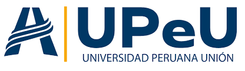
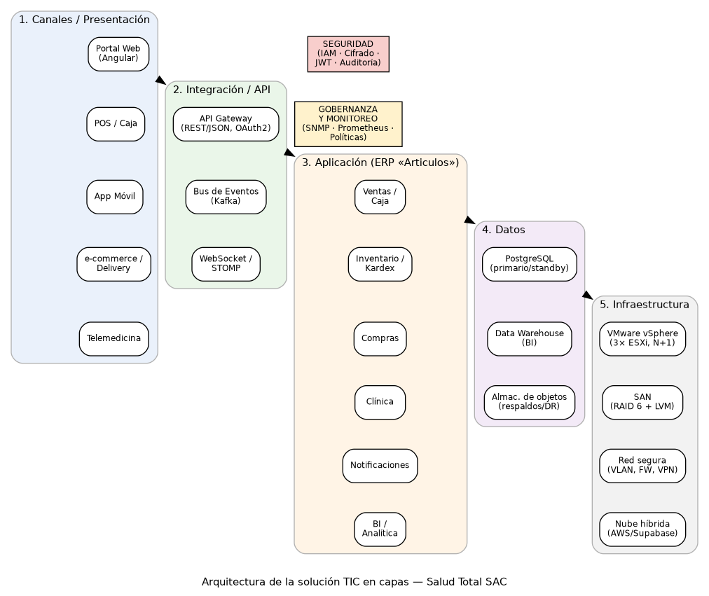
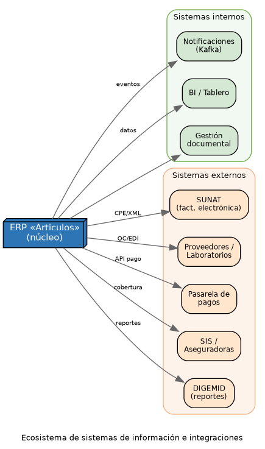
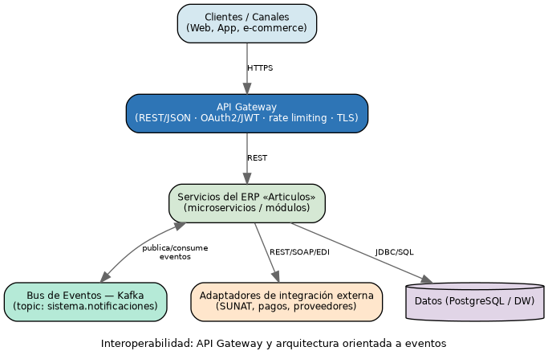
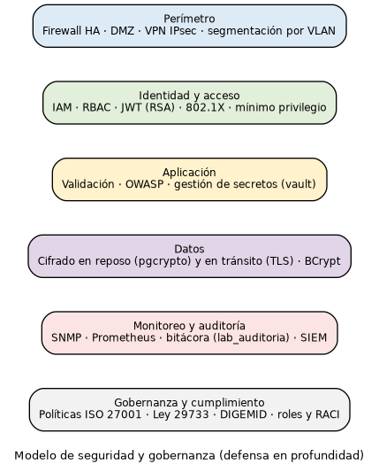
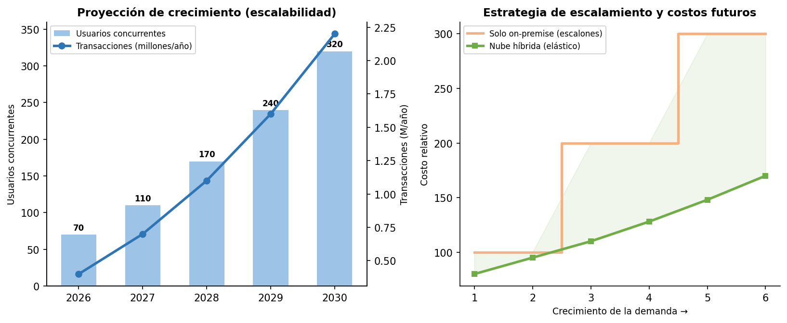

# CE0141-CE0145 - E5: Propuesta de Solución TIC

**UNIVERSIDAD PERUANA UNIÓN**

**FACULTAD DE INGENIERÍA Y ARQUITECTURA**

**Escuela Académico Profesional de Ingeniería de Sistemas**

ENTREGABLE 5: Propuesta de Solución TIC Integrada

Curso: EPE

RESPONSABLES:

Jhosef Anthony Quispe Huarilloclla

Jose Samuel Turpo Cauna

Yesenia Alejandra Gutierrez Anco

Juliaca – 2026

## Resumen Ejecutivo

Este documento presenta el diseño conceptual y técnico de la solución TIC propuesta para «Salud Total SAC», concebida no como un sistema aislado sino como una plataforma integrada al ecosistema de sistemas de información de la organización. La propuesta toma como núcleo el ERP propio «Articulos» y lo articula con los servicios de infraestructura, seguridad, datos y los nuevos canales digitales, definiendo su arquitectura, sus integraciones internas y externas, su modelo de seguridad y gobernanza, y sus lineamientos de escalabilidad y sostenibilidad.

La arquitectura se estructura en capas —canales, integración/API, aplicación, datos e infraestructura— con la seguridad y la gobernanza como componentes transversales. La integración se resuelve mediante un API Gateway (REST/JSON con OAuth2/JWT) y un bus de eventos (Kafka), que permiten la interoperabilidad tanto entre los módulos del ERP como con sistemas externos (SUNAT, proveedores, pasarela de pagos, aseguradoras y DIGEMID).

La solución prioriza la protección de los datos clínicos y financieros mediante defensa en profundidad y el cumplimiento normativo (Ley N.° 29733, DIGEMID), y se diseña para crecer de forma sostenible aprovechando una infraestructura híbrida (on-premise + nube), que permite escalar de manera elástica y controlar los costos futuros. En conjunto, la propuesta asegura coherencia con el ecosistema institucional y habilita la evolución tecnológica de la organización.

## 1. Contexto de la Solución

«Salud Total SAC» opera un ERP propio, «Articulos», que integra los procesos de ventas, inventario, compras, atención clínica, caja y notificaciones. El diagnóstico organizacional identificó la necesidad de modernizar la plataforma y el gobierno de TI para cerrar brechas de seguridad, continuidad, analítica y capacidad digital. La presente propuesta define cómo la solución tecnológica se integra de forma coherente con ese ecosistema, potenciando el activo existente en lugar de reemplazarlo.

El diseño se rige por principios de arquitectura empresarial: modularidad (componentes desacoplados), interoperabilidad (integración por estándares abiertos), seguridad por diseño, y escalabilidad (capacidad de crecer con la demanda). Estos principios aseguran que la solución sea robusta, evolutiva y alineada con los objetivos estratégicos de la organización.

## 2. Arquitectura de la Solución

### 2.1 Diagrama de Arquitectura

La arquitectura se organiza en cinco capas, con la seguridad y la gobernanza como elementos transversales que atraviesan todas ellas. Este enfoque en capas desacopla las responsabilidades y facilita la evolución independiente de cada nivel.

*Figura 2.1 — Arquitectura de la solución TIC en capas.*

### 2.2 Componentes Principales

| **Capa**                     | **Componentes**                                                                                                    |
|------------------------------|--------------------------------------------------------------------------------------------------------------------|
| Canales / Presentación       | Portal web (Angular), POS/Caja, app móvil, e-commerce/delivery y telemedicina.                                     |
| Integración / API            | API Gateway (REST/JSON, OAuth2), bus de eventos (Kafka), WebSocket/STOMP.                                          |
| Aplicación (ERP «Articulos») | Módulos de ventas/caja, inventario/kardex, compras, clínica, notificaciones y BI/analítica.                        |
| Datos                        | PostgreSQL (primario/standby), Data Warehouse para BI y almacenamiento de objetos (respaldos/DR).                  |
| Infraestructura              | VMware vSphere (3× ESXi, N+1), SAN (RAID 6 + LVM), red segura (VLAN, firewall, VPN) y nube híbrida (AWS/Supabase). |
| Transversal                  | Seguridad (IAM, cifrado, JWT, auditoría) y gobernanza/monitoreo (SNMP, Prometheus, políticas).                     |

### 2.3 Integraciones

La solución integra sus componentes mediante dos mecanismos complementarios: la integración síncrona por API (peticiones REST a través del API Gateway) para las operaciones en tiempo real, y la integración asíncrona por eventos (Kafka) para desacoplar los procesos y propagar cambios (por ejemplo, una venta que dispara la actualización de stock y una notificación). Las integraciones externas se realizan mediante adaptadores específicos por cada sistema (SUNAT, pasarela de pagos, proveedores), aislando al ERP de los detalles de cada protocolo.

## 3. Ecosistema de Sistemas de Información

### 3.1 Mapa de Sistemas e Integración Propuesta

El ecosistema se organiza en torno al ERP «Articulos» como núcleo, que se integra con los sistemas internos (notificaciones, BI, gestión documental) y con los sistemas externos del sector (SUNAT, proveedores/laboratorios, pasarela de pagos, aseguradoras/SIS y DIGEMID). El siguiente mapa muestra estas relaciones:

*Figura 3.1 — Ecosistema de sistemas de información e integraciones.*

| **Sistema externo**        | **Integración**                     | **Propósito**               |
|----------------------------|-------------------------------------|-----------------------------|
| SUNAT                      | Comprobantes electrónicos (CPE/XML) | Facturación electrónica     |
| Proveedores / Laboratorios | Órdenes de compra (EDI/API)         | Abastecimiento automatizado |
| Pasarela de pagos          | API de pagos (tokenizado)           | Cobro del canal digital     |
| Aseguradoras / SIS         | Servicios web de cobertura          | Validación de beneficios    |
| DIGEMID                    | Reportes regulatorios               | Cumplimiento sanitario      |

### 3.2 Interoperabilidad

La interoperabilidad se logra mediante estándares abiertos y un diseño orientado a eventos. El API Gateway expone servicios REST/JSON protegidos con OAuth2/JWT y TLS, aplicando control de tasa y enrutamiento; el bus de eventos (Kafka) permite que los módulos publiquen y consuman eventos de forma desacoplada; y los adaptadores de integración traducen los protocolos de los sistemas externos. Este enfoque evita el acoplamiento punto a punto y facilita incorporar nuevos sistemas sin alterar los existentes.

*Figura 3.2 — Interoperabilidad: API Gateway y arquitectura orientada a eventos.*

| **Mecanismo**   | **Descripción**                                                     |
|-----------------|---------------------------------------------------------------------|
| API REST/JSON   | Integración síncrona en tiempo real, con contratos versionados.     |
| Eventos (Kafka) | Integración asíncrona y desacoplada; propaga cambios entre módulos. |
| OAuth2 / JWT    | Autenticación y autorización de las llamadas entre sistemas.        |
| Adaptadores     | Traducción de protocolos externos (SOAP/EDI/XML) al modelo interno. |

## 4. Seguridad y Gobernanza

La seguridad se diseña bajo el principio de defensa en profundidad, con controles en cada capa, y se complementa con un marco de gobernanza que asegura el cumplimiento normativo. La Figura 4.1 resume el modelo:

*Figura 4.1 — Modelo de seguridad y gobernanza (defensa en profundidad).*

### 4.1 Gestión de Accesos

El control de accesos se basa en la gestión de identidades (IAM) con roles (RBAC) y el principio de mínimo privilegio, aplicado tanto en la aplicación (autenticación con JWT firmado con claves RSA, expiración de sesión, bloqueo tras intentos fallidos) como en la base de datos (roles con privilegios acotados) y en la red (autenticación 802.1X). Un directorio centralizado (LDAP/AD) unifica las identidades.

### 4.2 Protección de Datos

Los datos se protegen en reposo y en tránsito: cifrado de columnas sensibles con pgcrypto, hashing de contraseñas con BCrypt, y cifrado TLS de las comunicaciones y de los respaldos (AES-256). La segmentación de red aísla los datos clínicos, y la bitácora de auditoría registra los accesos y cambios sobre la información sensible, proporcionando trazabilidad.

### 4.3 Cumplimiento Normativo

| **Marco**                        | **Aplicación en la solución**                                                   |
|----------------------------------|---------------------------------------------------------------------------------|
| Ley N.° 29733 (datos personales) | Cifrado, control de acceso y auditoría de los datos de salud (datos sensibles). |
| DIGEMID / SUSALUD                | Trazabilidad de medicamentos y reportes regulatorios.                           |
| ISO/IEC 27001 (referencia)       | Políticas de seguridad, gestión de riesgos y controles.                         |
| Buenas prácticas (OWASP)         | Desarrollo seguro y gestión de vulnerabilidades.                                |

## 5. Escalabilidad y Sostenibilidad

### 5.1 Capacidad de Crecimiento

La solución se diseña para crecer con la organización. La arquitectura desacoplada permite el escalamiento horizontal (añadir instancias de los módulos y del ERP tras un balanceador), la replicación de la base de datos (primario/standby) y la ampliación elástica de la capacidad mediante la nube híbrida. La Figura 5.1 proyecta el crecimiento de la carga y compara las estrategias de escalamiento.

*Figura 5.1 — Proyección de crecimiento y estrategia de escalamiento.*

- Escalamiento horizontal: múltiples instancias de los servicios tras un balanceador, para absorber más usuarios concurrentes.

- Escalamiento de datos: réplicas de lectura y particionamiento para el crecimiento del volumen transaccional.

- Elasticidad en la nube: capacidad adicional bajo demanda (picos de campañas o crecimiento de sucursales) sin sobredimensionar la inversión.

### 5.2 Costos Futuros

El modelo híbrido optimiza los costos futuros: la infraestructura on-premise cubre la carga base (inversión amortizable), mientras que la nube absorbe los picos con un costo variable por uso. Esto evita los escalones de inversión propios de un modelo puramente on-premise (compra anticipada de hardware) y alinea el gasto con el crecimiento real de la demanda, mejorando la sostenibilidad financiera.

### 5.3 Evolución Tecnológica

La solución se concibe como una plataforma evolutiva. Su diseño por componentes e integración por estándares abiertos facilita incorporar nuevas capacidades sin rediseños mayores:

- Analítica avanzada e inteligencia artificial: predicción de demanda, optimización de inventario y detección de fraude, a partir del Data Warehouse.

- Nuevos canales: expansión de la telemedicina y de la app móvil, integrados por el mismo API Gateway.

- Interoperabilidad clínica: adopción de estándares del sector salud (p. ej. HL7/FHIR) para el intercambio de información clínica.

- Automatización (DevOps): integración y despliegue continuos para acelerar la entrega de mejoras de forma segura.

## 6. Conclusiones

La propuesta de solución TIC integra el ERP «Articulos» en un ecosistema coherente de sistemas de información, con una arquitectura en capas, seguridad por diseño y una estrategia de escalamiento sostenible. En lugar de reemplazar el activo digital existente, lo potencia y lo conecta —internamente y con los sistemas externos del sector— mediante un API Gateway y un bus de eventos que garantizan la interoperabilidad.

El diseño responde a las brechas identificadas en el diagnóstico y se apoya en los proyectos técnicos ya desarrollados (red segura, centro de datos, plataforma de datos y plan de seguridad), asegurando coherencia con el ecosistema institucional. La defensa en profundidad y el cumplimiento normativo protegen los datos clínicos y financieros, y el modelo híbrido habilita el crecimiento con costos controlados.

En síntesis, la solución propuesta es estructurada, integrada, segura y escalable: proporciona a Salud Total SAC una plataforma tecnológica sólida y evolutiva, alineada con su estrategia y preparada para su crecimiento futuro.

---

### Archivos del entregable

- [:material-file-word: Descargar documento original (.docx)](Entregable_Solucion_TIC.docx)
