# CE021 - S1 - E1: Requerimientos y Diseño del Sistema

**ENTREGABLE 1**

**Requerimientos y Diseño del Sistema**

*(Alineado con CE021)*

**Sistema ERP «Articulos» — Salud Total SAC (Cadena de farmacias y clínica ambulatoria · Juliaca y Puno)**

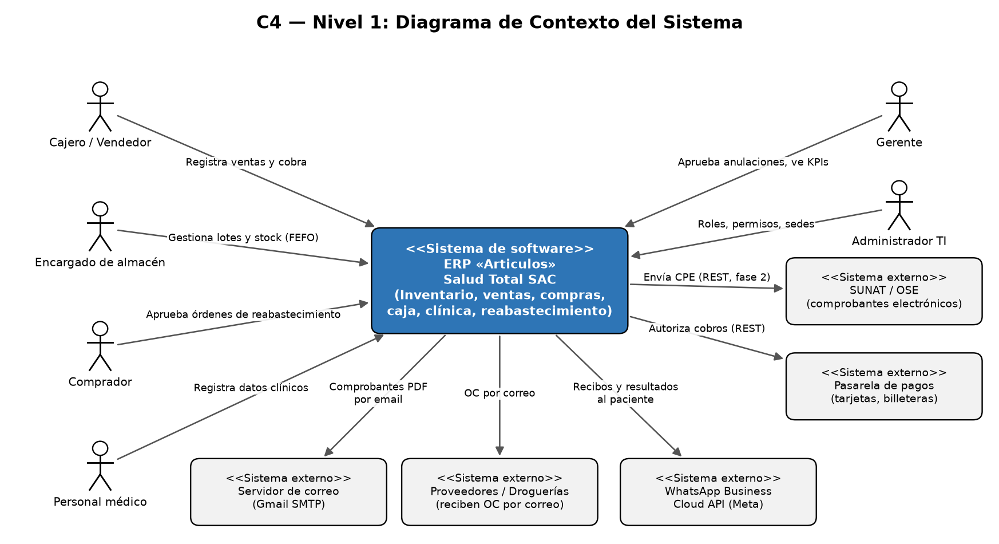

<table>
<colgroup>
<col style="width: 37%" />
<col style="width: 62%" />
</colgroup>
<thead>
<tr class="header">
<th><strong>Título del sistema</strong></th>
<th>Sistema ERP «Articulos» — Salud Total SAC (inventario por lotes, reabastecimiento, ventas, compras, caja y clínica)</th>
</tr>
</thead>
<tbody>
<tr class="odd">
<td><strong>Nombre del estudiante</strong></td>
<td>Gutierrez Anco Yesenia Alejandra 
Turpo Cauna Jose Samuel 
Quispe Huarilloclla Jhosef Antony</td>
</tr>
<tr class="even">
<td><strong>Semestre</strong></td>
<td>10</td>
</tr>
<tr class="odd">
<td><strong>Curso</strong></td>
<td>CE021 — Ingeniería de Software</td>
</tr>
<tr class="even">
<td><strong>Fecha</strong></td>
<td>Noviembre de 2026 — versión 2.0 (alineada con CE01 y CE03)</td>
</tr>
</tbody>
</table>

## Resumen Ejecutivo

Salud Total SAC es una cadena de farmacias con servicios de clínica ambulatoria, con sede central en Juliaca y sucursal en Puno. Su activo tecnológico principal es «Articulos», un ERP propio. El diagnóstico organizacional y el Business Case de la línea de Gestión de TI (CE01) identificaron que, aunque el ERP es funcional, la empresa opera con baja madurez digital, procesos de almacén manuales que provocan quiebres de stock y mermas por vencimiento, riesgos de seguridad (secretos en el repositorio, despliegues con ddl-auto=create) y ausencia de analítica. El presente documento especifica, valida y diseña la evolución de «Articulos» para cerrar esas brechas, tomando como eje el proceso TO-BE de reabastecimiento de inventario definido en CE01.

**Problema.** La gestión manual y reactiva del inventario genera quiebres de stock, mermas por productos vencidos (no se aplica FEFO de forma sistemática), descuadres de kardex, poco control de caja, anulaciones sin aprobación y falta de avisos oportunos entre Juliaca y Puno.

**Usuarios.** Cajeros/vendedores, encargados de almacén, compradores, personal médico, gerencia y el administrador de TI. El acceso se controla con roles y permisos granulares por módulo, sucursal y punto de emisión.

**Alcance.** Autenticación y seguridad (JWT firmado con RSA, bloqueo anti fuerza bruta), catálogo y productos con control por lote y fecha de vencimiento, almacenes, kardex, compras, ventas y caja, descuentos, documentos con plantillas, módulo clínico, transferencias entre sedes, alertas de vencimiento y de stock crítico, reabastecimiento automático por punto de reorden (TO-BE), reportes y notificaciones en tiempo real. La emisión electrónica ante SUNAT/OSE y la pasarela de pagos se integrarán en una fase 2 a través del API Gateway. La aplicación móvil nativa queda fuera del alcance.

**Solución propuesta.** Una SPA en Angular 20 (Signals + Tailwind 4) que consume una API REST expuesta por un backend monolítico modular en Spring Boot 3.5.9 / Java 21 (28 módulos de negocio, Clean Architecture). Los eventos de negocio se registran con el patrón Transactional Outbox en la tabla cola_eventos; un trigger de PostgreSQL emite pg_notify y el backend, suscrito con LISTEN, los entrega al navegador por WebSocket/STOMP, sin broker externo. El envío de comprobantes y resultados a pacientes y proveedores lo realiza el microservicio independiente mensajeria-api (Spring Boot 3.2.4 / Java 17, :8087), que integra correo SMTP y la API de WhatsApp Business (Meta) y valida el mismo JWT del ERP. La persistencia es PostgreSQL; hoy el esquema lo genera Hibernate (Flyway está incluido pero desactivado y se habilita en el Entregable 3). El sistema se despliega sobre la infraestructura híbrida diseñada en CE03: sedes Juliaca y Puno segmentadas por VLAN y conectadas por VPN IPsec Site-to-Site a una VPC en AWS (EC2 para la aplicación, RDS PostgreSQL Multi-AZ y S3 para respaldos).

Este entregable presenta la especificación de requerimientos (funcionales, no funcionales, reglas de negocio, restricciones, historias de usuario y casos de uso), la descripción del prototipo navegable, el diseño arquitectónico con sus decisiones documentadas (ADR) y el diseño detallado mediante diagramas UML (clases, secuencia y estados), cerrando con la evidencia de validación y la matriz de trazabilidad.

**Alineamiento con CE01.** Los requerimientos RF-23 a RF-30 materializan el proceso TO-BE de reabastecimiento (punto de reorden, órdenes automáticas, control por lote y FEFO), cuyo impacto esperado en el Business Case es: −58 % en el tiempo de ciclo de reposición, −67 % de quiebres de stock y un ahorro anual de S/ 81 000, dentro de un CAPEX de S/ 295 000 (VAN S/ 152 000; TIR 28,2 %). La matriz del Anexo E traza cada objetivo de negocio con sus requerimientos e indicadores.

### Objetivos del Sistema

**Objetivo general:** desarrollar y evolucionar el ERP web «Articulos» de Salud Total SAC para integrar y automatizar inventario por lotes, reabastecimiento, compras, ventas, caja y clínica, con trazabilidad completa, seguridad de los datos clínicos y notificación oportuna entre sedes.

**Objetivos específicos:**

- Centralizar el catálogo de productos, los almacenes y los movimientos de inventario (kardex) en una única fuente de verdad.

- Garantizar la integridad histórica de la información mediante eliminación lógica y auditoría automática de todas las entidades.

- Controlar el acceso por roles y permisos granulares con autenticación basada en tokens JWT.

- Desacoplar la entrega de notificaciones en tiempo real con el patrón Outbox sobre PostgreSQL (LISTEN/NOTIFY) y WebSocket/STOMP.

- Estandarizar el desarrollo bajo Clean Architecture y un contrato de respuesta uniforme para favorecer la mantenibilidad.

- Automatizar el reabastecimiento mediante punto de reorden y órdenes sugeridas, y aplicar FEFO por lote, para reducir quiebres (−67 %) y mermas por vencimiento.

- Proteger los datos clínicos conforme a la Ley 29733 (cifrado en tránsito y en reposo, acceso por rol y auditoría de accesos).

## Sección 1: Especificación de Requerimientos

Esta sección define el comportamiento esperado del sistema. Los requerimientos se derivaron de tres fuentes: (1) el análisis de los 28 módulos de negocio implementados en el backend y de los módulos del frontend; (2) el proceso TO-BE de reabastecimiento y los riesgos identificados en CE01; y (3) las restricciones de infraestructura y seguridad definidas en CE03. Cada requerimiento tiene un identificador único que se rastrea hasta su componente, pantalla y estado de implementación en el Anexo B.

**Actores del sistema.** Los siguientes roles interactúan con el sistema:

| Actor                        | Responsabilidad principal                                                                                                 |
|------------------------------|---------------------------------------------------------------------------------------------------------------------------|
| Administrador                | Configura compañías, sucursales, puntos de emisión, roles y permisos.                                                     |
| Encargado de almacén         | Gestiona productos, almacenes y consulta el stock valorizado.                                                             |
| Comprador                    | Registra órdenes de compra y compras a proveedores.                                                                       |
| Cajero / Vendedor            | Registra ventas y administra la caja; solicita anulaciones.                                                               |
| Gerente                      | Aprueba operaciones sensibles (anulaciones) y consulta reportes.                                                          |
| Personal médico              | Registra datos médicos y de pacientes en el módulo de clínica.                                                            |
| Sistema (Scheduler / Outbox) | Actor no humano: evalúa diariamente vencimientos y stock crítico, y dispara la generación de órdenes de reabastecimiento. |

### 1.1 Requerimientos Funcionales

Los requerimientos funcionales (RF) describen las capacidades que el sistema debe proveer. Se priorizan como Alta (A), Media (M) o Baja (B).

| ID    | Módulo               | Descripción                                                                                                                                                                                                                                                                  | Prior. |
|-------|----------------------|------------------------------------------------------------------------------------------------------------------------------------------------------------------------------------------------------------------------------------------------------------------------------|--------|
| RF-01 | Autenticación        | El sistema debe permitir el inicio de sesión validando credenciales y emitiendo un token JWT firmado con RSA.                                                                                                                                                                | A      |
| RF-02 | Autenticación        | El sistema debe bloquear temporalmente la IP o el usuario durante 15 minutos tras 5 intentos fallidos (parámetros configurables) y limitar a 3 las sesiones concurrentes.                                                                                                    | A      |
| RF-03 | Seguridad            | El sistema debe gestionar roles y permisos granulares por módulo, asociados a cada usuario.                                                                                                                                                                                  | A      |
| RF-04 | Catálogo             | El sistema debe registrar, editar, listar (paginado) y eliminar lógicamente productos del catálogo con su unidad de medida y atributos.                                                                                                                                      | A      |
| RF-05 | Productos            | El sistema debe asociar productos a un catálogo y mantener su precio de venta y stock.                                                                                                                                                                                       | A      |
| RF-06 | Almacén              | El sistema debe administrar almacenes por sucursal y consultar su stock valorizado.                                                                                                                                                                                          | A      |
| RF-07 | Kardex               | El sistema debe registrar automáticamente cada entrada y salida de inventario, calculando el saldo por producto y almacén.                                                                                                                                                   | A      |
| RF-08 | Compras              | El sistema debe registrar órdenes de compra y compras a proveedores con su detalle de productos y costos.                                                                                                                                                                    | A      |
| RF-09 | Proveedores          | El sistema debe gestionar proveedores y sus cuentas por pagar (pagos pendientes y compensaciones).                                                                                                                                                                           | M      |
| RF-10 | Ventas               | El sistema debe registrar ventas con su detalle, validando stock disponible antes de confirmar.                                                                                                                                                                              | A      |
| RF-11 | Caja                 | El sistema debe gestionar caja chica y caja general, con movimientos y arqueo de caja.                                                                                                                                                                                       | A      |
| RF-12 | Descuentos           | El sistema debe administrar descuentos maestro-detalle, globales o por producto, con vigencia por fechas.                                                                                                                                                                    | M      |
| RF-13 | Beneficios           | El sistema debe registrar la trazabilidad de los beneficios/descuentos aplicados a cada venta.                                                                                                                                                                               | M      |
| RF-14 | Documentos           | El sistema debe permitir diseñar plantillas de documentos (editor GrapesJS) y asignarlas a puntos de emisión.                                                                                                                                                                | M      |
| RF-15 | Documentos           | El sistema debe generar comprobantes en PDF con códigos de barras/QR a partir de las plantillas.                                                                                                                                                                             | M      |
| RF-16 | Aprobaciones         | El sistema debe gestionar un flujo de aprobación para operaciones sensibles (p. ej. anulación de comprobantes).                                                                                                                                                              | M      |
| RF-17 | Clínica              | El sistema debe registrar datos médicos y de pacientes asociados a la operación de la clínica.                                                                                                                                                                               | B      |
| RF-18 | Notificaciones       | El sistema debe emitir notificaciones en tiempo real a los usuarios conectados ante eventos del negocio.                                                                                                                                                                     | M      |
| RF-19 | Reportes             | El sistema debe generar reportes y gráficos (ApexCharts) y exportarlos a Excel/PDF de forma no paginada.                                                                                                                                                                     | M      |
| RF-20 | Auditoría            | El sistema debe registrar automáticamente el usuario y la fecha de creación/modificación de cada entidad.                                                                                                                                                                    | A      |
| RF-21 | Empresa              | El sistema debe administrar compañías, empresas, sucursales y puntos de emisión.                                                                                                                                                                                             | A      |
| RF-22 | Búsqueda             | El sistema debe ofrecer búsqueda insensible a mayúsculas y filtros opcionales en los listados.                                                                                                                                                                               | M      |
| RF-23 | Lotes                | El sistema debe registrar número de lote y fecha de vencimiento en cada ingreso de mercadería (compra, transferencia, ajuste) y conservarlos en el kardex.                                                                                                                   | A      |
| RF-24 | FEFO                 | Al vender o despachar, el sistema debe proponer automáticamente el lote con la fecha de vencimiento más próxima y bloquear la salida de lotes vencidos.                                                                                                                      | A      |
| RF-25 | Alertas              | El sistema debe generar diariamente alertas de vencimiento por lote (semáforo 90/60/30 días, configurable por producto) y notificarlas en tiempo real.                                                                                                                       | A      |
| RF-26 | Reorden              | El sistema debe permitir configurar stock mínimo (punto de reorden) y stock máximo por producto y sucursal (campos stockMinimo y stockMaximo de Producto), y alertar cuando el stock cae al mínimo.                                                                          | A      |
| RF-27 | Reabastecimiento     | Cuando el stock vigente sea ≤ al mínimo, el sistema debe generar una orden de reabastecimiento sugerida y registrar el evento inventario.reabastecimiento en la cola Outbox (cola_eventos).                                                                                  | A      |
| RF-28 | Reabastecimiento     | El comprador debe poder aprobar (ajustando la cantidad), rechazar o convertir en compra cada orden de reabastecimiento.                                                                                                                                                      | A      |
| RF-29 | Transferencias       | El sistema debe gestionar transferencias de stock entre Juliaca y Puno (solicitud, envío, recepción), conservando lote y vencimiento.                                                                                                                                        | M      |
| RF-30 | Indicadores          | El dashboard debe mostrar KPIs de inventario: productos bajo mínimo, quiebres del mes, mermas por vencimiento y tiempo de ciclo de reposición.                                                                                                                               | M      |
| RF-31 | Integración          | El sistema debe enviar comprobantes electrónicos a SUNAT/OSE y procesar cobros con la pasarela de pagos a través del API Gateway (fase 2).                                                                                                                                   | B      |
| RF-32 | Clínica / Privacidad | El acceso a datos clínicos debe restringirse al personal médico autorizado y cada consulta o modificación debe quedar auditada.                                                                                                                                              | A      |
| RF-33 | Mensajería           | El sistema debe enviar comprobantes (PDF) y avisos al paciente por correo electrónico y por WhatsApp con plantillas aprobadas por Meta (recibo de venta, resultados de laboratorio, CDI/imágenes, recordatorio de rehabilitación), mediante el microservicio mensajeria-api. | M      |

### 1.2 Requerimientos No Funcionales

Los requerimientos no funcionales (RNF) describen las cualidades y restricciones de calidad del sistema.

| ID     | Categoría      | Descripción                                                                                                                                                                                                                                         |
|--------|----------------|-----------------------------------------------------------------------------------------------------------------------------------------------------------------------------------------------------------------------------------------------------|
| RNF-01 | Rendimiento    | Los listados transaccionales deben paginarse en el servidor (Pageable) para evitar sobrecarga de memoria de la JVM y congelamiento del DOM en el navegador.                                                                                         |
| RNF-02 | Rendimiento    | Las entidades deben declarar índices (@Index) en llaves foráneas y columnas de alta consulta (p. ej. estado).                                                                                                                                       |
| RNF-03 | Seguridad      | El token JWT debe expirar a los 30 minutos (1 800 000 ms) y firmarse con llaves RSA (pública/privada).                                                                                                                                              |
| RNF-04 | Seguridad      | El sistema debe limitar sesiones concurrentes (máx. 3) y detectar cambios de IP sospechosos.                                                                                                                                                        |
| RNF-05 | Usabilidad     | La interfaz debe ser homogénea, reutilizando componentes compartidos (tabla, paginación, modal, buscador) y patrones de navegación consistentes.                                                                                                    |
| RNF-06 | Mantenibilidad | El código debe seguir Clean Architecture por capas, mapeo con MapStruct y un contrato de respuesta único (ApiResponse).                                                                                                                             |
| RNF-07 | Escalabilidad  | El subsistema de eventos debe estar desacoplado de la lógica de negocio (Outbox + LISTEN/NOTIFY), de modo que productores y consumidores evolucionen de forma independiente y sea posible migrar a un broker (p. ej. Kafka) si el volumen lo exige. |
| RNF-08 | Confiabilidad  | Las excepciones deben ser manejadas globalmente y devolver respuestas estructuradas con el código HTTP correcto (400/401/403/404/500).                                                                                                              |
| RNF-09 | Integridad     | El sistema no debe borrar físicamente datos de negocio: usa eliminación lógica (estado ELIMINADO = 3) aplicada con @SQLRestriction("estado != 3") en 21 entidades transaccionales.                                                                  |
| RNF-10 | Portabilidad   | El backend se ejecuta sobre JVM 21 y mensajeria-api sobre JVM 17; ambos deben empaquetarse en contenedores Docker (Dockerfile pendiente, E4).                                                                                                       |
| RNF-11 | Trazabilidad   | El esquema debe versionarse con migraciones Flyway. Estado actual: la dependencia existe pero está desactivada (spring.flyway.enabled=false) y el esquema lo generan Hibernate (ddl-auto) y los inicializadores; se habilita en E3 (ADR-09).        |
| RNF-12 | Disponibilidad | Los reportes y descargas masivas no deben paginarse y deben procesarse de forma continua (streaming) para no bloquear el servicio.                                                                                                                  |
| RNF-13 | Privacidad     | Los datos clínicos y personales deben cifrarse en tránsito (TLS 1.2+) y en reposo (pgcrypto en columnas sensibles; cifrado de RDS y S3) conforme a la Ley 29733.                                                                                    |
| RNF-14 | Rendimiento    | Registrar una venta de hasta 20 ítems debe responder en menos de 2 s (p95) con 50 usuarios concurrentes; los listados paginados en menos de 1 s.                                                                                                    |
| RNF-15 | Disponibilidad | Disponibilidad ≥ 99,5 % en horario operativo (07:00–23:00) usando RDS Multi-AZ y 2 instancias de aplicación; RPO ≤ 24 h y RTO ≤ 4 h.                                                                                                                |
| RNF-16 | Seguridad      | Ningún secreto en el repositorio (llaves RSA y credenciales en AWS Secrets Manager o variables de entorno); en producción ddl-auto=validate y el esquema solo cambia con Flyway.                                                                    |
| RNF-17 | Compatibilidad | La SPA debe funcionar en las dos últimas versiones de Chrome y Edge, con una resolución mínima de 1366×768.                                                                                                                                         |
| RNF-18 | Observabilidad | Logs estructurados con traza por petición, métricas vía Spring Actuator y alertas sobre errores 5xx, latencia y eventos de cola_eventos en estado PENDIENTE o ERROR.                                                                                |

### 1.3 Reglas de Negocio

Las reglas de negocio (RN) son políticas obligatorias que gobiernan la lógica del dominio y que el diseño debe respetar de forma transversal.

| ID    | Regla de Negocio                                                                                                                                                                                 |
|-------|--------------------------------------------------------------------------------------------------------------------------------------------------------------------------------------------------|
| RN-01 | Eliminación lógica obligatoria: ninguna operación realiza borrado físico; el estado se cambia a ELIMINADO (valor 3) y las entidades aplican @SQLRestriction("estado != 3").                      |
| RN-02 | Auditoría automática: el usuario creador/modificador se asigna mediante @CreatedBy/@LastModifiedBy; está prohibido setearlo manualmente.                                                         |
| RN-03 | Paginación vs. listas planas: las entidades que crecen de forma indefinida se paginan; los catálogos finitos (monedas, tipos de documento, roles) se devuelven como listas planas.               |
| RN-04 | Una venta solo se confirma si existe stock suficiente; al confirmarse, se genera el movimiento de salida en el kardex.                                                                           |
| RN-05 | La anulación de un comprobante pagado requiere pasar por el flujo de aprobación antes de cambiar a estado ANULADO.                                                                               |
| RN-06 | Los descuentos solo aplican si están activos y dentro de su rango de vigencia (fechaInicio ≤ hoy ≤ fechaFin).                                                                                    |
| RN-07 | Unicidad con soft-delete: hoy se controla en la capa de servicio y con @Column(unique=true) en 6 entidades; al habilitar Flyway se reemplazará por índices únicos parciales (WHERE estado != 3). |
| RN-08 | El ciclo de vida de los comprobantes y entidades se rige por el enumerado EstadoGeneral (18 estados normalizados).                                                                               |
| RN-09 | Cada punto de emisión mantiene su propia serie y correlativo de numeración por tipo de documento.                                                                                                |
| RN-10 | FEFO: toda salida de inventario consume primero el lote con la fecha de vencimiento más próxima que tenga stock \> 0.                                                                            |
| RN-11 | Un lote vencido no puede venderse ni transferirse; solo puede darse de baja como merma con la autorización del encargado de almacén.                                                             |
| RN-12 | Punto de reorden: si stock vigente ≤ stockMinimo y no hay otra orden PENDIENTE o APROBADA del mismo producto y sucursal, se genera una orden por (stockMáximo − stock vigente).                  |
| RN-13 | Una orden de reabastecimiento sin atender en 72 h pasa a VENCIDA y se notifica a gerencia.                                                                                                       |
| RN-14 | Solo el personal médico accede a los datos clínicos del paciente; cada acceso queda registrado (usuario, fecha, IP).                                                                             |

### 1.4 Restricciones del Sistema

Las restricciones limitan las opciones de diseño e implementación.

- Tecnológicas: backend en Java 21 + Spring Boot 3.5.9; frontend en Angular 20; base de datos PostgreSQL (también canal de eventos mediante LISTEN/NOTIFY); microservicio de mensajería en Spring Boot 3.2.4 / Java 17.

- Arquitectónicas: el backend debe respetar el flujo Controller → Service (interfaz) → ServiceImpl → Repository → Entity/DTO/Mapper; los controladores siempre retornan ResponseEntity\<ApiResponse\<T\>\>.

- De calidad de código: prohibido el uso de comentarios explicativos; prohibido el uso de rutas completamente calificadas (se debe importar); mapeos siempre con MapStruct (nunca builders manuales).

- De seguridad: las llaves criptográficas y credenciales no deben versionarse en el repositorio; deben gestionarse mediante variables de entorno o un gestor de secretos.

- De despliegue: el backend expone el puerto 8085 (REST y WebSocket/STOMP en el mismo artefacto); la mensajería interna de eventos usa PostgreSQL LISTEN/NOTIFY, por lo que no requiere un broker adicional; el microservicio mensajeria-api expone el 8087.

- Idiomáticas: la interfaz, mensajes y documentación se presentan en español.

- Presupuestarias: la solución debe ejecutarse dentro del CAPEX aprobado en el Business Case de CE01 (S/ 295 000).

- Legales y regulatorias: Ley 29733 de Protección de Datos Personales y su reglamento; trazabilidad de lotes y vencimientos exigida a establecimientos farmacéuticos; emisión de comprobantes conforme a SUNAT.

- De infraestructura: despliegue sobre la nube híbrida definida en CE03 (sedes Juliaca y Puno con VLAN y firewall HA, VPN IPsec Site-to-Site y VPC en AWS).

### 1.5 Historias de Usuario

Las historias de usuario expresan necesidades desde la perspectiva del rol, siguiendo el formato «Como… quiero… para…».

| ID    | Historia de Usuario                                                                                                                                    | Trazabilidad        |
|-------|--------------------------------------------------------------------------------------------------------------------------------------------------------|---------------------|
| HU-01 | Como cajero, quiero registrar una venta seleccionando productos y método de pago, para cobrar al cliente y descontar el stock automáticamente.         | RF-10, RF-07        |
| HU-02 | Como administrador, quiero gestionar roles y permisos por módulo, para controlar qué puede hacer cada usuario.                                         | RF-03               |
| HU-03 | Como encargado de almacén, quiero consultar el stock valorizado por almacén, para conocer el valor del inventario disponible.                          | RF-06               |
| HU-04 | Como comprador, quiero registrar compras a proveedores con su detalle, para incrementar el stock y controlar las cuentas por pagar.                    | RF-08, RF-09        |
| HU-05 | Como gerente, quiero que las anulaciones de comprobantes pasen por aprobación, para evitar anulaciones indebidas.                                      | RF-16, RN-05        |
| HU-06 | Como usuario, quiero recibir notificaciones en tiempo real de eventos relevantes, para enterarme de inmediato sin recargar la página.                  | RF-18               |
| HU-07 | Como usuario, quiero que mi sesión expire por seguridad y se bloquee tras varios intentos fallidos, para proteger mi cuenta.                           | RF-01, RF-02        |
| HU-08 | Como diseñador de documentos, quiero crear plantillas visuales y asignarlas a un punto de emisión, para imprimir comprobantes con el formato correcto. | RF-14, RF-15        |
| HU-09 | Como encargado de almacén, quiero que el sistema proponga siempre el lote que vence primero, para reducir las mermas por vencimiento.                  | RF-23, RF-24, RN-10 |
| HU-10 | Como encargado de almacén, quiero recibir alertas de lotes próximos a vencer, para rotarlos o transferirlos a tiempo.                                  | RF-25, RN-11        |
| HU-11 | Como comprador, quiero que el sistema genere órdenes de reabastecimiento cuando un producto llega a su mínimo, para evitar quiebres de stock.          | RF-26, RF-27, RF-28 |
| HU-12 | Como médico, quiero registrar y consultar los datos clínicos de mis pacientes con acceso restringido, para cumplir la Ley 29733.                       | RF-17, RF-32        |
| HU-13 | Como gerente, quiero ver indicadores de quiebres, mermas y tiempo de reposición, para medir el impacto del proyecto.                                   | RF-19, RF-30        |
| HU-14 | Como encargado de almacén de Puno, quiero solicitar productos a Juliaca, para cubrir faltantes sin hacer una compra nueva.                             | RF-29               |
| HU-15 | Como cajero, quiero enviar el comprobante al paciente por WhatsApp o correo, para no imprimirlo y que lo reciba al instante.                           | RF-15, RF-33        |

### 1.6 Criterios de Aceptación

Los criterios de aceptación se expresan en formato Gherkin (Dado / Cuando / Entonces) y definen cuándo una historia se considera terminada.

#### HU-01 — Registrar venta

- **Dado:** que el cajero tiene una sesión activa y existe stock suficiente del producto,

- **Cuando:** registra la venta con su detalle y confirma,

- **Entonces:** el sistema persiste la venta, genera el movimiento de salida en el kardex y retorna ApiResponse con la venta creada.

- **Y:** si el stock es insuficiente, el sistema rechaza la operación con un mensaje de error 400 y no altera el inventario.

#### HU-07 — Seguridad de la sesión

- **Dado:** que un usuario ingresa credenciales incorrectas 5 veces consecutivas,

- **Cuando:** intenta autenticarse una vez más,

- **Entonces:** el sistema bloquea la cuenta durante 15 minutos y responde con estado 401.

- **Y:** todo token emitido expira automáticamente a los 30 minutos.

#### HU-05 — Anulación con aprobación

- **Dado:** que existe un comprobante en estado PAGADO,

- **Cuando:** un usuario solicita su anulación,

- **Entonces:** el comprobante pasa a PENDIENTE_ANULACION y queda a la espera de aprobación.

- **Y:** solo al ser aprobado cambia a ANULADO; si se rechaza, regresa a PAGADO.

#### HU-09 — Despacho FEFO

- **Dado:** que el producto Paracetamol 500 mg tiene los lotes L-01 (vence 03/2027) y L-02 (vence 12/2026) con stock en Juliaca,

- **Cuando:** el cajero agrega 10 unidades a una venta,

- **Entonces:** el sistema asigna el lote L-02 y registra la salida en el kardex con ese lote.

- **Y:** si L-02 está vencido, el sistema lo omite y usa L-01; si ningún lote tiene stock vigente, responde 400.

#### HU-11 — Reabastecimiento automático

- **Dado:** que Amoxicilina 500 mg en Puno tiene stockMinimo = 60, stockMaximo = 120 y no tiene órdenes abiertas,

- **Cuando:** una venta deja su stock vigente en 18 unidades,

- **Entonces:** se crea una orden PENDIENTE por 102 unidades y se notifica al comprador en tiempo real.

- **Y:** si ya existe una orden PENDIENTE o APROBADA para ese producto y sucursal, no se genera otra.

Los criterios de aceptación de las demás historias se resumen en la siguiente tabla:

| HU    | Dado                                                  | Cuando                                              | Entonces                                                                                                                       |
|-------|-------------------------------------------------------|-----------------------------------------------------|--------------------------------------------------------------------------------------------------------------------------------|
| HU-02 | un administrador con permiso SEGURIDAD                | asigna el permiso «Ventas: anular» a un rol         | los usuarios de ese rol ven la opción en su próximo inicio de sesión; los demás reciben 403.                                   |
| HU-03 | un almacén con productos valorizados                  | el encargado consulta el stock valorizado           | ve cantidad × costo promedio por producto y el total, y puede exportarlo a Excel.                                              |
| HU-04 | una compra con 3 ítems y sus lotes                    | el comprador la registra                            | el stock aumenta por lote, se crea la cuenta por pagar y el kardex registra el ingreso.                                        |
| HU-06 | dos usuarios conectados en la misma sucursal          | uno registra una venta                              | el otro recibe la notificación en menos de 3 s sin recargar la página.                                                         |
| HU-08 | una plantilla diseñada en el editor                   | se asigna a un punto de emisión                     | los comprobantes de ese punto se imprimen en PDF con ese formato, QR y código de barras.                                       |
| HU-10 | un lote que vence en 25 días                          | se ejecuta el proceso diario de alertas             | aparece en rojo en «Por fecha de vencimiento» y el encargado recibe una notificación.                                          |
| HU-12 | un cajero sin rol médico                              | intenta abrir la historia clínica de un paciente    | el sistema responde 403 y registra el intento en la auditoría.                                                                 |
| HU-13 | ventas y compras del mes en curso                     | el gerente abre el dashboard                        | ve los KPIs de quiebres, mermas y tiempo de reposición frente a la línea base de CE01.                                         |
| HU-14 | stock disponible en Juliaca                           | Puno solicita una transferencia y Juliaca la acepta | el stock se descuenta en origen y entra en destino con el mismo lote y vencimiento.                                            |
| HU-15 | una venta pagada y un paciente con celular registrado | el cajero pulsa «Enviar por WhatsApp»               | el paciente recibe la plantilla recibo_venta con el PDF; si mensajeria-api falla, se informa el error y la venta no se altera. |

### 1.7 Casos de Uso

La figura 1.1 muestra los casos de uso del sistema y sus actores. En amarillo se destacan los casos de uso del proceso TO-BE de reabastecimiento. La tabla siguiente los cataloga, y a continuación se detallan los más representativos con su flujo principal y sus flujos alternativos.

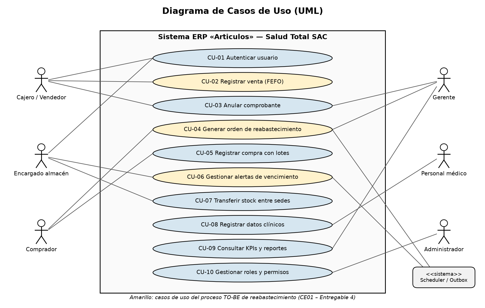

*Figura 1.1 — Diagrama de casos de uso del sistema.*

| CU    | Nombre                            | Actor principal                | Requerimientos             |
|-------|-----------------------------------|--------------------------------|----------------------------|
| CU-01 | Autenticar usuario                | Todos los usuarios             | RF-01, RF-02               |
| CU-02 | Registrar venta (FEFO)            | Cajero / Vendedor              | RF-10, RF-07, RF-24, RF-18 |
| CU-03 | Anular comprobante                | Cajero / Gerente               | RF-16                      |
| CU-04 | Generar orden de reabastecimiento | Sistema / Comprador / Gerente  | RF-26, RF-27, RF-28        |
| CU-05 | Registrar compra con lotes        | Comprador                      | RF-08, RF-09, RF-23        |
| CU-06 | Gestionar alertas de vencimiento  | Sistema / Encargado de almacén | RF-25                      |
| CU-07 | Transferir stock entre sedes      | Encargado de almacén           | RF-29                      |
| CU-08 | Registrar datos clínicos          | Personal médico                | RF-17, RF-32               |
| CU-09 | Consultar KPIs y reportes         | Gerente                        | RF-19, RF-30               |
| CU-10 | Gestionar roles y permisos        | Administrador                  | RF-03                      |

#### CU-01: Autenticar usuario

| Actor principal | Usuario del sistema                                           |
|-----------------|---------------------------------------------------------------|
| Precondiciones  | El usuario está registrado y activo (estado ≠ ELIMINADO).     |
| Postcondiciones | El usuario obtiene un token JWT válido y accede al dashboard. |

**Flujo principal:**

1.  El usuario ingresa su nombre de usuario y contraseña en la pantalla de login.

2.  El frontend envía POST /api/auth/login con las credenciales.

3.  AuthController delega en AuthService, que verifica que la IP no esté bloqueada (SecurityMonitorService) y autentica con AuthenticationManager (contraseña BCrypt).

4.  AuthService obtiene el usuario y sus roles con DatosPersonalesRepository.findByLoginWithRoles y JwtService genera el token firmado con RSA para la sucursal (generateTokenWithSucursal).

5.  El sistema retorna ApiResponse\<LoginResponse\>; el frontend guarda el token en localStorage y redirige al dashboard.

**Flujos alternativos:**

- 2a. Credenciales inválidas: SecurityMonitorService.registerFailedAttempt registra el intento y el sistema responde 401 indicando los intentos restantes.

- 2b. 5 intentos fallidos (security.max-failed-attempts): la IP o el usuario quedan bloqueados 15 minutos (security.block-duration-minutes).

#### CU-02: Registrar venta

| Actor principal | Cajero / Vendedor                                                             |
|-----------------|-------------------------------------------------------------------------------|
| Precondiciones  | Sesión activa, punto de emisión seleccionado y productos con stock.           |
| Postcondiciones | La venta queda registrada, el kardex actualizado y se emite una notificación. |

**Flujo principal:**

1.  El cajero selecciona los productos y cantidades, y elige el método de pago.

2.  El frontend envía POST /api/ventas con CrearVentaRequest validado (@Valid); el endpoint exige el permiso VENTA_CREAR (@PreAuthorize).

3.  Para cada ítem, VentaServiceImpl carga el registro de Producto (lote) elegido en el frontend (idArticulo) y valida que el stock alcance para la cantidad acumulada; si no, lanza ValidationException (400). La propuesta automática del lote FEFO es TO-BE (RF-24).

4.  VentaService persiste la venta y su detalle, y solicita a KardexService el registro de la salida.

5.  VentaService registra el evento en la cola Outbox (cola_evento) dentro de la misma transacción; al confirmarse, el trigger emite pg_notify y PostgresEventListenerService lo entrega por WebSocket/STOMP.

6.  El sistema retorna ApiResponse\<VentaRegistroDTO\> con la venta y su serie y número correlativo.

**Flujos alternativos:**

- 3a. Stock insuficiente: el sistema aborta la transacción y responde 400 sin modificar el inventario.

- 5a. El listener LISTEN pierde la conexión: la venta se confirma igualmente; el evento queda PENDIENTE en cola_eventos y lo procesa el sondeo de respaldo (cada 30 s) o la reconexión.

#### CU-03: Anular comprobante

| Actor principal | Cajero (solicita) / Gerente (aprueba)                              |
|-----------------|--------------------------------------------------------------------|
| Precondiciones  | Existe un comprobante en estado PAGADO.                            |
| Postcondiciones | El comprobante queda ANULADO o regresa a PAGADO según la decisión. |

**Flujo principal:**

1.  El cajero solicita la anulación del comprobante.

2.  El sistema cambia el estado del comprobante a PENDIENTE_ANULACION y crea una solicitud de aprobación.

3.  El gerente revisa la solicitud en el módulo de aprobaciones.

4.  Si la aprueba, el comprobante pasa a ANULADO; si la rechaza, regresa a PAGADO.

#### CU-04: Generar orden de reabastecimiento (TO-BE)

| Actor principal | Sistema (disparador) / Comprador (aprobación)                                                                  |
|-----------------|----------------------------------------------------------------------------------------------------------------|
| Precondiciones  | El producto tiene stockMinimo y stockMaximo configurados para la sucursal (RF-26).                             |
| Postcondiciones | Existe una orden en estado PENDIENTE y el comprador fue notificado; si se aprueba, se convierte en una Compra. |

**Flujo principal:**

- Una salida de inventario (venta, transferencia o merma) actualiza el stock del producto en la sucursal.

- ReabastecimientoService suma el stock vigente (lotes no vencidos) y lo compara con el punto de reorden.

- Si el stock es ≤ al mínimo y no hay otra orden abierta, crea una OrdenReabastecimiento PENDIENTE con cantidad = stockMáximo − stock.

- El sistema publica el evento inventario.reabastecimiento; el comprador lo recibe en tiempo real.

- El comprador revisa la orden, ajusta la cantidad si es necesario y la aprueba.

- El sistema la convierte en una Compra en estado REGISTRADO, con el proveedor habitual del producto.

**Flujos alternativos:**

- 3a. Ya existe una orden abierta: no se genera otra (RN-12).

- 5a. El comprador rechaza: la orden pasa a RECHAZADA y se registra el motivo.

- 5b. Sin atención en 72 h: la orden pasa a VENCIDA y se notifica a gerencia (RN-13).

## Sección 2: Prototipo Navegable

### 2.1 Tipo y Fidelidad del Prototipo

El prototipo navegable combina dos niveles de fidelidad: (1) alta fidelidad para los módulos ya construidos, implementados como aplicación funcional en Angular 20 con Tailwind CSS 4, que permite navegación real, formularios, paginación y consumo de la API REST; y (2) baja fidelidad (wireframes) para las pantallas del proceso TO-BE de reabastecimiento, que se validaron antes de construirse. El módulo features/documentos/punto-documento es la implementación de referencia que homogeniza el diseño del resto de pantallas.

### 2.2 Flujo de Navegación

El acceso parte de la pantalla de login; una vez autenticado, el usuario llega al dashboard, desde donde un menú lateral (sidebar) y un encabezado (header) dan acceso a los módulos según sus permisos. Cada módulo de gestión sigue el patrón «Lista ↔ Formulario» mediante componentes compartidos.

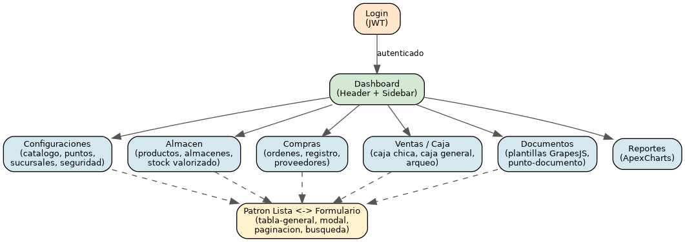

*Figura 2.1 — Flujo de navegación del prototipo.*

### 2.3 Pantallas Principales

| Pantalla             | Descripción                                                                                                               |
|----------------------|---------------------------------------------------------------------------------------------------------------------------|
| Login                | Autenticación con usuario y contraseña; emite el JWT y selecciona el punto de emisión.                                    |
| Dashboard            | Vista principal con header, sidebar colapsable (SidebarService) e indicadores.                                            |
| Listado genérico     | Pantalla de lista basada en app-page-header, filtros tipo «pill», app-search-generic, app-tabla-general y app-pagination. |
| Formulario genérico  | Alta/edición dentro de app-modal con inputs reutilizables (form-input, form-select, form-switch).                         |
| Punto-Documento      | Asignación de plantillas a puntos de emisión; referencia de diseño del proyecto.                                          |
| Editor de plantillas | Diseñador visual de documentos basado en GrapesJS con soporte Tailwind.                                                   |
| Reportes             | Tableros con gráficos ApexCharts y exportación a Excel/PDF.                                                               |

Todas las pantallas de gestión comparten la misma estructura de señales (currentPage, pageSize, totalElements, totalPages, searchTerm, searchType) y métodos (onSearch, cambiarPagina, cambiarTamanoPagina), garantizando una experiencia uniforme.

Las siguientes capturas se obtuvieron del prototipo en ejecución (backend en el puerto 8085 y frontend en el 4200, con datos semilla de Salud Total SAC). Cada pantalla indica los requerimientos que materializa.

<table>
<colgroup>
<col style="width: 48%" />
<col style="width: 51%" />
</colgroup>
<thead>
<tr class="header">
<th>
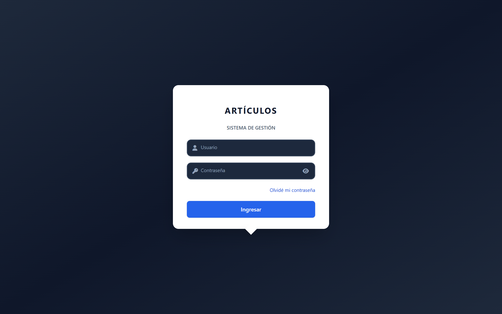

<em>Figura 2.2 — Login con bloqueo anti fuerza bruta (RF-01, RF-02).</em>
</th>
<th>
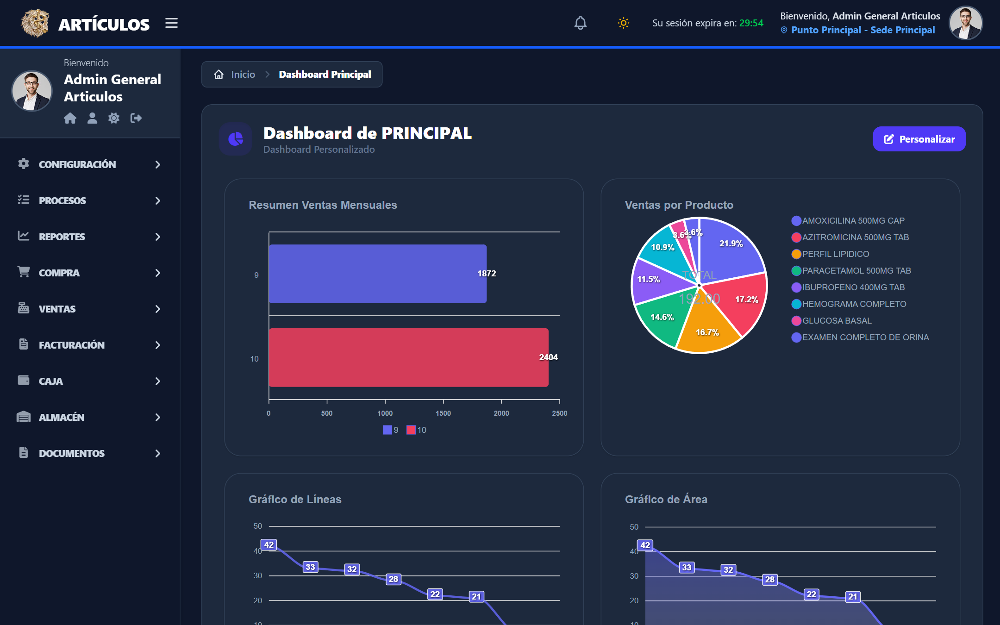

<em>Figura 2.3 — Dashboard de la sede principal (RF-19, RF-30).</em>
</th>
</tr>
</thead>
<tbody>
<tr class="odd">
<td>
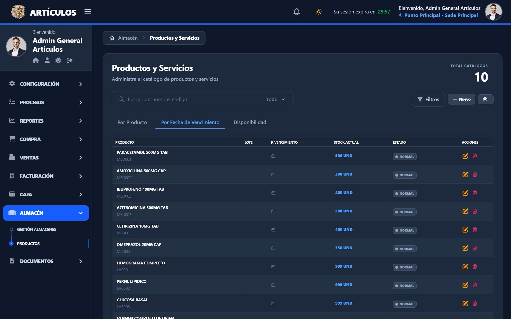

<em>Figura 2.4 — Productos por fecha de vencimiento y lote (RF-23, RF-25).</em>
</td>
<td>
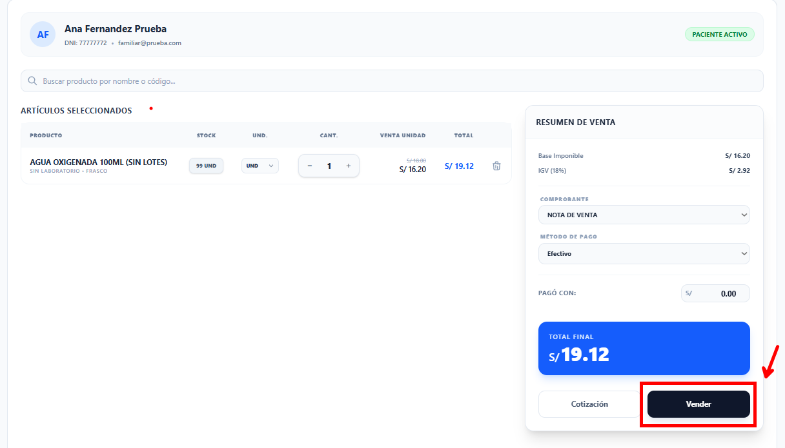

<em>Figura 2.5 — Registro de venta por paciente (RF-10, RF-24).</em>
</td>
</tr>
<tr class="even">
<td>
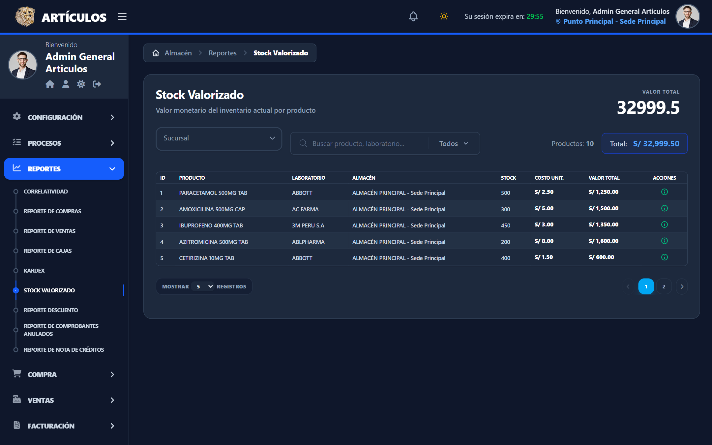

<em>Figura 2.6 — Stock valorizado por almacén (RF-06).</em>
</td>
<td>
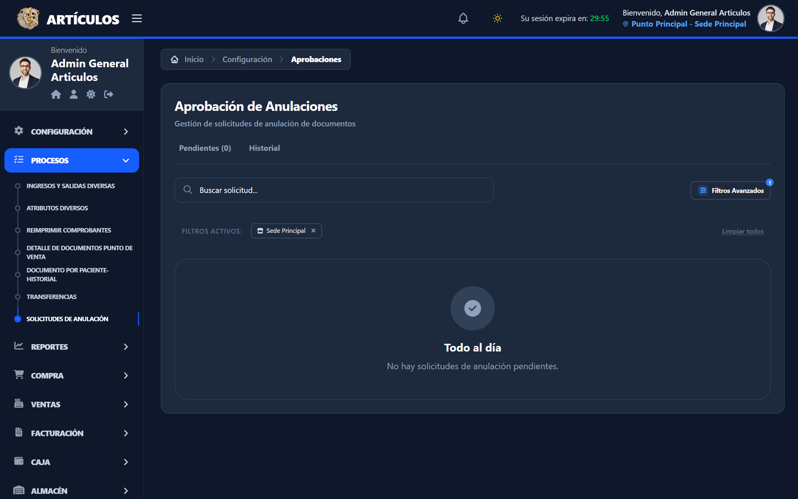

<em>Figura 2.7 — Aprobación de anulaciones (RF-16, RN-05).</em>
</td>
</tr>
<tr class="odd">
<td>
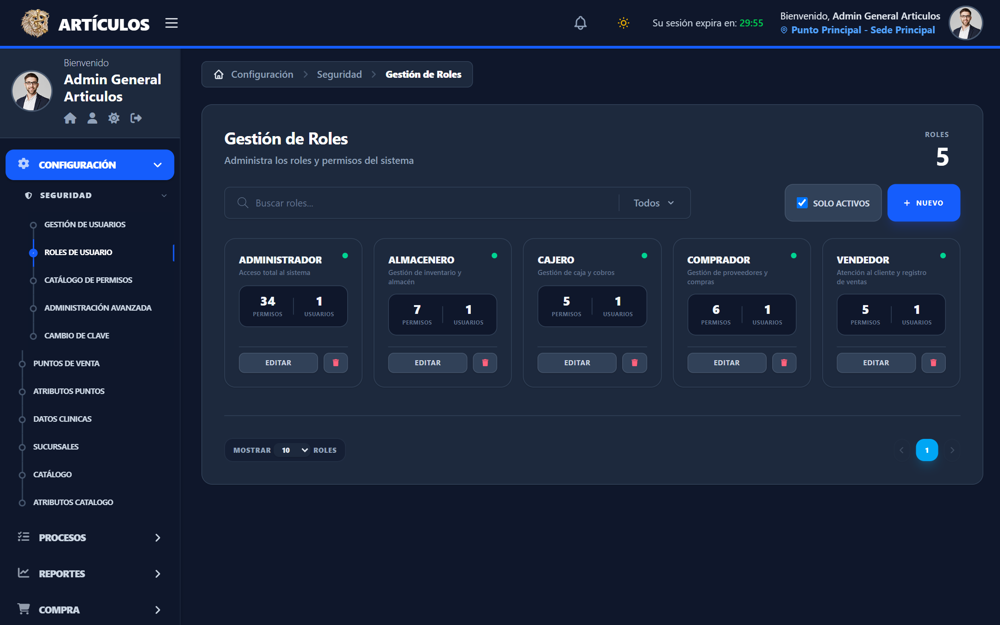

<em>Figura 2.8 — Gestión de roles y permisos (RF-03).</em>
</td>
<td>
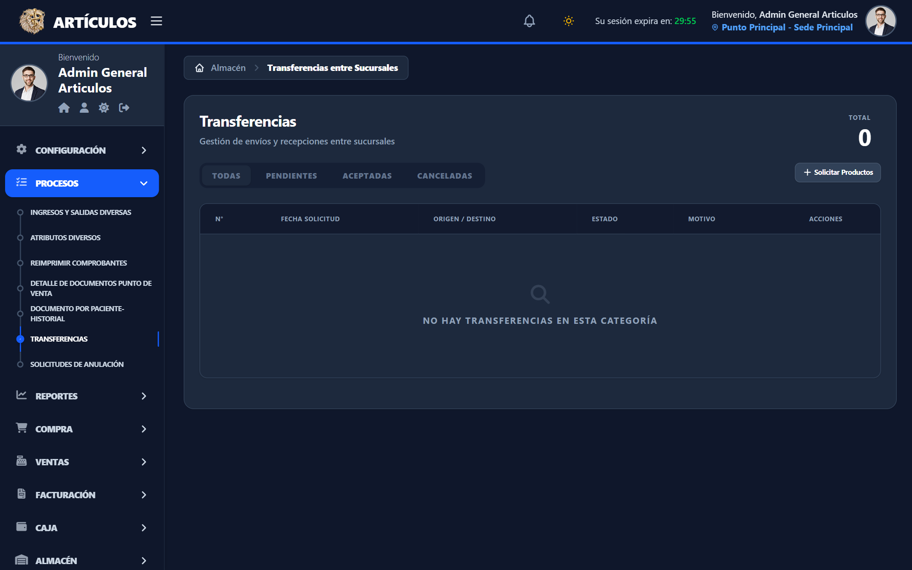

<em>Figura 2.9 — Transferencias entre sucursales (RF-29).</em>
</td>
</tr>
<tr class="even">
<td>
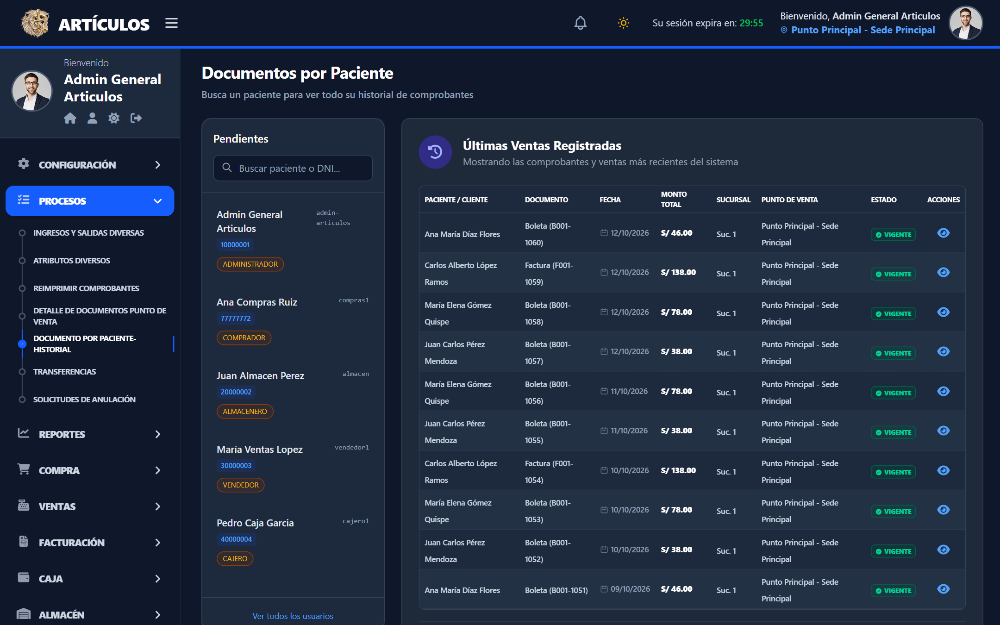

<em>Figura 2.10 — Documentos por paciente, módulo clínico (RF-17).</em>
</td>
<td>
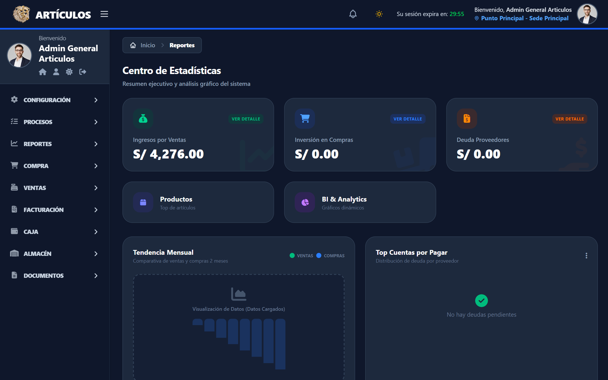

<em>Figura 2.11 — Centro de estadísticas y reportes (RF-19).</em>
</td>
</tr>
</tbody>
</table>

**Prototipo TO-BE.** La figura 2.12 muestra el wireframe de la pantalla de órdenes de reabastecimiento y alertas FEFO (RF-25 a RF-28, RF-30), que se construirá en el sprint de reabastecimiento del Entregable 3.

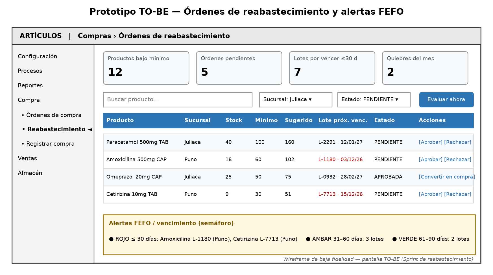

*Figura 2.12 — Wireframe TO-BE: órdenes de reabastecimiento y alertas FEFO.*

### 2.4 Evidencia de Validación con Usuarios/Stakeholders

La validación se realizó en sesiones de revisión guiada con los stakeholders de Salud Total SAC: gerencia, químico farmacéutico (director técnico), encargado de almacén y cajero. En cada sesión se recorrieron las pantallas de las figuras 2.2 a 2.12 contra los requerimientos y se registraron las observaciones con un instrumento de verificación por criterio (tabla siguiente). Las observaciones se resolvieron en esta versión del documento y se trazan a los requerimientos afectados. La evidencia formal (objetivos, hallazgos, acuerdos y firmas) está en el Anexo A.

| Criterio de validación                                       | Pantalla / artefacto | Resultado                | Observación → acción tomada                                                    |
|--------------------------------------------------------------|----------------------|--------------------------|--------------------------------------------------------------------------------|
| El flujo de venta descuenta stock y deja rastro en el kardex | Fig. 2.5, CU-02      | Conforme con observación | Se pidió elegir el lote automáticamente → RF-24, RN-10, HU-09.                 |
| Se visualizan los lotes próximos a vencer                    | Fig. 2.4             | Conforme con observación | Se pidió un semáforo de 90/60/30 días → RF-25 y wireframe 2.12.                |
| El comprador se entera a tiempo de los quiebres              | Wireframe 2.12       | Conforme con observación | Se pidió que la orden se genere sola y se pueda ajustar → RF-27, RF-28, CU-04. |
| Las anulaciones requieren aprobación                         | Fig. 2.7, CU-03      | Conforme                 | —                                                                              |
| Las transferencias entre Juliaca y Puno conservan el lote    | Fig. 2.9             | Conforme con observación | Se agregó RF-29 explícito con lote y vencimiento.                              |
| Los datos clínicos solo los ve el personal médico            | Fig. 2.10            | Conforme con observación | Se agregó auditoría de accesos → RF-32, RN-14, RNF-13.                         |
| Los listados son homogéneos y fáciles de aprender            | Figs. 2.3–2.11       | Conforme                 | —                                                                              |
| Los indicadores permiten medir el impacto del proyecto       | Fig. 2.3             | Parcial                  | Faltan KPIs de quiebre y merma → RF-30 (E3).                                   |

## Sección 3: Diseño Arquitectónico

### 3.1 Documento de Arquitectura

El sistema adopta un estilo arquitectónico híbrido que combina tres patrones complementarios:

- **Arquitectura en capas (Clean Architecture):** dentro del backend, separando responsabilidades en capas Web (controladores), Negocio (servicios y mappers) y Persistencia (repositorios y entidades), con un contrato de respuesta uniforme (ApiResponse) y manejo centralizado de excepciones.

- **Monolito modular:** el backend agrupa 28 módulos de negocio autocontenidos (la mayoría con su controller, service, repository, entity, dto y mapper), lo que favorece la cohesión y permite una futura extracción a microservicios.

- **Arquitectura orientada a eventos (EDA):** los eventos de negocio (notificaciones, alertas, reabastecimiento) se registran con el patrón Transactional Outbox en la tabla cola_eventos, dentro de la misma transacción que los origina; un trigger emite pg_notify('nuevo_evento_outbox') y PostgresEventListenerService, suscrito con LISTEN, los publica como eventos de Spring (OutboxEvent) que consumen WebSocketNotificationListener (avisos por STOMP) y CompraPagoConsumer. Así se separa la generación del evento de su entrega sin perder mensajes y sin operar un broker externo.

El frontend es una SPA independiente que consume la API REST y se suscribe a las notificaciones por WebSocket/STOMP. La persistencia recae en PostgreSQL, con el esquema generado por Hibernate (Flyway desactivado por ahora). La arquitectura se documenta con el modelo C4 en tres niveles: contexto (C1, figura 3.1), contenedores (C2, figura 3.2), que cumple además el rol de vista de despliegue lógico, y componentes (C3, figura 3.3). La figura 3.4 complementa con el despliegue físico sobre la infraestructura híbrida de CE03.

### 3.2 Vista C4 — Nivel 1: Contexto (C1)

El diagrama de contexto ubica a «Articulos» como el sistema central de Salud Total SAC, con sus seis tipos de usuario y cinco sistemas externos: SUNAT/OSE para comprobantes electrónicos (fase 2), la pasarela de pagos, los proveedores o droguerías que reciben las órdenes de compra, y los canales de comunicación con el paciente: el servidor de correo (SMTP) y WhatsApp Business Cloud API de Meta.

*Figura 3.1 — C4 Nivel 1: diagrama de contexto del sistema.*

### 3.3 Vista C4 — Nivel 2: Contenedores (C2)

La vista de contenedores muestra las unidades desplegables y sus protocolos: la SPA Angular se ejecuta en el navegador de las sedes; el API Gateway (Nginx/ALB) termina TLS y enruta /api y /ws hacia el backend; el backend persiste en PostgreSQL (RDS Multi-AZ), usa la propia base como canal de eventos (cola_eventos + LISTEN/NOTIFY) y respalda en S3. El microservicio mensajeria-api (:8087) recibe del backend las solicitudes de envío (REST con el JWT del usuario reenviado y el PDF adjunto) y se comunica con Gmail SMTP y con la Graph API de WhatsApp; valida los tokens con la llave pública RSA del ERP, actuando como resource server OAuth2 (ADR-10). Los avisos internos (campana, alertas) no usan un servicio aparte: salen del propio backend mediante Outbox y LISTEN/NOTIFY (ADR-04).

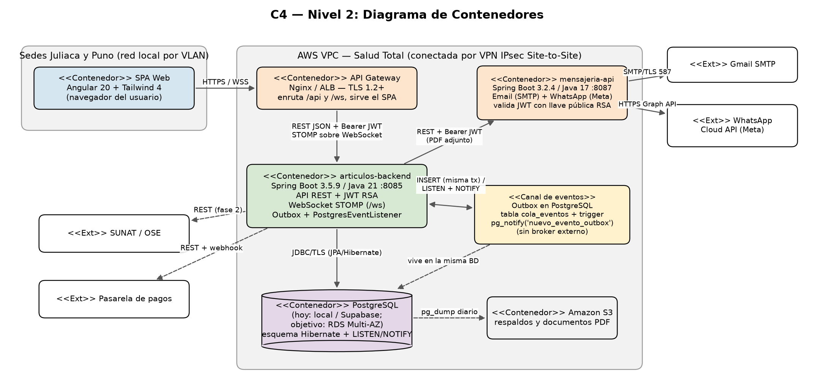

*Figura 3.2 — C4 Nivel 2: diagrama de contenedores.*

### 3.4 Vista C4 — Nivel 3: Componentes del backend (C3)

El diagrama de componentes detalla la organización interna del backend bajo Clean Architecture y sus elementos transversales: el filtro de seguridad JWT, el GlobalExceptionHandler, los mappers de MapStruct, la cola Outbox con su listener de PostgreSQL, los consumidores de eventos y los clientes REST hacia mensajeria-api.

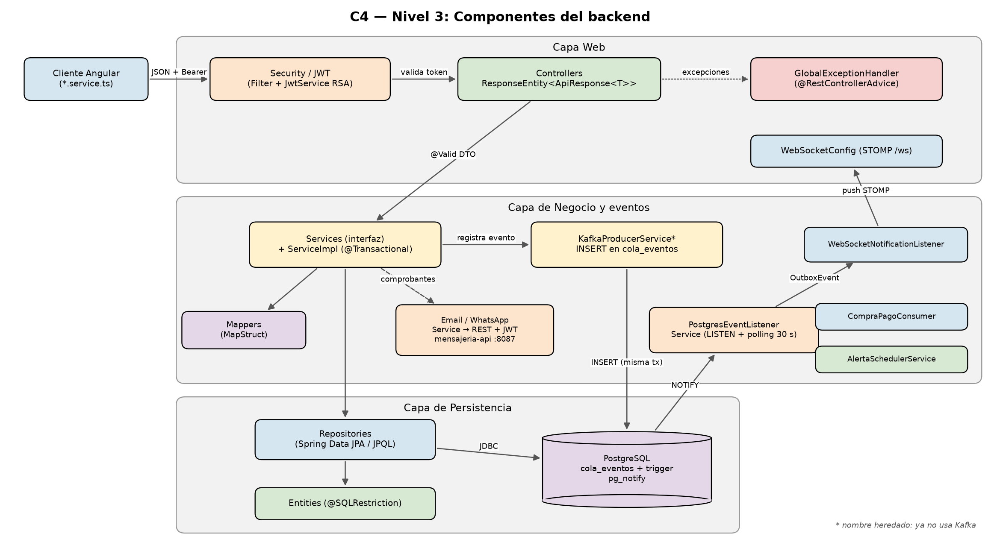

*Figura 3.3 — C4 Nivel 3: componentes del backend.*

### 3.5 Diagrama de Despliegue (infraestructura híbrida)

El despliegue está alineado con el diseño de red y de centro de datos de CE03. Las sedes de Juliaca y Puno tienen la red segmentada por VLAN (ventas/caja, almacén, clínica, administración) con core switch L3 y firewall HA, y se conectan por VPN IPsec Site-to-Site a la VPC de AWS. En la VPC, el Application Load Balancer y Nginx (subred pública) sirven el SPA y enrutan hacia dos instancias EC2 con articulos.jar y la instancia de mensajeria.jar (subred privada de aplicación); esta última sale a Internet solo por un NAT Gateway hacia Meta y Gmail. La base de datos corre en RDS PostgreSQL Multi-AZ, con snapshots en S3 (subred privada de datos). El host VMware ESXi de Juliaca queda como nodo de contingencia local. Estado actual: el sistema se ejecuta con el perfil local (PostgreSQL local) y con el perfil supabase (PostgreSQL gestionado); aún no existen Dockerfile ni pipeline, por lo que el despliegue de la figura 3.4 es el objetivo que se implementa en los Entregables 3 y 4.

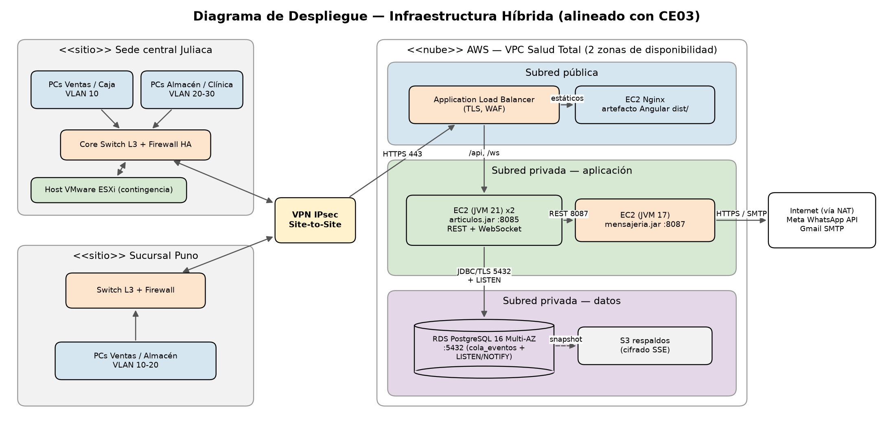

*Figura 3.4 — Despliegue sobre infraestructura híbrida (sedes Juliaca/Puno + AWS).*

### 3.6 Registro de Decisiones Arquitectónicas (ADR)

Las decisiones arquitectónicas se documentan en formato ADR (contexto → decisión → consecuencias).

**ADR-01: Monorepo con monolito modular**

| Contexto      | Se requiere organizar un sistema amplio (28 módulos) mantenido por un equipo reducido.                                                  |
|---------------|-----------------------------------------------------------------------------------------------------------------------------------------|
| Decisión      | Backend monolítico dividido en módulos autocontenidos dentro de un único repositorio junto al frontend y al servicio de notificaciones. |
| Consecuencias | (+) Alta cohesión y despliegue simple. (−) Acoplamiento de despliegue del backend; mitigable extrayendo módulos a futuro.               |

**ADR-02: Autenticación con JWT firmado por RSA**

| Contexto      | Se necesita autenticación sin estado para una API REST consumida por una SPA.                                            |
|---------------|--------------------------------------------------------------------------------------------------------------------------|
| Decisión      | Tokens JWT firmados con par de llaves RSA, expiración de 30 min y políticas anti-fuerza bruta.                           |
| Consecuencias | (+) Escalabilidad sin sesión en servidor. (−) Revocación no trivial; mitigada con expiración corta y límite de sesiones. |

**ADR-03: Eliminación lógica global (soft-delete)**

| Contexto      | El negocio exige trazabilidad e impide perder información histórica.                                                                                                                                                  |
|---------------|-----------------------------------------------------------------------------------------------------------------------------------------------------------------------------------------------------------------------|
| Decisión      | Prohibición de borrado físico: estado ELIMINADO (3) + @SQLRestriction("estado != 3") en las entidades de negocio. La unicidad se valida hoy en servicio; los índices únicos parciales se crearán al habilitar Flyway. |
| Consecuencias | (+) Auditoría e integridad histórica. (−) Mayor cuidado en unicidad; resuelto con índices parciales.                                                                                                                  |

**ADR-04: Eventos con Outbox + PostgreSQL LISTEN/NOTIFY en lugar de Kafka (revisado en v2.0)**

| Contexto      | El diseño inicial (y CE01) usaba Apache Kafka y un microservicio notificaciones-service (:8086). Para el volumen de dos sedes, operar un broker añadía costo y complejidad sin necesidad.                                                                                                                                                                                                           |
|---------------|-----------------------------------------------------------------------------------------------------------------------------------------------------------------------------------------------------------------------------------------------------------------------------------------------------------------------------------------------------------------------------------------------------|
| Decisión      | Se retiró Kafka. Transactional Outbox sobre PostgreSQL: el evento se inserta en cola_eventos en la misma transacción; el trigger trg_notify_evento_insert emite pg_notify('nuevo_evento_outbox'); PostgresEventListenerService (LISTEN en un hilo dedicado, con sondeo de respaldo cada 30 s) lo marca PROCESADO o ERROR y lo publica como OutboxEvent. El nombre KafkaProducerService es heredado. |
| Consecuencias | (+) Atomicidad con el negocio, cero infraestructura adicional y menor costo. (−) Sin particiones ni reprocesamiento como Kafka; con 2 instancias EC2 debe evitarse procesar dos veces (SELECT … FOR UPDATE SKIP LOCKED) y los avisos STOMP necesitan sesión fija o un broker STOMP compartido. Kafka queda como ruta de evolución si el volumen crece.                                              |

**ADR-05: Mapeo con MapStruct**

| Contexto      | Se necesita transformar entidades a DTOs de forma consistente y sin código repetitivo.               |
|---------------|------------------------------------------------------------------------------------------------------|
| Decisión      | Uso obligatorio de interfaces @Mapper de MapStruct; prohibidos los builders manuales.                |
| Consecuencias | (+) Menos errores y código uniforme. (−) Dependencia de procesamiento de anotaciones en compilación. |

**ADR-06: Paginación del lado del servidor**

| Contexto      | Las entidades transaccionales crecen indefinidamente y pueden saturar memoria y DOM.                    |
|---------------|---------------------------------------------------------------------------------------------------------|
| Decisión      | Paginación con Pageable y PageResponse para datos dinámicos; listas planas solo para catálogos finitos. |
| Consecuencias | (+) Rendimiento y menor payload. (−) Doble consulta COUNT; aceptable por el beneficio.                  |

**ADR-07: Infraestructura híbrida — aplicación y datos en AWS**

| Contexto      | Las dos sedes necesitan alta disponibilidad, CE01 aprobó migrar los servidores a la nube y CE03 diseñó la red híbrida con VPN Site-to-Site.                                                          |
|---------------|------------------------------------------------------------------------------------------------------------------------------------------------------------------------------------------------------|
| Decisión      | Desplegar la aplicación en EC2 (2 instancias detrás de un ALB) y PostgreSQL en RDS Multi-AZ dentro de una VPC con subredes pública, de aplicación y de datos; el ESXi local queda como contingencia. |
| Consecuencias | (+) Disponibilidad ≥ 99,5 %, respaldos gestionados y escalado horizontal. (−) Dependencia del enlace VPN; se mitiga con enlace de respaldo y modo contingencia local.                                |

**ADR-08: Inventario por lote como registro de Producto**

| Contexto      | Se necesita FEFO y trazabilidad de vencimientos sin reescribir el modelo existente (catálogo → producto).                                                                                      |
|---------------|------------------------------------------------------------------------------------------------------------------------------------------------------------------------------------------------|
| Decisión      | Cada registro de Producto representa un lote (nroLote, fechaVencimiento, stock) de un ítem de Catálogo en una sucursal; FEFO se resuelve con la consulta findFirst…OrderByFechaVencimientoAsc. |
| Consecuencias | (+) Reutiliza el modelo, el kardex y los índices actuales. (−) El stock total se obtiene sumando lotes; se mitiga con un índice (idCatalogo, idSucursal, fechaVencimiento).                    |

**ADR-09: Secretos fuera del repositorio y esquema versionado con Flyway (a implementar)**

| Contexto      | CE01 identificó como riesgo crítico las credenciales y llaves en el repositorio y el uso de ddl-auto=create. El código lo confirma: private.pem y keypair.pem están en src/main/resources/certs, el perfil supabase usa ddl-auto=create, el local ddl-auto=update y spring.flyway.enabled=false. |
|---------------|--------------------------------------------------------------------------------------------------------------------------------------------------------------------------------------------------------------------------------------------------------------------------------------------------|
| Decisión      | Llaves RSA y credenciales en AWS Secrets Manager o variables de entorno; perfil de producción con ddl-auto=validate; todo cambio de esquema mediante migraciones Flyway versionadas.                                                                                                             |
| Consecuencias | (+) Elimina el riesgo de fuga y de pérdida de datos por recreación del esquema. (−) Requiere disciplina de migraciones y configurar el pipeline (E4).                                                                                                                                            |

**ADR-10: Microservicio independiente de mensajería externa (mensajeria-api)**

| Contexto      | El envío por correo y WhatsApp depende de proveedores externos (Gmail, Meta) con credenciales, cuotas y latencias propias, que no deben afectar la venta.                                                                                                                                                     |
|---------------|---------------------------------------------------------------------------------------------------------------------------------------------------------------------------------------------------------------------------------------------------------------------------------------------------------------|
| Decisión      | Aislar la mensajería en el microservicio mensajeria-api (Spring Boot 3.2.4, :8087) con endpoints /api/email y /api/v1/mensajes/whatsapp; valida el JWT del ERP con la llave pública RSA (OAuth2 resource server) y las plantillas de WhatsApp se parametrizan por JSON sin cambiar código.                    |
| Consecuencias | (+) Aísla credenciales y fallos externos, y escala y se despliega de forma independiente. (−) Contrato REST que mantener sincronizado (hoy el backend llama a /enviar-con-adjunto, que el servicio no expone) y credenciales de correo en application.properties que deben migrar a Secrets Manager (ADR-09). |

## Sección 4: Diseño Detallado

### 4.1 Diagrama de Clases (UML)

El modelo de clases representa el dominio núcleo del sistema: inventario (catálogo, producto por lote, almacén, kardex), ventas y compras con sus detalles, proveedores, la cola de eventos Outbox y las clases del proceso TO-BE de reabastecimiento. Cada registro de Producto corresponde a un lote (nroLote, fechaVencimiento) de un ítem del catálogo en una sucursal, con su stockMinimo como punto de reorden (ADR-08). Las composiciones (rombo) modelan la relación maestro-detalle y las asociaciones, las referencias por llave foránea. Las entidades comparten el atributo estado del tipo EstadoGeneral para el soft-delete. OrdenReabastecimiento se marca como «TO-BE» porque se implementa en el Entregable 3.

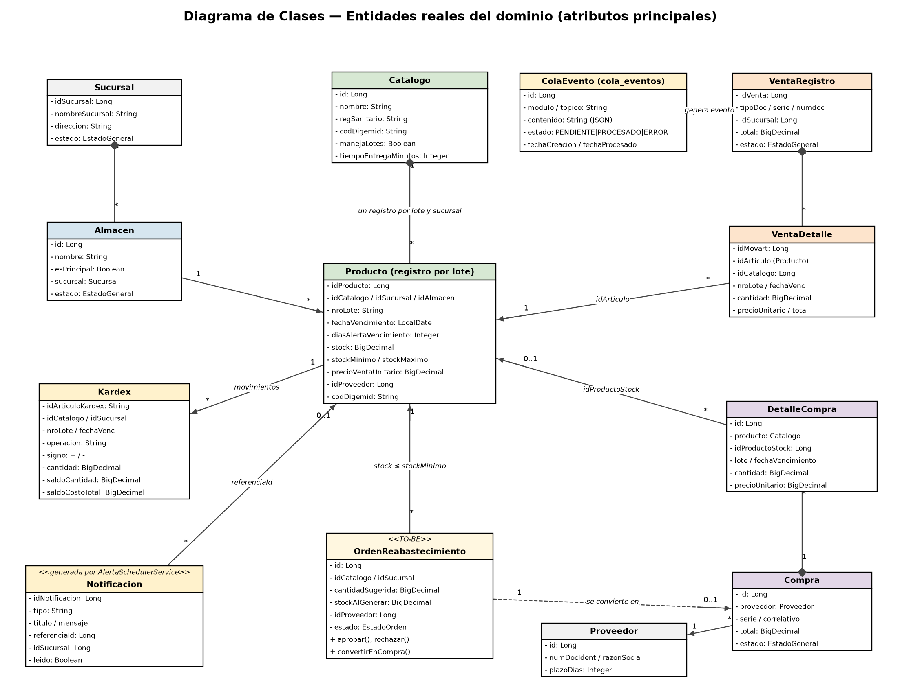

*Figura 4.1 — Diagrama de clases del dominio núcleo.*

### 4.2 Diagramas de Secuencia

Los diagramas de secuencia describen la interacción temporal entre los objetos para los casos de uso críticos.

#### 4.2.1 Autenticación con JWT

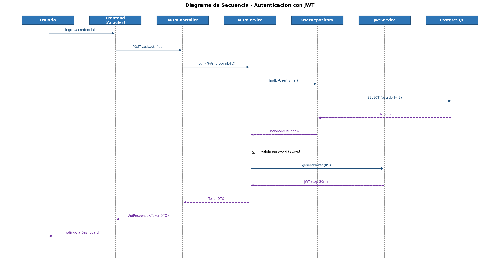

*Figura 4.2 — Secuencia de autenticación (CU-01).*

#### 4.2.2 Registro de venta con selección FEFO y notificación (Outbox)

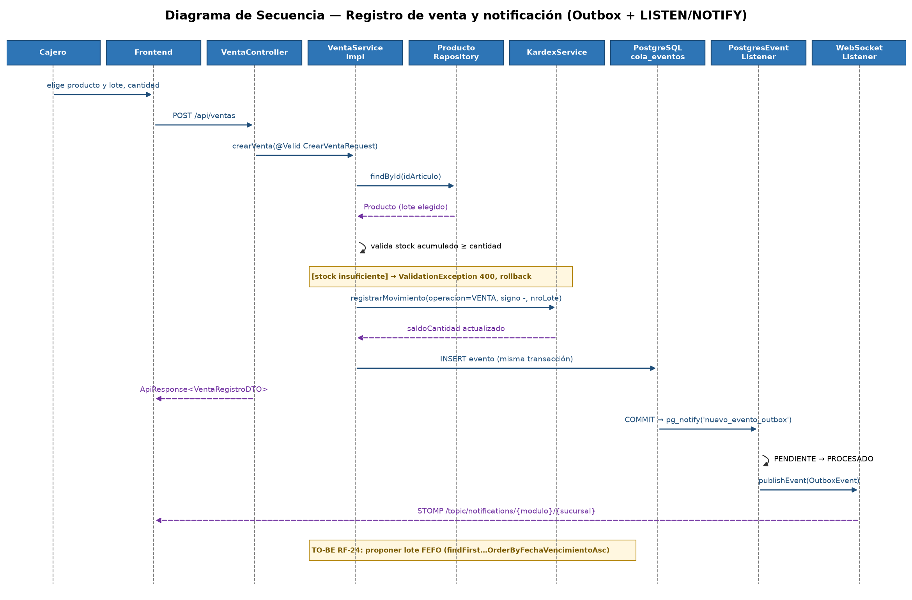

*Figura 4.3 — Secuencia de registro de venta con FEFO y notificación vía Outbox (CU-02).*

#### 4.2.3 Reabastecimiento automático por punto de reorden (TO-BE)

La secuencia muestra cómo una salida de inventario dispara la evaluación del punto de reorden, la creación de la orden, su notificación (Outbox + LISTEN/NOTIFY) y su conversión en compra cuando el comprador la aprueba (CU-04, RN-12).

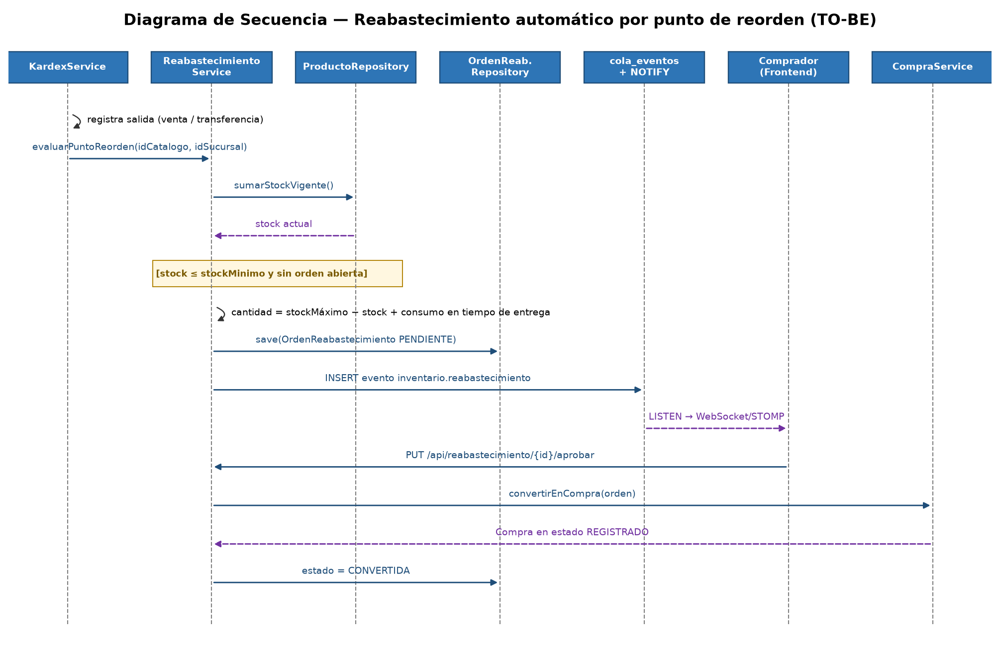

*Figura 4.4 — Secuencia de reabastecimiento automático (CU-04).*

### 4.3 Diagrama de Estados

El ciclo de vida de un comprobante de venta se modela con los estados del enumerado EstadoGeneral. El comprobante puede iniciar como cotización o como venta directa, avanza por validación y pago, y solo puede anularse a través del estado intermedio PENDIENTE_ANULACION (que materializa la regla de aprobación). El estado ELIMINADO representa la eliminación lógica.

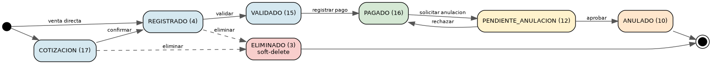

*Figura 4.5 — Diagrama de estados del comprobante de venta.*

La orden de reabastecimiento tiene su propio ciclo de vida: nace PENDIENTE cuando el stock cae al mínimo, puede aprobarse (con ajuste de cantidad), rechazarse o vencer sin atención en 72 h. Una vez aprobada, se convierte en Compra y termina como RECIBIDA cuando ingresan sus lotes.

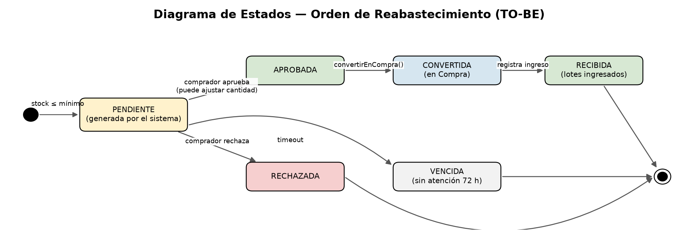

*Figura 4.6 — Diagrama de estados de la orden de reabastecimiento (TO-BE).*

### 4.4 Modelo de Diseño Detallado

El diseño detallado del backend estandariza el flujo de una petición y la responsabilidad de cada capa:

| Capa                  | Responsabilidad                                                                                                                                                                   |
|-----------------------|-----------------------------------------------------------------------------------------------------------------------------------------------------------------------------------|
| Controller            | Recibe la petición, valida el cuerpo con @Valid, registra trazas con @Slf4j y retorna siempre ResponseEntity\<ApiResponse\<T\>\>.                                                 |
| Service / ServiceImpl | Contiene la lógica de negocio; retorna el DTO directamente (sin envolverlo). Anota @SuppressWarnings("null") y @Transactional.                                                    |
| Mapper (MapStruct)    | Convierte Entity ↔ DTO con componentModel="spring" y unmappedTargetPolicy=IGNORE.                                                                                                 |
| Repository            | Extiende JpaRepository; las búsquedas usan JPQL con LOWER/CONCAT para ser insensibles a mayúsculas y reciben Pageable.                                                            |
| Entity                | Declara @Index en llaves foráneas y columnas de estado, auditoría con @EntityListeners y @SQLRestriction para el soft-delete.                                                     |
| DTO                   | Objeto de transferencia anotado con Lombok (@Data/@Builder); incluye campos derivados para la vista (p. ej. nombreProducto).                                                      |
| Scheduler / Listener  | AlertaSchedulerService (@Scheduled diario) genera alertas de vencimiento y de stock crítico; WebSocketNotificationListener (@EventListener) entrega los eventos Outbox por STOMP. |

El contrato de respuesta uniforme se compone de ApiResponse\<T\> (success, message, data, timestamp, status) y PageResponse\<T\> (content, totalElements, totalPages, size, number), lo que permite que el frontend tipe de forma homogénea todas las llamadas. La organización del backend en paquetes core (transversal) y modules (negocio) refuerza la separación de responsabilidades descrita en el modelo.

## Anexos

### Anexo A: Acta de Validación con Stakeholders

| Proyecto           | Sistema ERP «Articulos» — Salud Total SAC                                                                                           |
|--------------------|-------------------------------------------------------------------------------------------------------------------------------------|
| Fecha de la sesión | 20 de enero de 2026                                                                                                                 |
| Objetivo           | Validar el prototipo navegable y la correspondencia con los requerimientos especificados.                                           |
| Participantes      | Gerencia, Químico farmacéutico (director técnico), Encargado de almacén, Cajero, Estudiante responsable.                            |
| Modalidad          | Revisión guiada del prototipo de alta fidelidad y del wireframe TO-BE (recorrido por módulos con el instrumento de la sección 2.4). |

**Hallazgos y acuerdos:**

- Se aprueba la homogeneidad de los listados y el patrón Lista ↔ Formulario.

- Se confirma la necesidad del flujo de aprobación para anulaciones (RN-05).

- Se valida el valor de las notificaciones en tiempo real entre puntos de emisión.

- Se acuerda incorporar el control por lote, FEFO y alertas de vencimiento (RF-23 a RF-25, RN-10, RN-11).

- Se aprueba el wireframe de reabastecimiento y se prioriza para el siguiente sprint (RF-27, RF-28).

- Pendiente: la integración con SUNAT/OSE y la pasarela de pagos queda para la fase 2 (RF-31).

**Resultado:** Prototipo y requerimientos APROBADOS con observaciones menores.

### Anexo B: Matriz de Trazabilidad de Requerimientos

La matriz vincula cada requerimiento funcional con su historia de usuario, su caso de uso, el componente que lo implementa, la pantalla del frontend y su estado de implementación verificado contra el código fuente. Implementado: existe en el repositorio. Parcial: existe la base, pero falta completar el comportamiento. TO-BE: se construye en el Entregable 3.

| RF    | HU    | CU    | Componente / clase                                                                                                             | Pantalla                             | Estado                                                                                          |
|-------|-------|-------|--------------------------------------------------------------------------------------------------------------------------------|--------------------------------------|-------------------------------------------------------------------------------------------------|
| RF-01 | HU-07 | CU-01 | AuthController, AuthService, JwtService                                                                                        | Login                                | Implementado                                                                                    |
| RF-02 | HU-07 | CU-01 | SecurityMonitorService                                                                                                         | Login                                | Implementado                                                                                    |
| RF-03 | HU-02 | CU-10 | RoleService, PermissionService                                                                                                 | Seguridad › Roles                    | Implementado                                                                                    |
| RF-04 | —     | —     | CatalogoService, CatalogoMapper                                                                                                | Catálogo de productos                | Implementado                                                                                    |
| RF-05 | HU-03 | —     | ProductoService                                                                                                                | Almacén › Productos                  | Implementado                                                                                    |
| RF-06 | HU-03 | —     | AlmacenService y reporte de stock valorizado                                                                                   | Stock valorizado                     | Implementado                                                                                    |
| RF-07 | HU-01 | CU-02 | KardexService                                                                                                                  | Consultas › Kardex                   | Implementado                                                                                    |
| RF-08 | HU-04 | CU-05 | CompraService                                                                                                                  | Compra › Registrar                   | Implementado                                                                                    |
| RF-09 | HU-04 | CU-05 | ProveedorService, CronogramaPagosService                                                                                       | Proveedores, pagos pendientes        | Implementado                                                                                    |
| RF-10 | HU-01 | CU-02 | VentaService (venta_registro)                                                                                                  | Ventas › Registrar venta             | Implementado                                                                                    |
| RF-11 | —     | —     | Servicios de caja chica y caja general                                                                                         | Caja › General / Chica / Arqueos     | Implementado                                                                                    |
| RF-12 | —     | —     | DescuentoService                                                                                                               | Ventas › Descuentos                  | Implementado                                                                                    |
| RF-13 | —     | —     | Beneficios aplicados en venta                                                                                                  | Ventas                               | Implementado                                                                                    |
| RF-14 | HU-08 | —     | Módulo documentos (plantillas)                                                                                                 | Documentos › Editor                  | Implementado                                                                                    |
| RF-15 | HU-08 | —     | html2pdf (iText), ZXing (QR), Barcode4j                                                                                        | Reimpresión                          | Implementado                                                                                    |
| RF-16 | HU-05 | CU-03 | SolicitudAnulacionService (ventas, compras y movimientos)                                                                      | Solicitudes de anulación             | Implementado                                                                                    |
| RF-17 | HU-12 | CU-08 | Módulos clinica y datos_medico                                                                                                 | Documentos por paciente              | Implementado                                                                                    |
| RF-18 | HU-06 | CU-02 | cola_eventos + trigger, PostgresEventListenerService, WebSocketNotificationListener (/topic/notifications/{modulo}/{sucursal}) | Campana de notificaciones            | Implementado                                                                                    |
| RF-19 | HU-13 | CU-09 | Módulo reportes; Apache POI / JXLS (Excel); xlsx en el frontend                                                                | Reportes                             | Implementado                                                                                    |
| RF-20 | —     | —     | AuditingEntityListener                                                                                                         | Transversal                          | Implementado                                                                                    |
| RF-21 | —     | —     | Compañía, empresa, sucursal, puntos                                                                                            | Configuración                        | Implementado                                                                                    |
| RF-22 | —     | —     | Repositorios JPQL (LOWER/CONCAT)                                                                                               | Buscadores                           | Implementado                                                                                    |
| RF-23 | HU-09 | CU-05 | Producto.nroLote / fechaVencimiento                                                                                            | Productos › Por fecha de vencimiento | Implementado                                                                                    |
| RF-24 | HU-09 | CU-02 | ProductoRepository.findFirst…OrderByFechaVencimientoAsc                                                                        | Registrar venta                      | Parcial: la venta usa el lote elegido en el frontend; la consulta FEFO existe pero no se invoca |
| RF-25 | HU-10 | CU-06 | AlertaSchedulerService (diario)                                                                                                | Notificaciones, productos            | Implementado                                                                                    |
| RF-26 | HU-11 | CU-04 | Producto.stockMinimo / stockMaximo + alerta de stock crítico                                                                   | Productos                            | Implementado                                                                                    |
| RF-27 | HU-11 | CU-04 | ReabastecimientoService (nuevo)                                                                                                | Wireframe Fig. 2.12                  | TO-BE (E3)                                                                                      |
| RF-28 | HU-11 | CU-04 | OrdenReabastecimiento                                                                                                          | Wireframe Fig. 2.12                  | TO-BE (E3)                                                                                      |
| RF-29 | HU-14 | CU-07 | TransferenciaSucursal                                                                                                          | Procesos › Transferencias            | Implementado                                                                                    |
| RF-30 | HU-13 | CU-09 | Dashboard personalizado                                                                                                        | Dashboard                            | Parcial: faltan KPIs de quiebre y merma                                                         |
| RF-31 | —     | —     | Adaptador SUNAT/OSE y pasarela vía API Gateway                                                                                 | —                                    | Fase 2                                                                                          |
| RF-32 | HU-12 | CU-08 | Roles y auditoría; pgcrypto                                                                                                    | Documentos por paciente              | Parcial: falta cifrado de columnas                                                              |
| RF-33 | HU-15 | CU-02 | EmailService / WhatsAppService → mensajeria-api (EmailController, WhatsappController)                                          | Ventas › Listado (enviar)            | Parcial: el correo funciona; el PDF por WhatsApp llama a un endpoint inexistente                |

Trazabilidad de los requerimientos no funcionales hacia su mecanismo de implementación y su forma de verificación:

| RNF        | Mecanismo de diseño                                             | Verificación (E4)                                                           |
|------------|-----------------------------------------------------------------|-----------------------------------------------------------------------------|
| RNF-01, 02 | Pageable/PageResponse, @Index en llaves foráneas y estado       | Pruebas de carga de listados; EXPLAIN ANALYZE                               |
| RNF-03, 04 | JwtService RSA, expiración configurable, SecurityMonitorService | Pruebas de integración de autenticación                                     |
| RNF-06, 08 | Clean Architecture, MapStruct, GlobalExceptionHandler           | Revisión de código y análisis estático                                      |
| RNF-07     | Outbox + LISTEN/NOTIFY (ADR-04)                                 | Prueba cortando el LISTEN: el evento queda PENDIENTE y el sondeo lo entrega |
| RNF-09, 11 | @SQLRestriction en 21 entidades; Flyway por habilitar           | Migraciones Flyway ejecutadas en el pipeline CI (E4)                        |
| RNF-13, 16 | TLS, pgcrypto, Secrets Manager, ddl-auto=validate (ADR-09)      | Escaneo de secretos y checklist de seguridad                                |
| RNF-14     | Selección FEFO indexada y transacción única                     | Prueba de carga: 50 usuarios, p95 \< 2 s                                    |
| RNF-15     | RDS Multi-AZ, 2 EC2 detrás de un ALB (ADR-07)                   | Simulacro de failover y restauración                                        |
| RNF-18     | Logs estructurados, Actuator, alertas                           | Tablero de observabilidad                                                   |

### Anexo C: Diagramas Complementarios

Se incluyen como referencia consolidada los diagramas estructurales del sistema.

*Figura C.1 — Componentes del backend (detalle).*

### Anexo D: Glosario de Términos

Definiciones de los términos técnicos empleados en este documento.

| Término                 | Definición                                                                                                                  |
|-------------------------|-----------------------------------------------------------------------------------------------------------------------------|
| ADR                     | Architecture Decision Record. Registro de una decisión arquitectónica con su contexto y consecuencias.                      |
| ApiResponse             | Contrato de respuesta uniforme del backend (success, message, data, timestamp, status).                                     |
| DTO                     | Data Transfer Object. Objeto para transferir datos entre capas sin exponer la entidad.                                      |
| EDA                     | Event-Driven Architecture. Arquitectura orientada a eventos, asíncrona y desacoplada.                                       |
| JWT                     | JSON Web Token. Token firmado para autenticación sin estado.                                                                |
| Kardex                  | Registro cronológico de entradas y salidas de inventario con cálculo de saldo.                                              |
| MapStruct               | Generador de mapeadores Entity ↔ DTO en tiempo de compilación.                                                              |
| Pageable / PageResponse | Mecanismo y contrato de paginación del lado del servidor.                                                                   |
| Punto de emisión        | Ubicación lógica que mantiene series y correlativos de comprobantes.                                                        |
| Soft-delete             | Eliminación lógica: el registro se marca como ELIMINADO en lugar de borrarse.                                               |
| STOMP                   | Protocolo de mensajería sobre WebSocket usado para las notificaciones.                                                      |
| SPA                     | Single Page Application. Aplicación web de página única (Angular).                                                          |
| C4                      | Modelo de documentación de arquitectura en cuatro niveles: contexto, contenedores, componentes y código.                    |
| FEFO                    | First Expired, First Out: primero sale el lote que vence primero.                                                           |
| Lote                    | Conjunto de unidades de un producto con el mismo número de fabricación y fecha de vencimiento.                              |
| Outbox                  | Patrón que guarda los eventos en una tabla dentro de la transacción de negocio para publicarlos después de forma confiable. |
| Punto de reorden        | Nivel de stock (stockMinimo) que, al alcanzarse, dispara la reposición.                                                     |
| TO-BE                   | Situación futura deseada del proceso, definida en el modelado de procesos de CE01.                                          |
| LISTEN/NOTIFY           | Mecanismo de PostgreSQL para avisar a clientes suscritos (LISTEN) cuando ocurre un evento (NOTIFY / pg_notify).             |
| WhatsApp Cloud API      | API oficial de Meta para enviar mensajes y plantillas preaprobadas de WhatsApp Business.                                    |

### Anexo E: Matriz de Alineamiento con el Business Case (CE01)

Vincula los objetivos y beneficios del Business Case y del proceso TO-BE con los requerimientos de software y los indicadores que permitirán verificarlos.

| Objetivo de negocio (CE01)         | Requerimientos                      | Indicador / meta                                                                                        |
|------------------------------------|-------------------------------------|---------------------------------------------------------------------------------------------------------|
| Reducir quiebres de stock          | RF-26, RF-27, RF-28, RN-12          | Quiebres por mes: −67 %                                                                                 |
| Reducir mermas por vencimiento     | RF-23, RF-24, RF-25, RN-10, RN-11   | Valor de mermas anual (parte del ahorro de S/ 81 000)                                                   |
| Acortar el ciclo de reposición     | RF-27, RF-28, CU-04                 | Tiempo de ciclo: −58 %                                                                                  |
| Mitigar riesgos de seguridad       | RNF-13, RNF-16, ADR-09              | 0 secretos en el repositorio; 0 despliegues con ddl-auto=create                                         |
| Cumplir la Ley 29733               | RF-32, RN-14, RNF-13                | 100 % de accesos clínicos auditados                                                                     |
| Habilitar analítica (BI)           | RF-19, RF-30                        | Dashboard de KPIs disponible para gerencia                                                              |
| Integrar sedes y canales digitales | RF-29, RF-31, RF-33, ADR-07, ADR-10 | Transferencias Juliaca–Puno en el sistema; comprobantes y resultados por WhatsApp/correo; CPE en fase 2 |

### 

---

### Archivos del entregable

- [:material-file-word: Descargar documento original (.docx)](Entregable1_Requerimientos_Diseno.docx)
- Evidencias del prototipo: 25 imágenes (ver [galería](galeria.md))
