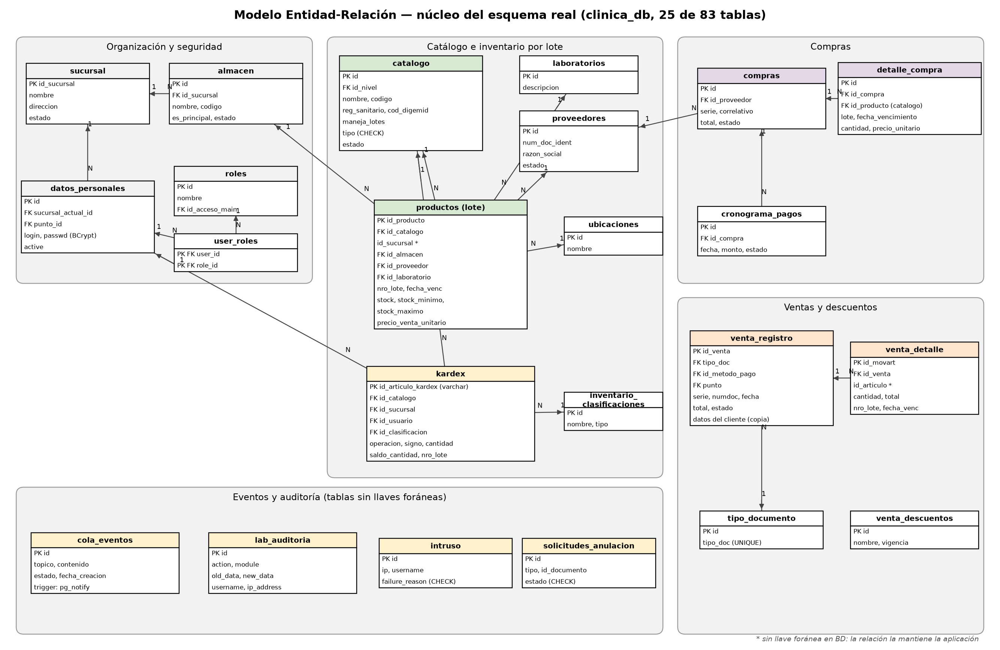

# CE022 - S2 - E2: Plataforma de Datos del Sistema

**ENTREGABLE 2**

**Plataforma de Datos del Sistema**

*(Alineado con CE022)*

**Modelado, implementación, programación, seguridad y administración de la base de datos real del ERP «Articulos» — Salud Total SAC**

<table>
<colgroup>
<col style="width: 37%" />
<col style="width: 62%" />
</colgroup>
<thead>
<tr class="header">
<th><strong>Título del sistema</strong></th>
<th>ERP «Articulos» — Salud Total SAC · Plataforma de datos (PostgreSQL 17)</th>
</tr>
</thead>
<tbody>
<tr class="odd">
<td><strong>Nombre del estudiante</strong></td>
<td>Gutierrez Anco Yesenia Alejandra 
Turpo Cauna Jose Samuel 
Quispe Huarilloclla Jhosef Antony</td>
</tr>
<tr class="even">
<td><strong>Semestre</strong></td>
<td>10</td>
</tr>
<tr class="odd">
<td><strong>Curso</strong></td>
<td>CE022 — Bases de Datos</td>
</tr>
<tr class="even">
<td><strong>Fecha</strong></td>
<td>Noviembre de 2026 — versión 2.0 (verificada contra el código y la base real)</td>
</tr>
</tbody>
</table>

## Resumen Ejecutivo

En Salud Total SAC —cadena de farmacias con clínica ambulatoria en Juliaca y Puno— cada venta, compra, transferencia o ajuste de inventario se convierte en transacciones sobre la base de datos del ERP «Articulos». De su consistencia dependen el stock por lote, el control de vencimientos (FEFO), la caja y los indicadores que el Business Case de CE01 se propuso mejorar: −67 % de quiebres de stock y menos mermas por vencimiento.

**Fuente de verdad.** Este entregable describe la base de datos que realmente usa el sistema: clinica_db sobre PostgreSQL 17.11, con un esquema de 83 tablas que Hibernate genera a partir de las 78 entidades JPA del backend (spring.jpa.hibernate.ddl-auto), más los objetos que crea el inicializador CoreDatabaseFunctionsInitializer. Todas las cifras y salidas provienen de consultas ejecutadas sobre esa base, o sobre clinica_db_e2, una copia exacta usada para las pruebas que modifican datos.

**Rol de los datos.** La aplicación concentra hoy la lógica de negocio en Java (VentaServiceImpl valida el stock y KardexService registra cada movimiento), mientras que la base aporta integridad referencial (97 llaves foráneas), 188 índices, 18 restricciones CHECK generadas desde enumerados y el canal de eventos del patrón Outbox: la tabla cola_eventos con el trigger trg_notify_evento_insert, que avisa al backend mediante pg_notify.

**Hallazgos y mejoras.** El análisis encontró brechas que este documento cuantifica y resuelve con scripts probados: Flyway está desactivado; no existen índices parciales ni CHECK de stock no negativo; el login no es único a nivel de BD; la aplicación se conecta como superusuario postgres; y la consulta más frecuente del kardex no tiene un índice adecuado. Se proponen y prueban funciones FEFO, un procedimiento de reabastecimiento integrado con el Outbox real, auditoría en BD, roles de mínimo privilegio, un índice compuesto (10 veces más rápido) y un simulacro de respaldo y restauración verificado.

## Sección 1: Modelo de Datos

### 1.1 Modelo Entidad-Relación

La figura 1.1 muestra el núcleo del modelo: 25 de las 83 tablas, agrupadas por dominio. Las relaciones corresponden a llaves foráneas que existen en clinica_db (verificadas en information_schema). Dos vínculos importantes no tienen llave foránea en la base y los mantiene la aplicación: productos.id_sucursal y venta_detalle.id_articulo. Las tablas de eventos y auditoría no tienen llaves foráneas por diseño, para registrar sin acoplarse.

*Figura 1.1 — Modelo Entidad-Relación del núcleo del esquema real (clinica_db).*

### 1.2 Modelo Lógico

El modelo lógico lo deriva Hibernate de las entidades JPA. Las decisiones de diseño que se observan en el esquema son:

- **Identidad:** 75 columnas de llave primaria son BIGINT GENERATED BY DEFAULT AS IDENTITY (GenerationType.IDENTITY). La excepción es kardex, cuya PK id_articulo_kardex es VARCHAR(50) generada por la aplicación.

- **Eliminación lógica:** 45 tablas tienen la columna estado (EstadoGeneral, 18 valores; ELIMINADO = 3). 21 entidades filtran con @SQLRestriction("estado != 3").

- **Auditoría de filas:** usuario_creacion/usuario_modificacion (26 tablas) y created_at/updated_at (24 tablas), completadas por @CreatedBy y @LastModifiedBy.

- **Lote como fila:** cada registro de productos es un lote (nro_lote, fecha_venc, stock) de un ítem de catalogo en una sucursal, con stock_minimo y stock_maximo.

- **Enumerados:** los @Enumerated(STRING) generan las 18 restricciones CHECK (p. ej. solicitudes_anulacion.estado ∈ {PENDIENTE, APROBADA, RECHAZADA}).

- **M:N:** user_roles, role_permissions y user_permissions; maestro-detalle en venta_registro/venta_detalle, compras/detalle_compra y transferencias.

### 1.3 Modelo Normalizado

El núcleo de inventario, compras y seguridad está en Tercera Forma Normal. Existen desnormalizaciones deliberadas, que se documentan con su justificación:

| Forma / caso           | Situación en el esquema real                                                                       | Justificación o acción                                                                               |
|------------------------|----------------------------------------------------------------------------------------------------|------------------------------------------------------------------------------------------------------|
| 1FN                    | Atributos atómicos; el detalle de ventas y compras va en filas separadas.                          | Cumple.                                                                                              |
| 2FN                    | Las tablas puente con clave compuesta no tienen atributos que dependan de parte de la clave.       | Cumple.                                                                                              |
| 3FN (núcleo)           | productos referencia catalogo, almacen, proveedores y laboratorios; los nombres viven en su tabla. | Cumple.                                                                                              |
| venta_registro         | 180 columnas: copia nombre, DNI, RUC y dirección del cliente al emitir.                            | Desnormalización intencional: el comprobante debe conservar los datos tal como se emitieron (SUNAT). |
| productos vs. catalogo | Precios y factores (blíster/caja) se repiten por lote y sucursal.                                  | Cada sede y lote puede tener precio propio; catalogo guarda el precio de referencia.                 |
| kardex                 | Guarda saldo_cantidad y saldo_costo_total acumulados.                                              | Optimiza la consulta de saldo; lo mantiene KardexService en la misma transacción.                    |
| bloque_modulos         | Única tabla sin llave primaria (colección @ElementCollection).                                     | Acción: añadir PK compuesta al habilitar Flyway.                                                     |

### 1.4 Diccionario de Datos

*Tabla 1.1 — Inventario de las 83 tablas por dominio.*

| Dominio                         | Tablas (principales)                                                                                                                                                                           | N.º |
|---------------------------------|------------------------------------------------------------------------------------------------------------------------------------------------------------------------------------------------|-----|
| Seguridad y acceso              | datos_personales, roles, permissions, user_roles, role_permissions, user_permissions, acceso_main, menu_items, sessiones, intruso…                                                             | 17  |
| Organización                    | datos_companias, datos_empresa, sucursal, almacen, puntos, puntos_tipo, puntos_proceso, configuracion…                                                                                         | 12  |
| Catálogo e inventario           | catalogo, productos, laboratorios, ubicaciones, unidad_medida, kardex, inventario_ajustes(\_detalle), inventario_transferencias(\_detalle), movimiento_diverso(\_detalle), principios_activos… | 18  |
| Compras y proveedores           | compras, detalle_compra, cronograma_pagos, proveedores, cuenta_proveedor(\_movimiento), deuda_proveedor                                                                                        | 7   |
| Ventas y caja                   | venta_registro, venta_detalle, venta_descuentos, venta_descuento_detalles, venta_beneficios, venta_reimpresion_log, tipo_documento, metodos_pago, caja_chica, caja_general…                    | 13  |
| Clínica                         | datos_clinica, datos_medico, datos_clinica_auditoria, tipo_paciente, tipos_atencion                                                                                                            | 5   |
| Documentos, eventos y auditoría | plantillas, documento_formatos, puntos_documento, puntos_documento_auditoria, cola_eventos, notificaciones, lab_auditoria, flujo_aprobacion, solicitudes_anulacion                             | 11  |

*Tabla 1.2 — Diccionario: productos (registro por lote; columnas principales de 52).*

| Columna                                                   | Tipo            | Nulo | Descripción                                                 |
|-----------------------------------------------------------|-----------------|------|-------------------------------------------------------------|
| id_producto                                               | bigint identity | No   | PK. Un registro por lote y sucursal                         |
| id_catalogo                                               | bigint          | No   | FK → catalogo                                               |
| id_sucursal                                               | bigint          | No   | Sede (sin FK en BD; la valida la aplicación)                |
| id_almacen / id_proveedor / id_laboratorio / id_ubicacion | bigint          | Sí   | FK → almacen / proveedores / laboratorios / ubicaciones     |
| nro_lote                                                  | varchar(50)     | Sí   | Número de lote del fabricante                               |
| fecha_venc                                                | date            | Sí   | Vencimiento del lote (base de FEFO y alertas)               |
| dias_alerta_vencimiento                                   | integer         | Sí   | Umbral de alerta (90 por defecto en AlertaSchedulerService) |
| stock / stock_minimo / stock_maximo                       | numeric(10,2)   | Sí   | Existencia, punto de reorden y nivel máximo                 |
| precio_compra / precio_venta_unitario                     | numeric(12,2)   | Sí   | Costo y precio de venta por unidad                          |
| cod_digemid / registro_invima_lote                        | varchar(50)     | Sí   | Códigos regulatorios del producto y del lote                |

*Tabla 1.3 — Diccionario: kardex.*

| Columna                                 | Tipo           | Nulo | Descripción                                      |
|-----------------------------------------|----------------|------|--------------------------------------------------|
| id_articulo_kardex                      | varchar(50)    | No   | PK generada por la aplicación                    |
| id_catalogo / id_sucursal / id_usuario  | bigint         | No   | FK → catalogo / sucursal / datos_personales      |
| id_clasificacion                        | bigint         | Sí   | FK → inventario_clasificaciones (motivo)         |
| fecha                                   | timestamp      | No   | Momento del movimiento (indexado)                |
| operacion / signo                       | varchar        | No   | VENTA, COMPRA, AJUSTE… / '+' entrada, '-' salida |
| cantidad / costo_unitario / costo_total | numeric(12,4)  | No   | Valores del movimiento                           |
| saldo_cantidad / saldo_costo_total      | numeric(12,4)  | No   | Saldo acumulado tras el movimiento               |
| nro_lote / fecha_venc                   | varchar / date | Sí   | Lote afectado                                    |
| origen_tipo / origen_id                 | varchar        | No   | Documento que originó el movimiento (VTA, CMP…)  |

*Tabla 1.4 — Diccionario: cola_eventos (Outbox).*

| Columna                          | Tipo            | Nulo | Descripción                                                  |
|----------------------------------|-----------------|------|--------------------------------------------------------------|
| id                               | bigint identity | No   | PK                                                           |
| topico                           | varchar(100)    | No   | sistema.notificaciones, compras.pago.realizado…              |
| modulo / titulo / tipo           | varchar         | Sí   | Origen y presentación del aviso                              |
| contenido                        | text            | Sí   | Carga JSON del evento                                        |
| estado                           | varchar(20)     | Sí   | PENDIENTE → PROCESADO / ERROR (PostgresEventListenerService) |
| fecha_creacion / fecha_procesado | timestamp       | Sí   | Trazabilidad del procesamiento                               |

## Sección 2: Implementación de Base de Datos

La base se implementa en PostgreSQL 17.11 (instalación local en el perfil local; PostgreSQL gestionado en el perfil supabase). Se crea en tres pasos al arrancar el backend:

- **DDL:** Hibernate crea o actualiza las tablas a partir de las entidades (ddl-auto=update en local; create en supabase, que recrea el esquema). La dependencia Flyway está incluida, pero spring.flyway.enabled=false.

- **Objetos de BD:** CoreDatabaseFunctionsInitializer ejecuta por JDBC la función notify_evento_insert y el trigger trg_notify_evento_insert.

- **DML inicial:** DataInitializer y CoreBusinessInitializer cargan roles, permisos, menús, sucursal, plantillas y usuarios desde los JSON de src/main/resources/data/seed.

### 2.1 Scripts DDL

El archivo 01_ddl_esquema_real.sql (5 396 líneas) es el DDL completo extraído con pg_dump --schema-only de clinica_db. Extracto real:

CREATE TABLE public.cola_eventos (

id bigint NOT NULL,

contenido text,

estado character varying(20),

fecha_creacion timestamp(6) without time zone,

fecha_procesado timestamp(6) without time zone,

modulo character varying(50),

tipo character varying(50),

titulo character varying(100),

topico character varying(100) NOT NULL

);

-- productos (52 columnas; se muestran las de inventario)

CREATE TABLE public.productos (

id_producto bigint NOT NULL,

...

fecha_venc date,

id_almacen bigint,

id_catalogo bigint NOT NULL,

id_sucursal bigint NOT NULL,

nro_lote character varying(50),

stock numeric(10,2),

stock_maximo numeric(10,2),

stock_minimo numeric(10,2),

...

);

ALTER TABLE ONLY public.productos ADD CONSTRAINT productos_pkey PRIMARY KEY (id_producto);

ALTER TABLE ONLY public.productos ADD CONSTRAINT fkohh7lchwdivjj5b2vactdl88w

FOREIGN KEY (id_almacen) REFERENCES public.almacen(id);

CREATE INDEX idx_producto_catalogo ON public.productos USING btree (id_catalogo);

CREATE INDEX idx_producto_sucursal ON public.productos USING btree (id_sucursal);

*Código 2.1 — DDL real generado por Hibernate (extracto de pg_dump).*

### 2.2 Scripts DML

Además de la semilla de los inicializadores, el script 02_dml_datos_prueba.sql carga en la copia clinica_db_e2 un escenario de Salud Total: la sede central de Juliaca (la semilla trae «Sede Principal, Lima»), la sucursal Puno con su almacén y lotes con vencimiento y punto de reorden. Respeta el esquema real (INSERT … SELECT para heredar las columnas obligatorias de almacen y productos).

-- 3. Segundo lote de Paracetamol (vence antes → debe salir primero por FEFO) y lotes en Puno

INSERT INTO productos (id_catalogo, id_sucursal, id_almacen, nro_lote, fecha_venc, stock, stock_minimo,

stock_maximo,

precio_compra, precio_venta_unitario, dias_alerta_vencimiento, presentacion,

fecha_reg, usuario_crea)

SELECT id_catalogo, 1, 1, 'L-2105', current_date + 40, 80, 100, 600, precio_compra, precio_venta_unitario,

90, presentacion, now(), 'dml_e2'

FROM productos WHERE id_producto = 1;

INSERT INTO productos (id_catalogo, id_sucursal, id_almacen, nro_lote, fecha_venc, stock, stock_minimo,

stock_maximo,

precio_compra, precio_venta_unitario, dias_alerta_vencimiento, presentacion,

fecha_reg, usuario_crea)

SELECT p.id_catalogo, 2, (SELECT id FROM almacen WHERE codigo = 'ALM-PUN'), v.lote, v.venc, v.stock,

v.minimo, v.maximo,

p.precio_compra, p.precio_venta_unitario, 90, p.presentacion, now(), 'dml_e2'

FROM productos p

JOIN (VALUES (1, 'L-2290', DATE '2027-01-12', 140::numeric, 60::numeric, 300::numeric),

(2, 'L-1181', current_date + 20, 18::numeric, 60::numeric, 120::numeric),

(5, 'L-7714', current_date - 5, 12::numeric, 30::numeric, 150::numeric)) v(id, lote,

venc, stock, minimo, maximo)

ON v.id = p.id_producto;

*Código 2.2 — Carga de lotes para FEFO y reabastecimiento.*

=== Lotes cargados por sede (FEFO: ordenados por vencimiento) ===

sede \| producto \| nro_lote \| fecha_venc \| stock \| stock_minimo

----------------------+------------------------+----------+------------+--------+--------------

Sede Central Juliaca \| AMOXICILINA 500MG CAP \| L-1180 \| 2026-12-13 \| 300.00 \| 60.00

Sede Central Juliaca \| AZITROMICINA 500MG TAB \| L-3310 \| 2027-01-27 \| 200.00 \| 40.00

Sede Central Juliaca \| CETIRIZINA 10MG TAB \| L-7713 \| 2026-12-03 \| 400.00 \| 30.00

Sede Central Juliaca \| IBUPROFENO 400MG TAB \| L-0444 \| 2027-08-30 \| 450.00 \| 80.00

Sede Central Juliaca \| OMEPRAZOL 20MG CAP \| L-0932 \| 2027-02-28 \| 350.00 \| 50.00

Sede Central Juliaca \| PARACETAMOL 500MG TAB \| L-2105 \| 2026-12-28 \| 80.00 \| 100.00

Sede Central Juliaca \| PARACETAMOL 500MG TAB \| L-2291 \| 2027-01-12 \| 500.00 \| 100.00

Sucursal Puno \| AMOXICILINA 500MG CAP \| L-1181 \| 2026-12-08 \| 18.00 \| 60.00

Sucursal Puno \| CETIRIZINA 10MG TAB \| L-7714 \| 2026-11-13 \| 12.00 \| 30.00

Sucursal Puno \| PARACETAMOL 500MG TAB \| L-2290 \| 2027-01-12 \| 140.00 \| 60.00

(10 rows)

*Evidencia 2.1 — Lotes por sede ordenados por vencimiento (clinica_db_e2).*

### 2.3 Evidencias de Creación de Tablas, Relaciones y Restricciones

clinica_db=\> SELECT version();

PostgreSQL 17.11 on x86_64-windows, compiled by msvc-19.44.35228, 64-bit

clinica_db=\> -- Inventario de objetos del esquema public

tablas \| pk \| fk \| checks \| uniques \| indices \| parciales \| triggers \| tamano

--------+----+----+--------+---------+---------+-----------+----------+--------

83 \| 82 \| 97 \| 18 \| 7 \| 188 \| 0 \| 1 \| 13 MB

(1 row)

clinica_db=\> -- Roles con los que se conecta la aplicación (application-local.properties: username=postgres)

rolname \| superusuario \| login

----------+--------------+-------

postgres \| t \| t

(1 row)

*Evidencia 2.2 — Inventario real de objetos de clinica_db y rol de conexión.*

Las 18 restricciones CHECK y las 7 UNIQUE las generó Hibernate (enumerados y @Column(unique = true)). No hay índices parciales ni restricciones de negocio como stock \>= 0. La tabla bloque_modulos no tiene llave primaria.

## Sección 3: Consultas y Programación en Base de Datos

### 3.1 Consultas SQL Relevantes

Las consultas son las que ejecuta la aplicación, copiadas de los repositorios Spring Data (consultas nativas o JPQL traducidas), con parámetros de prueba:

\echo '=== C1. ProductoRepository.findProductosEnAlertaVencimientoPorSucursal (AlertaSchedulerService,

diario) ==='

SELECT p.id_producto, p.nro_lote, p.fecha_venc, p.fecha_venc - current_date AS dias_restantes,

COALESCE(p.dias_alerta_vencimiento, 90) AS umbral

FROM productos p

WHERE p.id_sucursal = 1 AND p.fecha_venc IS NOT NULL

AND p.fecha_venc \>= CAST(current_date AS date)

AND p.fecha_venc \<= (CAST(current_date AS date) + COALESCE(p.dias_alerta_vencimiento, 90))

ORDER BY p.fecha_venc;

*Código 3.1 — ProductoRepository.findProductosEnAlertaVencimientoPorSucursal (la usa AlertaSchedulerService cada día).*

=== C1. ProductoRepository.findProductosEnAlertaVencimientoPorSucursal (AlertaSchedulerService, diario) ===

id_producto \| nro_lote \| fecha_venc \| dias_restantes \| umbral

-------------+----------+------------+----------------+--------

5 \| L-7713 \| 2026-12-03 \| 15 \| 60

2 \| L-1180 \| 2026-12-13 \| 25 \| 90

11 \| L-2105 \| 2026-12-28 \| 40 \| 90

1 \| L-2291 \| 2027-01-12 \| 55 \| 90

4 \| L-3310 \| 2027-01-27 \| 70 \| 90

(5 rows)

=== C2. ProductoRepository.findStockCriticoPorSucursal (JPQL: p.stock \<= p.stockMinimo AND p.stockMinimo \> 0)

===

id_producto \| nombre_catalogo \| nro_lote \| stock \| stock_minimo

-------------+-----------------------+----------+-------+--------------

13 \| AMOXICILINA 500MG CAP \| L-1181 \| 18.00 \| 60.00

14 \| CETIRIZINA 10MG TAB \| L-7714 \| 12.00 \| 30.00

(2 rows)

=== C3. Búsqueda para venta (JPQL con LOWER/CONCAT, soloVenta = true: excluye vencidos) ===

id_producto \| nombre \| nro_lote \| fecha_venc \| precio_venta_unitario

-------------+-----------------------+----------+------------+-----------------------

13 \| AMOXICILINA 500MG CAP \| L-1181 \| 2026-12-08 \| 15.00

(1 row)

=== C5. Productos más vendidos (venta_detalle.id_articulo -\> productos -\> catalogo) ===

nombre_catalogo \| unidades \| importe

------------------------+----------+---------

AMOXICILINA 500MG CAP \| 42.00 \| 630.00

AZITROMICINA 500MG TAB \| 33.00 \| 726.00

PERFIL LIPIDICO \| 32.00 \| 1600.00

PARACETAMOL 500MG TAB \| 28.00 \| 224.00

IBUPROFENO 400MG TAB \| 22.00 \| 220.00

(5 rows)

*Evidencia 3.1 — Alertas de vencimiento, stock crítico, búsqueda para venta (excluye vencidos) y productos más vendidos.*

Hallazgo: en los datos reales venta_detalle.id_catalogo está vacío en las 149 filas; el vínculo efectivo con el producto es id_articulo (el lote), que no tiene llave foránea.

### 3.2 Funciones

La única función real del sistema es notify_evento_insert (parte A de 03_programabilidad.sql). Se añaden tres funciones complementarias que hoy no invoca la aplicación y que implementan en la BD reglas del E1: fn_stock_vigente, fn_lote_fefo (RF-24) y fn_stock_valorizado.

CREATE OR REPLACE FUNCTION fn_lote_fefo(p_id_catalogo BIGINT, p_id_sucursal BIGINT)

RETURNS TABLE (id_producto BIGINT, nro_lote VARCHAR, fecha_venc DATE, stock NUMERIC, dias_para_vencer INTEGER)

LANGUAGE sql STABLE AS \$\$

SELECT p.id_producto, p.nro_lote, p.fecha_venc, p.stock, (p.fecha_venc - current_date)

FROM productos p

WHERE p.id_catalogo = p_id_catalogo

AND p.id_sucursal = p_id_sucursal

AND p.stock \> 0

AND p.fecha_venc \>= current_date

ORDER BY p.fecha_venc ASC, p.id_producto ASC;

\$\$;

*Código 3.2 — fn_lote_fefo: lote con el vencimiento más próximo, excluyendo vencidos y sin stock.*

=== P2. fn_lote_fefo: Paracetamol en Juliaca (debe salir primero L-2105) ===

id_producto \| nro_lote \| fecha_venc \| stock \| dias_para_vencer

-------------+----------+------------+--------+------------------

11 \| L-2105 \| 2026-12-28 \| 80.00 \| 40

1 \| L-2291 \| 2027-01-12 \| 500.00 \| 55

(2 rows)

=== P3. fn_lote_fefo: Cetirizina en Puno (lote L-7714 vencido -\> no se ofrece) ===

id_producto \| nro_lote \| fecha_venc \| stock \| dias_para_vencer

-------------+----------+------------+-------+------------------

(0 rows)

*Evidencia 3.2 — FEFO en Juliaca (sale primero L-2105) y en Puno (el lote vencido L-7714 no se ofrece).*

### 3.3 Procedimientos Almacenados

El sistema no tiene procedimientos almacenados. Se propone sp_generar_ordenes_reabastecimiento (TO-BE RF-27, CU-04 del E1) junto con la tabla orden_reabastecimiento. El procedimiento agrupa los lotes vigentes por producto y sede, detecta los que están en o bajo el punto de reorden y crea una orden. Un índice único parcial garantiza una sola orden abierta por producto y sede (RN-12). Cada orden publica un evento en la cola_eventos real, de modo que el backend la recibe por el mismo canal LISTEN/NOTIFY que ya usa.

CREATE OR REPLACE PROCEDURE sp_generar_ordenes_reabastecimiento(IN p_id_sucursal BIGINT, INOUT p_generadas

INTEGER DEFAULT 0)

LANGUAGE plpgsql AS \$\$

DECLARE

r RECORD;

BEGIN

p_generadas := 0;

FOR r IN

SELECT p.id_catalogo,

SUM(CASE WHEN p.fecha_venc IS NULL OR p.fecha_venc \>= current_date THEN p.stock ELSE 0 END) AS

stock_vigente,

MAX(p.stock_minimo) AS minimo,

MAX(p.stock_maximo) AS maximo

FROM productos p

WHERE p.id_sucursal = p_id_sucursal

GROUP BY p.id_catalogo

HAVING MAX(p.stock_minimo) \> 0

AND SUM(CASE WHEN p.fecha_venc IS NULL OR p.fecha_venc \>= current_date THEN p.stock ELSE 0 END) \<=

MAX(p.stock_minimo)

LOOP

INSERT INTO orden_reabastecimiento (id_catalogo, id_sucursal, stock_al_generar, stock_minimo,

cantidad_sugerida)

VALUES (r.id_catalogo, p_id_sucursal, r.stock_vigente, r.minimo,

GREATEST(COALESCE(r.maximo, r.minimo \* 2) - r.stock_vigente, 1))

ON CONFLICT DO NOTHING;

IF FOUND THEN

p_generadas := p_generadas + 1;

-- Se integra con el Outbox real: el trigger trg_notify_evento_insert emite pg_notify

INSERT INTO cola_eventos (modulo, topico, titulo, contenido, tipo, estado, fecha_creacion)

VALUES ('INVENTARIO', 'inventario.reabastecimiento', 'Orden de reabastecimiento generada',

json_build_object('idCatalogo', r.id_catalogo, 'idSucursal', p_id_sucursal,

'stock', r.stock_vigente, 'minimo', r.minimo)::text,

'INFO', 'PENDIENTE', now());

END IF;

END LOOP;

END;

\$\$;

*Código 3.3 — Procedimiento sp_generar_ordenes_reabastecimiento.*

=== P4. sp_generar_ordenes_reabastecimiento (Puno) ===

p_generadas

-------------

2

(1 row)

Asynchronous notification "nuevo_evento_outbox" with payload "{"id":2,"contenido":"{\\idCatalogo\\ : 5,

\\idSucursal\\ : 2, \\stock\\ : 0, \\minimo\\ :

30.00}","estado":"PENDIENTE","fecha_creacion":"2026-11-18T20:53:57.656609","fecha_procesado":null,"modulo"

:"INVENTARIO","tipo":"INFO","titulo":"Orden de reabastecimiento

generada","topico":"inventario.reabastecimiento"}" received from server process with PID 23792.

Asynchronous notification "nuevo_evento_outbox" with payload "{"id":3,"contenido":"{\\idCatalogo\\ : 2,

\\idSucursal\\ : 2, \\stock\\ : 18.00, \\minimo\\ :

60.00}","estado":"PENDIENTE","fecha_creacion":"2026-11-18T20:53:57.656609","fecha_procesado":null,"modulo"

:"INVENTARIO","tipo":"INFO","titulo":"Orden de reabastecimiento

generada","topico":"inventario.reabastecimiento"}" received from server process with PID 23792.

id \| nombre_catalogo \| stock_al_generar \| stock_minimo \| cantidad_sugerida \| estado

----+-----------------------+------------------+--------------+-------------------+-----------

1 \| CETIRIZINA 10MG TAB \| 0.00 \| 30.00 \| 150.00 \| PENDIENTE

2 \| AMOXICILINA 500MG CAP \| 18.00 \| 60.00 \| 102.00 \| PENDIENTE

(2 rows)

=== P5. Segunda ejecución: no duplica órdenes abiertas (índice único parcial) ===

p_generadas

-------------

0

(1 row)

=== P6. Eventos generados en el Outbox real ===

id \| topico \| titulo \| estado

----+-----------------------------+------------------------------------+-----------

1 \| sistema.notificaciones \| Prueba de notificación \| PENDIENTE

2 \| inventario.reabastecimiento \| Orden de reabastecimiento generada \| PENDIENTE

3 \| inventario.reabastecimiento \| Orden de reabastecimiento generada \| PENDIENTE

(3 rows)

*Evidencia 3.3 — Dos órdenes generadas en Puno, notificaciones recibidas por LISTEN y sin duplicados al repetir.*

### 3.4 Triggers

**Trigger real:** trg_notify_evento_insert (AFTER INSERT ON cola_eventos) ejecuta pg_notify('nuevo_evento_outbox', fila en JSON). PostgresEventListenerService mantiene un LISTEN en un hilo dedicado y, al recibir el aviso, procesa los eventos PENDIENTE (con un sondeo de respaldo cada 30 s).

CREATE OR REPLACE FUNCTION notify_evento_insert()

RETURNS trigger AS \$\$

BEGIN

PERFORM pg_notify('nuevo_evento_outbox', row_to_json(NEW)::text);

RETURN NEW;

END;

\$\$ LANGUAGE plpgsql;

DROP TRIGGER IF EXISTS trg_notify_evento_insert ON cola_eventos;

CREATE TRIGGER trg_notify_evento_insert

AFTER INSERT ON cola_eventos

FOR EACH ROW EXECUTE FUNCTION notify_evento_insert();

=== P1. Outbox real: LISTEN + INSERT en cola_eventos -\> pg_notify ===

LISTEN

INSERT 0 1

Asynchronous notification "nuevo_evento_outbox" with payload

"{"id":1,"contenido":"{\\userId\\:\\\\,\\titulo\\:\\Prueba\\}","estado":"PENDIENTE","fecha_creacion":"2026

-11-18T20:53:57.650118","fecha_procesado":null,"modulo":"VENTAS","tipo":"INFO","titulo":"Prueba de

notificación","topico":"sistema.notificaciones"}" received from server process with PID 23792.

espera_notificacion

---------------------

1

(1 row)

*Código 3.4 y Evidencia 3.4 — Trigger real del Outbox y notificación recibida por LISTEN.*

**Triggers complementarios:** trg_auditar_producto registra en lab_auditoria los cambios de stock o precio hechos directamente en la base, fuera de la aplicación. Además, la restricción ck_productos_stock_no_negativo impide que un error deje el stock negativo, regla que hoy solo valida VentaServiceImpl.

=== P7. Trigger de auditoría: cambio de precio y stock fuera de la app ===

UPDATE 1

id \| action \| module \| details \| method \|

username

----+-----------+-----------+---------------------------------------------------------------+------------+----

------

9 \| UPDATE_BD \| productos \| Producto 1 lote L-2291: stock 500.00→490.00, precio 8.00→8.50 \| DB-TRIGGER \|

postgres

(1 row)

=== P8. CHECK stock \>= 0: un stock negativo se rechaza ===

psql:03b_pruebas_programabilidad.sql:32: ERROR: el nuevo registro para la relación «productos» viola la

restricción «check» «ck_productos_stock_no_negativo»

DETAIL: La fila que falla contiene (3, null, MED003, null, 90, null, null, null, 2026-10-12 08:11:29.065317,

2027-08-30, null, null, null, null, null, null, 1, 3, 1, null, 1, null, null, null, null, null, L-0444,

null, null, 3.00, null, null, null, 10.00, null, null, -5.00, null, null, 500.00, 80.00, 450.00, null,

null, null, null, null, null, null, null, null).

*Evidencia 3.5 — Auditoría automática en BD y rechazo de stock negativo.*

### 3.5 Planes de Ejecución y Optimización

KardexRepository.findLastMovement se ejecuta en cada movimiento de inventario (cada línea de venta) para calcular el saldo. Con 300 000 movimientos cargados en la copia, el planificador usa el índice de una columna idx_kardex_fecha y filtra en memoria. Un índice compuesto que coincide con el WHERE y el ORDER BY resuelve la consulta leyendo una sola entrada:

=== ANTES: plan con los índices actuales (una columna) ===

QUERY PLAN

------------------------------------------------------------------------------------------------------------

Limit (actual time=1.097..1.097 rows=1 loops=1)

Buffers: shared hit=3025

-\> Incremental Sort (actual time=1.097..1.097 rows=1 loops=1)

Sort Key: fecha DESC, id_articulo_kardex DESC

Presorted Key: fecha

Full-sort Groups: 1 Sort Method: quicksort Average Memory: 25kB Peak Memory: 25kB

Buffers: shared hit=3025

-\> Index Scan Backward using idx_kardex_fecha on kardex (actual time=1.087..1.087 rows=2 loops=1)

Filter: ((id_catalogo = 3) AND (id_sucursal = 1))

Rows Removed by Filter: 2996

Buffers: shared hit=3025

Planning:

Buffers: shared hit=84

Planning Time: 0.187 ms

Execution Time: 1.112 ms

(15 rows)

=== Índice compuesto propuesto (coincide con WHERE + ORDER BY) ===

CREATE INDEX

ANALYZE

=== DESPUÉS: plan con idx_kardex_ultimo_mov ===

QUERY PLAN

--------------------------------------------------------------------------------------------------

Limit (actual time=0.083..0.083 rows=1 loops=1)

Buffers: shared hit=4 read=3

-\> Index Scan using idx_kardex_ultimo_mov on kardex (actual time=0.082..0.082 rows=1 loops=1)

Index Cond: ((id_catalogo = 3) AND (id_sucursal = 1))

Buffers: shared hit=4 read=3

Planning:

Buffers: shared hit=111 read=1

Planning Time: 0.333 ms

Execution Time: 0.108 ms

(9 rows)

*Evidencia 3.6 — EXPLAIN (ANALYZE, BUFFERS) antes y después del índice idx_kardex_ultimo_mov.*

Resultado: el tiempo de ejecución bajó de 1,11 ms a 0,11 ms (10 veces menos) y los bloques leídos de 3 025 a 7. Como la consulta corre en cada línea de venta, la mejora se multiplica en las horas punta. El índice se incluirá en la primera migración de Flyway.

## Sección 4: Seguridad y Administración

### 4.1 Usuarios y Roles

**Nivel aplicación (real):** control de acceso por roles y permisos en las tablas roles (5), permissions (34), user_roles, role_permissions y user_permissions, aplicado con @PreAuthorize (p. ej. VENTA_CREAR) y JWT firmado con RSA. Las contraseñas se guardan con BCrypt en datos_personales.passwd.

**Nivel base de datos (hallazgo):** la aplicación se conecta como postgres, un superusuario (Evidencia 2.2). Cualquier falla de la aplicación tendría privilegios totales sobre el servidor. 06_seguridad.sql define tres roles de mínimo privilegio para producción: st_app (DML sin DELETE físico, coherente con el soft-delete), st_reportes (solo lectura, sin tablas de credenciales ni datos clínicos) y st_dba (migraciones).

-- st_app: lo que necesita el backend en ejecución (DML, sin DDL ni DELETE físico: soft-delete)

GRANT SELECT, INSERT, UPDATE ON ALL TABLES IN SCHEMA public TO st_app;

GRANT USAGE, SELECT ON ALL SEQUENCES IN SCHEMA public TO st_app;

-- Las bitácoras solo admiten inserción (no se pueden alterar)

REVOKE UPDATE ON lab_auditoria, intruso, datos_clinica_auditoria, puntos_documento_auditoria FROM st_app;

-- Excepciones donde el código sí borra físicamente (tablas puente de seguridad y sesiones)

GRANT DELETE ON user_roles, role_permissions, user_permissions, sessiones TO st_app;

-- st_reportes: solo lectura, sin datos clínicos ni de credenciales

GRANT SELECT ON ALL TABLES IN SCHEMA public TO st_reportes;

REVOKE SELECT ON datos_personales, datos_clinica, datos_medico, sessiones, intruso FROM st_reportes;

*Código 4.1 — Privilegios del rol de la aplicación.*

=== Privilegios efectivos por rol (resumen) ===

grantee \| privilege_type \| tablas

-------------+----------------+--------

st_app \| DELETE \| 4

st_app \| INSERT \| 84

st_app \| SELECT \| 84

st_app \| UPDATE \| 80

st_dba \| DELETE \| 84

st_dba \| INSERT \| 84

st_dba \| REFERENCES \| 84

st_dba \| SELECT \| 84

st_dba \| TRIGGER \| 84

st_dba \| TRUNCATE \| 84

st_dba \| UPDATE \| 84

st_reportes \| SELECT \| 79

(12 rows)

=== Prueba 1: st_app intenta borrar físicamente una venta ===

SET

psql:06_seguridad.sql:43: ERROR: permiso denegado a la tabla venta_registro

=== Prueba 2: st_app intenta alterar la bitácora de auditoría ===

psql:06_seguridad.sql:45: ERROR: permiso denegado a la tabla lab_auditoria

=== Prueba 3: st_app sí puede registrar (soft-delete = UPDATE de estado) ===

BEGIN

UPDATE 1

ROLLBACK

RESET

=== Prueba 4: st_reportes intenta leer credenciales de usuarios ===

SET

psql:06_seguridad.sql:51: ERROR: permiso denegado a la tabla datos_personales

=== Prueba 5: st_reportes sí lee ventas ===

ventas

--------

60

(1 row)

RESET

*Evidencia 4.1 — Privilegios efectivos y pruebas de denegación con SET ROLE.*

### 4.2 Auditoría Implementada

La auditoría del sistema es de aplicación, en cuatro niveles:

- **Bitácora de acciones:** AuditService escribe en lab_auditoria el módulo, la acción, los datos anteriores y nuevos, el usuario, la IP y el user-agent (login, cambios de compañía, empresa, médicos, niveles y permisos).

- **Seguridad:** SecurityMonitorService registra los intentos fallidos en intruso y las sesiones en sessiones (con detección de cambio de IP).

- **Dominio:** datos_clinica_auditoria y puntos_documento_auditoria guardan el historial de la configuración clínica y de documentos.

- **Filas:** @CreatedBy, @LastModifiedBy y las marcas de tiempo en 26 tablas.

=== A1. Bitácora real de la aplicación (lab_auditoria, escrita por AuditService) ===

id \| action \| module \| username \| status \| fecha \| method

----+---------------+--------+-----------------+--------+------------------+--------

1 \| LOGIN_FAILED \| LOGIN \| admin \| Fallo \| 2026-10-12 07:50 \| POST

2 \| LOGIN_SUCCESS \| LOGIN \| admin-articulos \| Éxito \| 2026-10-12 07:52 \| POST

3 \| LOGIN_SUCCESS \| LOGIN \| admin-articulos \| Éxito \| 2026-10-12 08:12 \| POST

4 \| LOGIN_SUCCESS \| LOGIN \| admin-articulos \| Éxito \| 2026-10-12 08:13 \| POST

5 \| LOGIN_SUCCESS \| LOGIN \| admin-articulos \| Éxito \| 2026-10-12 08:48 \| POST

6 \| LOGIN_SUCCESS \| LOGIN \| admin-articulos \| Éxito \| 2026-11-18 20:09 \| POST

7 \| LOGIN_SUCCESS \| LOGIN \| admin-articulos \| Éxito \| 2026-11-18 20:22 \| POST

(7 rows)

=== A2. Otras tablas de auditoría y seguridad del sistema ===

tabla \| registros

----------------------------+-----------

lab_auditoria \| 7

intruso \| 1

sessiones \| 6

datos_clinica_auditoria \| 0

puntos_documento_auditoria \| 0

(5 rows)

=== A3. Columnas de auditoría JPA (@CreatedBy/@LastModifiedBy) presentes en el esquema ===

column_name \| tablas

----------------------+--------

usuario_creacion \| 26

usuario_modificacion \| 25

created_at \| 24

updated_at \| 24

created_by \| 11

updated_by \| 7

(6 rows)

*Evidencia 4.2 — Auditoría real registrada por la aplicación en clinica_db.*

Brecha: lo que se modifica directamente en la base no deja rastro. El trigger complementario trg_auditar_producto (Evidencia 3.5) cubre stock y precios, y 06_seguridad.sql quita al rol de la aplicación el permiso UPDATE sobre las bitácoras, para que no puedan alterarse.

### 4.3 Estrategias de Respaldo y Recuperación

| Entorno                | Estrategia                                                                                                      | RPO / RTO              |
|------------------------|-----------------------------------------------------------------------------------------------------------------|------------------------|
| Desarrollo (local)     | pg_dump formato custom diario (08_respaldo_restauracion.ps1) + simulacro de restauración mensual                | 24 h / 1 h             |
| Producción (AWS, CE03) | RDS PostgreSQL Multi-AZ: snapshots automáticos con PITR (retención 7 días) + pg_dump diario cifrado en S3 (SSE) | ≤ 5 min (PITR) / ≤ 4 h |
| Contingencia local     | Réplica del último dump en el host ESXi de Juliaca                                                              | 24 h / 4 h             |

PS\> pg_dump -h localhost -U postgres -d clinica_db_e2 -F c -Z 6 -f respaldo_clinica_db_e2.dump

Respaldo generado: respaldo_clinica_db_e2.dump 5032839 bytes (0.8 s)

PS\> createdb clinica_db_e2_restore ; pg_restore -d clinica_db_e2_restore --no-owner

respaldo_clinica_db_e2.dump

Restauración completada en 5.6 s

--- Conteos en ORIGEN (clinica_db_e2) ---

t \| count

------------------------+--------

kardex \| 300000

orden_reabastecimiento \| 2

productos \| 14

venta_detalle \| 149

venta_registro \| 60

(5 rows)

--- Conteos en RESTAURADA (clinica_db_e2_restore) ---

t \| count

------------------------+--------

kardex \| 300000

orden_reabastecimiento \| 2

productos \| 14

venta_detalle \| 149

venta_registro \| 60

(5 rows)

--- Objetos programados restaurados ---

trigger_name \| event_object_table

--------------------------+--------------------

trg_auditar_producto \| productos

trg_notify_evento_insert \| cola_eventos

(2 rows)

PS\> dropdb clinica_db_e2_restore (simulacro finalizado)

*Evidencia 4.3 — Respaldo, restauración en una base nueva y verificación de conteos y triggers.*

### 4.4 Evidencias de Monitoreo

07_monitoreo.sql reúne las consultas de administración sobre las vistas estadísticas de PostgreSQL 17, más dos indicadores propios del sistema: la salud del Outbox (eventos por estado) y los intentos de acceso fallidos.

=== M2. Tablas más grandes ===

tabla \| tamano_total \| filas_vivas \| filas_muertas

---------------+--------------+-------------+---------------

kardex \| 96 MB \| 300000 \| 0

sessiones \| 160 kB \| 6 \| 0

datos_clinica \| 144 kB \| 1 \| 0

bloques \| 128 kB \| 132 \| 0

plantillas \| 112 kB \| 7 \| 0

catalogo \| 96 kB \| 10 \| 0

(6 rows)

=== M3. Uso de índices de kardex ===

indice \| veces_usado \| tamano

-----------------------+-------------+---------

idx_kardex_sucursal \| 1 \| 1904 kB

idx_kardex_fecha \| 1 \| 7888 kB

idx_kardex_ultimo_mov \| 1 \| 16 MB

kardex_pkey \| 0 \| 14 MB

idx_kardex_catalogo \| 0 \| 1936 kB

(5 rows)

=== M4. Índices nunca usados (candidatos a revisión) ===

tabla \| indices_sin_uso

-------------------------+-----------------

sessiones \| 6

datos_medico \| 6

caja_general_movimiento \| 4

caja_chica \| 4

catalogo \| 4

(5 rows)

=== M5. Proporción de aciertos en caché ===

cache_hit_pct

---------------

100.00

(1 row)

=== M7. Salud del Outbox (eventos por estado) ===

estado \| count

-----------+-------

PENDIENTE \| 3

(1 row)

=== M8. Intentos de acceso fallidos registrados por la app (tabla intruso) ===

failure_reason \| count

---------------------+-------

INVALID_CREDENTIALS \| 1

(1 row)

*Evidencia 4.4 — Tamaño de tablas, uso de índices, índices sin uso, caché, Outbox e intentos fallidos (clinica_db_e2).*

Lectura: kardex concentra el volumen (96 MB con 300 000 filas) y el índice nuevo ya se usa. Varias tablas tienen índices nunca usados, que deben revisarse con carga real antes de eliminarlos. Los eventos en estado PENDIENTE se deben a que en la copia no corre el backend que los procesa.

## Anexos

### Anexo A: Scripts Completos

Se entregan en Entregable2_Scripts_SQL.zip. Cada script indica si refleja el sistema real o es complementario:

| Archivo                         | Contenido                                                                     | Tipo                  |
|---------------------------------|-------------------------------------------------------------------------------|-----------------------|
| 01_ddl_esquema_real.sql         | DDL completo de clinica_db (pg_dump --schema-only)                            | Real                  |
| 02_dml_datos_prueba.sql         | Sedes Juliaca y Puno, lotes, vencimientos y punto de reorden                  | Datos de prueba       |
| 03_programabilidad.sql          | A: Outbox real. B: FEFO, stock valorizado, reabastecimiento, auditoría, CHECK | Real + complementario |
| 03b_pruebas_programabilidad.sql | Pruebas P1–P9                                                                 | Pruebas               |
| 04_consultas.sql                | Consultas de los repositorios de la aplicación                                | Real                  |
| 05_optimizacion.sql             | Carga de 300 000 movimientos y EXPLAIN antes y después                        | Pruebas + propuesta   |
| 06_seguridad.sql                | Roles st_app, st_reportes y st_dba con pruebas                                | Propuesta             |
| 07_monitoreo.sql                | Consultas de monitoreo                                                        | Administración        |
| 08_respaldo_restauracion.ps1    | Respaldo, restauración y verificación                                         | Administración        |
| salidas/\*.txt                  | Salidas de psql sin editar                                                    | Evidencia             |

### Anexo B: Capturas de Ejecución y Resultados de Consultas

Las salidas de psql están en las Evidencias 2.1 a 4.4 y en la carpeta salidas/ del ZIP. Se obtuvieron el 18/11/2026 sobre PostgreSQL 17.11: las lecturas de inventario y auditoría, sobre clinica_db; las pruebas que modifican datos, sobre su copia clinica_db_e2.

### Anexo C: Documentación Técnica de Administración

| Aspecto                | Situación actual (código y BD)                           | Objetivo                                             |
|------------------------|----------------------------------------------------------|------------------------------------------------------|
| Motor                  | PostgreSQL 17.11 local (clinica_db); perfil supabase     | RDS PostgreSQL Multi-AZ en la VPC de AWS (CE03)      |
| Versionado del esquema | Hibernate ddl-auto (update / create); Flyway desactivado | Flyway activo + ddl-auto=validate (ADR-09 del E1)    |
| Conexión               | JDBC (HikariCP) como postgres, superusuario              | Rol st_app con contraseña en Secrets Manager         |
| Borrado                | Soft-delete (estado = 3); unicidad validada en servicio  | Índices únicos parciales vía Flyway                  |
| Eventos                | Outbox cola_eventos + pg_notify/LISTEN                   | Igual; depuración periódica de eventos PROCESADO     |
| Auditoría              | AuditService, intruso, sessiones y columnas JPA          | \+ trigger de BD para cambios fuera de la app        |
| Respaldo               | Sin política formal en desarrollo                        | Snapshots RDS + PITR + pg_dump diario a S3           |
| Monitoreo              | Ninguno automatizado                                     | 07_monitoreo.sql + CloudWatch / Performance Insights |

### Anexo D: Hallazgos y Plan de Mejora

| \#  | Hallazgo verificado                                      | Riesgo                                             | Mejora propuesta (script)                                      |
|-----|----------------------------------------------------------|----------------------------------------------------|----------------------------------------------------------------|
| 1   | Flyway desactivado; supabase con ddl-auto=create         | Pérdida de datos al reiniciar; esquema sin versión | Baseline Flyway con 01_ddl + migraciones (E3)                  |
| 2   | La aplicación usa el superusuario postgres               | Privilegio excesivo                                | Roles st\_\* (06_seguridad.sql)                                |
| 3   | Sin CHECK stock \>= 0 ni unicidad de login en BD         | Datos inconsistentes ante errores                  | ck_productos_stock_no_negativo, ux_datos_personales_login (03) |
| 4   | findLastMovement sin índice adecuado                     | Latencia en ventas con kardex grande               | idx_kardex_ultimo_mov (05)                                     |
| 5   | venta_detalle.id_articulo y productos.id_sucursal sin FK | Registros huérfanos                                | Agregar FK tras limpiar datos (E3)                             |
| 6   | FEFO y reabastecimiento no implementados en la app       | Mermas y quiebres                                  | fn_lote_fefo, sp_generar_ordenes_reabastecimiento (03)         |
| 7   | bloque_modulos sin PK                                    | Duplicados                                         | PK compuesta (modulo, bloque)                                  |

---

### Archivos del entregable

- [:material-file-word: Descargar documento original (.docx)](Entregable2_Plataforma_Datos.docx)

**Otros**

- [:material-folder-zip: Entregable2_Scripts_SQL.zip](archivos/Entregable2_Scripts_SQL.zip)
- [:material-folder-zip: Entregable2_Scripts_SQL.zip](archivos/Entregable2_Scripts_SQL.zip)
