# CE023 - S2 - E3: Sistema de Software Funcional Integrado

**ENTREGABLE 3**

**Sistema de Software Funcional Integrado**

*(Alineado con CE023)*

**ERP «Articulos» — Salud Total SAC: FEFO, reabastecimiento automático y despliegue en contenedores**

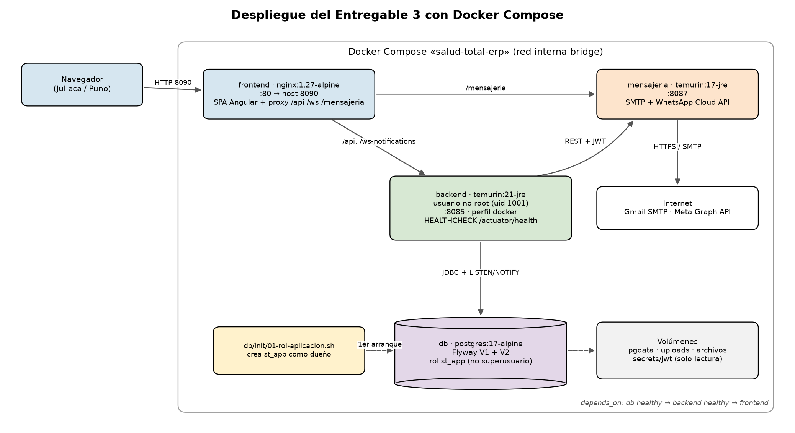

<table>
<colgroup>
<col style="width: 37%" />
<col style="width: 62%" />
</colgroup>
<thead>
<tr class="header">
<th><strong>Título del sistema</strong></th>
<th>ERP «Articulos» — Salud Total SAC (backend, frontend y mensajeria-api)</th>
</tr>
</thead>
<tbody>
<tr class="odd">
<td><strong>Nombre del estudiante</strong></td>
<td>Gutierrez Anco Yesenia Alejandra 
Turpo Cauna Jose Samuel 
Quispe Huarilloclla Jhosef Antony</td>
</tr>
<tr class="even">
<td><strong>Semestre</strong></td>
<td>10</td>
</tr>
<tr class="odd">
<td><strong>Curso</strong></td>
<td>CE023 — Sistema de Software Funcional Integrado</td>
</tr>
<tr class="even">
<td><strong>Fecha</strong></td>
<td>Noviembre de 2026</td>
</tr>
<tr class="odd">
<td><strong>Repositorio / despliegue</strong></td>
<td>Código: Entregable3_Codigo_Fuente.zip (git local, rama main) · Despliegue: docker compose → http://localhost:8090</td>
</tr>
</tbody>
</table>

## Resumen Ejecutivo

Salud Total SAC, cadena de farmacias con clínica ambulatoria en Juliaca y Puno, pierde dinero por dos causas que el Business Case de CE01 cuantificó: quiebres de stock por reposición manual y mermas por vender o almacenar lotes que vencen. Este entregable implementa, sobre el ERP real «Articulos», la solución de software diseñada en los Entregables 1 y 2 para atacar ambas causas, y la deja desplegable con un solo comando.

**Qué resuelve.** (1) FEFO obligatorio: el backend rechaza la venta de un lote vencido y exige vender primero el lote que vence antes (RF-24, RN-10, RN-11). (2) Reabastecimiento automático: cada salida de stock dispara, después de confirmada la transacción, la evaluación del punto de reorden; si el stock vigente queda en o bajo el mínimo se crea una orden pendiente, se notifica en tiempo real al comprador y éste la aprueba, rechaza o convierte en una orden de compra del módulo existente (RF-26 a RF-28, RN-12, RN-13).

**Cómo se usa.** El cajero vende como siempre desde la pantalla de ventas; el sistema le indica qué lote debe salir. El comprador abre Compra → Reabastecimiento, revisa los indicadores y atiende las órdenes con un clic. El administrador despliega todo con docker compose up y accede en http://localhost:8090.

**Resultados verificados.** La colección de pruebas de la API pasa 19 de 19 peticiones y 41 de 41 aserciones contra el despliegue en contenedores, sobre una base creada desde cero por Flyway. Las pruebas detectaron y permitieron corregir un defecto previo (el login con contraseña incorrecta respondía HTTP 500). Además se eliminaron las contraseñas de los archivos de configuración, se activó el versionado del esquema y la aplicación dejó de conectarse como superusuario.

| Indicador             | Valor                                                                                       |
|-----------------------|---------------------------------------------------------------------------------------------|
| Código nuevo          | 19 clases Java (808 líneas), 1 pantalla Angular (384 líneas), 1 migración Flyway de negocio |
| Código modificado     | 18 archivos (+204 / −138 líneas): venta, productos, seguridad, mensajería y configuración   |
| Endpoints nuevos      | 7 en /api/reabastecimiento, 1 FEFO en /api/productos, 1 en mensajeria-api                   |
| Pruebas automatizadas | Postman: 19 peticiones, 41 aserciones, 0 fallos (local y Docker)                            |
| Despliegue            | 4 contenedores (db, backend, mensajeria, frontend), todos healthy                           |

## Sección 1: Arquitectura e Integración

### 1.1 Arquitectura general del sistema

El sistema mantiene la arquitectura documentada en el E1: una SPA Angular, un backend monolítico modular en Spring Boot que expone una API REST con JWT firmado con RSA, un microservicio de mensajería y PostgreSQL como almacén y canal de eventos (patrón Outbox con LISTEN/NOTIFY). En el E3 se agregan el módulo de reabastecimiento, la validación FEFO, el proxy Nginx y el despliegue en contenedores.

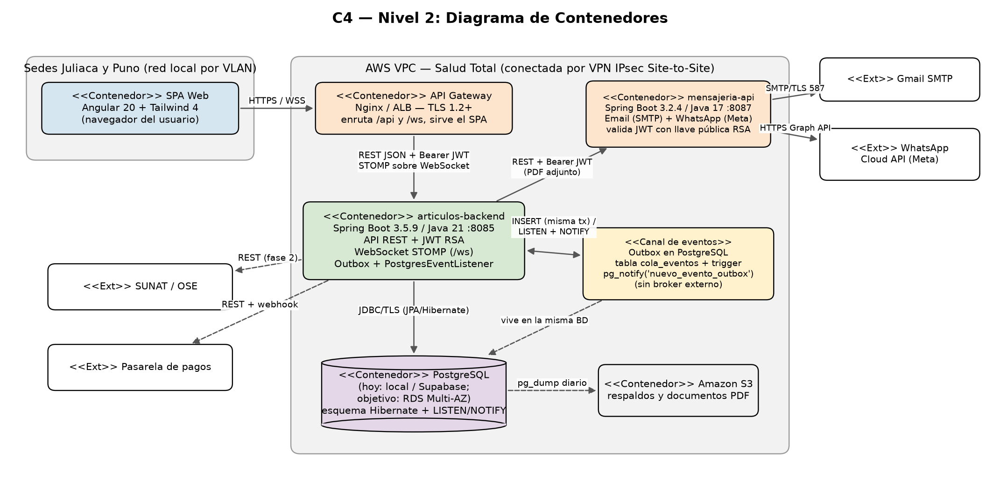

*Figura 1.1 — Contenedores del sistema (C4 nivel 2).*

### 1.2 Capas, módulos y componentes

El backend sigue la arquitectura por capas del proyecto (Controller → Service → Repository → Entity, con DTO y MapStruct). La figura 1.2 resume los módulos que intervienen en el E3 y marca el código nuevo.

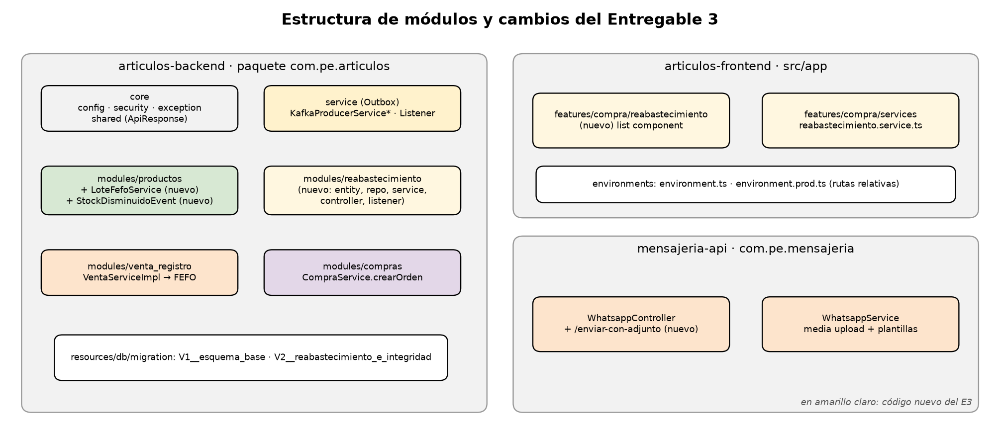

*Figura 1.2 — Módulos involucrados y código nuevo del Entregable 3.*

| Componente                  | Capa                 | Responsabilidad                                                                                                                         |
|-----------------------------|----------------------|-----------------------------------------------------------------------------------------------------------------------------------------|
| LoteFefoService             | Servicio (productos) | Lista lotes en orden FEFO y valida cada salida: rechaza vencidos y lotes que no vencen primero (configurable con ventas.fefo.estricto). |
| VentaServiceImpl            | Servicio (ventas)    | Invoca validarSalida() por cada línea tras el control de stock existente.                                                               |
| ProductoService             | Servicio (productos) | Tras actualizar stock y kardex publica StockDisminuidoEvent.                                                                            |
| ReabastecimientoListener    | Infraestructura      | @TransactionalEventListener(AFTER_COMMIT) y tarea programada horaria (evaluación y vencimiento a 72 h).                                 |
| ReabastecimientoServiceImpl | Servicio             | Genera, aprueba, rechaza, vence y convierte órdenes; notifica por el Outbox.                                                            |
| ReordenRepository           | Repositorio          | Consulta agregada: stock vigente por producto y sede frente al punto de reorden.                                                        |
| ReabastecimientoController  | Web                  | 7 endpoints REST con @PreAuthorize (COMPRA_LEER / COMPRA_CREAR).                                                                        |
| reabastecimiento-list       | Frontend             | Pantalla con indicadores, filtros por estado, búsqueda, paginación y acciones.                                                          |

### 1.3 Integración con la base de datos

La integración es por JPA/Hibernate y, desde este entregable, el esquema queda versionado con Flyway. V1\_\_esquema_base.sql es el esquema real extraído en el E2; en bases existentes Flyway lo registra como baseline y sólo aplica V2. En una base vacía (Docker) ejecuta ambas y Hibernate valida el resultado (ddl-auto=validate).

CREATE UNIQUE INDEX IF NOT EXISTS ux_orden_reab_abierta

ON orden_reabastecimiento (id_catalogo, id_sucursal)

WHERE estado IN ('PENDIENTE', 'APROBADA');

CREATE INDEX IF NOT EXISTS idx_kardex_ultimo_mov

ON kardex (id_catalogo, id_sucursal, fecha DESC, id_articulo_kardex DESC);

CREATE INDEX IF NOT EXISTS idx_producto_fefo

ON productos (id_catalogo, id_sucursal, fecha_venc);

*Código 1.1 — Extracto de V2: una sola orden abierta por producto y sede (índice parcial), índice del kardex e índice FEFO.*

La consulta que decide el reabastecimiento agrega todos los lotes del producto en la sede, excluye los vencidos y compara con el mínimo:

@Query("SELECT p.idCatalogo AS idCatalogo, "

\+ "SUM(CASE WHEN p.fechaVencimiento IS NULL OR p.fechaVencimiento \>= :hoy THEN p.stock ELSE 0

END) AS stockVigente, "

\+ "MAX(p.stockMinimo) AS stockMinimo, MAX(p.stockMaximo) AS stockMaximo, "

\+ "MAX(p.idProveedor) AS idProveedor, MAX(p.precioCompra) AS precioCompra "

\+ "FROM Producto p WHERE p.idSucursal = :idSucursal AND (:idCatalogo IS NULL OR p.idCatalogo =

:idCatalogo) "

\+ "GROUP BY p.idCatalogo "

\+ "HAVING MAX(p.stockMinimo) \> 0 AND "

\+ "SUM(CASE WHEN p.fechaVencimiento IS NULL OR p.fechaVencimiento \>= :hoy THEN p.stock ELSE 0

END) \<= MAX(p.stockMinimo)")

List\<ResumenReorden\> bajoPuntoDeReorden(@Param("idSucursal") Long idSucursal,

@Param("idCatalogo") Long idCatalogo,

@Param("hoy") LocalDate hoy);

*Código 1.2 — ReordenRepository.bajoPuntoDeReorden.*

### 1.4 Integración con servicios y APIs

- **Outbox y tiempo real:** las órdenes generadas usan el KafkaProducerService existente (nombre heredado), que inserta en cola_eventos; el trigger trg_notify_evento_insert emite pg_notify y el backend las entrega por WebSocket/STOMP a la campana de notificaciones.

- **Módulo de compras:** la conversión reutiliza CompraService.crearOrden(), por lo que la orden aparece en Compra → Órdenes de compra sin duplicar lógica.

- **mensajeria-api:** se agregó POST /api/v1/mensajes/whatsapp/enviar-con-adjunto (sube el PDF a la API de medios de Meta y lo envía como encabezado de la plantilla), que el backend ya invocaba y no existía; /enviar ahora acepta plantillas.

- **Proxy Nginx:** el frontend de producción usa rutas relativas (/api, /ws-notifications, /mensajeria) que Nginx enruta a cada contenedor.

## Sección 2: Funcionalidad del Sistema

### 2.1 Flujos principales implementados

**Flujo 1 — Venta con FEFO.** Al registrar una venta, por cada línea el backend obtiene el lote elegido, valida el stock y luego LoteFefoService.validarSalida(): si el lote está vencido responde 400 «El lote … venció el …»; si existe otro lote del mismo producto en la sede que vence antes y tiene stock suficiente responde 400 «Por FEFO debe venderse primero el lote …».

@Transactional(readOnly = true)

public void validarSalida(Producto lote, BigDecimal cantidad) {

LocalDate hoy = LocalDate.now();

if (lote.getFechaVencimiento() != null && lote.getFechaVencimiento().isBefore(hoy)) {

log.warn("Intento de vender el lote vencido {} del producto {}", lote.getNroLote(),

lote.getIdProducto());

throw new ValidationException("El lote " + descripcion(lote) + " venció el " +

lote.getFechaVencimiento()

\+ " y no puede venderse.");

}

if (!fefoEstricto \|\| lote.getIdCatalogo() == null \|\| lote.getIdSucursal() == null) {

return;

}

Optional\<Producto\> primero = productoRepository.findLotesFefo(lote.getIdCatalogo(),

lote.getIdSucursal(), hoy).stream()

.filter(l -\> !l.getIdProducto().equals(lote.getIdProducto()))

.filter(l -\> venceAntes(l, lote))

.filter(l -\> l.getStock() != null && l.getStock().compareTo(cantidad) \>= 0)

.findFirst();

if (primero.isPresent()) {

Producto debeSalir = primero.get();

log.warn("Venta del lote {} rechazada por FEFO: debe salir antes el lote {}", lote.getNroLote(),

debeSalir.getNroLote());

throw new ValidationException("Por FEFO debe venderse primero el lote " + descripcion(debeSalir)

\+ " (vence el "

\+ debeSalir.getFechaVencimiento() + ", stock " +

debeSalir.getStock().stripTrailingZeros().toPlainString() + ").");

}

}

*Código 2.1 — Regla FEFO en LoteFefoService.validarSalida.*

**Flujo 2 — Reabastecimiento automático.** La figura 2.1 muestra la secuencia tal como quedó implementada.

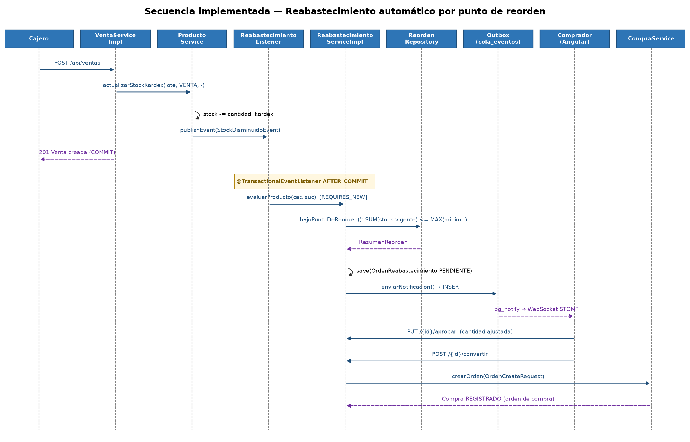

*Figura 2.1 — Secuencia implementada del reabastecimiento automático.*

| Estado     | Cómo se llega                                                                                             | Acción disponible                                       |
|------------|-----------------------------------------------------------------------------------------------------------|---------------------------------------------------------|
| PENDIENTE  | Stock vigente ≤ mínimo y sin otra orden abierta (evento tras la venta, evaluación manual o tarea horaria) | Aprobar (con cantidad) o rechazar (con motivo)          |
| APROBADA   | El comprador aprueba                                                                                      | Generar orden de compra (proveedor habitual o indicado) |
| CONVERTIDA | Se crea la orden de compra                                                                                | Consultar el número de compra                           |
| RECHAZADA  | El comprador rechaza                                                                                      | — (el producto puede volver a generar orden)            |
| VENCIDA    | 72 h en PENDIENTE sin atención                                                                            | — (se notifica)                                         |

*Tabla 2.1 — Estados de la orden de reabastecimiento (implementa el diagrama de estados del E1).*

### 2.2 Gestión de usuarios, permisos y roles

Los endpoints nuevos reutilizan los permisos del sistema: lectura con COMPRA_LEER y acciones con COMPRA_CREAR (@PreAuthorize), y el menú se registró en la semilla con moduloRequerido COMPRA, de modo que sólo lo ve quien tiene acceso al módulo. Las acciones quedan auditadas con @CreatedBy/@LastModifiedBy (usuario_creacion, usuario_modificacion). Sin token la API responde 401/403, y con contraseña incorrecta, 401.

### 2.3 Evidencias funcionales

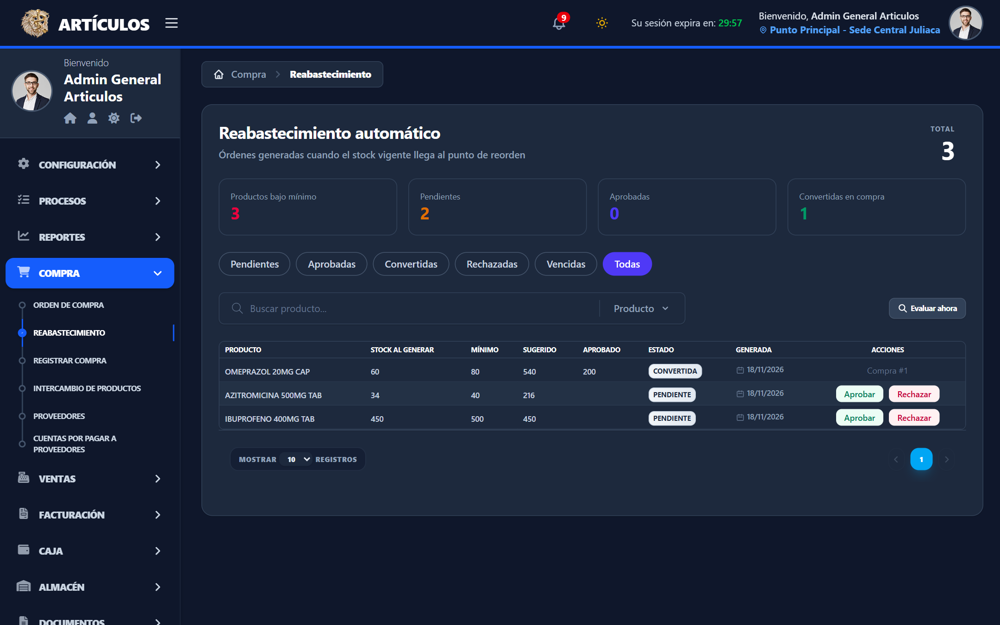

*Figura 2.2 — Compra → Reabastecimiento en el despliegue Docker: indicadores, filtros y órdenes en distintos estados.*

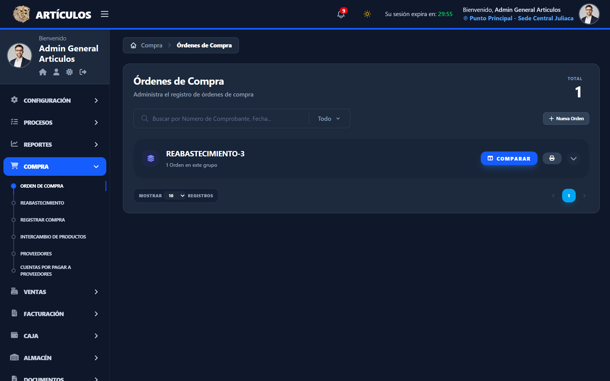

*Figura 2.3 — La orden convertida aparece en el módulo existente de Órdenes de compra (grupo REABASTECIMIENTO-3).*

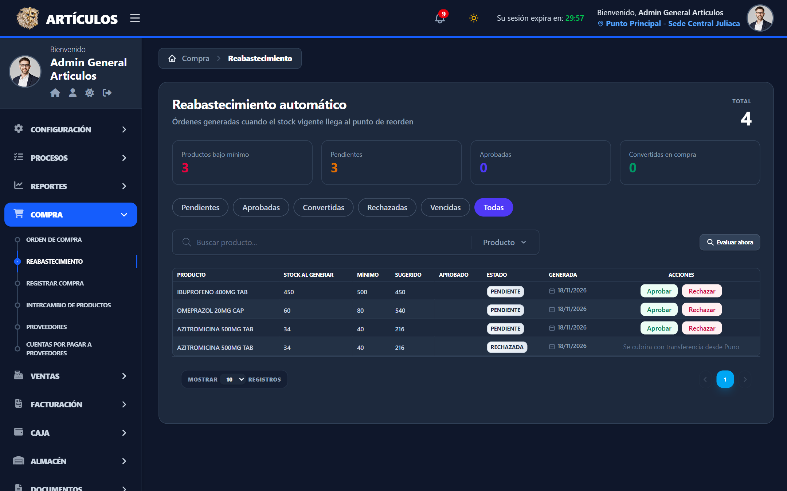

*Figura 2.4 — La misma pantalla en el entorno local, con una orden rechazada y su motivo.*

=== 1. GET /api/productos/catalogo/1/sucursal/1/fefo (Paracetamol, Sede Central Juliaca)

orden 1 \| lote L-2105 \| vence 2026-12-28 \| dias 40 \| stock 79.0

orden 2 \| lote L-2291 \| vence 2027-01-12 \| dias 55 \| stock 500.0

=== 2. POST /api/ventas con el lote que vence despues (id 10)

status 400 \| Error al crear venta: Por FEFO debe venderse primero el lote L-2105 (vence el 2026-12-28,

stock 79).

=== 3. POST /api/ventas con lote vencido de Puno (id 2)

status 400 \| Error al crear venta: El lote L-7714 venció el 2026-11-13 y no puede venderse.

=== 4. POST /api/ventas con el lote FEFO (id 8)

Venta creada exitosamente \| venta 2 B001-2

=== 5. POST /api/reabastecimiento/evaluar?idSucursal=2 (Puno)

2 órdenes generadas

\#4 AMOXICILINA 500MG CAP \| stock 18.0 \<= minimo 60.0 \| sugerido 102.0 \| PENDIENTE

\#5 CETIRIZINA 10MG TAB \| stock 0 \<= minimo 30.0 \| sugerido 150.0 \| PENDIENTE

=== 6. GET /api/reabastecimiento/resumen?idSucursal=2

{'pendientes': 2, 'aprobadas': 0, 'convertidas': 0, 'productosBajoMinimo': 2}

=== 7. Outbox: eventos generados (tabla cola_eventos)

id \| topico \| titulo \| estado

----+------------------------+------------------------------------+-----------

5 \| sistema.notificaciones \| Orden de reabastecimiento generada \| PROCESADO

4 \| sistema.notificaciones \| Orden de reabastecimiento generada \| PROCESADO

3 \| sistema.notificaciones \| Orden de reabastecimiento generada \| PROCESADO

2 \| sistema.notificaciones \| Orden de reabastecimiento generada \| PROCESADO

(4 rows)

*Evidencia 2.1 — Flujos ejecutados contra el despliegue Docker: FEFO, lote vencido, venta correcta, reabastecimiento y Outbox.*

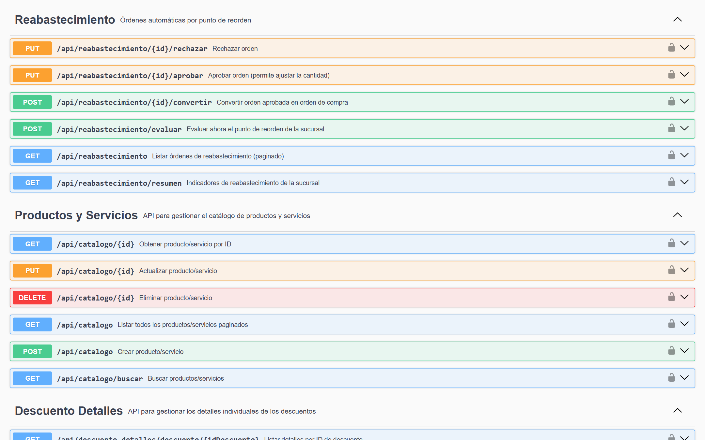

*Figura 2.5 — Documentación OpenAPI del controlador de reabastecimiento.*

## Sección 3: Código y Diseño Técnico

### 3.1 Estructura del repositorio

articulos-e3/

├── articulos-backend/ Spring Boot 3.5.9 · Java 21

│ ├── src/main/java/com/pe/articulos/

│ │ ├── core/ config, security, exception, shared

│ │ ├── service/ Outbox (cola_eventos) y listeners

│ │ └── modules/ 28 módulos + reabastecimiento (nuevo)

│ ├── src/main/resources/db/migration/ V1\_\_esquema_base, V2\_\_reabastecimiento_e_integridad

│ └── Dockerfile

├── articulos-frontend/ Angular 20 · Tailwind 4 · nginx.conf · Dockerfile

├── mensajeria-api/ Spring Boot 3.2.4 · Java 17 · Dockerfile

├── db/init/01-rol-aplicacion.sh

├── pruebas/ postman/ · datos/datos_demo.sql · evidencias/

├── docker-compose.yml · .env.example · iniciar-docker.ps1

└── README.md

*Código 3.1 — Estructura del repositorio entregado.*

### 3.2 Patrones y buenas prácticas aplicadas

| **Patrón / práctica**                        | **Dónde**                                          | **Beneficio**                                                                 |
|----------------------------------------------|----------------------------------------------------|-------------------------------------------------------------------------------|
| **Arquitectura por capas + DTO + MapStruct** | Módulo reabastecimiento, LoteFefoMapper            | Entidades no expuestas; mapeo generado en compilación                         |
| **Eventos de dominio (Observer)**            | StockDisminuidoEvent + @TransactionalEventListener | Ventas no conoce al reabastecimiento; bajo acoplamiento                       |
| **AFTER_COMMIT + REQUIRES_NEW**              | ReabastecimientoListener / evaluarProducto         | Sólo se evalúa stock confirmado y la orden se guarda en su propia transacción |
| **Transactional Outbox**                     | Notificaciones de órdenes                          | Avisos sin pérdida aunque falle la entrega                                    |
| **Máquina de estados con guardas**           | exigirEstado() → 409 Conflict                      | Transiciones inválidas imposibles                                             |
| **Reutilización de servicios**               | CompraService.crearOrden                           | Una sola lógica de órdenes de compra                                          |
| **Configuración externa (12-factor)**        | application\*.properties con \${VARIABLE}          | Sin secretos en el código; mismo artefacto en todos los entornos              |
| **Migraciones versionadas**                  | Flyway V1/V2                                       | Esquema reproducible y auditable                                              |

### 3.3 Modularidad y desacoplamiento

El módulo de ventas no depende del reabastecimiento: ProductoService sólo publica un evento y el listener vive en el módulo nuevo. Si el reabastecimiento falla, la venta no se revierte, porque la evaluación ocurre después del commit y cualquier excepción se registra en el log. El fragmento siguiente muestra el punto de desacople:

@TransactionalEventListener(phase = TransactionPhase.AFTER_COMMIT)

public void alDisminuirStock(StockDisminuidoEvent evento) {

try {

reabastecimientoService.evaluarProducto(evento.idCatalogo(), evento.idSucursal());

} catch (Exception e) {

log.error("No se pudo evaluar el reabastecimiento del catálogo {} en la sucursal {}",

evento.idCatalogo(), evento.idSucursal(), e);

}

}

@Scheduled(cron = "\${reabastecimiento.cron:0 0 \* \* \* \*}")

public void evaluacionPeriodica() {

reordenRepository.sucursalesConPuntoDeReorden().forEach(reabastecimientoService::evaluarSucursal);

reabastecimientoService.vencerOrdenesSinAtencion();

}

*Código 3.2 — ReabastecimientoListener: evento tras el commit y evaluación periódica.*

Durante las pruebas se comprobó por qué REQUIRES_NEW es necesario: sin él, la orden se insertaba en una transacción ya finalizada y no se confirmaba. El defecto se detectó porque la orden automática no aparecía tras la venta, y se corrigió anotando evaluarProducto con Propagation.REQUIRES_NEW.

### 3.4 Manejo de errores y validaciones

| **Situación**                                   | **Mecanismo**                                               | **Respuesta**                  |
|-------------------------------------------------|-------------------------------------------------------------|--------------------------------|
| **Cantidad aprobada ≤ 0 o motivo vacío**        | Bean Validation (@Positive, @NotBlank, @Size) + @Valid      | 400 con el detalle por campo   |
| **Lote vencido / no FEFO**                      | ValidationException en LoteFefoService                      | 400 con el lote que debe salir |
| **Orden inexistente**                           | ResourceNotFoundException                                   | 404                            |
| **Transición inválida (aprobar una rechazada)** | ConflictException en exigirEstado()                         | 409                            |
| **Convertir sin proveedor**                     | ValidationException                                         | 400 «indique el proveedor»     |
| **Contraseña incorrecta**                       | AuthException mapeada en GlobalExceptionHandler (corregido) | 401 (antes 500)                |
| **Fallo al evaluar tras la venta**              | try/catch en el listener + log                              | La venta se mantiene           |

Root 12 Aprobar con cantidad inválida

PUT http://localhost:8085/api/reabastecimiento/3/aprobar \[400 Bad Request, 595 B, 45 ms\]

Pass Validación (400)

Pass Mensaje del campo

Root 13 Aprobar orden ajustando cantidad

PUT http://localhost:8085/api/reabastecimiento/3/aprobar \[200 OK, 955 B, 41 ms\]

Pass HTTP 200

Pass Queda APROBADA

Pass Guarda la cantidad

Root 14 No se puede rechazar una orden ya aprobada

PUT http://localhost:8085/api/reabastecimiento/3/rechazar \[409 Conflict, 577 B, 38 ms\]

Pass Conflicto (409)

*Evidencia 3.1 — Validación 400, aprobación y conflicto 409 en la ejecución de Postman.*

## Sección 4: Despliegue e Instalación

### 4.1 Instrucciones de instalación

\# 1. Configuración

cp .env.example .env \# completar DB_ADMIN_PASSWORD, DB_PASSWORD y credenciales de mensajería

mkdir -p secrets/jwt \# copiar private.pem y public.pem

\# 2. Construir y levantar los cuatro servicios

docker compose up -d --build

\# 3. (Opcional) datos de demostración de Salud Total

docker exec -i salud-total-erp-db-1 psql -U st_app -d clinica_db \< pruebas/datos/datos_demo.sql

\# 4. Verificar

curl http://localhost:8085/actuator/health \# {"status":"UP"}

postman collection run pruebas/postman/E3_SaludTotal.postman_collection.json

*Código 4.1 — Instalación con Docker Compose (detalle en README.md).*

### 4.2 Configuración requerida

| **Variable**                                   | **Uso**                                              | **Por defecto**              |
|------------------------------------------------|------------------------------------------------------|------------------------------|
| **DB_URL, DB_USER, DB_PASSWORD**               | Conexión a PostgreSQL (rol de aplicación)            | local: clinica_db / postgres |
| **DB_ADMIN_PASSWORD**                          | Superusuario del contenedor db (sólo administración) | —                            |
| **JWT_PRIVATE_KEY_PATH / JWT_PUBLIC_KEY_PATH** | Llaves RSA (classpath: o file:)                      | classpath:certs/\*.pem       |
| **VENTAS_FEFO_ESTRICTO**                       | Exigir FEFO en la venta                              | true                         |
| **CORS_ALLOWED_ORIGINS**                       | Orígenes permitidos por la API                       | http://localhost:4200,4205   |
| **MENSAJERIA_API_URL**                         | URL del microservicio de mensajería                  | http://localhost:8087        |
| **MAIL\_\*, WHATSAPP\_\***                     | Credenciales de correo y WhatsApp                    | vacías                       |

Perfiles: local (desarrollo, ddl-auto=update), docker y supabase (ddl-auto=validate: el esquema sólo cambia con Flyway). Ningún archivo de configuración contiene contraseñas; el archivo .env y la carpeta secrets/ están excluidos del control de versiones.

### 4.3 Evidencia de despliegue y ejecución

*Figura 4.1 — Topología del despliegue con Docker Compose.*

PS\> docker compose ps

SERVICE IMAGE STATUS PORTS

backend salud-total-erp-backend Up About a minute (healthy) 0.0.0.0:8085-\>8085/tcp,

\[::\]:8085-\>8085/tcp

db postgres:17-alpine Up 20 minutes (healthy) 0.0.0.0:5433-\>5432/tcp,

\[::\]:5433-\>5432/tcp

frontend salud-total-erp-frontend Up About a minute (healthy) 0.0.0.0:8090-\>80/tcp,

\[::\]:8090-\>80/tcp

mensajeria salud-total-erp-mensajeria Up 20 minutes 0.0.0.0:8087-\>8087/tcp,

\[::\]:8087-\>8087/tcp

PS\> docker images

REPOSITORY TAG SIZE

salud-total-erp-frontend latest 86.3MB

salud-total-erp-backend latest 649MB

salud-total-erp-mensajeria latest 475MB

PS\> curl http://localhost:8085/actuator/health

{"status":"UP"}

PS\> psql (db): historial de Flyway en la base creada desde cero

version \| description \| installed_by \| instalado \| ms \| success

---------+-------------------------------+--------------+---------------------+-----+---------

1 \| esquema base \| st_app \| 2026-11-18 21:51:40 \| 675 \| t

2 \| reabastecimiento e integridad \| st_app \| 2026-11-18 21:51:40 \| 38 \| t

(2 rows)

PS\> psql (db): rol de la aplicación y dueño de las tablas

rolname \| superusuario \| crea_bd

----------+--------------+---------

postgres \| t \| t

st_app \| f \| f

(2 rows)

tableowner \| tablas

------------+--------

st_app \| 85

(1 row)

*Evidencia 4.1 — Contenedores healthy, imágenes, Flyway sobre base vacía y rol de aplicación sin superusuario.*

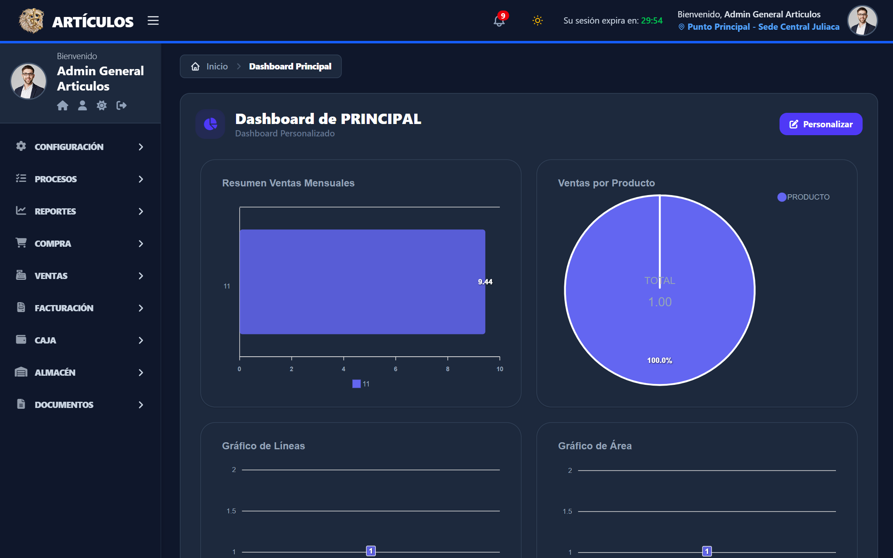

*Figura 4.2 — Sistema servido por Nginx en http://localhost:8090 con las sedes de Salud Total.*

*Tabla 4.1 — Resultado de la colección Postman contra el despliegue Docker.*

| Prueba                                            | HTTP | Aserciones |
|---------------------------------------------------|------|------------|
| 01 Health del backend                             | 200  | 2/2        |
| 02 Login con credenciales inválidas               | 401  | 2/2        |
| 03 Login correcto                                 | 200  | 2/2        |
| 04 Endpoint protegido sin token                   | 403  | 1/1        |
| 05 Lotes FEFO de Paracetamol en Juliaca           | 200  | 6/6        |
| 05b Lotes vencidos en Puno                        | 200  | 2/2        |
| 05c Abrir caja chica                              | 200  | 1/1        |
| 05d Crear proveedor                               | 201  | 1/1        |
| 06 Venta saltándose el lote FEFO                  | 400  | 2/2        |
| 07 Venta de un lote vencido                       | 400  | 2/2        |
| 08 Venta del lote que vence primero               | 201  | 2/2        |
| 09 Evaluar punto de reorden en Juliaca            | 200  | 2/2        |
| 10 Segunda evaluación no duplica órdenes abiertas | 200  | 1/1        |
| 11 Listar órdenes pendientes de Juliaca           | 200  | 4/4        |
| 12 Aprobar con cantidad inválida                  | 400  | 2/2        |
| 13 Aprobar orden ajustando cantidad               | 200  | 3/3        |
| 14 No se puede rechazar una orden ya aprobada     | 409  | 1/1        |
| 15 Convertir en orden de compra                   | 200  | 3/3        |
| 16 Resumen de reabastecimiento                    | 200  | 2/2        |

## Anexos

### Anexo A: Repositorio fuente

Se entrega Entregable3_Codigo_Fuente.zip con el repositorio completo (sin node_modules, target, .env ni secrets). Es un repositorio git local independiente del repositorio de la empresa: el trabajo del curso se hizo en una copia para no alterar la rama principal de producción.

### Anexo B: Manual técnico breve

El archivo README.md del repositorio contiene: componentes y puertos, novedades del E3, ejecución con Docker y en local, variables de entorno y cómo ejecutar las pruebas. En Windows Insider, si Docker Desktop no inicia por sockets bloqueados («rename … .sock.stale»), se usa iniciar-docker.ps1.

| Endpoint                                      | Método | Permiso      | Descripción                                    |
|-----------------------------------------------|--------|--------------|------------------------------------------------|
| /api/productos/catalogo/{c}/sucursal/{s}/fefo | GET    | autenticado  | Lotes vigentes en orden FEFO                   |
| /api/reabastecimiento                         | GET    | COMPRA_LEER  | Órdenes paginadas (estado, búsqueda)           |
| /api/reabastecimiento/resumen                 | GET    | COMPRA_LEER  | Indicadores de la sede                         |
| /api/reabastecimiento/evaluar                 | POST   | COMPRA_CREAR | Evaluar ahora el punto de reorden              |
| /api/reabastecimiento/{id}/aprobar            | PUT    | COMPRA_CREAR | Aprobar con cantidad                           |
| /api/reabastecimiento/{id}/rechazar           | PUT    | COMPRA_CREAR | Rechazar con motivo                            |
| /api/reabastecimiento/{id}/convertir          | POST   | COMPRA_CREAR | Generar orden de compra                        |
| /api/v1/mensajes/whatsapp/enviar-con-adjunto  | POST   | JWT          | Plantilla de WhatsApp con PDF (mensajeria-api) |

### Anexo C: Capturas de funcionamiento

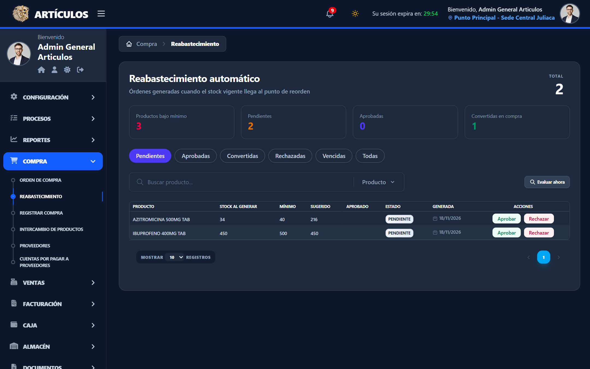

*Figura C.1 — Órdenes pendientes con acciones Aprobar / Rechazar.*

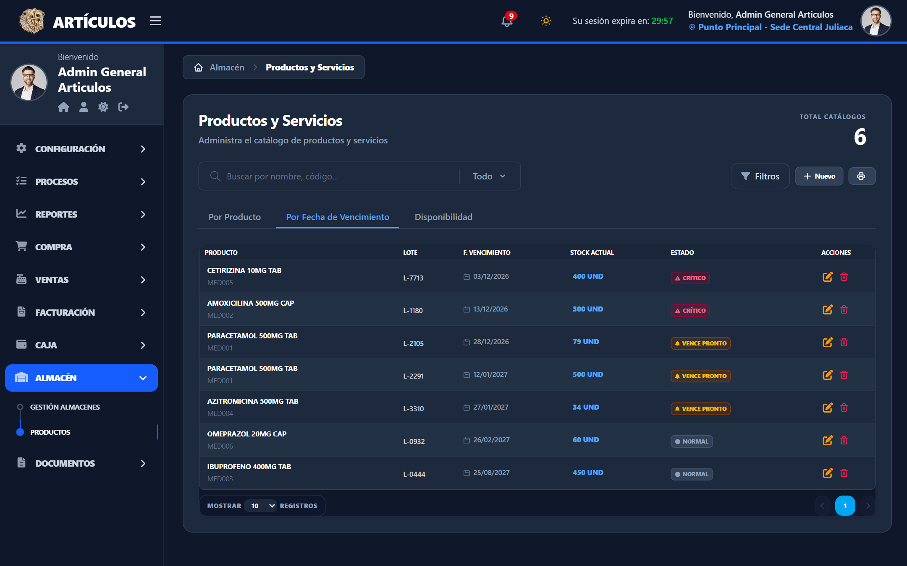

*Figura C.2 — Productos por fecha de vencimiento (lotes cargados para las pruebas FEFO).*

### Anexo D: Trazabilidad con el E1 y el E2

| Requerimiento (E1)                                 | Estado en E1                   | Estado en E3                     | Evidencia                                |
|----------------------------------------------------|--------------------------------|----------------------------------|------------------------------------------|
| RF-24 FEFO en la venta                             | Parcial                        | Implementado                     | Código 2.1, Evidencia 2.1, pruebas 05–08 |
| RF-26 Punto de reorden                             | Implementado                   | Implementado (usa stock vigente) | Código 1.2                               |
| RF-27 Orden automática                             | TO-BE                          | Implementado                     | Figura 2.1, pruebas 09–11                |
| RF-28 Aprobar / rechazar / convertir               | TO-BE                          | Implementado                     | Figuras 2.2–2.3, pruebas 12–15           |
| RF-33 WhatsApp con PDF                             | Parcial (endpoint inexistente) | Endpoint implementado            | Sección 1.4                              |
| RN-12 Una orden abierta                            | —                              | Índice parcial + validación      | Código 1.1, prueba 10                    |
| RN-13 Vencimiento 72 h                             | —                              | Tarea programada                 | Código 3.2                               |
| ADR-09 Secretos y Flyway (E1) / Hallazgos 1–2 (E2) | Pendiente                      | Implementado                     | Sección 4.2, Evidencia 4.1               |

---

### Archivos del entregable

- [:material-file-word: Descargar documento original (.docx)](Entregable3_Sistema_Funcional.docx)

**Otros**

- [:material-folder-zip: Entregable3_Codigo_Fuente.zip](archivos/Entregable3_Codigo_Fuente.zip)
- [:material-folder-zip: Entregable3_Codigo_Fuente.zip](archivos/Entregable3_Codigo_Fuente.zip)
