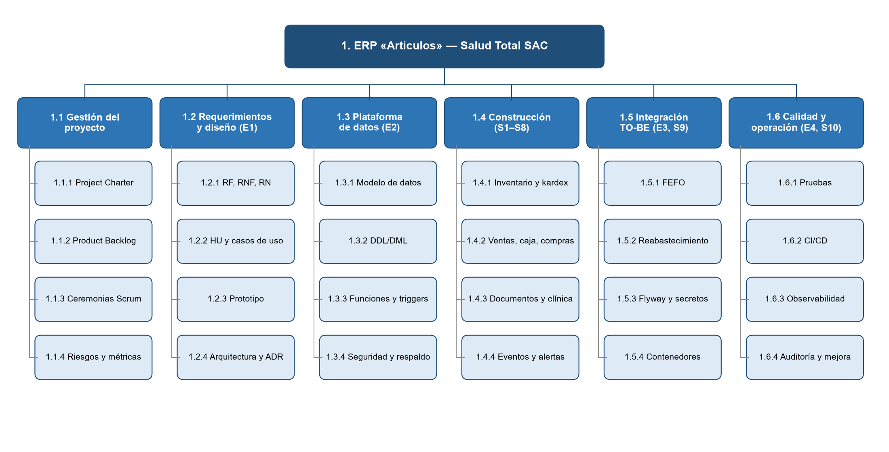
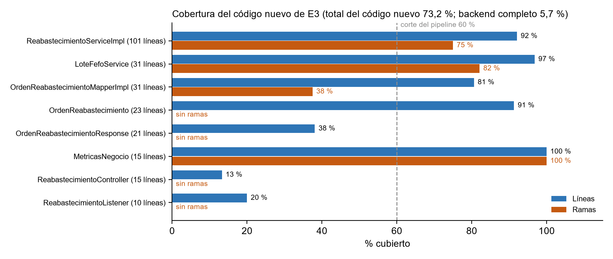
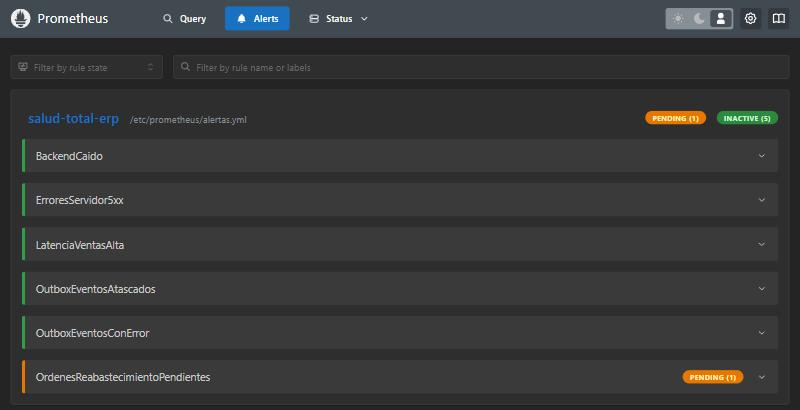
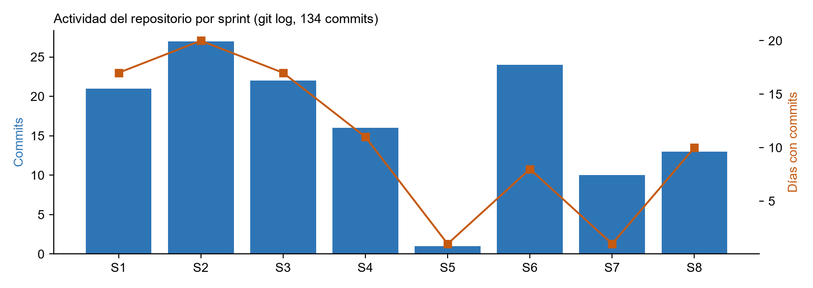
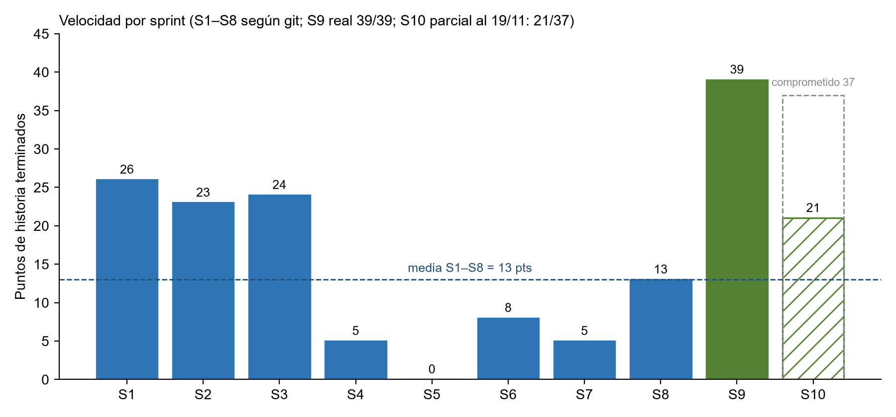
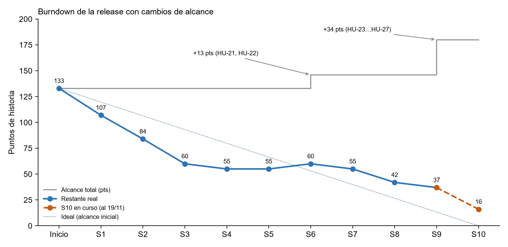
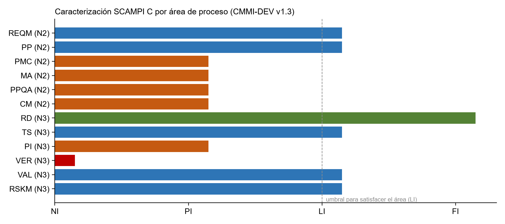

# CE024 - S2 - E4: Gestión del Proyecto y Calidad de Software

**ENTREGABLE 4**

**Gestión del Proyecto y Calidad de Software**

*(Alineado con CE024)*

**Gestión ágil del proyecto, aseguramiento y auditoría de la calidad del ERP «Articulos» — Salud Total SAC**

<table>
<colgroup>
<col style="width: 37%" />
<col style="width: 62%" />
</colgroup>
<thead>
<tr class="header">
<th><strong>Título del sistema</strong></th>
<th>ERP «Articulos» — Salud Total SAC · Gestión ágil, aseguramiento y auditoría de la calidad</th>
</tr>
</thead>
<tbody>
<tr class="odd">
<td><strong>Nombre del estudiante</strong></td>
<td>Gutierrez Anco Yesenia Alejandra 
Turpo Cauna Jose Samuel 
Quispe Huarilloclla Jhosef Antony</td>
</tr>
<tr class="even">
<td><strong>Semestre</strong></td>
<td>10</td>
</tr>
<tr class="odd">
<td><strong>Curso</strong></td>
<td>CE024 — Gestión del Proyecto y Calidad de Software</td>
</tr>
<tr class="even">
<td><strong>Fecha</strong></td>
<td>Noviembre de 2026 — versión 1.0 (Sprint 9 cerrado; Sprint 10 en curso: HU-12 y HU-13 pendientes)</td>
</tr>
</tbody>
</table>

## Resumen Ejecutivo

Salud Total SAC —cadena de farmacias con clínica ambulatoria en Juliaca y Puno— opera con el ERP propio «Articulos» (Spring Boot 3.5.9 / Java 21, Angular 20, PostgreSQL y el microservicio mensajeria_api). Este entregable evalúa la calidad del proceso con que se construye el sistema y la calidad del producto. Como en E1 y E2, toda cifra procede del código y del historial git del repositorio, no de lo planificado.

**Gestión del proyecto.** El trabajo se organizó con Scrum adaptado a un equipo de tres estudiantes (un Scrum Master y tres desarrolladores) y a los hitos académicos. Del historial git (134 commits entre el 11/01 y el 17/08/2026) se reconstruyeron ocho sprints de cuatro semanas: se terminaron 164 de los 180 puntos de la release (28 historias), con una velocidad media de 13 puntos y una caída marcada desde el Sprint 4 (S5 sin incremento). El alcance creció un 35 % (de 133 a 180 puntos) por la refactorización «Gold Standard» y por las historias técnicas de E3 y E4. El Sprint 9 (E3) comprometió 39 puntos —tres veces la velocidad media, riesgo R-01— y los entregó completos; en el Sprint 10 ya están terminadas HU-25, HU-26 y HU-27 (21 de 37 puntos) y quedan HU-12 y HU-13. El Project Charter, el Product Backlog, el Sprint Backlog y la comparación con RUP y cascada están en la Sección 3.

**Aseguramiento y auditoría.** La matriz de calidad ISO/IEC 25010 fija 16 métricas con meta y línea base medida. La línea base muestra fortalezas en seguridad de acceso (JWT RSA, bloqueo anti fuerza bruta, 155 @PreAuthorize) y en homogeneidad del código, y brechas en pruebas (1 prueba de backend), configuración (60 de 134 commits con mensajes de una palabra, sin ramas ni tags, Flyway desactivado), secretos versionados (3 archivos .pem) y observabilidad (sin Actuator). La auditoría SCAMPI clase C sobre CMMI-DEV v1.3 ubica el proceso en el nivel de madurez 1: REQM y PP están mayormente implementadas, pero PMC, MA, PPQA y CM solo parcialmente. El plan de mejora (11 acciones) apunta a satisfacer el nivel 2 al cierre del Sprint 10.

**Pruebas, integración y operación.** El backend pasó de 1 a 18 pruebas automatizadas (17 unitarias y 1 de integración sobre PostgreSQL con Flyway), todas aprobadas, con 73,2 % de cobertura en el código nuevo y 5,7 % en el total. La colección Postman de 19 peticiones (41 aserciones) verifica de punta a punta FEFO, reabastecimiento y seguridad, y la prueba de carga cumple el RNF-14 en operación normal (p95 1,37 s con 50 cajeros) pero no en el peor caso de un solo lote (2,16 s, R-11). Las pruebas encontraron ocho defectos, tres graves de concurrencia, ya corregidos. Un pipeline de ocho etapas compila, prueba, analiza, busca secretos, construye imágenes versionadas, despliega en contenedores y ejecuta pruebas de humo con rollback automático; Prometheus vigila seis reglas de alerta técnicas y de negocio.

**Calidad del código.** PMD registra 619 avisos y CPD 18 bloques duplicados; la deuda técnica estimada es de unas 81 horas (≈ 9 %, calificación B), concentrada en VentaServiceImpl, ExcelExportServiceImpl y UserServiceImpl. El código nuevo tiene menos avisos por línea que el heredado.

**Estado de este documento**

| Sección                                 | Contenido                                                                 | Estado |
|-----------------------------------------|---------------------------------------------------------------------------|--------|
| 1\. Pruebas                             | Casos automatizados, reporte de ejecución y cobertura, flujos críticos    | Hecho  |
| 2\. Integración, despliegue y operación | Pipeline CI/CD, contenedores, observabilidad, rollback y respaldos        | Hecho  |
| 3\. Gestión ágil                        | Charter, historias, backlogs, sprints, métricas, comparación de marcos    | Hecho  |
| 4.1 Matriz e instrumentos               | ISO 25010, métricas, riesgos, revisiones, inspecciones, checklists        | Hecho  |
| 4.2 Calidad de código                   | Atributos internos/externos, code smells, deuda técnica y refactorización | Hecho  |
| 4.3 Auditoría y madurez                 | Checklists de gestión, ingeniería y software; SCAMPI C / CMMI             | Hecho  |
| 4.4 Plan de mejora                      | Acciones, responsables, plazos e indicadores                              | Hecho  |

## Sección 1: Pruebas

Las pruebas se ejecutaron sobre la copia de trabajo articulos-e3 (código del Entregable 3) el 19/11/2026. Los criterios de aceptación en Gherkin de E1 §1.6 y las reglas de negocio RN-10 a RN-13 son el oráculo: cada caso automatizado cita la regla que verifica. La línea base del 18/11 era de una sola prueba de backend (ArticulosApplicationTests.contextLoads) y dos archivos .spec.ts en el frontend.

### 1.1 Estrategia y niveles de prueba

| Nivel       | Herramienta                                             | Qué cubre                                                                                                      | Dónde corre                                               | Casos                         |
|-------------|---------------------------------------------------------|----------------------------------------------------------------------------------------------------------------|-----------------------------------------------------------|-------------------------------|
| Unitarias   | JUnit 5 + Mockito + AssertJ                             | Reglas FEFO (LoteFefoService) y ciclo de vida de las órdenes de reabastecimiento (ReabastecimientoServiceImpl) | Etapa 1 del pipeline (mvn verify)                         | 17                            |
| Integración | Spring Boot Test sobre PostgreSQL 17                    | Arranque completo del contexto: Flyway V1/V2, validación del esquema por Hibernate, seguridad y beans          | Etapa 1 del pipeline (base clinica_db_e3)                 | 1                             |
| API / humo  | Postman CLI 1.73 (colección E3_SaludTotal)              | Flujos críticos de punta a punta: login, permisos, FEFO en la venta, reabastecimiento hasta la orden de compra | Etapa 8 del pipeline, contra los contenedores desplegados | 19 peticiones / 41 aserciones |
| Rendimiento | Script Python con hilos (pruebas/carga/carga_ventas.py) | POST /api/ventas con 50 cajeros concurrentes (RNF-14) y consistencia del stock                                 | Manual, contra Docker                                     | 2 escenarios                  |
| Cobertura   | JaCoCo 0.8.12                                           | Líneas y ramas ejecutadas por las pruebas; corte: ≥ 60 % en el código nuevo                                    | Etapa 1 del pipeline                                      | —                             |

El orden sigue la pirámide de pruebas: muchas pruebas unitarias rápidas sobre las reglas de negocio, pocas de integración y un conjunto acotado de pruebas de API que verifican el sistema desplegado. Las pruebas de frontend (Karma) no se incluyeron en el pipeline; es una brecha registrada (1.7).

### 1.2 Casos de prueba automatizados

**Pruebas unitarias del backend (src/test/java)**

| ID    | Clase                       | Caso                                                                     | Regla / HU     | Resultado |
|-------|-----------------------------|--------------------------------------------------------------------------|----------------|-----------|
| UT-01 | LoteFefoService             | Un lote vencido no puede venderse                                        | RN-11 · HU-09  | Pasa      |
| UT-02 | LoteFefoService             | Si otro lote vence antes y tiene stock, se exige venderlo primero        | RN-10 · HU-09  | Pasa      |
| UT-03 | LoteFefoService             | El lote que vence primero se vende sin observaciones                     | RN-10 · HU-09  | Pasa      |
| UT-04 | LoteFefoService             | Si el lote anterior no alcanza para la cantidad, se permite el siguiente | RN-10 · HU-09  | Pasa      |
| UT-05 | LoteFefoService             | Un lote sin fecha de vencimiento cede ante cualquier lote con fecha      | RN-10 · HU-09  | Pasa      |
| UT-06 | LoteFefoService             | Con ventas.fefo.estricto=false solo se bloquean los vencidos             | RN-11 · HU-09  | Pasa      |
| UT-07 | LoteFefoService             | listarLotes numera en orden FEFO y calcula los días para vencer          | RF-24 · HU-09  | Pasa      |
| UT-08 | ReabastecimientoServiceImpl | Genera una orden por (máximo − stock) bajo el punto de reorden           | RN-12 · HU-11  | Pasa      |
| UT-09 | ReabastecimientoServiceImpl | No duplica si ya existe una orden abierta del producto y sucursal        | RN-12 · HU-11  | Pasa      |
| UT-10 | ReabastecimientoServiceImpl | Sin stock máximo se sugiere hasta el doble del mínimo                    | RN-12 · HU-11  | Pasa      |
| UT-11 | ReabastecimientoServiceImpl | Aprobar guarda la cantidad ajustada y pasa a APROBADA                    | RF-28 · HU-11  | Pasa      |
| UT-12 | ReabastecimientoServiceImpl | No se puede aprobar una orden rechazada (409)                            | RF-28 · HU-11  | Pasa      |
| UT-13 | ReabastecimientoServiceImpl | Rechazar guarda el motivo                                                | RF-28 · HU-11  | Pasa      |
| UT-14 | ReabastecimientoServiceImpl | Orden inexistente responde 404                                           | HU-11          | Pasa      |
| UT-15 | ReabastecimientoServiceImpl | Convertir sin proveedor habitual ni indicado es un error de validación   | RF-28 · HU-11  | Pasa      |
| UT-16 | ReabastecimientoServiceImpl | Convertir crea la orden de compra con la cantidad aprobada               | RF-28 · HU-11  | Pasa      |
| UT-17 | ReabastecimientoServiceImpl | Las órdenes pendientes con más de 72 h pasan a VENCIDA                   | RN-13 · HU-11  | Pasa      |
| IT-01 | ArticulosApplicationTests   | El contexto arranca sobre PostgreSQL con Flyway y validación de esquema  | RNF-11 · HU-23 | Pasa      |

**Colección Postman E3_SaludTotal (pruebas de API y de humo)**

| \#     | Petición                                          | Verifica                                                                    | Resultado |
|--------|---------------------------------------------------|-----------------------------------------------------------------------------|-----------|
| 01     | GET /actuator/health                              | Backend y base de datos arriba (UP)                                         | Pasa      |
| 02–03  | POST /api/auth/login (inválido / válido)          | 401 con credenciales inválidas; token JWT con las válidas (HU-07)           | Pasa      |
| 04     | GET /api/reabastecimiento sin token               | 401: endpoint protegido                                                     | Pasa      |
| 05–05d | Lotes FEFO, lotes vencidos, caja chica, proveedor | Datos de partida: orden FEFO, lote vencido en Puno, caja abierta, proveedor | Pasa      |
| 06     | POST /api/ventas con un lote posterior            | 400 «Por FEFO debe venderse primero el lote …» (RN-10)                      | Pasa      |
| 07     | POST /api/ventas con un lote vencido              | 400 «El lote … venció …» (RN-11)                                            | Pasa      |
| 08     | POST /api/ventas con el lote FEFO                 | 201 y descuento del stock del lote                                          | Pasa      |
| 09–10  | POST /api/reabastecimiento/evaluar (dos veces)    | Genera órdenes bajo el mínimo y no las duplica (RN-12)                      | Pasa      |
| 11–14  | Listar, aprobar (inválido / válido) y rechazar    | Paginación; 400 con cantidad ≤ 0; 409 al rechazar una orden aprobada        | Pasa      |
| 15–16  | Convertir en compra y resumen                     | Crea la orden de compra REABASTECIMIENTO-{id}; contadores por estado        | Pasa      |

### 1.3 Reporte de ejecución

| Suite                                             | Ejecutados                    | Fallidos | Duración                                       | Evidencia                                                   |
|---------------------------------------------------|-------------------------------|----------|------------------------------------------------|-------------------------------------------------------------|
| JUnit (Surefire): unitarias + integración         | 18                            | 0        | 63,4 s (etapa 1 completa, incluye compilación) | articulos-backend/target/surefire-reports; log del pipeline |
| Postman CLI sobre Docker                          | 19 peticiones · 41 aserciones | 0        | 2,4 s (respuesta media 71 ms, máx. 196 ms)     | pruebas/postman/resultado_e3_docker.json                    |
| Postman CLI en la etapa 8 del pipeline            | 19 peticiones · 41 aserciones | 0        | —                                              | ci/reportes/pipeline_20261119-063850.log                    |
| Carga: 50 ventas concurrentes, lotes distribuidos | 50                            | 0        | 1,46 s · 34,3 ventas/s                         | pruebas/evidencias/carga_ventas_distribuido.txt             |
| Carga: 50 ventas concurrentes, mismo lote         | 50                            | 0        | 2,23 s · 22,4 ventas/s                         | pruebas/evidencias/carga_ventas_mismo_lote.txt              |

### 1.4 Cobertura

*Figura 1.1 — Cobertura de líneas y ramas por clase (JaCoCo, mvn verify).*

El código nuevo de E3 alcanza 73,2 % de cobertura de líneas y supera el corte del pipeline (60 %); los dos servicios con reglas de negocio superan el 90 % de líneas. La cobertura del backend completo es de 5,7 %: los 565 archivos heredados siguen sin pruebas, por lo que la métrica de la matriz 4.1 (≥ 60 % en servicios críticos) solo se cumple para FEFO y reabastecimiento. VentaServiceImpl y KardexService, también críticos, quedan como siguiente objetivo (PM-01).

### 1.5 Prueba de carga (RNF-14)

| Escenario                                        | Usuarios | Exitosas | p50      | p95      | p99      | RNF-14 (p95 \< 2 s) |
|--------------------------------------------------|----------|----------|----------|----------|----------|---------------------|
| Ventas sobre lotes distintos (operación normal)  | 50       | 50/50    | 784 ms   | 1 370 ms | 1 439 ms | Cumple              |
| Todas las ventas sobre el mismo lote (peor caso) | 50       | 50/50    | 1 496 ms | 2 162 ms | 2 231 ms | No cumple           |

En el peor caso las 50 transacciones esperan el bloqueo pesimista del mismo lote: es el precio de no vender stock que no existe. El stock final fue coherente en ambos escenarios (70 − 50 = 20 en el mismo lote). Con dos sedes y pocas cajas el escenario es improbable; se registra como riesgo R-11 y la alerta LatenciaVentasAlta lo vigila en operación.

### 1.6 Defectos encontrados por las pruebas

Las pruebas no solo confirmaron el comportamiento: encontraron ocho defectos —siete durante E3 y uno al repetir las pruebas de humo en el pipeline—, todos corregidos.

| ID    | Defecto                                             | Cómo se detectó                                              | Causa                                                                                                 | Corrección                                                           | Sev.  |
|-------|-----------------------------------------------------|--------------------------------------------------------------|-------------------------------------------------------------------------------------------------------|----------------------------------------------------------------------|-------|
| DF-01 | Ventas concurrentes perdían descuentos de stock     | Prueba de carga (stock final mayor al esperado)              | La entidad leída antes del bloqueo seguía en el contexto de persistencia                              | entityManager.refresh con PESSIMISTIC_WRITE en actualizarStockKardex | Alta  |
| DF-02 | Bajo carga el backend se colgaba                    | Prueba de carga (timeouts)                                   | El listener AFTER_COMMIT abría transacciones REQUIRES_NEW en el hilo de la petición y agotaba el pool | Listener @Async con ejecutor propio (core 2, máx. 4, cola 500)       | Alta  |
| DF-03 | La orden generada por el evento no se guardaba      | Postman 09                                                   | Escritura en AFTER_COMMIT sin transacción activa                                                      | evaluarProducto con REQUIRES_NEW                                     | Alta  |
| DF-04 | Login con clave incorrecta respondía 500            | Postman 02                                                   | AuthException no estaba mapeada en GlobalExceptionHandler                                             | Mapeo a 401                                                          | Media |
| DF-05 | Convertir en compra fallaba con entidad transitoria | Postman 15                                                   | DetalleCompra sin idUnidadMedida                                                                      | Unidad base del catálogo o UNIDAD                                    | Media |
| DF-06 | Búsqueda de órdenes fallaba con texto vacío         | Postman 11                                                   | Hibernate tipa :q nulo como bytea en lower()                                                          | Enviar siempre cadena vacía                                          | Media |
| DF-07 | El frontend en Docker recibía 403 (CORS)            | Prueba manual en contenedores                                | nginx reenviaba Host sin puerto; orígenes fijos en código                                             | proxy_set_header Host \$http_host y CORS_ALLOWED_ORIGINS             | Media |
| DF-08 | Abrir una caja chica ya abierta respondía 500       | Etapa 8 del pipeline (segunda ejecución sobre la misma base) | CajaChicaService lanzaba RuntimeException genérica (código heredado)                                  | ConflictException → 409                                              | Media |

### 1.7 Limitaciones

- Frontend: los dos .spec.ts existentes no se ejecutan en el pipeline; la pantalla de reabastecimiento se probó manualmente.

- Mensajería: el contrato /whatsapp/enviar-con-adjunto se verificó compilando y con el backend; el envío real requiere credenciales de Meta que no se usan en pruebas.

- Kardex: los datos de demostración no tienen movimiento inicial, por lo que algunos saldos del kardex resultan negativos; es un límite de los datos, no del cálculo.

- La cobertura total (5,7 %) refleja que las pruebas cubren lo nuevo y no el código heredado.

## Sección 2: Integración, Despliegue y Operación Continua

### 2.1 Pipeline CI/CD

El pipeline existe en dos formas equivalentes: .github/workflows/ci-cd.yml para GitHub Actions y ci/pipeline.ps1 para ejecutarlo en la máquina de desarrollo. El flujo de GitHub aún no se ha ejecutado porque la copia articulos-e3 no se ha publicado en un repositorio remoto; la evidencia de esta sección proviene del pipeline local, que corre las mismas etapas sobre el mismo código.

| Etapa                            | Herramienta                                               | Criterio de corte                                             |
|----------------------------------|-----------------------------------------------------------|---------------------------------------------------------------|
| 1\. Backend: pruebas y cobertura | Maven verify, JUnit 5, JaCoCo                             | Cualquier prueba fallida o cobertura del código nuevo \< 60 % |
| 2\. Análisis estático            | PMD 7 (quickstart) + CPD (≥ 100 tokens)                   | Informativo: publica conteos por regla y duplicados (4.2)     |
| 3\. mensajeria-api               | Maven package (Java 17)                                   | Error de compilación                                          |
| 4\. Frontend                     | Angular CLI, build de producción                          | Error de compilación o de presupuesto                         |
| 5\. Escaneo de secretos          | Expresiones regulares propias (local) / gitleaks (GitHub) | Hallazgo fuera de ci/secretos-permitidos.txt                  |
| 6\. Imágenes versionadas         | docker compose build                                      | Etiqueta = commit corto + fecha (nunca solo latest)           |
| 7\. Despliegue                   | docker compose up + healthchecks                          | Contenedores sin estado healthy en 200 s → rollback           |
| 8\. Pruebas de humo              | Actuator health + Postman CLI                             | Cualquier aserción fallida → rollback                         |

**Ejecución del pipeline local (19/11/2026 06:38–06:41, versión 29a26c3-20261119-063850)**

| Etapa                                                                                                                    | Resultado | Segundos |
|--------------------------------------------------------------------------------------------------------------------------|-----------|----------|
| 1\. Backend: pruebas unitarias e integración + cobertura — 18 pruebas, 0 fallos; cobertura total 5,7 %, código E3 73,2 % | OK        | 63,4     |
| 2\. Análisis estático — 619 avisos PMD, 18 duplicados CPD                                                                | OK        | 14,5     |
| 3\. mensajeria-api: compilar y empaquetar                                                                                | OK        | 5,5      |
| 4\. Frontend: build de producción                                                                                        | OK        | 20,1     |
| 5\. Escaneo de secretos — 6 hallazgos, todos registrados (NC-01, NC-07)                                                  | OK        | 2,4      |
| 6\. Imágenes versionadas — backend 654 MB, mensajería 475 MB, frontend 86 MB                                             | OK        | 31,4     |
| 7\. Despliegue — backend y frontend healthy                                                                              | OK        | 37,5     |
| 8\. Pruebas de humo — health UP; Postman 19/19 peticiones, 41/41 aserciones                                              | OK        | 5,4      |
| Total (despliegue confirmado en ci/version-desplegada.txt)                                                               | EXITOSO   | ≈ 180    |

Poner el pipeline en marcha tomó nueve ejecuciones, y casi cada fallo fue un hallazgo: PowerShell 5.1 trataba como error los avisos que Maven escribe en stderr; una descarga corrupta del wrapper de Maven (transitoria); un archivo versionado con corchetes en el nombre («\[Help») que rompía el escaneo; un patrón de secretos demasiado amplio (40 falsos positivos como token = request.getHeader(...)), afinado para exigir valores literales; las credenciales de la base de pruebas, que la etapa 1 dejaba en el entorno y que docker compose priorizaba sobre .env (el backend nuevo no arrancó y el pipeline revirtió); un rollback que trataba como error el progreso que docker escribe en stderr; y el defecto DF-08 del código, detectado por las pruebas de humo al repetir el despliegue sobre la misma base. En la ejecución en que falló la etapa 8 el pipeline volvió solo a la versión anterior y el backend quedó UP en 21,6 s.

### 2.2 Contenedores y despliegue

| Servicio   | Imagen                                                                                 | Puerto | Healthcheck / dependencia                                                     |
|------------|----------------------------------------------------------------------------------------|--------|-------------------------------------------------------------------------------|
| db         | postgres:17-alpine + db/init (rol st_app sin superusuario)                             | 5433   | pg_isready; volumen pgdata                                                    |
| backend    | salud-total-erp-backend:{versión} (temurin 21 JRE, usuario 1001)                       | 8085   | /actuator/health; espera a db healthy; Flyway al arrancar y ddl-auto=validate |
| mensajeria | salud-total-erp-mensajeria:{versión}                                                   | 8087   | Credenciales de Gmail y Meta por variables de entorno                         |
| frontend   | salud-total-erp-frontend:{versión} (nginx, proxy /api, /ws-notifications, /mensajeria) | 8090   | wget 127.0.0.1; espera a backend healthy                                      |
| prometheus | prom/prometheus:v3.1.0                                                                 | 9090   | Lee monitoring/prometheus.yml y alertas.yml; retención 15 días                |

- **Configuración:** toda credencial llega por variables de entorno (.env, fuera de git; plantilla .env.example). Las llaves JWT se montan de secrets/ en /run/secrets.

- **Esquema:** Flyway aplica V1 (baseline del esquema real, 83 tablas) y V2 (orden_reabastecimiento, índices FEFO y restricciones de integridad) antes de que Hibernate valide.

- **Mínimo privilegio:** la aplicación se conecta con st_app, dueño de su esquema pero sin superusuario; el contenedor del backend corre con un usuario sin privilegios.

### 2.3 Observabilidad

| Señal                             | Implementación                                                                                                    |                                                                         | Uso                                                         |             |               |
|-----------------------------------|-------------------------------------------------------------------------------------------------------------------|-------------------------------------------------------------------------|-------------------------------------------------------------|-------------|---------------|
| Salud                             | Actuator /actuator/health (liveness/readiness, base de datos)                                                     |                                                                         | Healthchecks de Docker y etapa 8 del pipeline               |             |               |
| Métricas técnicas                 | Micrometer → /actuator/prometheus: http.server.requests con histograma y SLO (500 ms, 1 s, 2 s), JVM, pool Hikari |                                                                         | Latencia p95 por endpoint, errores 5xx                      |             |               |
| Métricas de negocio               | MetricasNegocio: articulos.outbox.eventos{estado=PENDIENTE\|ERROR}, articulos.reabastecimiento.ordenes{estado}    |                                                                         | Eventos atascados; órdenes sin atender                      |             |               |
| Logs                              | Formato ECS JSON en el perfil docker (logging.structured.format.console=ecs)                                      |                                                                         | Búsqueda por campo en cualquier agregador (CloudWatch, ELK) |             |               |
| Alertas                           | monitoring/alertas.yml; Prometheus recolecta y evalúa cada 15 s                                                   |                                                                         | Ver tabla siguiente                                         |             |               |
| Alerta                            |                                                                                                                   | **Expresión (PromQL)**                                                  |                                                             | **Durante** | **Severidad** |
| BackendCaido                      |                                                                                                                   | up{job="articulos-backend"} == 0                                        |                                                             | 1 min       | Crítica       |
| ErroresServidor5xx                |                                                                                                                   | sum(rate(http_server_requests_seconds_count{status=~"5.."}\[5m\])) \> 0 |                                                             | 2 min       | Alta          |
| LatenciaVentasAlta                |                                                                                                                   | p95 (histogram_quantile 0.95) de POST /api/ventas \> 2 s (RNF-14)       |                                                             | 5 min       | Media         |
| OutboxEventosAtascados            |                                                                                                                   | articulos_outbox_eventos{estado="PENDIENTE"} \> 0                       |                                                             | 5 min       | Media         |
| OutboxEventosConError             |                                                                                                                   | articulos_outbox_eventos{estado="ERROR"} \> 0                           |                                                             | inmediata   | Media         |
| OrdenesReabastecimientoPendientes |                                                                                                                   | articulos_reabastecimiento_ordenes{estado="PENDIENTE"} \> 0             |                                                             | 24 h        | Baja          |

*Figura 2.1 — Las seis reglas cargadas en Prometheus (localhost:9090/alerts) tras el pipeline: cinco inactivas y OrdenesReabastecimientoPendientes en PENDING, porque hay órdenes pendientes y la regla espera 24 h antes de disparar. Target del backend: up.*

### 2.4 Estrategia de rollback

- Cada despliegue usa imágenes etiquetadas con la versión candidata; la última versión que pasó las pruebas de humo queda en ci/version-desplegada.txt.

- Si la etapa 7 o la 8 fallan, el pipeline ejecuta ci/rollback.ps1, que vuelve a levantar backend, mensajería y frontend con la versión anterior sin reconstruir.

- Las migraciones son aditivas (tablas, índices y restricciones nuevas; nunca DROP ni RENAME en la misma versión), así que la versión anterior funciona sobre el esquema migrado (patrón expand/contract).

- Si una migración debe deshacerse, se escribe una nueva migración correctiva; Flyway no reescribe historia.

Prueba de rollback (ci/reportes/pipeline_20261119-064201.log): con -ForzarFalloDespliegue la etapa 7 detuvo el backend de la versión candidata 29a26c3-20261119-064201; el pipeline ejecutó el rollback a 29a26c3-20261119-063850, el backend respondió UP en 18,5 s y ci/version-desplegada.txt conservó la versión anterior. Antes, en una ejecución real, la etapa 8 detectó DF-08 y el pipeline revirtió solo a la versión previa en 21,6 s.

### 2.5 Respaldos y restauración

ci/respaldo.ps1 genera un pg_dump en formato custom desde el contenedor db, conserva los últimos 7 y, con -ProbarRestauracion, lo restaura en una base temporal y compara conteos. Ejecución del 19/11/2026 (pruebas/evidencias/respaldo_restauracion.txt): respaldo de 0,3 MB en 1,4 s; restauración en 2,8 s; conteos idénticos en productos (10), venta_registro (169), kardex (169), orden_reabastecimiento (9) y flyway_schema_history (2). En AWS (CE03 y E2) el mismo procedimiento se complementa con snapshots automáticos de RDS y copia diaria del pg_dump a S3: RPO ≤ 24 h, RTO ≤ 4 h (RNF-15).

### 2.6 Procedimiento de operación

| Situación                     | Acción                                                                                                     |
|-------------------------------|------------------------------------------------------------------------------------------------------------|
| Despliegue normal             | Push a main → pipeline completo; el despliegue solo se confirma si pasan las pruebas de humo               |
| Alerta BackendCaido o 5xx     | docker compose ps y logs del backend; si coincide con un despliegue, ci/rollback.ps1 -Version \<anterior\> |
| Alerta Outbox                 | Revisar cola_eventos con estado ERROR; el sondeo de 30 s reintenta los PENDIENTE                           |
| Pérdida de datos              | Restaurar el último pg_dump (RPO ≤ 24 h) o el snapshot de RDS en AWS                                       |
| Arranque de Docker en Windows | iniciar-docker.ps1 limpia los sockets obsoletos antes de iniciar Docker Desktop                            |

## Sección 3: Gestión Ágil del Proyecto de Software

Esta sección documenta cómo se gestiona el proyecto. Los sprints S1 a S8 se reconstruyeron del historial git del repositorio articulos (fecha, mensaje y archivos de cada commit) y se asignó cada historia al sprint en que aparece terminada en el código. Los puntos se estimaron con la escala de Fibonacci en una sesión de estimación retrospectiva; por eso las métricas de S1–S8 son reales en cuanto a fechas y contenido, y estimadas en cuanto a tamaño. Desde el Sprint 9 (E3) los artefactos se mantienen durante el sprint.

### 3.1 Project Charter

<table>
<colgroup>
<col style="width: 27%" />
<col style="width: 72%" />
</colgroup>
<thead>
<tr class="header">
<th><strong>Proyecto</strong></th>
<th>Evolución del ERP «Articulos» para Salud Total SAC: inventario por lotes con FEFO, reabastecimiento automático, ventas, compras, caja, clínica y su operación en la nube</th>
</tr>
</thead>
<tbody>
<tr class="odd">
<td><strong>Patrocinador</strong></td>
<td>Gerencia General de Salud Total SAC</td>
</tr>
<tr class="even">
<td><strong>Product Owner</strong></td>
<td>Gerente de operaciones / Jefe de farmacia — Salud Total SAC</td>
</tr>
<tr class="odd">
<td><strong>Scrum Master y equipo de desarrollo</strong></td>
<td>
Gutierrez Anco Yesenia Alejandra (Scrum Master y desarrolladora)

Turpo Cauna Jose Samuel (desarrollador)

Quispe Huarilloclla Jhosef Antony (desarrollador)
</td>
</tr>
<tr class="even">
<td><strong>Inicio y fin</strong></td>
<td>05/01/2026 (Sprint 1) — 15/12/2026 (cierre del Sprint 10 y del Entregable 4)</td>
</tr>
<tr class="odd">
<td><strong>Presupuesto</strong></td>
<td>Dentro del CAPEX aprobado en el Business Case de CE01: S/ 295 000 (VAN S/ 152 000; TIR 28,2 %)</td>
</tr>
<tr class="even">
<td><strong>Versión del Charter</strong></td>
<td>1.0 — 18/11/2026. El proyecto arrancó con un alcance acordado de manera informal; este Charter lo formaliza y rige desde el Sprint 9</td>
</tr>
</tbody>
</table>

#### 3.1.1 Justificación y objetivos

El diagnóstico de CE01 mostró que la gestión manual del inventario provoca quiebres de stock, mermas por vencimiento y descuadres de kardex, y que el sistema tenía riesgos de seguridad (llaves en el repositorio, ddl-auto=create). El proyecto existe para cerrar esas brechas con el proceso TO-BE de reabastecimiento. Objetivos SMART:

| ID   | Objetivo                                                                              | Indicador y meta                                                                                 | Fuente                     |
|------|---------------------------------------------------------------------------------------|--------------------------------------------------------------------------------------------------|----------------------------|
| OB-1 | Reducir los quiebres de stock con el reabastecimiento automático por punto de reorden | Quiebres por mes −67 % frente a la línea base, 6 meses después de E3                             | CE01 Business Case; HU-11  |
| OB-2 | Acortar el ciclo de reposición                                                        | Tiempo de ciclo −58 %                                                                            | CE01; RF-27, RF-28         |
| OB-3 | Reducir las mermas por vencimiento con FEFO y alertas                                 | Parte del ahorro anual de S/ 81 000                                                              | CE01; HU-09, HU-10         |
| OB-4 | Entregar el alcance de la release                                                     | ≥ 95 % de los RF de la release implementados al 15/12/2026                                       | E1 Anexo B; matriz 4.1     |
| OB-5 | Operar con calidad verificable                                                        | ≥ 60 % de cobertura en servicios críticos; 0 secretos en el repositorio; pipeline en cada cambio | Matriz 4.1; plan de mejora |
| OB-6 | Madurar el proceso                                                                    | Áreas de nivel 2 de CMMI caracterizadas como LI o FI en la auditoría de seguimiento              | Sección 4.3                |

#### 3.1.2 Alcance

| Dentro del alcance                                                                                | Fuera del alcance                                                 |
|---------------------------------------------------------------------------------------------------|-------------------------------------------------------------------|
| Autenticación JWT RSA, roles y permisos; catálogo, productos por lote, almacenes y kardex         | Emisión electrónica SUNAT/OSE y pasarela de pagos (fase 2, HU-28) |
| Ventas, descuentos, caja chica y general, compras y cuentas por pagar, anulaciones con aprobación | Aplicación móvil nativa                                           |
| Documentos con plantillas (PDF, QR, código de barras); transferencias Juliaca–Puno                | Módulos de laboratorio, CDI y rehabilitación de otros proyectos   |
| FEFO, alertas de vencimiento, reabastecimiento automático (TO-BE)                                 | Integración con DIGEMID u otros sistemas del Estado               |
| Notificaciones en tiempo real (Outbox + LISTEN/NOTIFY) y mensajería por correo/WhatsApp           | Migración de datos históricos de sistemas anteriores              |
| Pruebas, CI/CD, contenedores, observabilidad y auditoría de calidad                               | Operación 24/7 con guardia (el horario operativo es 07:00–23:00)  |

#### 3.1.3 Estructura de Desglose del Trabajo (EDT)

La EDT descompone el proyecto en seis entregables de primer nivel. Los niveles 1.2 y 1.3 corresponden a los Entregables 1 y 2 ya presentados; 1.4 agrupa el trabajo de los sprints S1–S8; 1.5 y 1.6 son los Sprints 9 y 10. Cada paquete de trabajo de 1.4 a 1.6 se traduce en historias del Product Backlog.

*Figura 3.1 — EDT del proyecto (paquetes de trabajo de nivel 3).*

| Paquete                     | Entregable / criterio de término                                                          | Historias               |
|-----------------------------|-------------------------------------------------------------------------------------------|-------------------------|
| 1.1 Gestión                 | Charter aprobado, backlog priorizado, actas de ceremonias, registro de riesgos y métricas | —                       |
| 1.2 Requerimientos y diseño | E1 v2 aprobado (33 RF, 18 RNF, 14 RN, C4, ADR)                                            | Todas (trazabilidad)    |
| 1.3 Plataforma de datos     | E2 v2 aprobado sobre clinica_db (83 tablas)                                               | HU-23 (migraciones)     |
| 1.4 Construcción            | Incrementos S1–S8 integrados en main                                                      | HU-01…08, 10, 14, 16…22 |
| 1.5 Integración TO-BE       | FEFO, reabastecimiento, Flyway, contenedores y WhatsApp funcionando en articulos-e3       | HU-09, 11, 15, 23, 24   |
| 1.6 Calidad y operación     | Pruebas, pipeline, observabilidad, auditoría y plan de mejora (este documento)            | HU-12, 13, 25, 26, 27   |

#### 3.1.4 Equipo y roles

<table>
<colgroup>
<col style="width: 18%" />
<col style="width: 27%" />
<col style="width: 39%" />
<col style="width: 14%" />
</colgroup>
<thead>
<tr class="header">
<th>Rol</th>
<th>Persona</th>
<th>Responsabilidades</th>
<th>Dedicación</th>
</tr>
</thead>
<tbody>
<tr class="odd">
<td>Patrocinador</td>
<td>Gerencia General de Salud Total SAC</td>
<td>Aprueba presupuesto y Charter; resuelve conflictos de prioridad</td>
<td>Hitos</td>
</tr>
<tr class="even">
<td>Product Owner</td>
<td>Gerente de operaciones / Jefe de farmacia — Salud Total SAC</td>
<td>Ordena el Product Backlog, define criterios de aceptación y acepta cada incremento</td>
<td>2 h/semana</td>
</tr>
<tr class="odd">
<td>Scrum Master</td>
<td>Gutierrez Anco Yesenia Alejandra</td>
<td>Facilita las ceremonias, mide velocidad y burndown, elimina impedimentos</td>
<td>10 %</td>
</tr>
<tr class="even">
<td>Developers</td>
<td>
Turpo Cauna Jose Samuel (backend y datos)

Quispe Huarilloclla Jhosef Antony (frontend, integración y DevOps)

Gutierrez Anco Yesenia Alejandra (pruebas y calidad)
</td>
<td>Análisis, diseño, código backend/frontend, datos, pruebas, DevOps</td>
<td>Parcial S1–S8; completa S9–S10</td>
</tr>
<tr class="odd">
<td>Stakeholders</td>
<td>QF director técnico, encargado de almacén, cajero, médico, administrador de TI</td>
<td>Validan prototipos e incrementos en las Sprint Review</td>
<td>Reviews</td>
</tr>
<tr class="even">
<td>Auditor de calidad</td>
<td>Docente del curso / compañero revisor</td>
<td>Aplica los checklists de auditoría (Sección 4.3)</td>
<td>Por entregable</td>
</tr>
</tbody>
</table>

El equipo lo forman tres estudiantes. Gutierrez Anco ejerce el rol de Scrum Master y también desarrolla (pruebas y calidad); Turpo Cauna lidera backend y datos, y Quispe Huarilloclla frontend, integración y DevOps. Los tres participan en la planificación, estimación, revisiones cruzadas y retrospectivas, y cada módulo tiene un responsable principal y un suplente. Como la Scrum Master también desarrolla, se compensa la falta de una mirada externa con la auditoría del docente y con checklists objetivos (riesgo R-05).

#### 3.1.5 Hitos

| Hito                                                    | Fecha      | Criterio                                                                           | Estado   |
|---------------------------------------------------------|------------|------------------------------------------------------------------------------------|----------|
| H1 Inicio del desarrollo                                | 05/01/2026 | Base del ERP adaptada (commit «adaptacion backend»)                                | Hecho    |
| H2 Núcleo operativo (inventario, ventas, compras, caja) | 29/03/2026 | Fin de S3: HU-01…05, 08, 14, 16…19                                                 | Hecho    |
| H3 Código homogéneo «Gold Standard»                     | 19/07/2026 | Fin de S7: HU-21 y HU-22                                                           | Hecho    |
| H4 Eventos Outbox y alertas de vencimiento              | 17/08/2026 | Fin de S8: HU-06 y HU-10                                                           | Hecho    |
| H5 E1 v2 y E2 v2 aprobados                              | 18/11/2026 | Documentos verificados contra el código                                            | Hecho    |
| H6 E3: sistema funcional integrado                      | 01/12/2026 | Fin de S9: FEFO, reabastecimiento, Flyway, contenedores (logrado el 19/11)         | Hecho    |
| H7 E4: calidad y operación                              | 15/12/2026 | Fin de S10: pruebas, CI/CD, observabilidad (hechos); HU-12, HU-13 y plan de mejora | En curso |

#### 3.1.6 Riesgos

Los riesgos se valoran con probabilidad e impacto de 1 a 5; la exposición es su producto (alta ≥ 15). El registro completo, con fórmulas, está en el Anexo A, hoja Riesgos.

| ID   | Riesgo                                                                  | P   | I   | Exp. | Respuesta                                                                                                                                                     |
|------|-------------------------------------------------------------------------|-----|-----|------|---------------------------------------------------------------------------------------------------------------------------------------------------------------|
| R-01 | Compromiso del Sprint 9 muy por encima de la velocidad histórica        | 4   | 4   | 16   | Mitigar: priorizar HU-09, HU-23 y HU-24; HU-11 se divide si no cabe; dedicación completa                                                                      |
| R-02 | Regresiones por ausencia de pruebas automatizadas                       | 5   | 4   | 20   | Mitigar: HU-25 con pruebas de flujos críticos antes de desplegar                                                                                              |
| R-03 | Fuga de llaves y credenciales                                           | 4   | 5   | 20   | Evitar: HU-23 (secretos externos) y rotación de llaves                                                                                                        |
| R-04 | Pérdida de datos por recreación del esquema                             | 3   | 5   | 15   | Evitar: Flyway + ddl-auto=validate en producción                                                                                                              |
| R-05 | Conocimiento concentrado en un responsable por módulo (bus factor bajo) | 4   | 4   | 16   | Mitigar: rotar módulos entre los tres integrantes (responsable y suplente), documentación (E1–E4), estándar Gold Standard y revisiones cruzadas con checklist |
| R-06 | Interrupciones del desarrollo                                           | 3   | 3   | 9    | Aceptar/mitigar: sprints cortos de 2 semanas en E3/E4 y metas por entregable                                                                                  |
| R-07 | Falla de proveedores externos (Meta, Gmail)                             | 3   | 3   | 9    | Mitigar: microservicio aislado (ADR-10) y reintento; la venta no depende del envío                                                                            |
| R-08 | Incumplimiento de la Ley 29733 en datos clínicos                        | 3   | 5   | 15   | Evitar: HU-12 (pgcrypto + auditoría) en S10                                                                                                                   |
| R-09 | Cambios de alcance sin control                                          | 3   | 3   | 9    | Mitigar: refinamiento del backlog con el PO y registro de cambios                                                                                             |
| R-10 | Caída del enlace VPN entre sedes y AWS                                  | 2   | 4   | 8    | Mitigar: enlace de respaldo y contingencia local (ESXi Juliaca)                                                                                               |
| R-11 | Latencia de venta por contención en un mismo lote                       | 2   | 3   | 6    | Aceptar/mitigar: escenario poco realista en 2 sedes; alerta LatenciaVentasAlta; si ocurre, reservar stock por lote fuera de la transacción                    |

#### 3.1.7 Supuestos, restricciones y criterios de éxito

- **Supuestos:** el Product Owner dedica dos horas por semana; la infraestructura de CE03 (VPN y VPC en AWS) está disponible para el despliegue; las plantillas de WhatsApp siguen aprobadas por Meta.

- **Restricciones:** equipo de tres estudiantes con dedicación parcial en S1–S8; stack fijado en E1 (Java 21, Spring Boot 3.5.9, Angular 20, PostgreSQL); Ley 29733; CAPEX de S/ 295 000; fechas de entrega académicas.

- **Criterios de éxito:** OB-4 y OB-5 cumplidos al 15/12/2026; el Product Owner acepta los incrementos de S9 y S10; la auditoría de seguimiento no encuentra áreas de nivel 2 en PI o NI.

### 3.2 Artefactos de gestión ágil

#### 3.2.1 Historias de usuario

Las historias HU-01 a HU-15 son las de E1 (§1.5), con el mismo identificador y la misma trazabilidad a RF y casos de uso; HU-16 a HU-28 se añaden en este entregable para cubrir funcionalidades que ya existen en el código pero no tenían historia (catálogo, descuentos, kardex, caja, configuración) y el trabajo técnico de E3 y E4. Todas siguen el formato «Como… quiero… para…», cumplen INVEST y tienen criterios de aceptación en Gherkin (E1 §1.6 para HU-01…HU-15).

**Definición de Listo (DoR).** Una historia entra a un sprint solo si tiene rol, objetivo y beneficio; criterios de aceptación verificables; trazabilidad a RF/RNF; estimación en puntos; dependencias resueltas y tamaño ≤ 13 puntos.

Ejemplos de historias técnicas nuevas con sus criterios de aceptación:

| HU    | Historia                                                                                                                                                  | Criterios de aceptación (Dado / Cuando / Entonces)                                                                                                                                                                                                                                |
|-------|-----------------------------------------------------------------------------------------------------------------------------------------------------------|-----------------------------------------------------------------------------------------------------------------------------------------------------------------------------------------------------------------------------------------------------------------------------------|
| HU-23 | Como administrador de TI, quiero versionar el esquema con Flyway y sacar los secretos del repositorio, para desplegar sin perder datos ni filtrar llaves. | Dado un entorno vacío, cuando arranca el backend con spring.flyway.enabled=true, entonces se aplican V1 y V2 y el esquema coincide con las entidades (ddl-auto=validate no falla). Y el repositorio no contiene archivos .pem ni contraseñas (escaneo de secretos sin hallazgos). |
| HU-25 | Como equipo de desarrollo, quiero pruebas automatizadas de los flujos críticos, para detectar regresiones.                                                | Dado el pipeline, cuando se ejecuta mvn verify, entonces pasan las pruebas de login, venta, kardex, FEFO y reabastecimiento y la cobertura de esos servicios es ≥ 60 %; si una falla, el build se detiene.                                                                        |
| HU-27 | Como administrador de TI, quiero logs, métricas y alertas en producción, para detectar fallas antes que el usuario.                                       | Dado el sistema en producción, cuando la tasa de 5xx supera el 2 % en 5 minutos o hay eventos en cola_eventos en ERROR, entonces se envía una alerta al administrador en menos de 15 minutos.                                                                                     |

#### 3.2.2 Product Backlog

El Product Backlog tiene 28 historias y 193 puntos; 180 pertenecen a la release y 13 a la fase 2. Está ordenado por valor (MoSCoW) y dependencia técnica. La versión completa, con la evidencia en el código de cada historia y fórmulas de avance, está en el Anexo A.

| ID    | Historia (resumen)                                                                                                           | MoSCoW | Pts | Sprint | Estado  |
|-------|------------------------------------------------------------------------------------------------------------------------------|--------|-----|--------|---------|
| HU-01 | Cajero: registrar una venta seleccionando productos y método de pago                                                         | Must   | 8   | S1     | Hecho   |
| HU-02 | Administrador: gestionar roles y permisos por módulo                                                                         | Must   | 5   | S1     | Hecho   |
| HU-03 | Encargado de almacén: consultar el stock valorizado por almacén                                                              | Should | 3   | S3     | Hecho   |
| HU-04 | Comprador: registrar compras a proveedores con su detalle                                                                    | Must   | 8   | S2     | Hecho   |
| HU-05 | Gerente: que las anulaciones de comprobantes pasen por aprobación                                                            | Must   | 5   | S3     | Hecho   |
| HU-06 | Usuario: recibir notificaciones en tiempo real de eventos relevantes                                                         | Should | 8   | S8     | Hecho   |
| HU-07 | Usuario: que mi sesión expire y se bloquee tras varios intentos fallidos                                                     | Must   | 5   | S1     | Hecho   |
| HU-08 | Diseñador de documentos: crear plantillas visuales y asignarlas a un punto de emisión                                        | Should | 8   | S3     | Hecho   |
| HU-09 | Encargado de almacén: que el sistema proponga siempre el lote que vence primero                                              | Must   | 8   | S9     | Hecho   |
| HU-10 | Encargado de almacén: recibir alertas de lotes próximos a vencer                                                             | Must   | 5   | S8     | Hecho   |
| HU-11 | Comprador: que el sistema genere órdenes de reabastecimiento cuando un producto llega a su mínimo                            | Must   | 13  | S9     | Hecho   |
| HU-12 | Médico: registrar y consultar los datos clínicos de mis pacientes con acceso restringido                                     | Must   | 8   | S10    | Parcial |
| HU-13 | Gerente: ver indicadores de quiebres, mermas y tiempo de reposición                                                          | Should | 8   | S10    | Parcial |
| HU-14 | Encargado de almacén (Puno): solicitar productos a Juliaca                                                                   | Should | 5   | S2     | Hecho   |
| HU-15 | Cajero: enviar el comprobante al paciente por WhatsApp o correo                                                              | Should | 5   | S9     | Hecho   |
| HU-16 | Encargado de almacén: registrar y buscar productos del catálogo con su unidad, precio y stock                                | Must   | 8   | S1     | Hecho   |
| HU-17 | Cajero: aplicar descuentos vigentes, globales o por producto                                                                 | Should | 5   | S2     | Hecho   |
| HU-18 | Encargado de almacén: que cada entrada y salida quede en el kardex con su saldo                                              | Must   | 5   | S2     | Hecho   |
| HU-19 | Cajero: abrir, mover y arquear la caja chica y la caja general                                                               | Must   | 8   | S3     | Hecho   |
| HU-20 | Administrador: configurar compañías, sucursales y puntos de emisión con sus series                                           | Must   | 5   | S4     | Hecho   |
| HU-21 | Equipo de desarrollo: refactorizar los módulos núcleo al estándar «Gold Standard»                                            | Should | 8   | S6     | Hecho   |
| HU-22 | Equipo de desarrollo: completar la refactorización «Gold Standard» en los módulos restantes                                  | Should | 5   | S7     | Hecho   |
| HU-23 | Administrador de TI: versionar el esquema con Flyway y sacar los secretos del repositorio                                    | Must   | 8   | S9     | Hecho   |
| HU-24 | Administrador de TI: empaquetar backend, frontend y mensajería en contenedores                                               | Must   | 5   | S9     | Hecho   |
| HU-25 | Equipo de desarrollo: contar con pruebas automatizadas de los flujos críticos (login, venta, kardex, FEFO, reabastecimiento) | Must   | 8   | S10    | Hecho   |
| HU-26 | Equipo de desarrollo: un pipeline CI/CD que compile, pruebe y publique imágenes en cada cambio                               | Must   | 8   | S10    | Hecho   |
| HU-27 | Administrador de TI: logs, métricas y alertas de la aplicación en producción                                                 | Should | 5   | S10    | Hecho   |
| HU-28 | Contador: enviar comprobantes electrónicos a SUNAT/OSE y cobrar con pasarela de pagos                                        | Won't  | 13  | Fase 2 | Fase 2  |

Avance: 164 de 180 puntos de la release terminados (91%): los 39 del Sprint 9 y 21 de los 37 del Sprint 10. Las historias HU-12 y HU-13 figuran como Parcial porque existe parte del comportamiento (módulo clínico, reportes), pero sus 16 puntos no se cuentan hasta cumplir todos los criterios.

#### 3.2.3 Sprint Backlog

Sprint 9 (18/11/2026 – 01/12/2026). Objetivo: Entregable 3: FEFO, reabastecimiento automático, Flyway, Docker y WhatsApp con adjunto. Compromiso: 5 historias, 39 puntos, 89 horas de tareas. Las 15 tareas se terminaron en la copia articulos-e3; el sprint cerró antes de su timebox con los 39 puntos aceptados (Anexo B).

| HU    | Tarea                                                                      | Tipo        | h   |
|-------|----------------------------------------------------------------------------|-------------|-----|
| HU-09 | Consulta FEFO por catálogo y sucursal excluyendo lotes vencidos            | Backend     | 4   |
| HU-09 | Servicio y endpoint de lote sugerido (LoteFefoService)                     | Backend     | 6   |
| HU-09 | Venta: asignar el lote FEFO y bloquear lotes vencidos (RN-10, RN-11)       | Backend     | 6   |
| HU-09 | Frontend: mostrar el lote propuesto en el registro de venta                | Frontend    | 4   |
| HU-11 | Entidad OrdenReabastecimiento, estados y repositorio                       | Backend     | 5   |
| HU-11 | Evento de stock disminuido y evaluación del punto de reorden (RN-12)       | Backend     | 8   |
| HU-11 | Aprobar / rechazar / convertir en compra (RF-28)                           | Backend     | 8   |
| HU-11 | Publicar inventario.reabastecimiento en cola_eventos                       | Backend     | 3   |
| HU-11 | Pantalla de órdenes de reabastecimiento (wireframe Fig. 2.12 de E1)        | Frontend    | 10  |
| HU-15 | Alinear el contrato backend ↔ mensajeria_api para WhatsApp con PDF adjunto | Integración | 6   |
| HU-23 | Migración base V1 y V2 (reabastecimiento e integridad) con Flyway          | Datos       | 8   |
| HU-23 | Llaves RSA y credenciales fuera del repositorio (.env / secretos)          | Seguridad   | 4   |
| HU-24 | Dockerfile de backend, frontend (nginx) y mensajeria_api                   | DevOps      | 6   |
| HU-24 | docker-compose con PostgreSQL y rol de aplicación sin superusuario         | DevOps      | 5   |
| —     | Prueba manual integrada de los flujos venta → kardex → reabastecimiento    | QA          | 6   |

El Sprint 10 (02/12/2026 – 15/12/2026) tiene 12 tareas (91 h). Al 19/11 están hechas las 7 de HU-25, HU-26 y HU-27; quedan HU-12, HU-13, la refactorización de code smells y la auditoría de seguimiento (Anexo B, hoja Sprint 10).

**Definición de Hecho (DoD).** Una historia está terminada cuando: compila sin errores; cumple el checklist Gold Standard (§4.1.3); sus criterios de aceptación se verificaron; tiene pruebas automatizadas que pasan en el pipeline (desde S10); no introduce secretos; si cambia el esquema, incluye su migración Flyway; y el Product Owner la aceptó en la Sprint Review.

### 3.3 Ceremonias y métricas de avance

#### 3.3.1 Cadencia de ceremonias

| Ceremonia                | Frecuencia y duración                                                 | Participantes                | Evidencia                                                        |
|--------------------------|-----------------------------------------------------------------------|------------------------------|------------------------------------------------------------------|
| Sprint Planning          | Inicio de sprint; 2 h (S9–S10), 3 h (S1–S8)                           | PO, Scrum Master, Developers | Sprint Backlog (Anexo B)                                         |
| Daily Scrum              | Diaria, 15 min (cada integrante informa avances, plan e impedimentos) | Developers                   | Bitácora diaria y burndown del Anexo B (desde S9)                |
| Refinamiento del backlog | Semanal, 1 h                                                          | PO, Developers               | Cambios de estado y prioridad en el Anexo A                      |
| Sprint Review            | Fin de sprint; 1 h                                                    | PO, stakeholders, docente    | Acta de validación (E1 Anexo A); sustentación de cada entregable |
| Retrospectiva            | Fin de sprint; 45 min                                                 | Scrum Master, Developers     | Sección 3.3.5                                                    |

En S1–S8 las ceremonias fueron informales: no hay actas ni burndown diario, y la evidencia disponible es el propio repositorio y las sesiones de validación con stakeholders registradas en E1. Es un hallazgo de la auditoría (PMC, Sección 4.3) y se corrige desde el Sprint 9.

#### 3.3.2 Historial de sprints

| Sprint | Fechas        | Objetivo                                                                                  | Commits | HU terminadas                     | Pts |
|--------|---------------|-------------------------------------------------------------------------------------------|---------|-----------------------------------|-----|
| S1     | 05/01 – 01/02 | Adaptar la base del ERP a Salud Total y construir catálogo, productos, ventas y seguridad | 21      | HU-16, HU-07, HU-02, HU-01        | 26  |
| S2     | 02/02 – 01/03 | Kardex, descuentos, compras con cuentas por pagar y transferencias entre sedes            | 27      | HU-17, HU-18, HU-04, HU-14        | 23  |
| S3     | 02/03 – 29/03 | Anulación con aprobación, caja general, stock valorizado, plantillas y lotes              | 22      | HU-05, HU-03, HU-08, HU-19        | 24  |
| S4     | 30/03 – 26/04 | Configuración multiempresa, módulo clínico y spike de eventos (Kafka)                     | 16      | HU-20                             | 5   |
| S5     | 27/04 – 24/05 | Estabilización (impedimento: solo un commit de respaldo)                                  | 1       | —                                 | 0   |
| S6     | 25/05 – 21/06 | Compras y refactorización «Gold Standard» de los módulos núcleo                           | 24      | HU-21                             | 8   |
| S7     | 22/06 – 19/07 | Refactorización «Gold Standard» de los módulos restantes                                  | 10      | HU-22                             | 5   |
| S8     | 20/07 – 17/08 | Kardex por lote, Outbox sobre PostgreSQL y alertas diarias de vencimiento                 | 13      | HU-06, HU-10                      | 13  |
| S9     | 18/11 – 01/12 | Entregable 3: FEFO, reabastecimiento automático, Flyway, Docker y WhatsApp con adjunto    | —       | HU-09, HU-11, HU-15, HU-23, HU-24 | 39  |
| S10    | 02/12 – 15/12 | Entregable 4: pruebas automatizadas, CI/CD, observabilidad, privacidad clínica y KPIs     | —       | HU-25, HU-26, HU-27               | 21  |

*Figura 3.2 — Commits y días con actividad por sprint (git log del repositorio articulos).*

#### 3.3.3 Velocidad

*Figura 3.3 — Velocidad por sprint en puntos de historia terminados.*

La velocidad media de S1–S8 es de 13 puntos por sprint, pero la serie tiene dos tramos: S1–S3 promedian 24 puntos y S4–S8 solo 6. S1 se apoya en una base de código previa adaptada al dominio (más de 80 000 líneas añadidas); S4 se dedicó a un spike de Kafka que se descartó en S8 en favor del Outbox sobre PostgreSQL (ADR-04 de E1); S5 tuvo un único commit de respaldo; y S6–S7 fueron trabajo de refactorización, con poco valor visible para el usuario pero necesario para reducir la deuda técnica.

#### 3.3.4 Burndown de la release

*Figura 3.4 — Burndown de la release: puntos restantes al cierre de cada sprint y escalones de alcance.*

El alcance inicial de 133 puntos (HU-01…HU-20) aumentó a 146 en S6 por la refactorización y a 180 en S9 por las historias técnicas de E3 y E4. Entre S3 y S7 la curva se aplana: el trabajo restante no baja porque se añade alcance al mismo ritmo que se termina. Con la velocidad media de 13 puntos, los 76 puntos pendientes al inicio de S9 requerirían unos seis sprints de cuatro semanas; el plan los concentra en dos sprints de dos semanas con dedicación completa, lo que solo es viable si se sostiene una velocidad cercana a la de S1–S3 o si se recorta alcance. Por eso R-01 tiene exposición 16 y el Product Owner fijó un orden de corte: si el sprint no alcanza, HU-11 se divide (generación de órdenes en S9; conversión a compra en S10). No hizo falta: S9 cerró con 39 puntos y dejó 37 restantes, que S10 ya redujo a 16.

#### 3.3.5 Sprint Review y retrospectiva

**Sprint Review S8 (17/08/2026).** Se demostraron el kardex por lote, la entrega de notificaciones por Outbox + LISTEN/NOTIFY con sondeo de respaldo de 30 s y la alerta diaria de vencimientos. Se aceptaron HU-06 y HU-10. El PO pidió priorizar FEFO y reabastecimiento automático para la siguiente entrega (base del Sprint 9).

Retrospectiva consolidada de S1–S8 (formato Comenzar / Dejar / Continuar), con los datos del repositorio como evidencia:

|           | Observación                                                     | Evidencia                                      | Acción                                                  |
|-----------|-----------------------------------------------------------------|------------------------------------------------|---------------------------------------------------------|
| Continuar | Ritmo alto cuando el objetivo del sprint es funcional y acotado | S1–S3: 24 pts de media                         | Objetivo de sprint con 1 o 2 historias Must             |
| Continuar | Estándar de código común y refactorización planificada          | 23 commits «Gold Standard» en S6–S7            | Checklist Gold Standard en la DoD                       |
| Continuar | Validar con stakeholders antes de construir                     | Acta de validación de E1                       | Review con PO al final de cada sprint                   |
| Dejar     | Spikes tecnológicos sin criterio de salida                      | Kafka (S4) retirado en S8                      | Spike con duración fija y decisión registrada en un ADR |
| Dejar     | Commits sin descripción y trabajo directo en main               | 60/134 mensajes de una palabra; 0 merges       | Conventional Commits y ramas feature/\* con PR          |
| Dejar     | Añadir alcance sin registrarlo                                  | +47 pts no registrados en su momento           | Registro de cambios y refinamiento con el PO            |
| Comenzar  | Pruebas automatizadas como parte de la DoD                      | 1 prueba en todo el backend                    | HU-25 en S10; ninguna historia sin pruebas              |
| Comenzar  | Medir durante el sprint, no después                             | Métricas de S1–S8 reconstruidas en E4          | Burndown diario en el Anexo B                           |
| Comenzar  | Sprints cortos con metas claras                                 | S5 sin incremento; pausa de agosto a noviembre | Sprints de 2 semanas en S9–S10                          |

**Sprint Review S9 (19/11/2026).** Se demostraron la venta con FEFO estricto (rechazo de lote posterior y de lote vencido), la generación automática de órdenes de reabastecimiento hasta su conversión en orden de compra, WhatsApp con PDF adjunto y el sistema completo en contenedores. Se aceptaron HU-09, HU-11, HU-15, HU-23 y HU-24 (39 pts).

Retrospectiva S9:

|           | Observación                                      | Evidencia                                                        | Acción                                  |
|-----------|--------------------------------------------------|------------------------------------------------------------------|-----------------------------------------|
| Continuar | Pruebas escritas junto con la historia           | 17 pruebas unitarias del código nuevo; 73 % de cobertura         | Mantener en la DoD                      |
| Continuar | Probar el sistema desplegado, no solo el código  | La prueba de carga, Postman y el pipeline encontraron 8 defectos | Etapas 7–8 del pipeline en cada cambio  |
| Dejar     | Trabajo sin commits durante el sprint            | El incremento de S9–S10 sigue sin confirmar en git               | Commits pequeños con convención (PM-05) |
| Comenzar  | Pruebas de caracterización antes de refactorizar | VentaServiceImpl sin pruebas (1 645 líneas)                      | Tarea previa a PM-09                    |

### 3.4 Comparación y adaptación frente a otros marcos de proceso

Se comparó Scrum con dos marcos dirigidos por el plan: el modelo en cascada y el Proceso Unificado de Rational (RUP). La comparación considera las cuatro dimensiones que pide la rúbrica (ciclo de vida, fases, disciplinas y roles) y otras que influyen en este proyecto.

| Dimensión     | Cascada                                                        | RUP                                                                                                                                                      | Scrum (Guía 2020)                                                                                |
|---------------|----------------------------------------------------------------|----------------------------------------------------------------------------------------------------------------------------------------------------------|--------------------------------------------------------------------------------------------------|
| Ciclo de vida | Secuencial; cada fase empieza cuando termina la anterior       | Iterativo e incremental, dirigido por casos de uso y centrado en la arquitectura                                                                         | Iterativo e incremental en sprints de duración fija (≤ 1 mes)                                    |
| Fases         | Requisitos → Diseño → Implementación → Pruebas → Mantenimiento | Inicio, Elaboración, Construcción y Transición, con hitos (objetivos, arquitectura, capacidad operativa, release)                                        | Sin fases; cada sprint repite planificación, desarrollo, revisión y retrospectiva                |
| Disciplinas   | Una actividad por fase                                         | Modelado de negocio, requisitos, análisis y diseño, implementación, pruebas, despliegue; soporte: configuración y cambios, gestión del proyecto, entorno | No las define; el equipo realiza todo el trabajo necesario dentro del sprint                     |
| Roles         | Jefe de proyecto, analista, diseñador, programador, tester     | Más de 30 roles: analista de sistemas, arquitecto, diseñador, implementador, tester, gestor de configuración, jefe de proyecto…                          | Product Owner, Scrum Master y Developers                                                         |
| Artefactos    | Un documento por fase (SRS, SDD, plan de pruebas)              | Visión, SRS, modelo de casos de uso, documento de arquitectura, plan de iteración, lista de riesgos                                                      | Product Backlog, Sprint Backlog e Incremento, con objetivo de producto, objetivo de sprint y DoD |
| Cambios       | Costosos; control formal                                       | Se absorben entre iteraciones                                                                                                                            | Se incorporan reordenando el backlog                                                             |
| Riesgo        | Se descubre tarde (en pruebas)                                 | Se ataca en la Elaboración (arquitectura)                                                                                                                | Se revisa en cada sprint                                                                         |
| Medición      | % de avance por fase                                           | Logro de hitos por fase                                                                                                                                  | Velocidad, burndown e incremento terminado                                                       |

#### 3.4.1 Adaptación aplicada: Scrum con hitos de fase de RUP

El proyecto no usa ninguno de los tres en forma pura. Combina sprints de Scrum para construir con las fases e hitos de RUP para los entregables que exigen documentación revisable (la evaluación académica, la Ley 29733 y la trazabilidad de lotes que piden los establecimientos farmacéuticos):

<table>
<colgroup>
<col style="width: 16%" />
<col style="width: 11%" />
<col style="width: 7%" />
<col style="width: 4%" />
<col style="width: 27%" />
<col style="width: 14%" />
<col style="width: 18%" />
</colgroup>
<thead>
<tr class="header">
<th>Fase RUP</th>
<th colspan="3">Hito</th>
<th colspan="2">Equivalente en el proyecto</th>
<th>Sprints</th>
</tr>
</thead>
<tbody>
<tr class="odd">
<td>Inicio</td>
<td colspan="3">Objetivos del ciclo de vida</td>
<td colspan="2">Business Case de CE01 y este Project Charter</td>
<td>—</td>
</tr>
<tr class="even">
<td>Elaboración</td>
<td colspan="3">Arquitectura del ciclo de vida</td>
<td colspan="2">E1 (requerimientos, C4, ADR) y E2 (plataforma de datos)</td>
<td>Paralela a S1–S3 en el código; documentada en noviembre</td>
</tr>
<tr class="odd">
<td>Construcción</td>
<td colspan="3">Capacidad operativa inicial</td>
<td colspan="2">Incrementos S1–S8 y E3 (FEFO, reabastecimiento, Flyway, contenedores)</td>
<td>S1–S9</td>
</tr>
<tr class="even">
<td>Transición</td>
<td colspan="3">Release del producto</td>
<td colspan="2">E4: pruebas, CI/CD, observabilidad, despliegue en AWS y auditoría</td>
<td>S10</td>
</tr>
<tr class="odd">
<td colspan="2">Disciplina RUP</td>
<td colspan="5"><strong>Cómo se cubre dentro de Scrum</strong></td>
</tr>
<tr class="even">
<td colspan="2">Modelado de negocio</td>
<td colspan="5">Procesos AS-IS/TO-BE de CE01; se refleja en el objetivo de producto</td>
</tr>
<tr class="odd">
<td colspan="2">Requisitos</td>
<td colspan="5">Historias de usuario + RF/RNF/RN de E1; refinamiento semanal</td>
</tr>
<tr class="even">
<td colspan="2">Análisis y diseño</td>
<td colspan="5">C4, ADR y UML de E1; tareas de diseño dentro del Sprint Backlog</td>
</tr>
<tr class="odd">
<td colspan="2">Implementación</td>
<td colspan="5">Tareas Backend, Frontend y Datos del Sprint Backlog</td>
</tr>
<tr class="even">
<td colspan="2">Pruebas</td>
<td colspan="5">Tareas QA y DoD con pruebas automatizadas (desde S10)</td>
</tr>
<tr class="odd">
<td colspan="2">Despliegue</td>
<td colspan="5">Tareas DevOps (contenedores, pipeline) en S9–S10</td>
</tr>
<tr class="even">
<td colspan="2">Configuración y cambios</td>
<td colspan="5">Git con ramas y PR, Flyway y registro de cambios de alcance (plan de mejora PM-04, PM-05)</td>
</tr>
<tr class="odd">
<td colspan="2">Gestión del proyecto</td>
<td colspan="5">Ceremonias, velocidad, burndown y registro de riesgos</td>
</tr>
<tr class="even">
<td colspan="2">Entorno</td>
<td colspan="5">Estándar Gold Standard, docker-compose y perfiles de Spring</td>
</tr>
<tr class="odd">
<td colspan="3">Rol RUP</td>
<td colspan="2"><strong>Rol Scrum</strong></td>
<td colspan="2"><strong>Quién lo ejerce</strong></td>
</tr>
<tr class="even">
<td colspan="3">Analista de sistemas / stakeholder</td>
<td colspan="2">Product Owner</td>
<td colspan="2">Gerente de operaciones / jefe de farmacia</td>
</tr>
<tr class="odd">
<td colspan="3">Jefe de proyecto</td>
<td colspan="2">Scrum Master (facilita; no asigna trabajo)</td>
<td colspan="2">Gutierrez Anco Yesenia Alejandra</td>
</tr>
<tr class="even">
<td colspan="3">Arquitecto, diseñador, implementador, integrador</td>
<td colspan="2">Developers</td>
<td colspan="2">
Turpo Cauna Jose Samuel (backend, datos)

Quispe Huarilloclla Jhosef Antony (frontend, integración)
</td>
</tr>
<tr class="odd">
<td colspan="3">Tester, revisor</td>
<td colspan="2">Developers + auditor externo</td>
<td colspan="2">Equipo (revisión cruzada; pruebas: Gutierrez Anco Yesenia Alejandra); docente como auditor</td>
</tr>
<tr class="even">
<td colspan="3">Gestor de configuración</td>
<td colspan="2">Developers (DoD y pipeline)</td>
<td colspan="2">Quispe Huarilloclla Jhosef Antony (pipeline); Turpo Cauna Jose Samuel (migraciones)</td>
</tr>
</tbody>
</table>

#### 3.4.2 Justificación

- **Por qué no cascada:** los requisitos cambiaron durante el proyecto (lotes en S3, Kafka reemplazado por Outbox en S8, reabastecimiento priorizado tras la validación). En cascada esos cambios habrían obligado a rehacer documentos ya cerrados; con sprints se absorbieron reordenando el backlog.

- **Por qué no RUP completo:** RUP supone un equipo con roles especializados y abundante documentación por iteración; con un equipo de tres estudiantes eso duplica el esfuerzo sin aportar control. Se toman solo sus fases e hitos como puntos de control y los artefactos que agregan valor (casos de uso, arquitectura, lista de riesgos).

- **Por qué Scrum adaptado:** entrega valor verificable cada sprint, hace visibles los problemas (la caída de velocidad de S4–S8 y el crecimiento del alcance aparecen en las métricas) y se integra con los hitos académicos. Las adaptaciones (sprints de 4 semanas con dedicación parcial y de 2 con dedicación completa, Scrum Master que también desarrolla, con auditoría externa, documentación por hito) son explícitas y tienen su riesgo registrado.

- **Qué aporta CMMI:** Scrum no prescribe gestión de configuración, medición ni aseguramiento de calidad; esas prácticas se toman del modelo CMMI evaluado en la Sección 4.3.

## Sección 4: Aseguramiento y Auditoría de la Calidad del Software

El aseguramiento de la calidad se organiza en cuatro piezas: una matriz de calidad que dice qué medir (4.1), instrumentos que dicen cómo verificarlo (4.1.2–4.1.4), una evaluación del código (4.2) y una auditoría del proceso con su plan de mejora (4.3–4.4). Las líneas base se midieron sobre el repositorio articulos el 18/11/2026.

### 4.1 Matriz de calidad e instrumentos de aseguramiento

#### 4.1.1 Matriz de calidad (ISO/IEC 25010)

La matriz usa las características de calidad del producto de ISO/IEC 25010 (en la revisión de 2023, Usabilidad pasa a llamarse Capacidad de interacción y Portabilidad, Flexibilidad). Cada fila vincula una subcaracterística con una métrica calculable, su meta, la línea base medida, el instrumento que la verifica, el riesgo si no se cumple y el requerimiento no funcional de E1 al que responde. La versión completa está en el Anexo C.

<table>
<colgroup>
<col style="width: 18%" />
<col style="width: 22%" />
<col style="width: 13%" />
<col style="width: 20%" />
<col style="width: 25%" />
</colgroup>
<thead>
<tr class="header">
<th>Característica / sub.</th>
<th>Métrica</th>
<th>Meta</th>
<th>Línea base (18/11)</th>
<th>Medición S9–S10 (19/11)</th>
</tr>
</thead>
<tbody>
<tr class="odd">
<td>
Adecuación funcional

Completitud funcional
</td>
<td>RF implementados / RF de la release (sin fase 2)</td>
<td>≥ 95 % al cierre de E4</td>
<td>81 % (26/32; 4 parciales, 2 TO-BE)</td>
<td>91 % (29/32: FEFO, reabastecimiento y WhatsApp con adjunto cerrados; RF-17/32 y RF-19/30 parciales)</td>
</tr>
<tr class="even">
<td>
Adecuación funcional

Corrección funcional
</td>
<td>Casos de prueba de aceptación aprobados / ejecutados</td>
<td>100 % en flujos críticos</td>
<td>Pendiente (Sección 1)</td>
<td>100 %: 18/18 JUnit y 41/41 aserciones Postman (19 peticiones)</td>
</tr>
<tr class="odd">
<td>
Eficiencia de desempeño

Comportamiento temporal
</td>
<td>p95 de POST /api/ventas (20 ítems, 50 usuarios)</td>
<td>&lt; 2 s</td>
<td>No medido</td>
<td>1 370 ms distribuido (cumple); 2 162 ms mismo lote (no cumple, R-11)</td>
</tr>
<tr class="even">
<td>
Eficiencia de desempeño

Utilización de recursos
</td>
<td>Listados transaccionales paginados en servidor</td>
<td>100 %</td>
<td>Regla vigente (tamaño ≤ 100, por defecto 10)</td>
<td>Se mantiene (órdenes de reabastecimiento paginadas)</td>
</tr>
<tr class="odd">
<td>
Compatibilidad

Interoperabilidad
</td>
<td>Contratos REST backend ↔︎ mensajeria_api conformes</td>
<td>100 %</td>
<td>1 contrato roto (/whatsapp/enviar-con-adjunto)</td>
<td>100 %: /whatsapp/enviar-con-adjunto implementado</td>
</tr>
<tr class="even">
<td>
Usabilidad (capacidad de interacción)

Consistencia / aprendizaje
</td>
<td>Pantallas de gestión que usan los componentes compartidos</td>
<td>100 %</td>
<td>Patrón homogéneo validado con stakeholders (E1 2.4)</td>
<td>Pantalla de reabastecimiento con componentes compartidos</td>
</tr>
<tr class="odd">
<td>
Fiabilidad

Tolerancia a fallos
</td>
<td>Eventos en cola_eventos en estado ERROR o PENDIENTE &gt; 5 min</td>
<td>0</td>
<td>Sondeo de respaldo cada 30 s implementado; sin alerta</td>
<td>Métrica articulos.outbox.eventos + alertas OutboxEventosAtascados/ConError</td>
</tr>
<tr class="even">
<td>
Fiabilidad

Disponibilidad / recuperabilidad
</td>
<td>Disponibilidad en horario operativo; RPO / RTO</td>
<td>≥ 99,5 %; RPO ≤ 24 h; RTO ≤ 4 h</td>
<td>Restauración probada en E2; sin medición en producción</td>
<td>Healthchecks en 5 contenedores; rollback a versión anterior probado</td>
</tr>
<tr class="odd">
<td>
Seguridad

Confidencialidad
</td>
<td>Secretos versionados en el repositorio</td>
<td>0</td>
<td>3 archivos .pem en src/main/resources/certs</td>
<td>2 (.pem de desarrollo, registrados como NC-01); 0 en imágenes y despliegue</td>
</tr>
<tr class="even">
<td>
Seguridad

Integridad / no repudio
</td>
<td>Entidades con auditoría @CreatedBy/@LastModifiedBy y soft-delete</td>
<td>100 % de entidades transaccionales</td>
<td>21 entidades con @SQLRestriction; auditoría en 26 tablas</td>
<td>Se mantiene; orden_reabastecimiento con auditoría</td>
</tr>
<tr class="odd">
<td>
Seguridad

Autenticidad / responsabilidad
</td>
<td>Endpoints protegidos con permiso; accesos clínicos auditados</td>
<td>100 %; 100 %</td>
<td>155 @PreAuthorize en 56 controladores; acceso clínico sin auditoría</td>
<td>Endpoints nuevos con @PreAuthorize; acceso clínico sin auditoría (HU-12)</td>
</tr>
<tr class="even">
<td>
Mantenibilidad

Modularidad / reusabilidad
</td>
<td>Módulos que siguen Controller → Service → Repository → Mapper</td>
<td>100 %</td>
<td>Módulos de negocio refactorizados a «Gold Standard» (23 commits, S6–S7)</td>
<td>Módulo reabastecimiento sigue el patrón; PMD 8 avisos en código nuevo</td>
</tr>
<tr class="odd">
<td>
Mantenibilidad

Analizabilidad
</td>
<td>Clases &gt; 500 líneas</td>
<td>≤ 3</td>
<td>12 en backend (máx. VentaServiceImpl, 1 644)</td>
<td>12 (sin cambio); PMD 619 avisos, CPD 18 duplicados</td>
</tr>
<tr class="even">
<td>
Mantenibilidad

Capacidad de ser probado
</td>
<td>Cobertura de líneas en servicios críticos</td>
<td>≥ 60 %</td>
<td>≈ 0 % (1 prueba contextLoads)</td>
<td>LoteFefoService 96,8 %; ReabastecimientoServiceImpl 92,1 %; total 5,7 %</td>
</tr>
<tr class="odd">
<td>
Mantenibilidad

Modificabilidad (esquema)
</td>
<td>Cambios de esquema realizados con migración versionada</td>
<td>100 %</td>
<td>0 % (Flyway desactivado; ddl-auto)</td>
<td>100 % desde E3 (V1 baseline, V2)</td>
</tr>
<tr class="even">
<td>
Portabilidad (flexibilidad)

Instalabilidad
</td>
<td>Componentes desplegables con contenedor</td>
<td>3/3</td>
<td>0/3 (en curso en E3)</td>
<td>3/3 (+ PostgreSQL y Prometheus)</td>
</tr>
</tbody>
</table>

La línea base deja tres métricas en estado crítico (cobertura ≈ 0 %, 3 secretos versionados, 0 % de cambios de esquema por migración) y cuatro sin medir (rendimiento, corrección funcional, disponibilidad y tolerancia a fallos), que se miden en las Secciones 1 y 2. Tras S9–S10 las tres críticas mejoraron (cobertura del código nuevo 73 %, 100 % de cambios de esquema por migración, ningún secreto en las imágenes) y las cuatro sin medir ya tienen valor; siguen fuera de meta la cobertura total, las clases grandes y el p95 en el peor caso de carga.

#### 4.1.2 Instrumentos de aseguramiento

| Instrumento                            | Momento                                                 | Qué verifica                                                                                                                                                                               | Responsable                           |
|----------------------------------------|---------------------------------------------------------|--------------------------------------------------------------------------------------------------------------------------------------------------------------------------------------------|---------------------------------------|
| Definición de Listo (DoR)              | Antes de comprometer una historia en el Sprint Planning | Historia con rol/objetivo/beneficio, criterios Gherkin, RF trazado y estimación en puntos                                                                                                  | Product Owner + equipo                |
| Definición de Hecho (DoD)              | Al cerrar cada historia                                 | Compila; cumple checklist Gold Standard; criterios de aceptación verificados; pruebas de la historia; sin secretos; migración Flyway si cambia el esquema; desplegado en entorno de prueba | Equipo                                |
| Revisión de código con checklist       | En cada historia antes de integrarla a main             | Checklist Gold Standard backend/frontend (§4.1.3)                                                                                                                                          | Autor + revisor par (otro integrante) |
| Inspección formal (Fagan simplificada) | Módulos críticos: venta, kardex, auth, reabastecimiento | Roles moderador / autor / inspector; tasa ≤ 200 LOC/h; registro de defectos por severidad                                                                                                  | Moderador (Scrum Master)              |
| Walkthrough con stakeholders           | Sprint Review y validación de prototipos                | Recorrido de pantallas contra RF y criterios; acta firmada                                                                                                                                 | Product Owner                         |
| Análisis estático                      | En cada build del pipeline                              | Reglas de complejidad, duplicación, code smells y vulnerabilidades                                                                                                                         | Pipeline CI                           |
| Pruebas automatizadas                  | En cada build del pipeline                              | Unitarias, integración API y contrato con mensajeria_api                                                                                                                                   | Pipeline CI                           |
| Auditoría de proceso (SCAMPI C)        | Al cierre de cada entregable                            | Checklists de gestión, ingeniería y software (Anexo D)                                                                                                                                     | Auditor (rol rotativo)                |

#### 4.1.3 Checklist de revisión de código (Gold Standard)

El repositorio ya tiene un estándar de codificación escrito (.windsurfrules del backend y del frontend), que se aplicó en la refactorización de S6–S7. Se convierte en checklist verificable para cada revisión e inspección (Anexo C, hoja Checklist Gold Standard):

| \#  | Aspecto       | Criterio verificable                                                                                       |
|-----|---------------|------------------------------------------------------------------------------------------------------------|
| 1   | Arquitectura  | Flujo Controller → Service (interfaz) → ServiceImpl → Repository → Entity/DTO/Mapper                       |
| 2   | Contrato      | El controlador retorna ResponseEntity\<ApiResponse\<T\>\>; el servicio retorna el DTO                      |
| 3   | Validación    | @Valid en el cuerpo de la petición y errores por GlobalExceptionHandler (400/401/403/404/500)              |
| 4   | Seguridad     | @PreAuthorize con el permiso del módulo en cada endpoint de escritura                                      |
| 5   | Mapeo         | MapStruct (componentModel=spring); prohibido el mapeo manual con builders                                  |
| 6   | Persistencia  | @Index en llaves foráneas y estado; @SQLRestriction("estado != 3") en entidades transaccionales            |
| 7   | Integridad    | Sin borrado físico (estado ELIMINADO = 3); auditoría con @CreatedBy/@LastModifiedBy, nunca manual          |
| 8   | Paginación    | Datos que crecen → Pageable/PageResponse (por defecto 10, máximo 100); catálogos finitos → lista plana     |
| 9   | Búsqueda      | JPQL con LOWER/CONCAT, insensible a mayúsculas, filtros opcionales                                         |
| 10  | Estilo        | Sin comentarios explicativos; sin nombres totalmente calificados (usar import)                             |
| 11  | Transacciones | @Transactional en operaciones de escritura; eventos de negocio por Outbox en la misma transacción          |
| 12  | Frontend      | Componentes compartidos (app-page-header, app-tabla-general, app-pagination, app-modal) y señales estándar |
| 13  | Secretos      | Ningún secreto, llave o contraseña en el código ni en properties versionados                               |
| 14  | Esquema       | Todo cambio de esquema acompañado de su migración Flyway (desde E3)                                        |

#### 4.1.4 Inspecciones y revisiones: procedimiento y primeros resultados

Las inspecciones siguen el método de Fagan simplificado: planificación (moderador elige el módulo y los inspectores), preparación individual con el checklist, reunión de inspección (máx. 2 h, 200 LOC/h), registro de defectos por severidad, retrabajo del autor y seguimiento del moderador. Se inspeccionan los módulos de mayor riesgo: venta_registro, kardex, auth y reabastecimiento. El formato de registro está en el Anexo D (hoja Registro de inspección).

Una primera revisión documental de configuración y seguridad sobre el repositorio, realizada para esta auditoría, registró estas no conformidades:

| \#    | No conformidad                                                                | Instrumento                    | Severidad | Tratamiento                                           |
|-------|-------------------------------------------------------------------------------|--------------------------------|-----------|-------------------------------------------------------|
| NC-01 | Llaves RSA versionadas (private.pem, keypair.pem) en src/main/resources/certs | Checklist ítem 13              | Alta      | Abierta: fuera de Docker; siguen para el perfil local |
| NC-02 | spring.flyway.enabled=false; perfil supabase con ddl-auto=create              | Checklist ítem 14              | Alta      | Cerrada (Flyway V1/V2, validate)                      |
| NC-03 | El backend llama a /whatsapp/enviar-con-adjunto, que mensajeria_api no expone | Revisión de integración        | Media     | Cerrada (HU-15)                                       |
| NC-04 | commons-io declarado dos veces y spring-boot-devtools en el pom de producción | Revisión de configuración      | Baja      | PM-02                                                 |
| NC-05 | Clase KafkaProducerService con nombre heredado: el sistema ya no usa Kafka    | Revisión de diseño             | Baja      | Renombrar (4.2)                                       |
| NC-06 | Sin Spring Boot Actuator ni logs estructurados                                | Checklist de operación         | Media     | Cerrada (HU-27)                                       |
| NC-07 | Claves de usuarios demo en el seed (usuarios.json)                            | Escaneo de secretos (pipeline) | Media     | Abierta: registrada en la lista permitida             |
| NC-08 | Archivo vacío «\[Help» versionado en articulos-backend                        | Escaneo de secretos (pipeline) | Baja      | Abierta: eliminar                                     |

### 4.2 Evaluación de calidad de código, code smells y deuda técnica

El análisis se hizo sobre articulos-e3 con PMD 7 (conjunto de reglas quickstart) y su detector de copias CPD (bloques ≥ 100 tokens), integrados en la etapa 2 del pipeline. Se eligió PMD en lugar de SonarQube porque corre dentro de Maven sin servidor y sus reportes quedan como artefactos del pipeline; SonarCloud queda como opción cuando el repositorio se publique. El alcance es el backend: 565 archivos Java y 45 011 líneas.

#### 4.2.1 Atributos internos y externos

| Atributo                | Tipo    | Medida                                      | Valor                                          | Lectura                                                                       |
|-------------------------|---------|---------------------------------------------|------------------------------------------------|-------------------------------------------------------------------------------|
| Tamaño                  | Interno | Líneas de código Java / archivos            | 45 011 / 565                                   | Media de 80 líneas por archivo; la masa está concentrada en pocas clases      |
| Tamaño de clase         | Interno | Clases \> 500 líneas                        | 12                                             | Meta ≤ 3 (matriz 4.1); VentaServiceImpl 1 645, ExcelExportServiceImpl 1 411   |
| Acoplamiento            | Interno | Dependencias inyectadas en VentaServiceImpl | 16                                             | Clase «dios»: concentra venta, caja, kardex, documentos y descuentos          |
| Duplicación             | Interno | Bloques duplicados (CPD ≥ 100 tokens)       | 18                                             | 9 de los 18 en ExcelExportServiceImpl                                         |
| Conformidad al estándar | Interno | Avisos PMD / KLOC                           | 13,8 (código heredado) · 9,7 (código nuevo E3) | El código nuevo sigue el estándar con menos avisos por línea                  |
| Fiabilidad              | Externo | Defectos encontrados por pruebas (1.6)      | 8 (3 de severidad alta)                        | Todos en concurrencia, transacciones o integración: zonas sin pruebas previas |
| Mantenibilidad          | Externo | Deuda técnica estimada (4.2.4)              | ≈ 81 h                                         | ≈ 2 semanas de un desarrollador                                               |
| Seguridad               | Externo | Hallazgos del escaneo de secretos           | 6 en 4 archivos (todos registrados)            | Llaves de desarrollo (NC-01) y claves demo del seed (NC-07)                   |

#### 4.2.2 Resultado del análisis estático

| Prioridad PMD                                   | Significado                         |            |                                                                                     |            |                | Avisos |
|-------------------------------------------------|-------------------------------------|------------|-------------------------------------------------------------------------------------|------------|----------------|--------|
| 1                                               | Error probable / bloqueante         |            |                                                                                     |            |                | 3      |
| 2                                               | Alta: riesgo de error o rendimiento |            |                                                                                     |            |                | 191    |
| 3                                               | Media: diseño y buenas prácticas    |            |                                                                                     |            |                | 308    |
| 4                                               | Baja: estilo                        |            |                                                                                     |            |                | 117    |
| Total                                           |                                     |            |                                                                                     |            |                | 619    |
| Regla PMD                                       |                                     | **Avisos** | **Qué indica**                                                                      |            |                |        |
| GuardLogStatement                               |                                     | 191        | Logs con concatenación que se evalúan aunque el nivel esté apagado                  |            |                |        |
| ControlStatementBraces                          |                                     | 126        | if/for sin llaves: riesgo de errores al editar                                      |            |                |        |
| UnnecessaryFullyQualifiedName                   |                                     | 87         | Nombres totalmente calificados; viola la regla de estilo del estándar Gold Standard |            |                |        |
| UseLocaleWithCaseConversions                    |                                     | 64         | toUpperCase/toLowerCase sin Locale: resultados distintos según el sistema           |            |                |        |
| LiteralsFirstInComparisons                      |                                     | 40         | x.equals("…") puede lanzar NullPointerException                                     |            |                |        |
| EmptyCatchBlock                                 |                                     | 29         | Excepciones tragadas sin registro: fallos silenciosos                               |            |                |        |
| LambdaCanBeMethodReference / UselessParentheses |                                     | 35         | Legibilidad                                                                         |            |                |        |
| Otras 17 reglas                                 |                                     | 47         | Varias                                                                              |            |                |        |
| Clase                                           |                                     |            |                                                                                     | **Líneas** | **Avisos PMD** |        |
| VentaServiceImpl                                |                                     |            |                                                                                     | 1 645      | 109            |        |
| ExcelExportServiceImpl                          |                                     |            |                                                                                     | 1 411      | 60             |        |
| ReporteServiceImpl                              |                                     |            |                                                                                     | 533        | 48             |        |
| UserServiceImpl                                 |                                     |            |                                                                                     | 834        | 24             |        |
| CompraServiceImpl                               |                                     |            |                                                                                     | 588        | 21             |        |

Cinco clases concentran el 42 % de los avisos. El código nuevo de E3 (módulo reabastecimiento, LoteFefoService y MetricasNegocio; 829 líneas) tiene 8 avisos: 6 GuardLogStatement y 2 LambdaCanBeMethodReference, ninguno de prioridad 1 o 2 ligado a errores.

#### 4.2.3 Catálogo de code smells

| Smell                       | Dónde                                    | Evidencia                                                                   | Impacto                                                        | Refactorización propuesta                                                               | Prioridad |
|-----------------------------|------------------------------------------|-----------------------------------------------------------------------------|----------------------------------------------------------------|-----------------------------------------------------------------------------------------|-----------|
| Clase grande / clase dios   | VentaServiceImpl                         | 1 645 líneas, 16 dependencias, 109 avisos                                   | Todo cambio en ventas toca el mismo archivo; difícil de probar | Extraer CalculoVentaService, PagoVentaService y ComprobanteVentaService (Extract Class) | Alta      |
| Código duplicado            | ExcelExportServiceImpl                   | 9 de los 18 bloques duplicados; el mayor, 33 líneas repetidas en 4 reportes | Un cambio de formato debe hacerse cuatro veces                 | Método plantilla para la cabecera y el estilo de las hojas (Template Method)            | Alta      |
| Código duplicado            | VentaRegistro / VentaDetalle             | 47 líneas idénticas de campos y auditoría                                   | Columnas que divergen con el tiempo                            | @MappedSuperclass o @Embeddable común                                                   | Media     |
| Excepciones tragadas        | 29 catch vacíos; 117 catch (Exception …) | PMD EmptyCatchBlock                                                         | Fallos silenciosos en producción                               | Registrar y relanzar excepciones de dominio; capturar tipos concretos                   | Alta      |
| Nombre engañoso             | KafkaProducerService                     | El sistema no usa Kafka (Outbox + LISTEN/NOTIFY)                            | Confunde a quien mantiene el código (NC-05)                    | Renombrar a OutboxPublisher (Rename Class)                                              | Baja      |
| Duplicación entre servicios | EmailService / WhatsAppService           | 18 líneas iguales de armado de petición                                     | Dos contratos con mensajeria-api que deben cambiar a la vez    | Cliente común MensajeriaClient                                                          | Media     |
| Archivo basura              | articulos-backend/\[Help                 | Archivo vacío versionado (salida de Maven redirigida por error)             | Rompió el escaneo de secretos del pipeline                     | Eliminar del repositorio                                                                | Baja      |

#### 4.2.4 Deuda técnica estimada

La estimación usa tiempos de remediación por aviso al estilo SQALE (2 min para estilo, 10 min para un catch vacío, 30 min por bloque duplicado y una estimación por clase grande):

| Componente                          | Cálculo                                                                                        | Horas  |
|-------------------------------------|------------------------------------------------------------------------------------------------|--------|
| Avisos de estilo y buenas prácticas | 572 avisos de las 8 reglas principales × 1–2 min + 29 catch vacíos × 10 min + 47 otros × 5 min | 26     |
| Duplicación                         | 18 bloques × 30 min                                                                            | 9      |
| Clases grandes                      | VentaServiceImpl 16 h + ExcelExportServiceImpl 12 h + UserServiceImpl 8 h                      | 36     |
| Manejo de excepciones genérico      | 117 catch (Exception …) × 5 min                                                                | 10     |
| Total                               |                                                                                                | ≈ 81 h |

Con 45 000 líneas (≈ 900 h de desarrollo a 50 líneas por hora) la relación de deuda es ≈ 9 %, calificación B en la escala SQALE (6–10 %). La deuda no está distribuida: tres clases concentran el 44 % de las horas, así que pagarla por partes es viable.

#### 4.2.5 Refactorizaciones aplicadas en E3 y E4

| Antes                                                                                                          | Después                                                                                       | Efecto                                                                   |
|----------------------------------------------------------------------------------------------------------------|-----------------------------------------------------------------------------------------------|--------------------------------------------------------------------------|
| ProductoService.actualizarStockKardex leía el producto y luego lo bloqueaba; la copia en memoria quedaba vieja | findByIdForUpdate + entityManager.refresh(producto, PESSIMISTIC_WRITE)                        | Sin pérdida de stock con 50 ventas concurrentes (DF-01)                  |
| Propiedades con URL, usuario y clave de la base y orígenes CORS escritos en el código                          | Perfiles local/docker/supabase y variables de entorno (DB\_\*, JWT\_\*, CORS_ALLOWED_ORIGINS) | La misma imagen corre en cualquier entorno; sin secretos en las imágenes |
| JwtService leía las llaves solo del classpath                                                                  | DefaultResourceLoader: classpath: o file:                                                     | Llaves montadas desde secrets/ en Docker                                 |
| Esquema creado por ddl-auto=update/create                                                                      | Flyway V1 (baseline) + V2; ddl-auto=validate                                                  | Cambios de esquema versionados y verificables (NC-02 cerrada)            |
| URL del backend y de mensajería fijas en los servicios Angular                                                 | environment.ts / environment.prod.ts con fileReplacements                                     | El frontend funciona detrás de nginx sin recompilar                      |
| Evaluación de reorden síncrona dentro de la venta                                                              | Evento StockDisminuidoEvent → listener AFTER_COMMIT @Async con REQUIRES_NEW                   | La venta no espera al reabastecimiento ni bloquea el pool (DF-02)        |

Las refactorizaciones de las clases grandes (PM-09) no se hicieron todavía: cambiar VentaServiceImpl sin pruebas que lo cubran sería un riesgo mayor que la deuda. El orden acordado es primero pruebas de caracterización de VentaServiceImpl (PM-01) y después Extract Class.

### 4.3 Informe de auditoría técnica

| **Objeto**               | Proceso de desarrollo y producto del ERP «Articulos» (repositorio articulos, rama main, commit del 17/08/2026) y artefactos E1–E4                                                   |
|--------------------------|-------------------------------------------------------------------------------------------------------------------------------------------------------------------------------------|
| **Modelo y método**      | CMMI para Desarrollo v1.3; evaluación SCAMPI clase C (diagnóstico ligero, sin calificación oficial)                                                                                 |
| **Alcance**              | Áreas de proceso del nivel 2 (REQM, PP, PMC, MA, PPQA, CM, SAM) y seis del nivel 3 relevantes para el proyecto (RD, TS, PI, VER, VAL, RSKM)                                         |
| **Fecha**                | 18/11/2026                                                                                                                                                                          |
| **Equipo auditor**       | Auditor externo: docente del curso CE024; auditados: Gutierrez Anco Yesenia Alejandra (Scrum Master), Turpo Cauna Jose Samuel y Quispe Huarilloclla Jhosef Antony (desarrolladores) |
| **Fuentes de evidencia** | Historial git (134 commits), código fuente, archivos de configuración, E1 v2, E2 v2, artefactos ágiles de este documento                                                            |
| **Escala**               | Prácticas: FI totalmente, LI mayormente, PI parcialmente, NI no implementada. Ítems de checklist: Cumple / Parcial / No cumple                                                      |

#### 4.3.1 Checklist de gestión de proyecto

| Área | Ítem verificado                                                           | Resultado | Evidencia                                                                |
|------|---------------------------------------------------------------------------|-----------|--------------------------------------------------------------------------|
| PP   | Existe un Project Charter con objetivos, alcance, EDT, equipo y riesgos   | Cumple    | Sección 3.1 de este documento                                            |
| PP   | El trabajo está descompuesto en historias estimadas (puntos)              | Cumple    | Product Backlog: 28 historias, 193 pts (Anexo A)                         |
| PP   | Existe un plan de iteraciones con fechas y objetivos de sprint            | Parcial   | Sprints reconstruidos del historial git; S9–S10 planificados formalmente |
| PMC  | Se mide el avance (velocidad, burndown) y se compara con el plan          | Parcial   | Métricas calculadas en E4; no se registraron durante S1–S8               |
| PMC  | Las desviaciones generan acciones correctivas registradas                 | No cumple | S5 sin incremento y sin acción registrada                                |
| RSKM | Riesgos identificados, valorados y con respuesta y responsable            | Cumple    | Registro de riesgos R-01…R-10                                            |
| RSKM | Los riesgos se revisan periódicamente                                     | Parcial   | Revisión en las retrospectivas desde S9                                  |
| REQM | Requerimientos con ID único y trazabilidad RF ↔ HU ↔ CU ↔ componente      | Cumple    | E1 Anexo B y Product Backlog                                             |
| REQM | Los cambios de alcance se registran                                       | Parcial   | Cambios de S6 y S9 documentados en E4, no en su momento                  |
| MA   | Indicadores definidos con fórmula, meta y fuente                          | Cumple    | Matriz de calidad ISO 25010 (tabla 4.1)                                  |
| MA   | Los indicadores se recolectan automáticamente                             | No cumple | Sin pipeline ni tablero; pendiente Secciones 1 y 2                       |
| PPQA | Existen estándares de proceso y producto definidos                        | Cumple    | .windsurfrules (Gold Standard), DoR y DoD                                |
| PPQA | Se verifica objetivamente el cumplimiento y se registran no conformidades | Parcial   | Refactorización Gold Standard (S6–S7) sin registro de hallazgos          |

#### 4.3.2 Checklist de ingeniería

| Área  | Ítem verificado                                                              | Resultado | Evidencia                                                                               |
|-------|------------------------------------------------------------------------------|-----------|-----------------------------------------------------------------------------------------|
| RD    | Requerimientos funcionales, no funcionales y reglas de negocio especificados | Cumple    | E1: 33 RF, 18 RNF, 14 RN                                                                |
| RD    | Criterios de aceptación verificables                                         | Cumple    | E1 1.6 (Gherkin)                                                                        |
| TS    | Arquitectura documentada con vistas y decisiones (ADR)                       | Cumple    | E1: C4 nivel 1–3, despliegue y ADR-01…ADR-10                                            |
| TS    | El diseño coincide con la implementación                                     | Parcial   | Corregido en E1 v2 (Kafka → Outbox); persisten nombres heredados (KafkaProducerService) |
| PI    | Integración de componentes definida y probada                                | Parcial   | Contrato roto backend ↔ mensajeria_api (HU-15, en E3)                                   |
| VER   | Revisiones de pares o inspecciones de código registradas                     | No cumple | Sin revisión cruzada registrada ni pull requests (0 merges)                             |
| VER   | Pruebas unitarias y de integración automatizadas                             | No cumple | 1 prueba de backend (contextLoads), 2 specs de frontend                                 |
| VAL   | Validación con usuarios / stakeholders                                       | Cumple    | Sesiones de validación del prototipo (E1 2.4 y Anexo A)                                 |
| Datos | Modelo de datos documentado y verificado sobre la BD real                    | Cumple    | E2: 83 tablas, 97 FK, 188 índices                                                       |

#### 4.3.3 Checklist de software

| Área         | Ítem verificado                                        | Resultado | Evidencia                                                                             |
|--------------|--------------------------------------------------------|-----------|---------------------------------------------------------------------------------------|
| CM           | Repositorio con control de versiones                   | Cumple    | Git, 134 commits (11/01–17/08/2026)                                                   |
| CM           | Mensajes de commit descriptivos / convención           | No cumple | 60 de 134 mensajes de una sola palabra («a», «cambios», «arreglos»); 2 con convención |
| CM           | Estrategia de ramas y líneas base (tags / releases)    | No cumple | Rama única main, 0 tags, 0 merges                                                     |
| CM           | Esquema de base de datos versionado                    | No cumple | spring.flyway.enabled=false; ddl-auto=update/create                                   |
| Seguridad    | Sin secretos en el repositorio                         | No cumple | private.pem, keypair.pem, public.pem en src/main/resources/certs                      |
| Seguridad    | Autenticación robusta y control de acceso              | Cumple    | JWT RSA 30 min, bloqueo 5 intentos/15 min, 3 sesiones, 155 @PreAuthorize              |
| Construcción | Build reproducible y dependencias limpias              | Parcial   | Maven/npm OK; commons-io declarado dos veces; devtools en el pom                      |
| Construcción | Contenedores y despliegue automatizado                 | No cumple | Sin Dockerfile ni pipeline (en curso en E3 / Sección 2)                               |
| Operación    | Observabilidad (métricas, logs estructurados, alertas) | No cumple | Sin Actuator; solo patrón de log en consola                                           |
| Operación    | Respaldo y restauración probados                       | Parcial   | Simulacro en E2 (local); falta en producción                                          |
| Código       | Estándar de codificación aplicado de forma homogénea   | Cumple    | Refactorización Gold Standard: 23 commits por módulo (S6–S7)                          |
| Código       | Tamaño y complejidad controlados                       | Parcial   | 12 clases \> 500 líneas; VentaServiceImpl 1 644 líneas (detalle en 4.2)               |

**Resumen de los checklists (índice = (Cumple + 0,5 × Parcial) / total)**

| Checklist           | Cumple | Parcial | No cumple | Índice |
|---------------------|--------|---------|-----------|--------|
| Gestión de proyecto | 6      | 5       | 2         | 65%    |
| Ingeniería          | 5      | 2       | 2         | 67%    |
| Software            | 3      | 3       | 6         | 38%    |

#### 4.3.4 Caracterización por área de proceso y nivel de madurez

| Área | Nombre                                         | Nivel | Caract. | Justificación                                                          |
|------|------------------------------------------------|-------|---------|------------------------------------------------------------------------|
| REQM | Gestión de requerimientos                      | 2     | LI      | IDs únicos y trazabilidad completa; falta control formal de cambios    |
| PP   | Planificación del proyecto                     | 2     | LI      | Charter, EDT, backlog estimado; plan de sprints formal solo desde S9   |
| PMC  | Monitoreo y control                            | 2     | PI      | Métricas calculadas a posteriori; sin acciones correctivas registradas |
| MA   | Medición y análisis                            | 2     | PI      | Indicadores definidos; sin recolección automática                      |
| PPQA | Aseguramiento de calidad de proceso y producto | 2     | PI      | Estándar Gold Standard aplicado; sin registro de no conformidades      |
| CM   | Gestión de configuración                       | 2     | PI      | Git sí; sin ramas, tags, convención de commits ni esquema versionado   |
| SAM  | Gestión de acuerdos con proveedores            | 2     | N/A     | Sin proveedores de desarrollo; Meta/Gmail son servicios estándar       |
| RD   | Desarrollo de requerimientos                   | 3     | FI      | RF, RNF, RN, HU, CU y criterios de aceptación completos                |
| TS   | Solución técnica                               | 3     | LI      | Arquitectura C4 y ADR; diseño alineado al código en E1 v2              |
| PI   | Integración del producto                       | 3     | PI      | Integración manual; contrato con mensajeria_api roto                   |
| VER  | Verificación                                   | 3     | NI      | Sin revisiones registradas ni pruebas automatizadas                    |
| VAL  | Validación                                     | 3     | LI      | Validación de prototipo con stakeholders y acta                        |
| RSKM | Gestión de riesgos                             | 3     | LI      | Registro valorado con respuestas; revisión periódica desde S9          |

*Figura 4.1 — Perfil de caracterización SCAMPI C (verde FI, azul LI, naranja PI, rojo NI).*

**Nivel de madurez.** En la representación por etapas, el nivel 2 (Gestionado) exige que todas sus áreas estén satisfechas (prácticas caracterizadas como FI o LI). REQM y PP lo están; PMC, MA, PPQA y CM quedan en PI y SAM no aplica. El proceso se ubica, por tanto, en el nivel 1 (Inicial): se obtienen resultados —el sistema funciona y los requerimientos están bien especificados—, pero dependen de la persona y no de un proceso gestionado. En la representación continua, RD alcanza nivel de capacidad 1 con prácticas genéricas parciales, y VER es la brecha más grave (NI).

- **Fortalezas:** especificación de requerimientos y trazabilidad (RD, REQM); arquitectura documentada con ADR (TS); validación con stakeholders (VAL); estándar de código aplicado de forma homogénea.

- **Debilidades:** verificación (sin pruebas ni revisiones registradas), gestión de configuración (rama única, sin tags, commits no descriptivos, esquema sin versionar), medición solo a posteriori y aseguramiento sin registro de no conformidades.

- **Conclusión:** el producto tiene una base técnica sólida, pero el proceso no garantiza que esa calidad se repita. Las acciones PM-01 a PM-07 atacan directamente las cuatro áreas de nivel 2 en PI.

### 4.4 Plan de mejora de la calidad del software

El plan sigue el ciclo PDCA: cada acción nace de un hallazgo de la auditoría (Planificar), se ejecuta como tarea del Sprint Backlog (Hacer), se mide con el indicador de la matriz 4.1 (Verificar) y se revisa en la retrospectiva y en la auditoría de seguimiento (Actuar). Meta: que REQM, PP, PMC, MA, PPQA y CM estén en LI o FI en la auditoría de seguimiento al cierre del Sprint 10.

| ID    | Hallazgo                                          | Acción                                                                           | Área           | Plazo            | Indicador / meta                                           | Estado      |
|-------|---------------------------------------------------|----------------------------------------------------------------------------------|----------------|------------------|------------------------------------------------------------|-------------|
| PM-01 | Sin pruebas automatizadas                         | Pruebas unitarias e integración de flujos críticos + JaCoCo                      | VER            | S10 (15/12/2026) | Cobertura servicios críticos ≥ 60 %; 100 % flujos críticos | En curso    |
| PM-02 | Sin pipeline CI/CD                                | Pipeline: build, pruebas, análisis estático, imágenes y despliegue               | PI / CM        | S10              | 100 % de cambios a main pasan por el pipeline              | Hecho       |
| PM-03 | Secretos en el repositorio                        | Sacar llaves/credenciales, rotarlas y escaneo de secretos en CI                  | CM / Seguridad | S9 (01/12/2026)  | 0 secretos versionados                                     | En curso    |
| PM-04 | Esquema sin versionar                             | Flyway con baseline V1, ddl-auto=validate en producción                          | CM             | S9               | 100 % cambios de esquema por migración                     | Hecho       |
| PM-05 | Commits no descriptivos y rama única              | Conventional Commits, ramas feature/\* con pull request y tag por entregable     | CM / VER       | S10              | ≥ 90 % commits con convención; 1 tag por release           | Planificado |
| PM-06 | Sin revisiones registradas                        | Revisión con checklist Gold Standard en cada PR e inspección de módulos críticos | VER / PPQA     | S10              | 100 % de PR revisados; 4 inspecciones registradas          | Planificado |
| PM-07 | Métricas solo a posteriori                        | Tablero ágil con burndown diario y revisión de velocidad en cada Review          | PMC / MA       | S9               | Burndown actualizado diariamente                           | En curso    |
| PM-08 | Sin observabilidad                                | Actuator, logs estructurados, alertas sobre 5xx, latencia y cola_eventos         | MA / Operación | S10              | Alertas activas; MTTD \< 15 min                            | Hecho       |
| PM-09 | Clases grandes (deuda técnica)                    | Refactorizar VentaServiceImpl y ExcelExportServiceImpl (extraer servicios)       | TS             | S10              | Clases \> 500 líneas ≤ 3                                   | Planificado |
| PM-10 | Datos clínicos sin cifrado ni auditoría de acceso | pgcrypto en columnas sensibles y auditoría de cada acceso                        | RD / Seguridad | S10              | 100 % accesos clínicos auditados                           | Planificado |
| PM-11 | Sin registro de no conformidades                  | Registro de hallazgos de QA con seguimiento hasta el cierre                      | PPQA           | S9               | 100 % hallazgos con responsable y fecha                    | En curso    |

Seguimiento: el Scrum Master revisa el estado del plan en cada retrospectiva; el auditor repite los checklists del Anexo D al cierre del Sprint 10 y compara el índice de cumplimiento con el de esta auditoría (gestión 65%, ingeniería 67%, software 38%).

## Anexos

Los artefactos ágiles, la matriz de calidad y los checklists se entregan como libros de Excel en la carpeta Anexos, junto a este documento:

| Anexo | Archivo                                                                     | Contenido                                                                                                                   | Estado |
|-------|-----------------------------------------------------------------------------|-----------------------------------------------------------------------------------------------------------------------------|--------|
| A     | Anexo_A_Product_Backlog.xlsx                                                | Product Backlog (28 HU, evidencia en el código, fórmulas de avance), velocidad y burndown con gráficos, registro de riesgos | Hecho  |
| B     | Anexo_B_Sprint_Backlog.xlsx                                                 | Sprint Backlog S9 (con plantilla de burndown diario) y S10; historial S1–S8                                                 | Hecho  |
| C     | Anexo_C_Matriz_Calidad.xlsx                                                 | Matriz ISO 25010, instrumentos de aseguramiento, checklist Gold Standard                                                    | Hecho  |
| D     | Anexo_D_Checklists_Auditoria.xlsx                                           | Checklists de gestión, ingeniería y software; caracterización SCAMPI; plan de mejora; registro de inspección                | Hecho  |
| E     | Reportes de pruebas (articulos-e3/pruebas, target/site/jacoco)              | Surefire, cobertura JaCoCo, Postman CLI, prueba de carga                                                                    | Hecho  |
| F     | Evidencias de CI/CD y observabilidad (articulos-e3/ci/reportes, Figura 2.1) | Logs de las ejecuciones del pipeline y del rollback, alertas de Prometheus                                                  | Hecho  |

### 

---

### Archivos del entregable

- [:material-file-word: Descargar documento original (.docx)](Entregable4_Gestion_Calidad.docx)

**Anexos**

- [:material-file-excel: Anexo_A_Product_Backlog.xlsx](archivos/Anexos/Anexo_A_Product_Backlog.xlsx)
- [:material-file-excel: Anexo_B_Sprint_Backlog.xlsx](archivos/Anexos/Anexo_B_Sprint_Backlog.xlsx)
- [:material-file-excel: Anexo_C_Matriz_Calidad.xlsx](archivos/Anexos/Anexo_C_Matriz_Calidad.xlsx)
- [:material-file-excel: Anexo_D_Checklists_Auditoria.xlsx](archivos/Anexos/Anexo_D_Checklists_Auditoria.xlsx)
