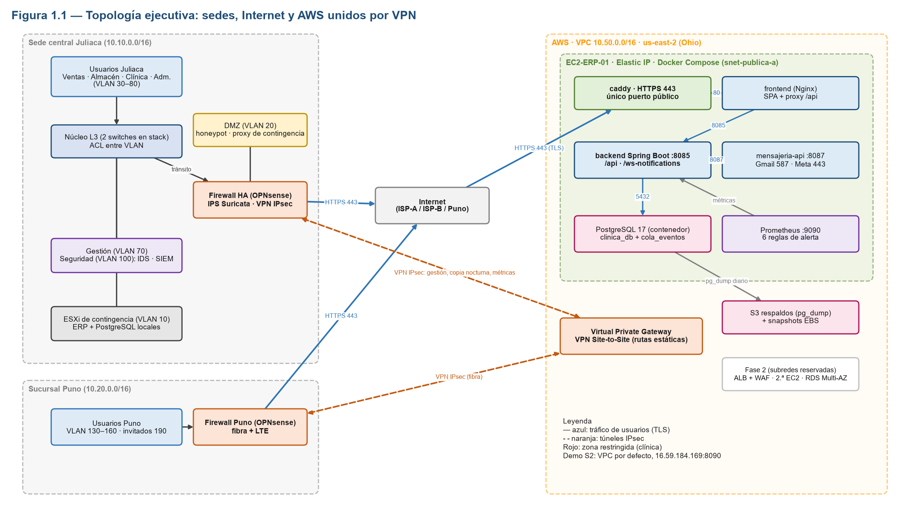
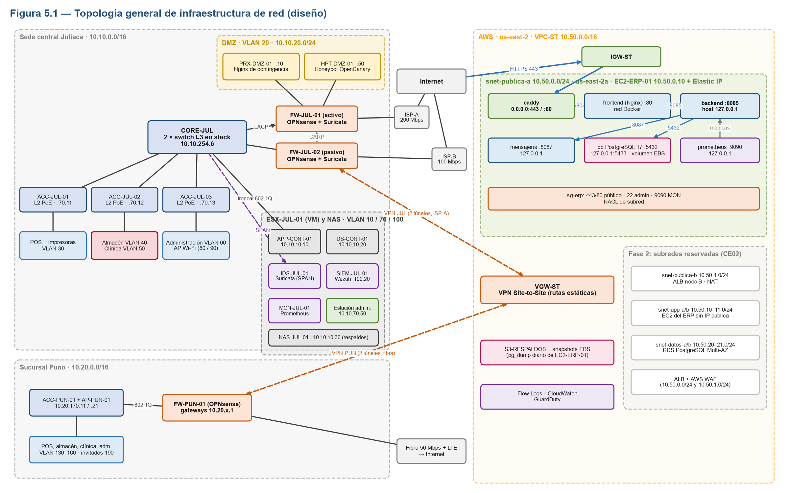
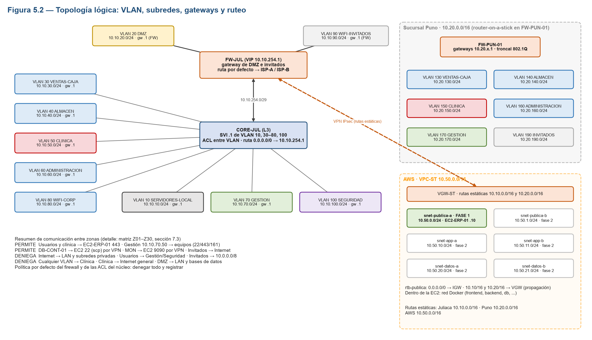
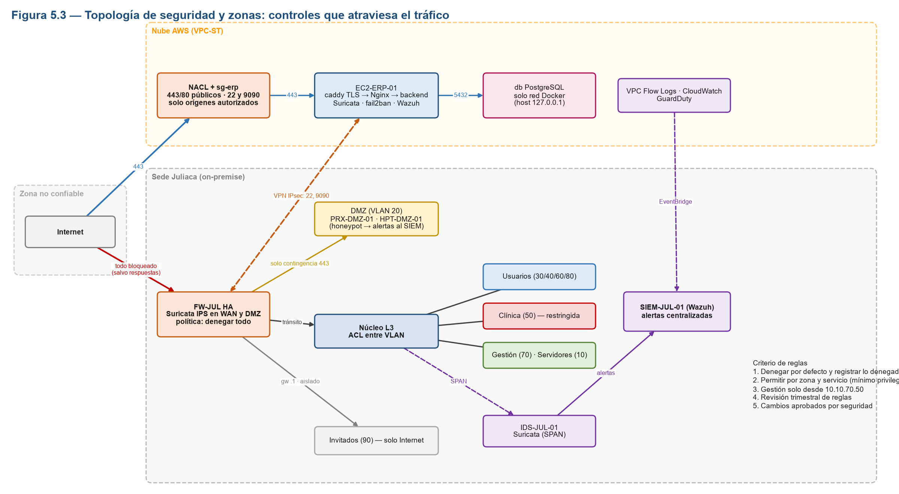
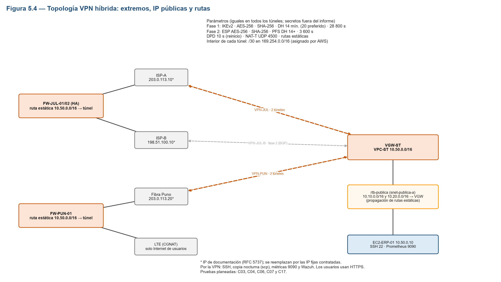
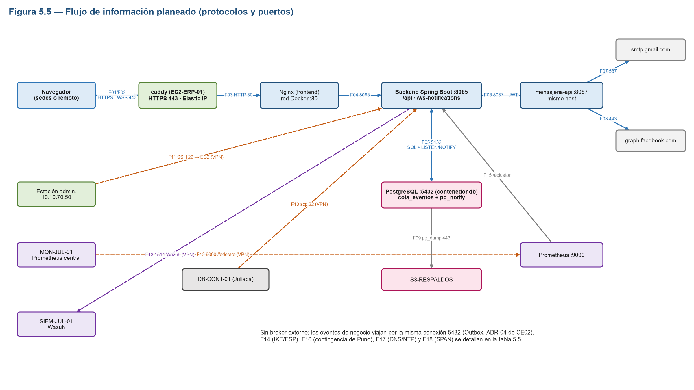

# CE0311 - S1 - E1: Análisis y Diseño de Red

**UNIVERSIDAD PERUANA UNIÓN**

Facultad de Ingeniería y Arquitectura · Escuela Profesional de Ingeniería de Sistemas

**ENTREGABLE 1 · SEMESTRE 1**

**Análisis y Diseño de Red**

*(CE0311 · Línea de Infraestructura Tecnológica — CE03)*

**Red híbrida on-premise + AWS del ERP «Articulos» — Salud Total SAC  
(cadena de farmacias y clínica ambulatoria · Juliaca y Puno)**

| **Campo**       | **Detalle**                                                                                          |
|-----------------|------------------------------------------------------------------------------------------------------|
| Proyecto        | Infraestructura híbrida AWS + on-premise (VMware ESXi) con seguridad perimetral y SGSI ISO/IEC 27001 |
| Organización    | Salud Total SAC — sede central Juliaca y sucursal Puno                                               |
| Responsables    | Jhosef Anthony Quispe Huarilloclla · Jose Samuel Turpo Cauna · Yesenia Alejandra Gutierrez Anco      |
| Curso           | CE0311 — Análisis y Diseño de Red                                                                    |
| Versión y fecha | v2.1 — 19 de noviembre de 2026 (alineada con CE01, CE02 E1 v2.0 y el código del ERP)                 |

## Control de versiones

| Versión | Fecha         | Cambios                                                                                                                                                                                                                                                                                                    |
|---------|---------------|------------------------------------------------------------------------------------------------------------------------------------------------------------------------------------------------------------------------------------------------------------------------------------------------------------|
| 1.0     | Julio de 2026 | Primera versión (variantes «Local» y «AWS»): requerimientos, topología, redundancia, estándares y ética                                                                                                                                                                                                    |
| 2.0     | 19/11/2026    | Reestructurada según la plantilla S1-E1: alcance, objetivos medibles, seis vistas de topología, VPN, DMZ y matriz de zonas, IDS/IPS y honeypot, flujos y matriz de componentes, trazabilidad. Se retiran Kafka y Supabase y se fija la VPC 10.50.0.0/16                                                    |
| 2.1     | 19/11/2026    | AWS alineado a lo implementado y al resumen de la línea: fase 1 con una EC2 y Docker Compose (Elastic IP, sg-erp, Caddy para TLS, puertos internos en 127.0.0.1), VPN con rutas estáticas (una conexión por sede), detección en la instancia; ALB, 2 EC2, RDS y BGP pasan a fase 2 con subredes reservadas |

Este informe se acompaña de tres productos independientes, exigidos por la rúbrica: los diagramas editables (carpeta Diagramas, formato .drawio de diagrams.net y .png), la matriz de componentes y la matriz de pruebas de conectividad (Anexos/Matrices_Diseno_Red_E1.xlsx). Todas las tablas del informe y de la hoja de cálculo se generan desde la misma fuente de datos, por lo que coinciden entre sí.

## 1. Resumen ejecutivo del diseño de red

Salud Total SAC es una cadena de farmacias con clínica ambulatoria que opera una sede central en Juliaca y una sucursal en Puno (unos 66 usuarios). Toda su operación —ventas y caja, inventario por lotes con FEFO, compras, reabastecimiento, historia clínica y notificaciones— corre sobre «Articulos», un ERP web propio (Angular 20, Spring Boot 3.5 / Java 21, PostgreSQL y el microservicio mensajeria-api). CE01 decidió llevar el ERP a la nube y CE02 lo diseñó sobre AWS; este documento diseña la red que lo hace posible.

Problema que se resuelve. El ERP ya corre en AWS (una EC2 con Docker Compose), pero sin una red diseñada a su alrededor: se publica por HTTP en el puerto 8090, los puertos internos quedan escuchando en el host, las sedes no tienen segmentación documentada (los datos de salud comparten red con cajas e invitados), no hay un camino cifrado hacia la nube para administrar y respaldar ni visibilidad de ataques. Una caída de enlace detiene las ventas.

Topología propuesta. Cada sede tiene una red segmentada en VLAN (ventas/caja, almacén, clínica, administración, gestión, seguridad, Wi-Fi corporativo e invitados). Juliaca usa un núcleo L3 de dos switches en stack, un par de firewalls OPNsense en alta disponibilidad y doble ISP; Puno, un firewall OPNsense con fibra y respaldo LTE. El ERP vive en AWS (us-east-2) tal como se implementó: una instancia EC2 Ubuntu 24.04 con Elastic IP que ejecuta el sistema con Docker Compose (Nginx, backend Spring Boot, PostgreSQL, mensajería y Prometheus). El diseño la ubica en una VPC dedicada 10.50.0.0/16 y reserva las subredes de la fase 2 (ALB, segunda EC2 y RDS Multi-AZ, la arquitectura objetivo de CE02) para crecer sin renumerar. Un host VMware ESXi en Juliaca queda como contingencia.

Integración híbrida. VPN IPsec Site-to-Site (IKEv2, AES-256, SHA-256, rutas estáticas) de cada sede a un Virtual Private Gateway, con dos túneles por conexión. Por la VPN viaja lo que nunca debe tocar Internet: gestión, copia nocturna de la base para contingencia, métricas y registros. Los usuarios llegan al ERP por HTTPS a la Elastic IP, de modo que la venta no depende del túnel.

Zonas de seguridad. Exterior, DMZ local (honeypot y proxy de contingencia), DMZ en la nube (la EC2 publicada), red interna de Docker, zonas de usuarios, zona restringida de clínica, gestión, seguridad e invitados. La política por defecto es denegar; el único servicio publicado es HTTPS 443 en la EC2 (Caddy delante de Nginx), y backend, base y monitoreo solo escuchan en 127.0.0.1 o en la red Docker. Suricata (IPS en el firewall, IDS por SPAN y en la instancia), un honeypot OpenCanary, VPC Flow Logs y Wazuh centralizan la detección.

Riesgos de red preliminares: caída del enlace o del túnel (mitigado con doble ISP, LTE y dos túneles; el ERP no depende de la VPN); exposición de la base o del backend (mitigado con un único puerto público y puertos internos en 127.0.0.1, riesgo R1 del SGSI); tráfico sin cifrar (TLS con Caddy, riesgo R6); instancia única (snapshots EBS, pg_dump diario y contingencia local); acceso administrativo indebido (VLAN de gestión, SSH solo con llave y desde orígenes autorizados); fuga de secretos de la VPN (fuera del informe y de git).

Resultados esperados y siguientes pasos. Ocho objetivos medibles (sección 4), 30 reglas de comunicación entre zonas, 40 componentes con IP planeada, 20 pruebas de conectividad y 8 de detección para el Semestre 2 (entregable «Implementación, testing y monitoreo de red»), donde ya se desplegó la fase 1 en AWS.

*Figura 1.1 — Topología ejecutiva simplificada del diseño de red*

## 2. Descripción de la organización y necesidades de red

### 2.1 Descripción general

Organización y rubro: Salud Total SAC, cadena de farmacias (venta de medicamentos con control de lotes y vencimientos exigido por DIGEMID) con consultorios de atención ambulatoria. Sedes: central en Juliaca (ventas, almacén principal, clínica, administración y sala de comunicaciones) y sucursal en Puno.

Servicios TI que dependen de la red: el ERP «Articulos» (SPA Angular que consume la API REST del backend en el puerto 8085 y recibe notificaciones por WebSocket/STOMP en /ws-notifications), la base de datos PostgreSQL clinica_db, el microservicio mensajeria-api (puerto 8087, correo por Gmail SMTP y WhatsApp Business de Meta), la emisión de comprobantes y, en la fase 2, SUNAT/OSE y pasarela de pagos.

Uso de nube e infraestructura local: la producción del ERP se aloja en AWS (decisión ADR-07 de CE02) en una EC2 con Docker Compose; en las sedes quedan la red de usuarios, la seguridad perimetral, el monitoreo y un host ESXi de contingencia en Juliaca.

Usuarios y dispositivos estimados por área:

| Área / servicio                    | Juliaca  | Puno     | Total | VLAN     |
|------------------------------------|----------|----------|-------|----------|
| Ventas / caja (POS)                | 12       | 4        | 16    | 30 / 130 |
| Almacén                            | 6        | 2        | 8     | 40 / 140 |
| Clínica                            | 8        | 3        | 11    | 50 / 150 |
| Administración / gerencia          | 10       | 1        | 11    | 60 / 160 |
| Wi-Fi corporativo                  | 15       | —        | 15    | 80       |
| Invitados (Wi-Fi)                  | variable | variable | —     | 90 / 190 |
| Total de usuarios activos (aprox.) | ~50      | ~16      | ~66   | —        |

Ancho de banda: el ERP intercambia JSON pequeño; los picos vienen de reportes y exportaciones. La estimación y la provisión son:

| Tráfico                                         | Por usuario      | Concurrencia     | Agregado                                    |
|-------------------------------------------------|------------------|------------------|---------------------------------------------|
| Operación del ERP (REST/JSON)                   | 0,5–1 Mbps       | ~50 en Juliaca   | ~40 Mbps                                    |
| Reportes y exportaciones (PDF/Excel)            | 3–5 Mbps en pico | ~8 simultáneos   | ~30 Mbps en ráfaga                          |
| Notificaciones (WebSocket/STOMP)                | \< 50 kbps       | ~66              | ~3 Mbps                                     |
| Túneles VPN (gestión, copia nocturna, métricas) | —                | Programado 02:00 | ~5 Mbps en ventana (pg_dump de ~0,3 MB hoy) |
| Navegación, correo y actualizaciones            | variable         | —                | ~40 Mbps                                    |
| Provisión Juliaca                               |                  |                  | 200 Mbps (ISP-A) + 100 Mbps (ISP-B)         |
| Provisión Puno                                  |                  |                  | 50 Mbps fibra + LTE de respaldo             |

Disponibilidad y crecimiento: el ERP debe estar disponible ≥ 99,5 % de 07:00 a 23:00 (RNF-15 de CE02), con RPO ≤ 24 h y RTO ≤ 4 h; las ventas de hasta 20 ítems deben responder en menos de 2 s con 50 usuarios (RNF-14). El plan estratégico de CE01 (OE1) prevé abrir nuevas sucursales, por lo que el direccionamiento debe admitirlas sin renumerar.

### 2.2 Servicios y procesos críticos dependientes de la red

| Proceso                                  | Servicio TI                                                 | Dependencia de red                           | Criticidad |
|------------------------------------------|-------------------------------------------------------------|----------------------------------------------|------------|
| Ventas y caja                            | ERP: módulo de ventas, caja y comprobantes                  | Sede → EC2-ERP-01 443; WebSocket para avisos | Crítica    |
| Inventario por lotes (FEFO) y kardex     | ERP: almacenes, lotes y alertas de vencimiento              | Sede → EC2-ERP-01 443                        | Alta       |
| Compras y reabastecimiento               | ERP: órdenes de compra y punto de reorden                   | Sede → EC2-ERP-01 443; mensajería → Gmail    | Alta       |
| Atención clínica                         | ERP: historia clínica y resultados                          | VLAN de clínica → EC2-ERP-01 443 únicamente  | Crítica    |
| Transferencias entre sedes               | ERP: transferencias Juliaca–Puno                            | Ambas sedes → EC2-ERP-01 443                 | Alta       |
| Comunicación con pacientes y proveedores | mensajeria-api (WhatsApp y correo)                          | EC2 → IGW → Meta 443 / Gmail 587             | Media      |
| Continuidad                              | pg_dump diario, snapshots EBS y ERP de contingencia en ESXi | EC2 → S3 443; VPN Juliaca → EC2 22 (scp)     | Alta       |
| Administración y monitoreo               | SSH, SIEM, federación de Prometheus                         | VLAN 70/100 → EC2 por VPN (22, 9090)         | Alta       |

### 2.3 Partes interesadas relevantes a la red

| Parte interesada                              | Qué espera de la conectividad y la seguridad de red                                                | Influencia |
|-----------------------------------------------|----------------------------------------------------------------------------------------------------|------------|
| Clientes y pacientes                          | Atención sin colas por caídas; confidencialidad de su historia clínica; Wi-Fi de cortesía separado | Alta       |
| Cajeros, almaceneros y personal clínico       | ERP rápido y disponible; no perder ventas por la red                                               | Alta       |
| Gerencia / Dirección                          | Continuidad del negocio, costo controlado, acceso a reportes                                       | Alta       |
| Administrador de TI / red                     | Red documentada, gestionable y con acceso administrativo seguro                                    | Alta       |
| Responsable de seguridad (SGSI)               | Segmentación, registros y controles alineados a ISO/IEC 27001                                      | Alta       |
| Proveedores ISP (Juliaca y Puno)              | Enlaces con IP fija y soporte; responsabilidad hasta el CPE                                        | Media      |
| AWS (proveedor de nube)                       | Modelo de responsabilidad compartida: AWS protege la infraestructura física                        | Alta       |
| Meta (WhatsApp) y Google (Gmail SMTP)         | Salida HTTPS/SMTP desde la mensajería                                                              | Media      |
| Reguladores: DIGEMID, SUNAT, ANPD (Ley 29733) | Trazabilidad de lotes, comprobantes y protección de datos de salud                                 | Alta       |

### 2.4 Necesidades de negocio que guían el diseño

Cada decisión de diseño se rastrea a una de estas necesidades (matriz completa en el Anexo B):

| ID    | Necesidad                                                        |
|-------|------------------------------------------------------------------|
| ON-01 | Vender y facturar sin interrupciones en ambas sedes              |
| ON-02 | Centralizar inventario, ventas y clínica entre sedes             |
| ON-03 | Proteger los datos de pacientes y de la operación                |
| ON-04 | Abrir sucursales y crecer sin rediseñar                          |
| ON-05 | Cumplir normativa (Ley 29733, DIGEMID, SUNAT) y buenas prácticas |
| ON-06 | Contener costos                                                  |

## 3. Alcance del diseño de red

### 3.1 Declaración de alcance

El diseño comprende la infraestructura de conectividad, direccionamiento y segmentación de las redes de las sedes Juliaca y Puno (VLAN de usuarios, clínica, DMZ, gestión, seguridad e invitados), su seguridad perimetral y de detección, y su integración mediante VPN IPsec Site-to-Site con la VPC de AWS (subredes, tablas de rutas, Security Group y NACL de la EC2 que ejecuta el ERP con Docker Compose, y la red interna de esos contenedores), incluido el host ESXi de contingencia en lo que respecta a su conectividad.

### 3.2 Límites

- **Físicos:** sala de comunicaciones y gabinetes de piso de Juliaca, gabinete de Puno, enlaces WAN hasta el CPE del ISP.

- **Tecnológicos:** firewalls OPNsense, switches núcleo y acceso, puntos de acceso Wi-Fi, VLAN 802.1Q, VPN IPsec, IDS/IPS Suricata, honeypot, VPC, subredes, tablas de rutas, IGW, VGW, EC2 con Elastic IP, red Docker, Security Group y NACL.

- **Organizacionales:** quién administra cada segmento (tabla siguiente).

| Segmento                                  | Administra                       | Observación                                               |
|-------------------------------------------|----------------------------------|-----------------------------------------------------------|
| Perímetro (firewalls, VPN)                | Administrador de red             | Responsable de seguridad aprueba cambios de reglas        |
| Núcleo, acceso y Wi-Fi                    | Administrador de red             | —                                                         |
| Host ESXi y VM de contingencia            | Administrador de TI              | —                                                         |
| VLAN de seguridad (IDS, SIEM, monitoreo)  | Responsable de seguridad         | Administrador de TI opera                                 |
| Cuenta, VPC y EC2 de AWS (Docker Compose) | Responsable de nube (Jefe de TI) | Usuarios IAM con MFA, sin uso de root; SSH solo con llave |
| Enlaces WAN hasta el CPE                  | ISP                              | TI gestiona el contrato y el SLA                          |

### 3.3 Exclusiones

| Exclusión                                              | Justificación                                                                                                  |
|--------------------------------------------------------|----------------------------------------------------------------------------------------------------------------|
| Equipos personales del personal (BYOD)                 | Solo pueden usar la Wi-Fi de invitados; no se administran ni se conectan a la red corporativa                  |
| Cableado horizontal detallado (planos y certificación) | Se rige por TIA-568 (sección 9); el levantamiento de planos se hará con el contratista de cableado             |
| Equipos biomédicos con red propia                      | La clínica es ambulatoria y hoy no tiene equipos conectados; si se adquieren, irán en una VLAN nueva (VLAN 55) |
| Redes de los ISP y de AWS bajo su responsabilidad      | Responsabilidad compartida; solo se diseña lo configurable por Salud Total                                     |
| Integración con SUNAT/OSE y pasarela de pagos          | Fase 2 del ERP (RF-31 de CE02); solo se reserva la salida HTTPS                                                |
| Diseño físico del centro de datos, energía y clima     | Se trata en el E2 de CE03 (Centro de Datos Híbrido)                                                            |

## 4. Objetivos del diseño de red

Los objetivos son medibles y cada uno se comprobará con las pruebas de las secciones 6 y 8:

| ID    | Objetivo                         | Indicador                                                                                      | Meta                                                                 | Responsable     | Necesidad    |
|-------|----------------------------------|------------------------------------------------------------------------------------------------|----------------------------------------------------------------------|-----------------|--------------|
| OD-01 | Segmentar el tráfico por zonas   | Servidores, datos y equipos clínicos en VLAN/subredes o redes Docker dedicadas                 | 100 %                                                                | Diseño de red   | ON-03        |
| OD-02 | Aislar la gestión                | Interfaces de gestión en VLAN 70/170; SSH a la EC2 solo con llave y desde orígenes autorizados | 100 %                                                                | Seguridad       | ON-03        |
| OD-03 | Minimizar la exposición          | Servicios publicados a Internet                                                                | 1 (HTTPS 443 en la Elastic IP); 0 puertos de BD, backend o monitoreo | Seguridad       | ON-03        |
| OD-04 | Garantizar el enlace híbrido     | Túneles por conexión y tiempo de conmutación; independencia del ERP respecto del túnel         | 2 túneles por sede; \< 60 s; ventas sin VPN                          | Infraestructura | ON-01, ON-02 |
| OD-05 | Disponibilidad del acceso al ERP | Disponibilidad medida desde las sedes (07:00–23:00)                                            | ≥ 99,5 % (RNF-15 de CE02)                                            | Infraestructura | ON-01        |
| OD-06 | Rendimiento                      | RTT sede → EC2-ERP-01 (p95) · RTT Juliaca ↔ Puno                                               | \< 150 ms · \< 30 ms                                                 | Infraestructura | ON-01        |
| OD-07 | Visibilidad de seguridad         | Eventos de firewall, IDS, honeypot, EC2 y nube centralizados                                   | 100 %; alerta \< 5 min                                               | Seguridad       | ON-03, ON-05 |
| OD-08 | Crecer sin renumerar             | Bloques /16 por sede y subredes de fase 2 reservadas en la VPC                                 | ≥ 20 sedes; fase 2 sin cambiar direcciones                           | Diseño de red   | ON-04        |

## 5. Topologías de red (diseño)

Se presentan seis vistas con propósito distinto; la 5.1 es la vista maestra y las demás son acercamientos. Los originales editables están en la carpeta Diagramas (.drawio) y todos sus elementos aparecen en la matriz de componentes (sección 5.6).

### 5.1 Topología general de infraestructura de red

Juliaca: dos ISP (A de 200 Mbps y B de 100 Mbps) terminan en el par FW-JUL-01/02 (OPNsense en activo/pasivo con CARP). El firewall es puerta de enlace de la DMZ y de invitados y se conecta al núcleo por un enlace de tránsito agregado (LACP). El núcleo CORE-JUL —dos switches L3 en stack, un solo plano de control— enruta las VLAN internas y distribuye troncales 802.1Q a tres switches de acceso PoE (ventas, almacén/clínica, administración) y al host ESX-JUL-01, que aloja las VM de contingencia y de seguridad. Puno: un firewall OPNsense que hace de gateway de todas las VLAN (router-on-a-stick) sobre un switch PoE, con fibra y LTE. AWS: VPC-ST con la subred pública snet-publica-a, donde EC2-ERP-01 (Elastic IP) ejecuta los seis contenedores del ERP; las subredes de la fase 2 aparecen reservadas; el VGW termina las VPN de ambas sedes y las copias van a S3.

*Figura 5.1 — Topología general de red propuesta*

### 5.2 Topología lógica de red — VLAN y subredes

Direccionamiento privado RFC 1918, jerárquico por sitio: una /16 por sede (resumible en una sola ruta) y el tercer octeto igual al número de VLAN, lo que simplifica reglas y diagnóstico. La puerta de enlace es siempre la .1. Se conservan las direcciones de la v1.0 y de la implementación de S2 (Juliaca 10.10.x, Puno 10.20.130.x); la VPC se mueve a 10.50.0.0/16 porque la propuesta previa 10.20.0.0/16 se solapaba con Puno.

| Sitio                                    | Bloque                          | Esquema                                        | Estado    |
|------------------------------------------|---------------------------------|------------------------------------------------|-----------|
| Sede central Juliaca                     | 10.10.0.0/16                    | VLAN 10–100 (tercer octeto = n.º de VLAN)      | En uso    |
| Sucursal Puno                            | 10.20.0.0/16                    | VLAN 130–190 (tercer octeto = n.º de VLAN)     | En uso    |
| Futuras sedes (3.ª a 22.ª)               | 10.30.0.0/16 – 10.49.0.0/16     | Mismo patrón, una /16 por sede                 | Reservado |
| VPC de AWS (us-east-2, Ohio)             | 10.50.0.0/16                    | Subredes /24 por capa y zona de disponibilidad | En uso    |
| Ampliación en la nube (otra región / DR) | 10.51.0.0/16 – 10.59.0.0/16     | VPC adicionales sin solaparse                  | Reservado |
| Enlaces de tránsito internos             | 10.10.254.0/24 y 10.20.254.0/24 | /29 entre firewall y núcleo                    | En uso    |
| Túneles IPsec (interior)                 | 169.254.0.0/16 (/30 por túnel)  | Asignado por AWS (RFC 3927)                    | En uso    |

| Sede    | VLAN | Nombre           | Subred         | Gateway                | DHCP           | Zona                  |
|---------|------|------------------|----------------|------------------------|----------------|-----------------------|
| Juliaca | 10   | SERVIDORES-LOCAL | 10.10.10.0/24  | 10.10.10.1 (núcleo)    | Estático       | Servidores locales    |
| Juliaca | 20   | DMZ              | 10.10.20.0/24  | 10.10.20.1 (firewall)  | Estático       | DMZ                   |
| Juliaca | 30   | VENTAS-CAJA      | 10.10.30.0/24  | 10.10.30.1 (núcleo)    | DHCP .100–.200 | Usuarios              |
| Juliaca | 40   | ALMACEN          | 10.10.40.0/24  | 10.10.40.1 (núcleo)    | DHCP .100–.200 | Usuarios              |
| Juliaca | 50   | CLINICA          | 10.10.50.0/24  | 10.10.50.1 (núcleo)    | DHCP .100–.200 | Clínica (restringida) |
| Juliaca | 60   | ADMINISTRACION   | 10.10.60.0/24  | 10.10.60.1 (núcleo)    | DHCP .100–.200 | Usuarios              |
| Juliaca | 70   | GESTION          | 10.10.70.0/24  | 10.10.70.1 (núcleo)    | Estático       | Gestión               |
| Juliaca | 80   | WIFI-CORP        | 10.10.80.0/24  | 10.10.80.1 (núcleo)    | DHCP .20–.250  | Usuarios              |
| Juliaca | 90   | WIFI-INVITADOS   | 10.10.90.0/24  | 10.10.90.1 (firewall)  | DHCP .20–.250  | Invitados             |
| Juliaca | 100  | SEGURIDAD        | 10.10.100.0/24 | 10.10.100.1 (núcleo)   | Estático       | Seguridad             |
| Puno    | 130  | VENTAS-CAJA      | 10.20.130.0/24 | 10.20.130.1 (firewall) | DHCP .100–.200 | Usuarios              |
| Puno    | 140  | ALMACEN          | 10.20.140.0/24 | 10.20.140.1 (firewall) | DHCP .100–.200 | Usuarios              |
| Puno    | 150  | CLINICA          | 10.20.150.0/24 | 10.20.150.1 (firewall) | DHCP .100–.200 | Clínica (restringida) |
| Puno    | 160  | ADMINISTRACION   | 10.20.160.0/24 | 10.20.160.1 (firewall) | DHCP .100–.200 | Usuarios              |
| Puno    | 170  | GESTION          | 10.20.170.0/24 | 10.20.170.1 (firewall) | Estático       | Gestión               |
| Puno    | 190  | WIFI-INVITADOS   | 10.20.190.0/24 | 10.20.190.1 (firewall) | DHCP .20–.250  | Invitados             |

Subredes de la VPC (una /24 por capa y zona; en la fase 1 solo se usa snet-publica-a, las demás quedan reservadas para la fase 2):

| Subred         | CIDR          | Zona       | Tipo                              | Tabla de rutas                                          | Recursos                                                    |
|----------------|---------------|------------|-----------------------------------|---------------------------------------------------------|-------------------------------------------------------------|
| snet-publica-a | 10.50.0.0/24  | us-east-2a | Pública (fase 1)                  | rtb-publica: 0.0.0.0/0 → IGW; 10.10/16 y 10.20/16 → VGW | EC2-ERP-01 con Elastic IP (fase 1); nodo A del ALB (fase 2) |
| snet-publica-b | 10.50.1.0/24  | us-east-2b | Pública (reservada)               | rtb-publica                                             | Fase 2: nodo B del ALB y NAT Gateway                        |
| snet-app-a     | 10.50.10.0/24 | us-east-2a | Privada de aplicación (reservada) | Fase 2: rtb-app-a → NAT; sedes → VGW                    | Fase 2: EC2 del ERP sin IP pública                          |
| snet-app-b     | 10.50.11.0/24 | us-east-2b | Privada de aplicación (reservada) | Fase 2: rtb-app-b → NAT; sedes → VGW                    | Fase 2: segunda EC2 del ERP                                 |
| snet-datos-a   | 10.50.20.0/24 | us-east-2a | Privada de datos (reservada)      | Fase 2: rtb-datos sin Internet                          | Fase 2: RDS PostgreSQL primario                             |
| snet-datos-b   | 10.50.21.0/24 | us-east-2b | Privada de datos (reservada)      | Fase 2: rtb-datos sin Internet                          | Fase 2: RDS en espera (Multi-AZ)                            |

Ruteo. En Juliaca el núcleo tiene las SVI .1 de las VLAN internas y una ruta por defecto hacia la VIP del firewall (10.10.254.1); el firewall tiene una ruta estática 10.50.0.0/16 hacia el túnel VPN-JUL, y la conexión de AWS declara 10.10.0.0/16 como ruta estática. Las ACL del núcleo aplican la matriz de la sección 7.3 al tráfico entre VLAN; lo que sale de la sede lo filtra el firewall. En Puno el firewall es gateway de todas las VLAN y su conexión declara 10.20.0.0/16. En AWS, rtb-publica tiene 0.0.0.0/0 hacia el IGW y recibe por propagación 10.10.0.0/16 y 10.20.0.0/16 hacia el VGW. Dentro de EC2-ERP-01 los contenedores se comunican por la red interna de Docker.

Ejemplo de cálculo (VLAN 30 — 10.10.30.0/24): 24 bits de red y 8 de host → 2⁸ = 256 direcciones, 254 utilizables; red 10.10.30.0, gateway 10.10.30.1, difusión 10.10.30.255. Con VLSM la VLAN de clínica (11 hosts) cabría en una /28; se prefiere /24 por simplicidad y crecimiento, lo que es razonable en espacio privado.

*Figura 5.2 — Topología lógica de red propuesta (incluye el resumen de comunicación entre VLAN)*

### 5.3 Diseño de seguridad perimetral y zonas

La figura muestra los controles que atraviesa el tráfico antes de llegar a cada zona. En la nube: Internet → NACL → sg-erp (solo 443/80 públicos; 22 y 9090 solo desde orígenes autorizados) → Caddy (TLS) → Nginx → backend en la red Docker → PostgreSQL, que no tiene puerto accesible desde fuera del host. En la sede: Internet → firewall HA con Suricata en modo IPS → DMZ o núcleo con ACL → zonas internas; una copia del tráfico del núcleo (SPAN) alimenta al sensor IDS; firewall, IDS, honeypot, la EC2 (Suricata y Wazuh) y los Flow Logs envían sus eventos al SIEM.

| Zona                                         | Nivel de confianza | Contenido                                   | Controles                                                           |
|----------------------------------------------|--------------------|---------------------------------------------|---------------------------------------------------------------------|
| Exterior (Internet)                          | Nula               | ISP, usuarios remotos, atacantes            | Firewall HA, IPS, NACL, sg-erp                                      |
| DMZ nube (snet-publica-a)                    | Baja               | EC2-ERP-01: solo Caddy y Nginx publicados   | sg-erp (443/80), TLS, Suricata y fail2ban en la instancia           |
| DMZ local (VLAN 20)                          | Baja               | Proxy de contingencia, honeypot             | Firewall, IPS, sin acceso a LAN                                     |
| Invitados (VLAN 90/190)                      | Baja               | Wi-Fi de clientes                           | Solo Internet, aislamiento de clientes                              |
| Usuarios (VLAN 30/40/60/80, 130/140/160)     | Media              | POS y estaciones                            | 802.1X, ACL del núcleo, filtrado web                                |
| Clínica (VLAN 50/150)                        | Media, restringida | Equipos con datos de salud                  | Sin Internet general, monitoreo este-oeste                          |
| Aplicación (red Docker de EC2-ERP-01)        | Alta               | backend, mensajería, Prometheus             | Sin puertos públicos; host solo en 127.0.0.1; JWT                   |
| Datos (contenedor db, volumen en EBS)        | Máxima             | PostgreSQL clinica_db                       | Solo el backend lo alcanza; rol st_app; EBS cifrado; respaldos a S3 |
| Gestión (VLAN 70/170) y Seguridad (VLAN 100) | Máxima             | Interfaces de gestión, IDS, SIEM, monitoreo | Solo desde 10.10.70.50, registro en SIEM                            |

*Figura 5.3 — Topología de seguridad y zonas propuesta*

### 5.4 Diseño de conectividad VPN híbrida

Extremos, redes anunciadas y cifrado previsto (los secretos no se incluyen en este documento):

| Parámetro                          | Extremo on-premise                                                                                 | Extremo AWS                                                     |
|------------------------------------|----------------------------------------------------------------------------------------------------|-----------------------------------------------------------------|
| Tipo de túnel                      | IPsec Site-to-Site basado en rutas (VTI) con rutas estáticas                                       | AWS Site-to-Site VPN (2 túneles por conexión)                   |
| Dispositivo                        | FW-JUL-01/02 (OPNsense, strongSwan) · FW-PUN-01                                                    | VGW-ST asociado a VPC-ST                                        |
| IP pública                         | Juliaca: 203.0.113.10 (ISP-A)\* · Puno: 203.0.113.20 (fibra)\*                                     | Dos IP públicas por conexión, asignadas por AWS                 |
| Customer Gateway                   | CGW-JUL (IP fija de ISP-A) y CGW-PUN (IP fija de la fibra)                                         | —                                                               |
| Redes anunciadas (rutas estáticas) | Juliaca 10.10.0.0/16 · Puno 10.20.0.0/16                                                           | 10.50.0.0/16                                                    |
| Enrutamiento                       | Ruta estática 10.50.0.0/16 → interfaz del túnel; los dos túneles con monitoreo de puerta de enlace | Rutas estáticas por conexión y propagación a rtb-publica        |
| Fase 1 (IKE)                       | IKEv2 · AES-256 · SHA-256 · DH 14 mínimo (20 preferido) · vida 28 800 s                            | Igual (propuesta restringida en la configuración del túnel)     |
| Fase 2 (ESP)                       | AES-256 · SHA-256 · PFS DH 14 o superior · vida 3 600 s                                            | Igual                                                           |
| Autenticación                      | Clave precompartida por túnel                                                                      | —                                                               |
| Detección de caída                 | DPD 10 s, acción reiniciar; el firewall conmuta al otro túnel                                      | DPD timeout 30 s, acción restart; alarma CloudWatch TunnelState |
| Custodia de secretos               | Gestor de contraseñas del área de TI; nunca en el informe ni en git                                | Configuración del túnel en AWS (no se exporta)                  |

| Conexión           | Extremos                | Túneles   | Rol                                                                                |
|--------------------|-------------------------|-----------|------------------------------------------------------------------------------------|
| VPN-JUL            | FW-JUL (ISP-A) ↔ VGW-ST | 2 túneles | Gestión, copia nocturna, métricas y registros de Juliaca                           |
| VPN-PUN            | FW-PUN (fibra) ↔ VGW-ST | 2 túneles | Gestión y registros de Puno                                                        |
| VPN-JUL-B (fase 2) | FW-JUL (ISP-B) ↔ VGW-ST | 2 túneles | Respaldo por el segundo ISP con BGP, cuando la VPN deje de ser solo administrativa |

*\* Las IP públicas mostradas son de documentación (RFC 5737); se reemplazarán por las IP fijas que asignen los ISP. El LTE de Puno suele estar detrás de CGNAT y sin IP fija, por eso solo da salida a Internet a los usuarios y no levanta VPN en la fase 1.*

*Figura 5.4 — Topología VPN híbrida propuesta*

### 5.5 Diagrama de flujo de información planeado

Por dónde viajan los datos, con protocolo, puerto y cifrado. Los puertos son los del docker-compose.yml real: frontend Nginx (publicado en 8090 en la línea base inicial As-Is, 80 detrás de Caddy en el diseño), backend 8085 con /api y /ws-notifications, mensajería 8087, PostgreSQL 5432 y Prometheus 9090; no hay broker de mensajería porque los eventos se guardan en cola_eventos y se avisan con pg_notify/LISTEN (ADR-04 de CE02).

| N.° | Origen                          | Destino                     | Protocolo           | Puerto                       | Cifrado               | Ruta           |
|-----|---------------------------------|-----------------------------|---------------------|------------------------------|-----------------------|----------------|
| F01 | Navegador (sede o remoto)       | EC2-ERP-01 (caddy)          | HTTPS               | 443                          | TLS 1.2+              | Internet       |
| F02 | Navegador                       | caddy → Nginx → backend     | WSS (STOMP)         | 443 → 8085 /ws-notifications | TLS 1.2+              | Internet       |
| F03 | caddy                           | Nginx (contenedor frontend) | HTTP                | 80                           | Red interna de Docker | Mismo host     |
| F04 | Nginx                           | Backend Spring Boot         | HTTP                | 8085                         | Red interna de Docker | Mismo host     |
| F05 | Backend                         | PostgreSQL (contenedor db)  | PostgreSQL          | 5432                         | Red interna de Docker | Mismo host     |
| F06 | Backend                         | mensajeria-api              | HTTP REST           | 8087                         | Red interna + JWT     | Mismo host     |
| F07 | mensajeria-api                  | smtp.gmail.com              | SMTP                | 587                          | STARTTLS              | IGW → Internet |
| F08 | mensajeria-api                  | graph.facebook.com          | HTTPS               | 443                          | TLS                   | IGW → Internet |
| F09 | EC2-ERP-01 (cron 02:00)         | S3-RESPALDOS                | HTTPS               | 443                          | TLS + cifrado SSE     | IGW → S3       |
| F10 | DB-CONT-01                      | EC2-ERP-01                  | SSH (scp)           | 22                           | SSH dentro de IPsec   | VPN Juliaca    |
| F11 | Estación de administración      | EC2-ERP-01                  | SSH                 | 22                           | SSH dentro de IPsec   | VPN Juliaca    |
| F12 | MON-JUL-01                      | Prometheus (EC2-ERP-01)     | HTTP                | 9090 /federate               | Dentro de IPsec       | VPN Juliaca    |
| F13 | EC2-ERP-01, firewalls, switches | SIEM-JUL-01                 | Wazuh / syslog TLS  | 1514, 1515 / 6514            | TLS                   | LAN o VPN      |
| F14 | FW-JUL / FW-PUN                 | VGW-ST                      | IKEv2 / ESP (NAT-T) | UDP 500, UDP 4500, IP 50     | AES-256               | Internet       |
| F15 | Prometheus                      | Backend                     | HTTP                | 8085 /actuator/prometheus    | Red interna de Docker | Mismo host     |
| F16 | Puno (contingencia)             | PRX-DMZ-01 (Juliaca)        | HTTPS               | 443                          | TLS                   | Internet       |
| F17 | Todos los equipos               | Firewall (resolvedor) / NTP | DNS / NTP           | UDP 53 / UDP 123             | —                     | LAN            |
| F18 | Puertos del núcleo (SPAN)       | IDS-JUL-01                  | Copia de tráfico    | —                            | —                     | LAN            |

*Figura 5.5 — Flujo de información planeado*

### 5.6 Matriz de componentes de red

Todo elemento dibujado en las figuras 1.1 y 5.1–5.5 aparece aquí con su IP planeada (también en la hoja «Componentes» del XLSX):

| ID  | Componente                                          | Zona                    | IP planeada                                                                                       | Función                                                                                                                                                                 | Crit.   | Fig.               |
|-----|-----------------------------------------------------|-------------------------|---------------------------------------------------------------------------------------------------|-------------------------------------------------------------------------------------------------------------------------------------------------------------------------|---------|--------------------|
| C01 | ISP-A (fibra 200 Mbps)                              | Exterior                | 203.0.113.10 (IP pública fija)\*                                                                  | Enlace primario a Internet                                                                                                                                              | Alta    | 5.1, 5.4           |
| C02 | ISP-B (radioenlace/fibra 100 Mbps)                  | Exterior                | 198.51.100.10 (IP pública fija)\*                                                                 | Enlace de respaldo a Internet                                                                                                                                           | Alta    | 5.1, 5.4           |
| C03 | FW-JUL-01 (OPNsense, activo)                        | Perímetro               | WAN 203.0.113.10 / 198.51.100.10; tránsito 10.10.254.2; DMZ 10.10.20.2; gestión 10.10.70.3        | Firewall de estado, VPN IPsec, IPS Suricata, gateway DMZ/invitados                                                                                                      | Crítica | 1.1, 5.1–5.4       |
| C04 | FW-JUL-02 (OPNsense, pasivo)                        | Perímetro               | Tránsito 10.10.254.3; DMZ 10.10.20.3; gestión 10.10.70.4                                          | Par de alta disponibilidad (CARP + pfsync)                                                                                                                              | Crítica | 5.1, 5.3           |
| C05 | VIP del firewall (CARP)                             | Perímetro               | 10.10.254.1 · 10.10.20.1 · 10.10.90.1                                                             | Puerta de enlace virtual del par HA                                                                                                                                     | Crítica | 5.2                |
| C06 | CORE-JUL (2 switches L3 en stack)                   | Núcleo                  | Tránsito 10.10.254.6; SVI .1 de VLAN 10,30–80,100; gestión 10.10.70.2                             | Ruteo entre VLAN con ACL, LACP hacia acceso                                                                                                                             | Crítica | 5.1, 5.2           |
| C07 | ACC-JUL-01 (L2 PoE 24p)                             | Acceso                  | 10.10.70.11                                                                                       | Piso de ventas: POS e impresoras                                                                                                                                        | Alta    | 5.1                |
| C08 | ACC-JUL-02 (L2 PoE 24p)                             | Acceso                  | 10.10.70.12                                                                                       | Almacén y clínica                                                                                                                                                       | Alta    | 5.1                |
| C09 | ACC-JUL-03 (L2 PoE 24p)                             | Acceso                  | 10.10.70.13                                                                                       | Administración y sala de servidores                                                                                                                                     | Alta    | 5.1                |
| C10 | AP-JUL-01…03 (Wi-Fi 6)                              | Acceso                  | 10.10.70.21–23                                                                                    | SSID corporativo (VLAN 80) e invitados (VLAN 90)                                                                                                                        | Media   | 5.1                |
| C11 | ESX-JUL-01 (host VMware ESXi)                       | Servidores locales      | vmk0 gestión 10.10.70.30; iDRAC 10.10.70.31                                                       | Hipervisor de contingencia y de seguridad                                                                                                                               | Alta    | 5.1, 5.2           |
| C12 | APP-CONT-01 (VM)                                    | Servidores locales      | 10.10.10.10                                                                                       | ERP de contingencia (frontend :8090, backend :8085, mensajería :8087)                                                                                                   | Alta    | 5.2, 5.5           |
| C13 | DB-CONT-01 (VM)                                     | Servidores locales      | 10.10.10.20                                                                                       | PostgreSQL de contingencia (restaura el pg_dump nocturno de EC2-ERP-01)                                                                                                 | Alta    | 5.2, 5.5           |
| C40 | NAS-JUL-01 (2 bahías, RAID 1)                       | Servidores locales      | 10.10.10.30                                                                                       | Respaldos locales: VM del ESXi, pg_dump nocturno y archivo del SIEM (copia 3 de la regla 3-2-1)                                                                         | Alta    | 5.1                |
| C14 | PRX-DMZ-01 (VM)                                     | DMZ                     | 10.10.20.10                                                                                       | Nginx de contingencia; publica APP-CONT-01 solo en modo contingencia                                                                                                    | Media   | 5.3                |
| C15 | HPT-DMZ-01 (VM, OpenCanary)                         | DMZ                     | 10.10.20.50                                                                                       | Honeypot de baja interacción (SSH, HTTP, SMB, PostgreSQL falsos)                                                                                                        | Media   | 5.3                |
| C16 | IDS-JUL-01 (VM, Suricata)                           | Seguridad               | Gestión 10.10.100.10; interfaz de captura sin IP (SPAN)                                           | IDS de tráfico este-oeste (copia del núcleo)                                                                                                                            | Alta    | 5.3                |
| C17 | SIEM-JUL-01 (VM, Wazuh)                             | Seguridad               | 10.10.100.20                                                                                      | Centraliza syslog, alertas de IDS, honeypot y agentes                                                                                                                   | Alta    | 5.3, 5.5           |
| C18 | MON-JUL-01 (VM, Prometheus + Grafana)               | Seguridad               | 10.10.100.30                                                                                      | Monitoreo de red y enlaces; federa el Prometheus de EC2-ERP-01 por VPN                                                                                                  | Media   | 5.5                |
| C19 | Estación de administración                          | Gestión                 | 10.10.70.50                                                                                       | Único origen autorizado para SSH/HTTPS de gestión                                                                                                                       | Alta    | 5.3, 5.5           |
| C20 | Cajas POS e impresoras (Juliaca)                    | Usuarios                | 10.10.30.100–200 (DHCP); impresoras 10.10.30.50–69                                                | Ventas y caja                                                                                                                                                           | Crítica | 5.2                |
| C21 | Estaciones de almacén, clínica y administración     | Usuarios / Clínica      | DHCP .100–.200 de VLAN 40, 50 y 60                                                                | Operación del ERP                                                                                                                                                       | Alta    | 5.2                |
| C22 | ISP Puno (fibra 50 Mbps) + LTE                      | Exterior                | 203.0.113.20 (fija)\*; LTE con IP dinámica (CGNAT)                                                | Enlace primario y de respaldo                                                                                                                                           | Alta    | 5.1, 5.4           |
| C23 | FW-PUN-01 (OPNsense)                                | Perímetro               | WAN 203.0.113.20; gateways 10.20.x.1; gestión 10.20.170.1                                         | Firewall, gateway de VLAN (router-on-a-stick), VPN                                                                                                                      | Crítica | 5.1–5.4            |
| C24 | ACC-PUN-01 (L2 PoE 24p)                             | Acceso                  | 10.20.170.11                                                                                      | Acceso de la sucursal (troncal 802.1Q al firewall)                                                                                                                      | Alta    | 5.1                |
| C25 | AP-PUN-01 (Wi-Fi 6)                                 | Acceso                  | 10.20.170.21                                                                                      | SSID de invitados (VLAN 190)                                                                                                                                            | Baja    | 5.1                |
| C26 | Cajas POS y estaciones (Puno)                       | Usuarios / Clínica      | DHCP .100–.200 de VLAN 130–160                                                                    | Operación del ERP en la sucursal                                                                                                                                        | Crítica | 5.2                |
| C27 | VPC-ST (10.50.0.0/16)                               | Nube                    | 10.50.0.0/16                                                                                      | Red virtual del ERP en us-east-2 (el despliegue inicial As-Is usó la VPC por defecto 172.31.0.0/16)                                                                     | Crítica | 5.1, 5.2           |
| C28 | IGW-ST (Internet Gateway)                           | Nube pública            | —                                                                                                 | Entrada y salida a Internet de snet-publica-a                                                                                                                           | Alta    | 5.1                |
| C29 | VGW-ST (Virtual Private Gateway)                    | Borde híbrido           | Interior de túneles 169.254.x.x/30                                                                | Extremo AWS de las VPN Site-to-Site (rutas estáticas)                                                                                                                   | Crítica | 5.4                |
| C30 | EC2-ERP-01 (Ubuntu 24.04, 2 vCPU / 4 GB, gp3 20 GB) | Pública (DMZ nube)      | 10.50.0.10 + Elastic IP (línea base inicial: 172.31.4.35 / IP elástica pública (198.51.100.50)\*) | Host Docker Compose del ERP; único servidor publicado                                                                                                                   | Crítica | 1.1, 5.1, 5.3, 5.5 |
| C31 | Contenedor caddy (TLS)                              | Pública (DMZ nube)      | Host :443 y :80 (redirección)                                                                     | Termina HTTPS (certificado TLS autofirmado o Let's Encrypt sobre IP/DNS dinámico al no disponer de dominio comercial registrado) y reenvía a Nginx; cierra el riesgo R6 | Alta    | 5.3, 5.5           |
| C32 | Contenedor frontend (Nginx)                         | Aplicación (red Docker) | :80 interno (línea base inicial: publicado en :8090)                                              | SPA Angular y proxy de /api, /ws-notifications y /mensajeria                                                                                                            | Crítica | 5.5                |
| C33 | Contenedor backend (Spring Boot)                    | Aplicación (red Docker) | :8085 interno; host 127.0.0.1:8085                                                                | API REST con JWT, WebSocket y /actuator                                                                                                                                 | Crítica | 5.5                |
| C34 | Contenedor mensajeria (mensajeria-api)              | Aplicación (red Docker) | :8087 interno; host 127.0.0.1:8087                                                                | Correo (Gmail 587) y WhatsApp (Meta 443)                                                                                                                                | Media   | 5.5                |
| C35 | Contenedor db (PostgreSQL 17)                       | Datos (red Docker)      | :5432 interno; host 127.0.0.1:5433                                                                | Base clinica_db (volumen pgdata en EBS) y eventos Outbox                                                                                                                | Crítica | 5.5                |
| C36 | Contenedor prometheus                               | Seguridad (red Docker)  | :9090 interno; host 127.0.0.1:9090                                                                | Métricas y 6 reglas de alerta del ERP                                                                                                                                   | Media   | 5.5                |
| C37 | sg-erp + NACL de snet-publica-a                     | Nube                    | —                                                                                                 | Filtrado de la instancia y de la subred (matriz 7.3)                                                                                                                    | Crítica | 5.3                |
| C38 | S3-RESPALDOS + snapshots EBS (DLM)                  | Servicio regional       | —                                                                                                 | pg_dump diario cifrado y snapshot diario del disco (7 días)                                                                                                             | Alta    | 5.1, 5.5           |
| C39 | VPC Flow Logs, CloudWatch y GuardDuty               | Servicio regional       | —                                                                                                 | Registro y detección en la nube; alarmas de CPU, disco y StatusCheck                                                                                                    | Alta    | 5.3                |

## 6. Diseño de conectividad híbrida

Tecnología. AWS Site-to-Site VPN sobre un Virtual Private Gateway (VGW-ST) asociado a la VPC, con rutas estáticas. Cada conexión trae dos túneles hacia dos extremos de AWS distintos; OPNsense los configura como túneles basados en rutas (VTI) con monitoreo de la puerta de enlace, de modo que si cae uno el tráfico pasa al otro. Se elige VGW y no Transit Gateway porque hay una sola VPC, y rutas estáticas y no BGP porque cada sede tiene una sola conexión: BGP entra en la fase 2, cuando Juliaca agregue la conexión por ISP-B (VPN-JUL-B).

Peers y rutas. Juliaca declara 10.10.0.0/16 en VPN-JUL (Customer Gateway en la IP fija de ISP-A) y Puno 10.20.0.0/16 en VPN-PUN (fibra); AWS ofrece 10.50.0.0/16. Las sedes no se comunican entre sí por la VPN: lo único que comparten es el ERP, al que ambas llegan por HTTPS.

Qué tráfico usa la VPN y cuál no. Los usuarios usan el ERP por HTTPS en la Elastic IP (no dependen del túnel). Por la VPN viajan: SSH de administración desde 10.10.70.50, la copia nocturna del pg_dump hacia DB-CONT-01 (scp), la federación de Prometheus (9090) hacia MON-JUL-01 y los eventos de los agentes Wazuh hacia el SIEM.

Controles previstos. En el firewall, la interfaz IPsec es una zona propia con reglas explícitas (sección 7.3); en AWS, sg-erp solo acepta desde las sedes 10.10.70.50/32 (22), 10.10.10.20/32 (22) y 10.10.100.30/32 (9090), y la NACL de la subred repite esa restricción. El estado de los túneles se monitorea con CloudWatch (TunnelState) y alerta al SIEM.

Matriz de pruebas de conectividad que se ejecutará en el Semestre 2 (hoja «Pruebas_conectividad» del XLSX, con columna para el resultado obtenido):

| ID  | Origen                                | Destino                               | Puerto                     | Resultado esperado                                                                | Cómo se verifica                                                                                                              |
|-----|---------------------------------------|---------------------------------------|----------------------------|-----------------------------------------------------------------------------------|-------------------------------------------------------------------------------------------------------------------------------|
| C01 | POS Juliaca (VLAN 30)                 | EC2-ERP-01                            | TCP 443                    | Permitido · HTTP 200                                                              | curl -k -I https://198.51.100.50 (o https://198.51.100.50.sslip.io; verificación TLS sobre IP elástica sin dominio comercial) |
| C02 | Clínica Puno (VLAN 150)               | EC2-ERP-01                            | TCP 443                    | Permitido · HTTP 200                                                              | Navegador y curl                                                                                                              |
| C03 | ON-PREMISE → AWS: gestión 10.10.70.50 | EC2-ERP-01 10.50.0.10                 | SSH 22 por VPN             | Permitido                                                                         | ssh y traceroute (salto por el túnel)                                                                                         |
| C04 | ON-PREMISE → AWS: DB-CONT-01          | EC2-ERP-01                            | SSH 22 por VPN (scp)       | Permitido                                                                         | scp del último pg_dump                                                                                                        |
| C05 | ON-PREMISE → AWS: POS (VLAN 30)       | EC2-ERP-01 10.50.0.10                 | SSH 22 / TCP 9090          | Denegado                                                                          | nc -zv (timeout) + log del firewall                                                                                           |
| C06 | AWS → ON-PREMISE: EC2-ERP-01          | SIEM-JUL-01 10.10.100.20              | TCP 1514                   | Permitido                                                                         | Estado del agente Wazuh                                                                                                       |
| C07 | AWS → ON-PREMISE: EC2-ERP-01          | VLAN 30 / VLAN 50                     | Cualquiera                 | Denegado                                                                          | nc -zv + log del firewall                                                                                                     |
| C08 | Internet                              | Elastic IP de EC2-ERP-01              | TCP 8085, 8087, 9090, 5433 | Denegado (filtrado)                                                               | nmap -Pn -p 8085,8087,9090,5433 desde equipo externo                                                                          |
| C09 | Internet (IP no autorizada)           | Elastic IP de EC2-ERP-01              | TCP 22                     | Denegado                                                                          | ssh con timeout; registro REJECT en Flow Logs                                                                                 |
| C10 | DMZ (PRX-DMZ-01)                      | DB-CONT-01 / EC2-ERP-01               | TCP 5432 / 22              | Denegado                                                                          | nc -zv + log                                                                                                                  |
| C11 | Invitados (VLAN 90)                   | 10.10.0.0/16 y 10.50.0.0/16           | Cualquiera                 | Denegado                                                                          | nmap -sn desde un portátil de prueba                                                                                          |
| C12 | Invitados (VLAN 90)                   | Internet                              | TCP 443                    | Permitido                                                                         | Navegación                                                                                                                    |
| C13 | Clínica (VLAN 50)                     | Internet general                      | TCP 443                    | Denegado                                                                          | curl a sitio externo (bloqueado)                                                                                              |
| C14 | Puno (VLAN 130)                       | PRX-DMZ-01 (Juliaca)                  | TCP 443                    | Permitido solo en contingencia                                                    | Activar regla y probar con curl                                                                                               |
| C15 | Puno (VLAN 130)                       | Juliaca VLAN 50                       | Cualquiera                 | Denegado                                                                          | nc -zv + log                                                                                                                  |
| C16 | EC2-ERP-01                            | smtp.gmail.com / destino no permitido | TCP 587 / TCP 25           | Permitido / Denegado                                                              | openssl s_client -starttls smtp; nc -zv                                                                                       |
| C17 | Conmutación de túnel                  | VPN-JUL túnel 1 caído                 | —                          | Tráfico por el túnel 2 en \< 60 s                                                 | Desactivar túnel; ping continuo a 10.50.0.10                                                                                  |
| C18 | Conmutación de ISP                    | ISP-A desconectado                    | —                          | Usuarios siguen en el ERP por ISP-B en \< 2 min (la VPN queda caída hasta fase 2) | Desconectar WAN1; medir                                                                                                       |
| C19 | Corte de fibra en Puno                | Fibra desconectada                    | —                          | Usuarios siguen en el ERP por LTE en \< 3 min                                     | Desconectar fibra; medir                                                                                                      |
| C20 | Conmutación del firewall              | FW-JUL-01 apagado                     | —                          | FW-JUL-02 asume la VIP; \< 5 s de pérdida                                         | Apagar el nodo activo; ping continuo                                                                                          |

## 7. Diseño de seguridad perimetral

### 7.1 Firewall

Producto propuesto: OPNsense 25.x sobre dos appliances x86 de 4 puertos 2,5 GbE en Juliaca (HA con CARP y pfsync) y uno en Puno. Se elige porque soporta IPsec con AWS (y BGP para la fase 2), alta disponibilidad, IPS Suricata integrado y no requiere licencias anuales; un FortiGate 60F sería técnicamente equivalente. En el Semestre 2 puede emularse con máquinas virtuales manteniendo la misma política (equivalencia técnica aceptada por la línea).

| Interfaz             | Zona      | Dirección (Juliaca)            | Uso                                        |
|----------------------|-----------|--------------------------------|--------------------------------------------|
| WAN1                 | Exterior  | 203.0.113.10/29 (ISP-A)\*      | Internet primario, VPN-JUL                 |
| WAN2                 | Exterior  | 198.51.100.10/29 (ISP-B)\*     | Internet de respaldo (VPN-JUL-B en fase 2) |
| LAN (tránsito, LACP) | Interna   | 10.10.254.2–.3/29, VIP .1      | Enlace con el núcleo                       |
| DMZ (VLAN 20)        | DMZ       | 10.10.20.2–.3/24, VIP .1       | Proxy de contingencia y honeypot           |
| INVITADOS (VLAN 90)  | Invitados | 10.10.90.2–.3/24, VIP .1       | Wi-Fi de clientes                          |
| GESTION (VLAN 70)    | Gestión   | 10.10.70.3–.4/24               | Interfaz web/SSH del firewall              |
| SYNC                 | HA        | 10.10.253.0/30 (cable directo) | pfsync y XMLRPC entre nodos                |
| ipsec1–ipsec2 (VTI)  | VPN       | 169.254.x.x/30                 | Los dos túneles de VPN-JUL hacia AWS       |

Política por defecto: denegar todo el tráfico entrante y entre zonas, y registrar lo denegado. Criterio de reglas: (1) una regla por flujo de negocio, con origen, destino y puerto concretos —nunca «any-any»—; (2) mínimo privilegio por zona; (3) las interfaces de gestión solo aceptan a 10.10.70.50; (4) salida de usuarios por proxy/filtrado web; (5) toda regla lleva descripción, responsable y fecha; (6) revisión trimestral y cambios aprobados por el responsable de seguridad (control A.8.32).

### 7.2 DMZ

DMZ local (VLAN 20). Contiene PRX-DMZ-01 (Nginx que publica el ERP de contingencia solo cuando se activa ese modo) y HPT-DMZ-01 (honeypot). Puede: recibir 443 desde Internet en contingencia; que el proxy alcance APP-CONT-01:8090; enviar registros al SIEM. No puede: alcanzar bases de datos, la LAN ni la VPN; el honeypot no tiene salida a Internet.

DMZ en la nube (snet-publica-a). EC2-ERP-01 es el único equipo con IP pública. Hacia Internet solo expone el 443 (Caddy, con redirección desde el 80) y el 22 para la IP autorizada del administrador; Nginx, backend, mensajería, PostgreSQL y Prometheus viven en la red interna de Docker y sus puertos de host se publican solo en 127.0.0.1. Así se cumple la intención de la DMZ —un compromiso del punto expuesto no da acceso directo a la base— sin pagar un ALB. En la fase 2 el ALB con AWS WAF toma este papel y las EC2 pasan a subredes privadas.

### 7.3 Segmentación planeada

Comportamiento esperado de la segmentación (se valida con las pruebas C05–C16 y D01–D06). Matriz completa de comunicación permitida/denegada entre zonas:

| N.° | Origen                                        | Destino                                          | Servicio / puerto                                      | Decisión                 | Justificación                                                                                          |
|-----|-----------------------------------------------|--------------------------------------------------|--------------------------------------------------------|--------------------------|--------------------------------------------------------------------------------------------------------|
| Z01 | Internet                                      | EC2-ERP-01 (Elastic IP)                          | TCP 443 (80 → redirección 301)                         | **PERMITIDO**            | Único servicio publicado (Caddy → Nginx). En la línea base inicial As-Is se publicaba TCP 8090 sin TLS |
| Z02 | Internet                                      | EC2-ERP-01: 8085, 8087, 9090, 5433               | Cualquiera                                             | **DENEGADO**             | sg-erp no los abre y Docker los publica solo en 127.0.0.1 (riesgo R1)                                  |
| Z03 | Internet                                      | DMZ local                                        | Cualquiera (excepto contingencia)                      | **DENEGADO**             | En modo contingencia se abre solo TCP 443 a PRX-DMZ-01                                                 |
| Z04 | Internet                                      | LAN (VLAN 10–100, 130–190)                       | Cualquiera                                             | **DENEGADO**             | Política por defecto: denegar todo lo no permitido                                                     |
| Z05 | Usuarios (VLAN 30, 40, 60, 80, 130, 140, 160) | EC2-ERP-01                                       | TCP 443                                                | **PERMITIDO**            | Uso del ERP por HTTPS; no depende del túnel                                                            |
| Z06 | Usuarios (VLAN 40, 60, 80, 160)               | Internet general                                 | TCP 80/443 con filtrado web                            | **PERMITIDO**            | Correo, SUNAT, proveedores; categorías de riesgo bloqueadas                                            |
| Z07 | Ventas/caja (VLAN 30, 130)                    | Internet general                                 | Cualquiera salvo lista blanca                          | **DENEGADO**             | Los POS solo alcanzan el ERP y la lista blanca (SUNAT/OSE, NTP)                                        |
| Z08 | Clínica (VLAN 50, 150)                        | EC2-ERP-01                                       | TCP 443                                                | **PERMITIDO**            | Historia clínica a través del ERP                                                                      |
| Z09 | Clínica (VLAN 50, 150)                        | Internet general                                 | Cualquiera                                             | **DENEGADO**             | Datos de salud (Ley 29733): sin navegación general                                                     |
| Z10 | Cualquier VLAN de usuarios                    | Clínica (VLAN 50, 150)                           | Cualquiera                                             | **DENEGADO**             | Aislamiento de los equipos con datos de salud                                                          |
| Z11 | Usuarios e invitados                          | Gestión (VLAN 70, 170) y Seguridad (VLAN 100)    | Cualquiera                                             | **DENEGADO**             | Planos de gestión y seguridad fuera del alcance de usuarios                                            |
| Z12 | Estación de administración (10.10.70.50)      | Equipos de red, ESXi y VM                        | SSH 22, HTTPS 443, SNMPv3 161                          | **PERMITIDO**            | Acceso administrativo con registro en el SIEM                                                          |
| Z13 | Gestión (10.10.70.50) por VPN                 | EC2-ERP-01                                       | SSH 22                                                 | **PERMITIDO**            | Administración con llave; ruta alterna: SSH desde la IP pública fija del administrador                 |
| Z14 | Invitados (VLAN 90, 190)                      | Redes internas (10.0.0.0/8)                      | Cualquiera                                             | **DENEGADO**             | Wi-Fi de invitados aislado                                                                             |
| Z15 | Invitados (VLAN 90, 190)                      | Internet                                         | TCP 80/443, UDP 53 al resolvedor del firewall          | **PERMITIDO**            | Con límite de ancho de banda (10 Mbps por sede)                                                        |
| Z16 | DMZ (PRX-DMZ-01)                              | APP-CONT-01 (VLAN 10)                            | TCP 8090                                               | **PERMITIDO**            | Solo en modo contingencia                                                                              |
| Z17 | DMZ                                           | DB-CONT-01, EC2-ERP-01 y cualquier base de datos | TCP 5432/5433                                          | **DENEGADO**             | La DMZ nunca alcanza datos                                                                             |
| Z18 | DMZ                                           | LAN                                              | Cualquiera                                             | **DENEGADO**             | Un compromiso en la DMZ no se propaga                                                                  |
| Z19 | DB-CONT-01 (VLAN 10) por VPN                  | EC2-ERP-01                                       | SSH 22 (scp del pg_dump)                               | **PERMITIDO**            | Copia nocturna para contingencia (RPO ≤ 24 h); la base nunca se expone                                 |
| Z20 | MON-JUL-01 (VLAN 100) por VPN                 | EC2-ERP-01                                       | TCP 9090 (federación de Prometheus)                    | **PERMITIDO**            | Métricas del ERP en el monitoreo central; sg-erp admite solo 10.10.100.30/32                           |
| Z21 | EC2-ERP-01 y equipos de red                   | SIEM-JUL-01                                      | TCP 1514/1515 (Wazuh), TCP 6514 (syslog TLS)           | **PERMITIDO**            | Centralización de registros                                                                            |
| Z22 | Contenedor caddy                              | Contenedor frontend (Nginx)                      | TCP 80 (red Docker)                                    | **PERMITIDO**            | Proxy inverso dentro del host                                                                          |
| Z23 | Contenedor backend                            | Contenedor mensajeria                            | TCP 8087 (red Docker)                                  | **PERMITIDO**            | Envío de comprobantes y resultados (REST + JWT)                                                        |
| Z24 | Contenedor backend                            | Contenedor db                                    | TCP 5432 (red Docker)                                  | **PERMITIDO**            | Persistencia y eventos Outbox (LISTEN/NOTIFY); rol st_app sin superusuario                             |
| Z25 | Cualquier otro origen                         | Contenedor db                                    | TCP 5432/5433                                          | **DENEGADO**             | Solo el backend lo alcanza por la red Docker; host 127.0.0.1                                           |
| Z26 | EC2-ERP-01 (mensajería)                       | Internet                                         | TCP 587 (smtp.gmail.com), TCP 443 (graph.facebook.com) | **PERMITIDO**            | Correo y WhatsApp Business; también 443 para S3 y actualizaciones                                      |
| Z27 | EC2-ERP-01                                    | Internet                                         | Cualquier otro destino o puerto                        | **DENEGADO**             | Egreso mínimo en sg-erp y NACL                                                                         |
| Z28 | Puno (VLAN 130–160)                           | PRX-DMZ-01 (Juliaca)                             | TCP 443 por Internet                                   | **PERMITIDO**            | Solo en modo contingencia                                                                              |
| Z29 | Puno                                          | LAN de Juliaca (usuarios, clínica)               | Cualquiera                                             | **DENEGADO**             | Las sedes no se ven entre sí                                                                           |
| Z30 | Cualquier VLAN interna                        | HPT-DMZ-01 (honeypot)                            | Cualquiera                                             | **PERMITIDO y alertado** | Nadie legítimo lo usa: todo contacto es indicio de intrusión                                           |

Security Group, NACL y publicación de puertos que implementan la misma matriz en la nube (fase 1):

| Grupo                                       | Entrada permitida                                                                                                           | Salida permitida                                                                    |
|---------------------------------------------|-----------------------------------------------------------------------------------------------------------------------------|-------------------------------------------------------------------------------------|
| sg-erp (EC2-ERP-01)                         | 0.0.0.0/0 :443 y :80; IP pública fija del administrador /32 :22; 10.10.70.50/32 y 10.10.10.20/32 :22; 10.10.100.30/32 :9090 | 0.0.0.0/0 :443 y :587; UDP 53/123; 10.10.100.20/32 :1514-1515                       |
| NACL de snet-publica-a                      | 80/443 desde 0.0.0.0/0; 22 y 9090 desde los mismos orígenes; efímeros de retorno; resto denegado                            | Puertos permitidos y efímeros de retorno                                            |
| Publicación en el host (docker-compose.yml) | caddy 0.0.0.0:443/80; frontend, backend, mensajería, Prometheus y db solo en 127.0.0.1                                      | —                                                                                   |
| Línea base diagnosticada (As-Is)            | sg: 22 desde la IP del administrador y 8090 desde 0.0.0.0/0; el resto de puertos publicados en 0.0.0.0                      | Se subsana y endurece con el diseño propuesto To-Be (mitigación de riesgos R1 y R6) |

## 8. Diseño de detección — IDS/IPS y honeypot

En esta etapa solo se planifica. Para cada tecnología se indica qué es, dónde va (correlacionado con las figuras 5.1 y 5.3), qué debería detectar y cómo se operará:

| Tecnología                                 | Ubicación                                                                    | Qué debe detectar                                                                                                 | Operación                                                                                                      |
|--------------------------------------------|------------------------------------------------------------------------------|-------------------------------------------------------------------------------------------------------------------|----------------------------------------------------------------------------------------------------------------|
| Suricata en modo IPS (paquete de OPNsense) | FW-JUL-01/02: interfaces WAN y DMZ; FW-PUN-01: WAN                           | Escaneos desde Internet, explotación de servicios, firmas conocidas (ET Open), conexiones a IP de mala reputación | Dos semanas en modo detección para ajustar falsos positivos; luego bloqueo de las categorías de alta confianza |
| Sensor Suricata IDS-JUL-01                 | VLAN 100; recibe SPAN de los uplinks del núcleo (VLAN 10, 30, 50, 70)        | Movimiento lateral, escaneos internos, acceso a la VLAN de clínica, tunelización DNS, beaconing                   | Solo detección (fuera de banda): un fallo del sensor no corta el servicio                                      |
| Suricata IDS + fail2ban en EC2-ERP-01      | Interfaz ens5 de la instancia (equivalente a un IDS de perímetro en la nube) | Escaneos a la Elastic IP, fuerza bruta SSH, solicitudes anómalas al ERP                                           | Modo detección; fail2ban bloquea la IP tras 5 intentos SSH fallidos; eventos al SIEM por el agente Wazuh       |
| Honeypot HPT-DMZ-01 (OpenCanary)           | DMZ 10.10.20.50; servicios señuelo SSH 22, HTTP 80, SMB 445, PostgreSQL 5432 | Cualquier intento de conexión: reconocimiento interno, fuerza bruta, ransomware buscando recursos compartidos     | Sin salida a Internet ni acceso a la LAN; solo envía alertas al SIEM                                           |
| VPC Flow Logs + GuardDuty                  | VPC-ST y la cuenta                                                           | Conexiones rechazadas a la instancia, escaneos, uso anómalo de credenciales IAM, comunicación con C2              | Flow Logs a CloudWatch Logs; GuardDuty recomendado (detección gestionada), hallazgos por EventBridge al SIEM   |
| Agentes Wazuh (HIDS)                       | EC2-ERP-01 y VM del ESXi                                                     | Cambios en archivos críticos (docker-compose.yml, secrets/), intentos SSH fallidos, elevación de privilegios      | Correlación central en SIEM-JUL-01                                                                             |

Centralización. Todos los eventos llegan a SIEM-JUL-01 (Wazuh) en la VLAN 100: syslog TLS de firewalls y switches, EVE JSON de Suricata, alertas de OpenCanary, el agente Wazuh de EC2-ERP-01 (incluye Suricata y fail2ban de la instancia) y, si se activa, los hallazgos de GuardDuty por EventBridge. Las alertas de negocio del ERP (outbox, reabastecimiento, 5xx, latencia) las evalúa el Prometheus de la instancia. Se retienen 90 días y se definen alertas por correo al responsable de seguridad para severidad alta.

Plan de validación (pruebas controladas del Semestre 2, sobre infraestructura propia y con autorización):

| ID  | Prueba                                                        | Resultado esperado                                                  | Criterio de aceptación                        |
|-----|---------------------------------------------------------------|---------------------------------------------------------------------|-----------------------------------------------|
| D01 | Escaneo nmap -sS desde VLAN 90 hacia 10.10.50.0/24            | Denegado por el firewall + alerta ET SCAN en Suricata               | Alerta visible en Wazuh en \< 5 min           |
| D02 | Fuerza bruta SSH (hydra, 20 intentos) contra HPT-DMZ-01       | Alerta del honeypot                                                 | Alerta en Wazuh en \< 1 min                   |
| D03 | Escaneo nmap autorizado a la Elastic IP de EC2-ERP-01         | Solo 443/80 abiertos; alerta ET SCAN de Suricata en la instancia    | Evento en Wazuh y REJECT en Flow Logs         |
| D04 | Seis intentos SSH fallidos contra EC2-ERP-01 desde IP externa | fail2ban bloquea la IP; sg-erp ya filtra el origen no autorizado    | Registro en fail2ban y en el SIEM             |
| D05 | Descarga del archivo de prueba EICAR desde VLAN 60            | Alerta y bloqueo en el IPS                                          | Evento en Wazuh                               |
| D06 | Ping sweep desde la DMZ hacia la LAN                          | Denegado + alerta del sensor IDS                                    | Evento en Wazuh                               |
| D07 | Hallazgos de muestra de GuardDuty                             | Hallazgo recibido en el SIEM                                        | Regla de EventBridge funcionando              |
| D08 | Diez logins fallidos seguidos en el ERP                       | Bloqueo temporal del usuario (función del ERP: 5 intentos / 15 min) | Registro en la tabla de intentos y en el SIEM |

## 9. Consideraciones de escalabilidad y disponibilidad

Crecimiento sin romper la segmentación. Cada sede nueva recibe la siguiente /16 libre (10.30.0.0/16 en adelante; hay 20 reservadas) con el mismo patrón de VLAN, un firewall OPNsense y su propia conexión VPN al VGW: no se renumera nada existente ni se tocan las reglas de las demás sedes. Cada VLAN /24 admite 254 hosts frente a un máximo actual de 21, es decir, más de diez veces la demanda. En la nube, el crecimiento sigue la tabla siguiente: cada paso usa subredes ya reservadas en 10.50.0.0/16; para otra región se reserva 10.51.0.0/16 y superiores.

| Paso            | Qué se agrega                                                                    | Disparador                                                      | Subred                              |
|-----------------|----------------------------------------------------------------------------------|-----------------------------------------------------------------|-------------------------------------|
| Fase 1 (actual) | EC2-ERP-01 con Docker Compose, Elastic IP, sg-erp, VPN con rutas estáticas       | —                                                               | 10.50.0.0/24                        |
| 1               | EC2 de mayor tamaño (escalado vertical)                                          | CPU \> 70 % sostenido o p95 de ventas \> 2 s                    | Igual                               |
| 2               | RDS PostgreSQL Multi-AZ y EC2 sin IP pública                                     | Requisito de 99,5 % medido no alcanzado o datos clínicos reales | 10.50.10–11.0/24 y 10.50.20–21.0/24 |
| 3               | ALB + AWS WAF, segunda EC2 en us-east-2b y NAT Gateway (arquitectura de CE02 E1) | Más de 2 sedes o necesidad de cero caídas por mantenimiento     | 10.50.0.0/24 y 10.50.1.0/24         |
| 4               | VPN-JUL-B por ISP-B y BGP                                                        | Cuando la VPN transporte tráfico de negocio                     | —                                   |

Capacidad. Los enlaces se dimensionaron con margen (sección 2.1); el tráfico del ERP tiene prioridad mediante QoS (DSCP AF31 para el tráfico hacia la Elastic IP del ERP desde VLAN 30/130) y los invitados se limitan a 10 Mbps por sede. Los uplinks núcleo–acceso son 2 × 1 GbE en LACP y el núcleo tiene puertos de 10 GbE libres.

Disponibilidad. Análisis de fallos y mitigación:

| Escenario de fallo                           | Mitigación                                                                                              | Impacto residual                                                                    |
|----------------------------------------------|---------------------------------------------------------------------------------------------------------|-------------------------------------------------------------------------------------|
| Caída del ISP-A en Juliaca                   | Salida a Internet por ISP-B (grupo de puertas de enlace del firewall); el ERP sigue por HTTPS           | \< 2 min; la VPN-JUL queda caída hasta que vuelva ISP-A (fase 2: VPN-JUL-B con BGP) |
| Falla del firewall activo                    | FW-JUL-02 asume las VIP (CARP)                                                                          | Segundos; sesiones sincronizadas                                                    |
| Falla de un switch del núcleo                | El otro miembro del stack sigue enrutando; LACP en los uplinks                                          | Sin corte perceptible                                                               |
| Caída de un túnel IPsec                      | Segundo túnel de la misma conexión                                                                      | \< 60 s; no afecta a las ventas                                                     |
| Corte de fibra en Puno                       | Salida por LTE; el ERP sigue por HTTPS                                                                  | Velocidad reducida; VPN-PUN caída                                                   |
| Falla del host de EC2-ERP-01                 | Recuperación automática de EC2 (alarma StatusCheckFailed_System) y política restart de los contenedores | Minutos de corte; datos intactos en EBS                                             |
| Pérdida del disco o de la zona us-east-2a    | Nueva EC2 en us-east-2b desde el último snapshot EBS o el pg_dump en S3 (subredes ya reservadas)        | RTO ≤ 4 h, RPO ≤ 24 h (RNF-15)                                                      |
| Caída total de AWS o de ambos ISP de Juliaca | Modo contingencia: APP-CONT-01 + DB-CONT-01 en el ESXi con la copia nocturna; Puno entra por PRX-DMZ-01 | RTO ≤ 4 h, RPO ≤ 24 h (RNF-15)                                                      |

Estándares aplicados: TIA-568 (cableado Cat 6A horizontal y fibra en el backbone), TIA-606 (etiquetado), TIA-607 (puesta a tierra); IEEE 802.1Q (VLAN), 802.1X (control de acceso por puerto con RADIUS en el firewall), 802.1w (RSTP), 802.3ad (LACP), 802.3at (PoE+) y 802.11ax con WPA3-Enterprise; RFC 1918 y RFC 5737 para direccionamiento; IKEv2 (RFC 7296) y ESP (RFC 4303) para la conectividad híbrida y BGP-4 (RFC 4271) para la fase 2.

## 10. Conclusiones del diseño y siguientes pasos

El diseño da a Salud Total SAC una red segmentada por función y sensibilidad, con un único punto expuesto a Internet (HTTPS 443 en la EC2 del ERP), datos de salud y base de datos sin acceso directo, y una integración híbrida por IPsec para la administración, las copias y el monitoreo. Describe lo que ya está desplegado en AWS (una EC2 con Docker Compose) y deja trazado, con subredes reservadas, el crecimiento hacia la arquitectura objetivo de CE02 E1 (ALB, dos EC2 y RDS Multi-AZ). Toma los puertos y flujos del código real y no menciona Kafka ni Supabase, que el sistema no usa.

Pendiente para el entregable «Implementación, testing y monitoreo de red» (Semestre 2):

- Implementar (o emular con equivalencia técnica) las VLAN, el par de firewalls y las ACL, y ejecutar C05–C16 registrando el resultado en el XLSX.

- Migrar la instancia EC2 de la VPC por defecto (172.31.0.0/16) a la VPC-ST dedicada 10.50.0.0/16 aplicando el Security Group sg-erp y la NACL diseñada.

- Publicar los puertos internos del docker-compose.yml en 127.0.0.1 (R1) y poner Caddy con TLS en 443 (R6); agregar el origen HTTPS de la IP elástica (o DNS dinámico/público) a CORS_ALLOWED_ORIGINS.

- Levantar VPN-JUL (AWS Site-to-Site o strongSwan/WireGuard como equivalencia técnica) y medir C03, C04, C06, C07 y C17.

- Instalar Suricata y fail2ban en la EC2, OpenCanary y Wazuh, activar Flow Logs (y GuardDuty) y ejecutar D01–D08.

- Medir los indicadores de la sección 4 (disponibilidad, RTT, tiempos de conmutación) y reportarlos.

Consideraciones éticas (Código de Ética de la ACM). Privacidad (1.6) y confidencialidad (1.7): la VLAN de clínica aislada y el cifrado protegen datos de salud (Ley 29733). Evitar daños (1.2): la redundancia evita interrupciones de la atención. Seguridad (2.9): defensa en profundidad y ninguna base de datos expuesta. Las pruebas del Semestre 2 se harán solo sobre infraestructura propia y con autorización, y ninguna credencial figura en este documento.

## 11. Referencias

\[1\] ISO/IEC 27001:2022, "Information security, cybersecurity and privacy protection — Information security management systems — Requirements", ISO, Ginebra, 2022.

\[2\] ISO/IEC 27002:2022, "Information security, cybersecurity and privacy protection — Information security controls", ISO, Ginebra, 2022.

\[3\] Amazon Web Services, "AWS Site-to-Site VPN User Guide", 2026. \[En línea\]. Disponible: https://docs.aws.amazon.com/vpn/latest/s2svpn/

\[4\] Amazon Web Services, "Amazon VPC User Guide", 2026. \[En línea\]. Disponible: https://docs.aws.amazon.com/vpc/latest/userguide/

\[5\] Amazon Web Services, "AWS Well-Architected Framework — Security Pillar", 2025.

\[6\] Y. Rekhter et al., "Address Allocation for Private Internets", RFC 1918, IETF, 1996.

\[7\] J. Arkko, M. Cotton y L. Vegoda, "IPv4 Address Blocks Reserved for Documentation", RFC 5737, IETF, 2010.

\[8\] C. Kaufman et al., "Internet Key Exchange Protocol Version 2 (IKEv2)", RFC 7296, IETF, 2014.

\[9\] S. Kent, "IP Encapsulating Security Payload (ESP)", RFC 4303, IETF, 2005.

\[10\] Y. Rekhter, T. Li y S. Hares, "A Border Gateway Protocol 4 (BGP-4)", RFC 4271, IETF, 2006.

\[11\] IEEE Std 802.1Q-2022, "Bridges and Bridged Networks", IEEE, 2022.

\[12\] IEEE Std 802.1X-2020, "Port-Based Network Access Control", IEEE, 2020.

\[13\] NIST SP 800-41 Rev. 1, "Guidelines on Firewalls and Firewall Policy", NIST, 2009.

\[14\] NIST SP 800-77 Rev. 1, "Guide to IPsec VPNs", NIST, 2020.

\[15\] NIST SP 800-94, "Guide to Intrusion Detection and Prevention Systems (IDPS)", NIST, 2007.

\[16\] Deciso B.V., "OPNsense Documentation: High Availability, IPsec and Intrusion Prevention", 2026. \[En línea\]. Disponible: https://docs.opnsense.org/

\[17\] OISF, "Suricata User Guide", 2026. \[En línea\]. Disponible: https://docs.suricata.io/

\[18\] Thinkst, "OpenCanary Documentation", 2025. \[En línea\]. Disponible: https://opencanary.readthedocs.io/

\[19\] Congreso de la República del Perú, "Ley N.° 29733, Ley de Protección de Datos Personales", 2011, y su reglamento (D.S. 016-2024-JUS).

\[20\] ACM, "ACM Code of Ethics and Professional Conduct", 2018.

## Anexo A. Coherencia con CE01, CE02 y el sistema real

La regla del proyecto es que manda el programa real. Esta tabla muestra qué se tomó de cada fuente y qué ajustes introduce la v2.1:

| **Fuente**                                    | **Qué dice**                                                                                                                                                                   | **Cómo queda en este diseño**                                                                                                                                                                                                                      |
|-----------------------------------------------|--------------------------------------------------------------------------------------------------------------------------------------------------------------------------------|----------------------------------------------------------------------------------------------------------------------------------------------------------------------------------------------------------------------------------------------------|
| Resumen de la línea CE03 (19/11/2026)         | Una EC2 Ubuntu 24.04 con Docker Compose (Nginx, backend, PostgreSQL, mensajería, Prometheus), Elastic IP, Security Group 22/8090; VLAN 10–70 y VPC 10.20.0.0/16 como propuesta | La fase 1 toma como referencia la instancia EC2. El direccionamiento se estandariza con un bloque /16 independiente por sede (Puno en 10.20.0.0/16 y VPC en 10.50.0.0/16) para evitar solapamientos; se homologa con la tabla de VLAN corporativa. |
| Línea base inicial (Diagnóstico As-Is en AWS) | VPC por defecto 172.31.0.0/16, EC2 en subred pública con Elastic IP (198.51.100.50)\*, puerto 8090 sin TLS, puertos internos publicados en el host                             | Línea base. El diseño fija VPC-ST dedicada, HTTPS 443 con Caddy y puertos internos en 127.0.0.1 (riesgos R1 y R6 del SGSI)                                                                                                                         |
| CE01 · E5 (Solución TIC)                      | Nube híbrida con AWS, red segura con VLAN, firewall y VPN                                                                                                                      | Se mantiene. El clúster de 3 ESXi de CE01 se reduce a un host de contingencia, como decidió CE02 E1 (ADR-07)                                                                                                                                       |
| CE02 · E1 v2.0 (Arquitectura)                 | Arquitectura objetivo: ALB + Nginx, 2 EC2, RDS Multi-AZ, S3, NAT Gateway, ESXi de contingencia                                                                                 | Es la fase 2 de este diseño; sus subredes (10.50.1.0/24, 10.50.10–11.0/24, 10.50.20–21.0/24) quedan reservadas para crecer sin renumerar                                                                                                           |
| CE02 · E1 (ADR-04)                            | Eventos por Outbox (cola_eventos) + pg_notify/LISTEN, sin Kafka                                                                                                                | No hay broker: los eventos viajan por la conexión 5432 dentro del host                                                                                                                                                                             |
| CE02 · E2 (Plataforma de datos)               | PostgreSQL clinica_db; rol de aplicación st_app distinto del superusuario                                                                                                      | El contenedor db solo es accesible desde el backend por la red Docker                                                                                                                                                                              |
| Código real (docker-compose.yml)              | Servicios db, backend :8085, mensajeria :8087, frontend :8090→80, prometheus :9090; healthchecks; CORS por variable CORS_ALLOWED_ORIGINS                                       | Los puertos y flujos de la sección 5.5 son esos; en producción se agrega el origen HTTPS de la IP elástica a CORS_ALLOWED_ORIGINS                                                                                                                  |
| CE03 · Entorno de pruebas y validación        | Se emuló Juliaca 10.10.x (VLAN 10, 30, 50, 90) y Puno 10.20.130.0/24                                                                                                           | Se conservan esas direcciones; el diseño agrega VLAN 100 y 160–190                                                                                                                                                                                 |

## Anexo B. Trazabilidad necesidades → objetivos → decisiones → pruebas

| **Necesidad** | **Descripción**                                                  | **Objetivos**              | **Decisión de diseño**                                                                                                                               | **Sección** | **Pruebas**      | **ISO 27002**          |
|---------------|------------------------------------------------------------------|----------------------------|------------------------------------------------------------------------------------------------------------------------------------------------------|-------------|------------------|------------------------|
| ON-01         | Vender y facturar sin interrupciones en ambas sedes              | OD-04, OD-05, OD-06        | Doble ISP y firewall HA en Juliaca, LTE en Puno; el ERP se usa por HTTPS y no depende del túnel; EC2 con recuperación automática y respaldos diarios | 6, 9        | C17–C20          | A.8.14, A.8.20         |
| ON-02         | Centralizar inventario, ventas y clínica entre sedes             | OD-04                      | ERP único en AWS; VPN Site-to-Site por sede para administración, copias y monitoreo                                                                  | 5.4, 6      | C01–C04, C14     | A.8.20, A.8.21         |
| ON-03         | Proteger los datos de pacientes y de la operación                | OD-01, OD-02, OD-03, OD-07 | VLAN de clínica sin Internet, DMZ, gestión aislada, sg-erp con un solo puerto público, puertos internos en 127.0.0.1, TLS e IPsec                    | 5.2, 5.3, 7 | C05–C13, D01–D08 | A.8.20, A.8.22, A.8.24 |
| ON-04         | Abrir sucursales y crecer sin rediseñar                          | OD-08                      | Una /16 por sede, tercer octeto = VLAN; subredes de fase 2 reservadas en la VPC                                                                      | 5.2, 9      | —                | A.8.20                 |
| ON-05         | Cumplir normativa (Ley 29733, DIGEMID, SUNAT) y buenas prácticas | OD-07                      | Registro centralizado, segmentación de datos de salud, controles ISO/IEC 27002                                                                       | 7, 8        | D01–D08          | A.5.34, A.8.15, A.8.16 |
| ON-06         | Contener costos                                                  | OD-05                      | Una sola EC2 con Docker Compose en la fase 1 (sin ALB, NAT ni RDS), OPNsense sin licencias, ESXi solo para contingencia                              | 6, 9        | —                | —                      |

## Anexo C. Productos entregados

| **Producto**                      | **Archivo**                                                                                       | **Contenido**                                                             |
|-----------------------------------|---------------------------------------------------------------------------------------------------|---------------------------------------------------------------------------|
| Informe                           | AWS/Entregable1_Diseno_Red_AWS.docx y .pdf                                                        | Este documento (v2.1)                                                     |
| Diagramas                         | Diagramas/F1_1\_\*.drawio/.png … F5_5\_\*.drawio/.png                                             | Ejecutiva, general, lógica, seguridad y zonas, VPN y flujo de información |
| Matriz de componentes             | Anexos/Matrices_Diseno_Red_E1.xlsx (hoja Componentes)                                             | 40 componentes con IP, zona, función y criticidad                         |
| Matriz de pruebas de conectividad | Anexos/Matrices_Diseno_Red_E1.xlsx (hoja Pruebas_conectividad)                                    | 20 pruebas con resultado esperado y columna para S2                       |
| Otras matrices                    | Hojas Direccionamiento, Subredes_AWS, Bloques, Comunicacion_zonas, Flujos, VPN, Pruebas_deteccion | Soporte de las secciones 5–8                                              |
| Versiones anteriores              | version_anterior_v1/ (AWS y Local) y version_anterior_v2_0/                                       | v1.0 de julio de 2026 y v2.0 del 19/11/2026, conservadas sin cambios      |

---

### Archivos del entregable

- [:material-file-word: Descargar documento original (.docx)](Entregable1_Diseno_Red_AWS.docx)

**Anexos**

- [:material-file-excel: Matrices_Diseno_Red_E1.xlsx](archivos/Anexos/Matrices_Diseno_Red_E1.xlsx)

**Diagramas**

- [:material-file: F1_1_topologia_ejecutiva.drawio](archivos/Diagramas/F1_1_topologia_ejecutiva.drawio)
- [:material-image: F1_1_topologia_ejecutiva.png](archivos/Diagramas/F1_1_topologia_ejecutiva.png)
- [:material-file: F5_1_topologia_general.drawio](archivos/Diagramas/F5_1_topologia_general.drawio)
- [:material-image: F5_1_topologia_general.png](archivos/Diagramas/F5_1_topologia_general.png)
- [:material-file: F5_2_topologia_logica.drawio](archivos/Diagramas/F5_2_topologia_logica.drawio)
- [:material-image: F5_2_topologia_logica.png](archivos/Diagramas/F5_2_topologia_logica.png)
- [:material-file: F5_3_seguridad_zonas.drawio](archivos/Diagramas/F5_3_seguridad_zonas.drawio)
- [:material-image: F5_3_seguridad_zonas.png](archivos/Diagramas/F5_3_seguridad_zonas.png)
- [:material-file: F5_4_vpn_hibrida.drawio](archivos/Diagramas/F5_4_vpn_hibrida.drawio)
- [:material-image: F5_4_vpn_hibrida.png](archivos/Diagramas/F5_4_vpn_hibrida.png)
- [:material-file: F5_5_flujo_informacion.drawio](archivos/Diagramas/F5_5_flujo_informacion.drawio)
- [:material-image: F5_5_flujo_informacion.png](archivos/Diagramas/F5_5_flujo_informacion.png)
