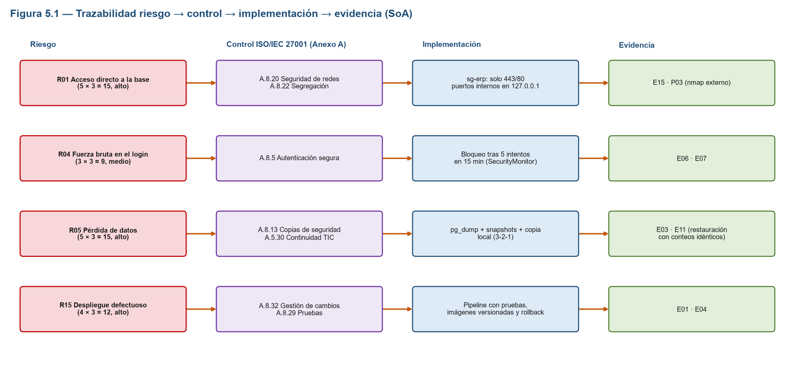
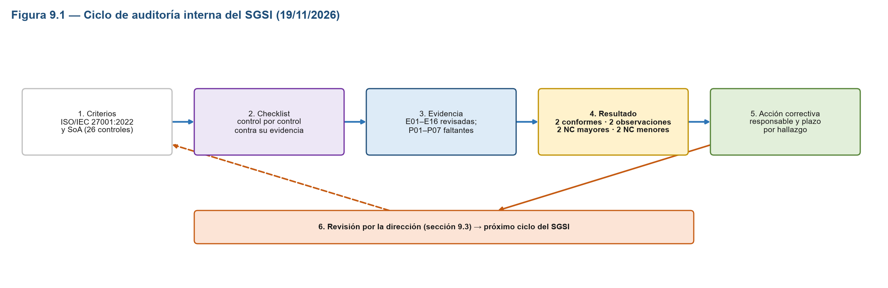

# CE0321-CE0324 - S2 - E1: Planificación e Implementación del SGSI

**UNIVERSIDAD PERUANA UNIÓN**

Facultad de Ingeniería y Arquitectura · Escuela Profesional de Ingeniería de Sistemas

**SEMESTRE 2 · ENTREGABLE 1 DE 3**

**Planificación e Implementación del SGSI**

*ISO/IEC 27001 · 27002 · 27005 — (CE0321–CE0324 · Línea de Infraestructura — CE03)*

Sistema de Gestión de Seguridad de la Información del ERP «Articulos» — Salud Total SAC  
(infraestructura híbrida on-premise VMware ESXi + AWS · Juliaca y Puno)

| **Campo**       | **Detalle**                                                                                              |
|-----------------|----------------------------------------------------------------------------------------------------------|
| Organización    | Salud Total SAC — cadena de farmacias y clínica ambulatoria (Juliaca y Puno)                             |
| Responsables    | Jhosef Anthony Quispe Huarilloclla · Jose Samuel Turpo Cauna · Yesenia Alejandra Gutierrez Anco          |
| Curso           | Seguridad de la Información / Habilidades Directivas                                                     |
| Versión y fecha | v2.0 — 19 de noviembre de 2026                                                                           |
| Base técnica    | CE0311 E1 v2.1 (red), CE0331 E2 v2.0 (centro de datos), resumen de la línea CE03 y evidencias de CE02 E4 |

## Control de versiones

| **Versión** | **Fecha**     | **Cambios**                                                                                                                                                                                                                                              |
|-------------|---------------|----------------------------------------------------------------------------------------------------------------------------------------------------------------------------------------------------------------------------------------------------------|
| 1.0         | Julio de 2026 | «Implementación, monitoreo y ética de seguridad»: pruebas sobre PostgreSQL y el código (estaba archivado en la carpeta de red)                                                                                                                           |
| 2.0         | 19/11/2026    | Rehecho según la plantilla S2-E1: contexto, alcance, riesgos ISO 27005, SoA con trazabilidad, políticas, accesos, incidentes, ética, auditoría interna y matriz maestra. Alineado con E1 v2.1, E2 v2.0, el resumen de la línea y la evidencia de CE02 E4 |

Anexos que acompañan este informe: Anexos/SGSI_Matrices_SaludTotal.xlsx (inventario de activos, matriz de riesgos con fórmulas, SoA, trazabilidad, objetivos, evidencias, auditoría y accesos) y los diagramas editables de la carpeta Diagramas. Las políticas (sección 6) y la declaración de ética (sección 8) forman parte de este documento.

## 1. Resumen ejecutivo del SGSI

Proyecto y alcance. SGSI basado en ISO/IEC 27001:2022 para la infraestructura híbrida que soporta el ERP «Articulos» de Salud Total SAC: la red de las sedes de Juliaca y Puno (E1 v2.1), el centro de datos local con VMware ESXi y la VPC de AWS en us-east-2 donde corre el ERP en una EC2 con Docker Compose (E2 v2.0), la VPN que los une, y los procesos de operación, respaldo y despliegue.

Riesgos principales. Se evaluaron 17 riesgos con la secuencia activo → amenaza → vulnerabilidad → impacto → probabilidad; 7 son altos (nivel ≥ 12): puertos internos publicados en la EC2 (R01, 15), llaves JWT en el repositorio (R02, 15), pérdida de datos por instancia única (R05, 15), tráfico sin TLS en la demo (R06, 12), acceso no autorizado a firewalls y switches (R14, 15), despliegues defectuosos (R15, 12) y movimiento lateral (R16, 12). Todos tienen tratamiento de mitigación y quedan en riesgo residual bajo o medio.

Controles y SoA. La Declaración de Aplicabilidad cubre 26 controles del Anexo A: 13 implementados, 9 parciales, 3 planificados y los controles físicos del centro de datos de AWS excluidos por responsabilidad compartida. Los más sólidos son autenticación segura (A.8.5), gestión de cambios (A.8.32), prevención de fuga de secretos (A.8.12) y monitoreo (A.8.16), todos con evidencia de ejecución.

Ciclo PHVA. Planificar: alcance, riesgos y SoA (secciones 3–5). Hacer: políticas, accesos e incidentes (6–7) y controles técnicos evidenciados en el pipeline y el stack del ERP. Verificar: indicadores y auditoría interna del 19/11/2026, con 2 conformidades, 2 observaciones y 4 no conformidades (2 mayores: puertos internos expuestos y HTTP sin TLS). Actuar: acciones correctivas con responsable y plazo y revisión por la dirección (9.3).

Conclusión. Los controles de la aplicación y del proceso de despliegue funcionan y tienen evidencia; los del perímetro en AWS (MFA, puertos, TLS) y los del entorno on-premise están diseñados pero sin evidencia de implementación, y son la prioridad del cierre del Semestre 2. Este entregable se apoya en los diseños del Semestre 1 (sección 3 de ambos).

## 2. Contexto de la organización

Salud Total SAC vende medicamentos con control de lotes y vencimientos (DIGEMID) y atiende consultas ambulatorias en dos sedes. Toda su operación pasa por el ERP «Articulos»: ventas y caja, inventario por lote con FEFO, compras y reabastecimiento, historia clínica y notificaciones a pacientes. El SGSI protege la confidencialidad de los datos de salud (Ley 29733), la integridad del inventario y de las ventas (que se reportan a SUNAT) y la disponibilidad del ERP en horario de atención (07:00–23:00).

Cuestiones externas: regulación sanitaria y de datos personales, dependencia de AWS, de dos ISP y de servicios de Meta y Google para la mensajería. Cuestiones internas: un equipo de TI pequeño, un ERP desarrollado en casa (CE02) y una infraestructura que mezcla una EC2 ya operativa con un diseño on-premise aún no desplegado.

### 2.1 Partes interesadas y sus expectativas de seguridad

| **Parte interesada**                                                     | **Expectativa de seguridad**                                                                   |
|--------------------------------------------------------------------------|------------------------------------------------------------------------------------------------|
| Pacientes y clientes                                                     | Confidencialidad de su historia clínica y de sus datos personales; atención sin interrupciones |
| Cajeros, almaceneros y personal clínico                                  | Acceso rápido y solo a lo que necesita su rol; que el sistema no se caiga en caja              |
| Dirección / gerencia                                                     | Continuidad del negocio, cumplimiento legal, costos controlados                                |
| Administradores de TI y de red                                           | Accesos administrativos seguros y trazables; procedimientos claros ante incidentes             |
| Equipo de desarrollo                                                     | Despliegues seguros, sin secretos en el código y con vuelta atrás                              |
| AWS                                                                      | Uso conforme al modelo de responsabilidad compartida (AWS protege la infraestructura física)   |
| ISP de Juliaca y Puno                                                    | Uso de los enlaces según contrato; responsabilidad hasta el CPE                                |
| Meta y Google (mensajería)                                               | Uso de credenciales y plantillas según sus términos                                            |
| DIGEMID, SUNAT y la Autoridad Nacional de Protección de Datos Personales | Trazabilidad de lotes, integridad de comprobantes y protección de datos de salud               |

## 3. Alcance del SGSI

### 3.1 Declaración de alcance

El SGSI comprende la infraestructura tecnológica híbrida que soporta el ERP «Articulos» de Salud Total SAC: la red de las sedes de Juliaca y Puno (VLAN, firewalls OPNsense, núcleo y acceso) diseñada en el E1 v2.1; el centro de datos local con VMware ESXi (contingencia, IDS, SIEM, honeypot y monitoreo) y los recursos de AWS en us-east-2 (VPC 10.50.0.0/16, EC2 con Docker Compose, Security Group, NACL, S3 y servicios de gestión) diseñados en el E2 v2.0; la VPN IPsec entre ambos; y los procesos de operación, respaldo, monitoreo, gestión de incidentes y despliegue continuo del ERP.

### 3.2 Límites y exclusiones

- **Físicos:** sala de comunicaciones y rack de Juliaca, gabinete de Puno; en la nube, la cuenta y la región de AWS.

- **Tecnológicos:** los componentes de las matrices del E1 (40) y del E2 (25), más el repositorio de código y el pipeline CI/CD.

- **Organizacionales:** administrador de TI, administrador de red, responsable de seguridad, responsable de nube, equipo de desarrollo y gerencia.

| **Exclusión**                                                             | **Justificación**                                                                     |
|---------------------------------------------------------------------------|---------------------------------------------------------------------------------------|
| Seguridad física de los centros de datos de AWS (A.7.1–A.7.14 en la nube) | Responsabilidad de AWS según el modelo compartido; se respalda en sus certificaciones |
| Redes de los ISP hasta el CPE                                             | Fuera del control de Salud Total; se gestiona por contrato                            |
| Dispositivos personales del personal (BYOD)                               | Solo usan la Wi-Fi de invitados, aislada de la red interna                            |
| Facturación electrónica SUNAT/OSE y pasarela de pagos                     | Fase 2 del ERP (RF-31 de CE02), aún no implementada                                   |

## 4. Liderazgo y objetivos de seguridad

Política de seguridad de la información (resumen; texto completo en 6.1). La gerencia de Salud Total SAC se compromete a proteger la confidencialidad de los datos de pacientes, la integridad de las ventas y del inventario y la disponibilidad del ERP, cumpliendo la Ley 29733 y la normativa sanitaria, asignando recursos al SGSI y mejorándolo en cada ciclo.

| **Rol**                  | **Responsabilidades en el SGSI**                                           | **Quién**                        |
|--------------------------|----------------------------------------------------------------------------|----------------------------------|
| Dirección (gerencia)     | Aprueba la política, los riesgos residuales y la revisión por la dirección | Gerente general (rol del equipo) |
| Responsable de seguridad | Mantiene riesgos, SoA y auditoría; lidera incidentes                       | Integrante del equipo            |
| Responsable de nube      | Cuenta AWS, IAM, VPC, costos                                               | Integrante del equipo            |
| Administrador de TI      | EC2, ESXi, respaldos y monitoreo                                           | Integrante del equipo            |
| Administrador de red     | Firewalls, VPN, switches                                                   | Integrante del equipo            |
| Equipo de desarrollo     | Código seguro, pipeline, secretos fuera del repositorio                    | Equipo de CE02                   |

Objetivos medibles (su avance se reporta en 9.1):

| **ID** | **Objetivo**                                   | **Indicador**                                                | **Meta**                          | **Responsable** |
|--------|------------------------------------------------|--------------------------------------------------------------|-----------------------------------|-----------------|
| OS-01  | Exposición mínima a Internet                   | Puertos internos accesibles desde Internet (nmap externo)    | 0                                 | Seguridad       |
| OS-02  | Accesos administrativos protegidos             | Cuentas administrativas con MFA y SSH solo con llave         | 100 %                             | Seguridad       |
| OS-03  | Cero secretos no controlados en el repositorio | Hallazgos del escaneo de secretos fuera de la lista aceptada | 0                                 | Desarrollo      |
| OS-04  | Respaldo restaurable                           | Restauraciones verificadas por mes                           | ≥ 1                               | Infraestructura |
| OS-05  | Detección de fallas del servicio               | Reglas de alerta activas sobre caída, errores y latencia     | ≥ 5                               | Infraestructura |
| OS-06  | Bloqueo de fuerza bruta en el ERP              | Usuarios bloqueados tras intentos fallidos                   | Bloqueo tras 5 intentos en 15 min | Desarrollo      |
| OS-07  | Recuperación del ERP                           | RTO / RPO del ERP y su base                                  | ≤ 4 h / ≤ 24 h                    | Infraestructura |

## 5. Planificación

### 5.1 Inventario de activos y clasificación de la información

Cada componente relevante de las topologías del Semestre 1 se convierte en activo (columna «Componente S1» = ID en las matrices del E1 o E2). Clasificación: Restringido \> Confidencial \> Uso interno \> Público.

| **ID** | **Activo**                                                      | **Propietario**          | **Ubicación**                     | **C-I-D**         | **Criticidad** | **Clasificación** |
|--------|-----------------------------------------------------------------|--------------------------|-----------------------------------|-------------------|----------------|-------------------|
| A01    | Base de datos clinica_db (ventas, inventario, historia clínica) | Administrador de TI      | Contenedor db en EC2-ERP-01       | Alta-Alta-Alta    | Crítica        | Confidencial      |
| A02    | Backend del ERP (Spring Boot)                                   | Jefe de TI               | EC2-ERP-01                        | Media-Alta-Alta   | Crítica        | Uso interno       |
| A03    | Frontend y Nginx / Caddy                                        | Jefe de TI               | EC2-ERP-01                        | Baja-Media-Alta   | Alta           | Público           |
| A04    | Microservicio de mensajería y sus credenciales (Gmail, Meta)    | Jefe de TI               | EC2-ERP-01 (variables de entorno) | Alta-Media-Media  | Media          | Confidencial      |
| A05    | Llaves JWT RSA                                                  | Responsable de seguridad | secrets/jwt en la EC2             | Alta-Alta-Media   | Crítica        | Restringido       |
| A06    | Llave SSH (.pem) de la EC2                                      | Administrador de TI      | Equipo del administrador          | Alta-Alta-Media   | Crítica        | Restringido       |
| A07    | Cuenta AWS (raíz e IAM)                                         | Responsable de nube      | AWS                               | Alta-Alta-Alta    | Crítica        | Restringido       |
| A08    | EC2-ERP-01 y su volumen EBS                                     | Responsable de nube      | AWS us-east-2                     | Media-Alta-Alta   | Crítica        | Uso interno       |
| A09    | VPC, Security Group y NACL                                      | Responsable de nube      | AWS                               | Media-Alta-Alta   | Crítica        | Uso interno       |
| A10    | Respaldos (S3, snapshots, NAS)                                  | Administrador de TI      | S3, EBS y NAS-JUL-01              | Alta-Alta-Media   | Alta           | Confidencial      |
| A11    | Firewalls OPNsense y VPN IPsec                                  | Administrador de red     | Juliaca y Puno                    | Media-Alta-Alta   | Crítica        | Uso interno       |
| A12    | Núcleo y switches de acceso                                     | Administrador de red     | Juliaca y Puno                    | Baja-Alta-Alta    | Alta           | Uso interno       |
| A13    | Host ESXi y sus VM (contingencia y seguridad)                   | Administrador de TI      | Rack de Juliaca                   | Media-Alta-Media  | Alta           | Uso interno       |
| A14    | SIEM, IDS y honeypot                                            | Responsable de seguridad | VM del ESXi (VLAN 100, DMZ)       | Alta-Alta-Media   | Alta           | Confidencial      |
| A15    | Prometheus y registros (logs ECS)                               | Administrador de TI      | EC2-ERP-01 y MON-JUL-01           | Media-Media-Media | Media          | Uso interno       |
| A16    | Repositorio de código (GitHub)                                  | Equipo de desarrollo     | GitHub                            | Media-Alta-Media  | Alta           | Uso interno       |
| A17    | Estaciones POS y de clínica                                     | Jefatura de sede         | VLAN 30/50/130/150                | Media-Media-Alta  | Alta           | Uso interno       |
| A18    | Personal (cajeros, médicos, administradores)                    | Gerencia                 | Juliaca y Puno                    | —-—-—             | Alta           | —                 |

### 5.2 Evaluación de riesgos (ISO/IEC 27005)

Metodología: impacto y probabilidad de 1 a 5; nivel = impacto × probabilidad; alto ≥ 12, medio 6–11, bajo ≤ 5. Se acepta sin tratamiento solo el riesgo bajo. Cada riesgo sigue la secuencia activo → amenaza → vulnerabilidad → impacto → probabilidad.

| **ID** | **Activo** | **Amenaza**                                          | **Vulnerabilidad**                                                                                    | **I** | **P** | **Nivel** |
|--------|------------|------------------------------------------------------|-------------------------------------------------------------------------------------------------------|-------|-------|-----------|
| R01    | A01, A02   | Acceso directo a la base o al backend desde Internet | Puertos 8085, 8087, 9090 y 5433 publicados en 0.0.0.0 del host; protegidos solo por el Security Group | 5     | 3     | 15 Alto   |
| R02    | A05        | Falsificación de tokens JWT                          | Llaves RSA de desarrollo versionadas en el repositorio y su historial (NC-01)                         | 5     | 3     | 15 Alto   |
| R03    | A08        | Fuerza bruta contra SSH                              | SSH expuesto a Internet                                                                               | 5     | 2     | 10 Medio  |
| R04    | A02        | Fuerza bruta contra el login del ERP                 | Formulario de login público                                                                           | 3     | 3     | 9 Medio   |
| R05    | A01, A10   | Pérdida de datos                                     | Instancia única y base en un solo volumen                                                             | 5     | 3     | 15 Alto   |
| R06    | A01, A02   | Captura de credenciales y datos en tránsito          | El despliegue inicial As-Is se publica por HTTP en el 8090, sin TLS                                   | 3     | 4     | 12 Alto   |
| R07    | A07        | Costos por recursos olvidados o abuso de la cuenta   | Sin presupuesto ni alertas de costo evidenciados                                                      | 3     | 3     | 9 Medio   |
| R08    | A01        | Acceso indebido a datos de salud                     | Datos clínicos sin cifrado de columna ni auditoría de cada acceso (HU-12 pendiente)                   | 5     | 2     | 10 Medio  |
| R09    | A02, A08   | Caída no detectada del servicio                      | Falta de alertas y de revisión de métricas                                                            | 3     | 3     | 9 Medio   |
| R10    | A07        | Toma de control de la cuenta AWS                     | Cuenta raíz sin MFA evidenciado; uso de credenciales con más permisos de los necesarios               | 5     | 2     | 10 Medio  |
| R11    | A04, A16   | Exposición de credenciales demo o de terceros        | Claves de usuarios demo en el seed (NC-07); credenciales de Gmail/Meta por variables                  | 3     | 3     | 9 Medio   |
| R12    | A11        | Interceptación del tráfico híbrido                   | VPN aún no desplegada; configuración débil posible                                                    | 4     | 2     | 8 Medio   |
| R13    | A13        | Compromiso del hipervisor                            | Parches atrasados y acceso de gestión mal segmentado                                                  | 5     | 2     | 10 Medio  |
| R14    | A11, A12   | Acceso no autorizado a firewall y switches           | Credenciales por defecto o compartidas                                                                | 5     | 3     | 15 Alto   |
| R15    | A02        | Despliegue que rompe la producción                   | Cambios sin pruebas ni vuelta atrás                                                                   | 4     | 3     | 12 Alto   |
| R16    | A17, A14   | Movimiento lateral desde una estación comprometida   | Red plana entre áreas                                                                                 | 4     | 3     | 12 Alto   |
| R17    | A18        | Error humano o ingeniería social                     | Personal sin capacitación en seguridad                                                                | 3     | 3     | 9 Medio   |

### 5.3 Tratamiento de riesgos

| **ID** | **Tratamiento**                                                                                                          | **Control(es)**       | **Responsable**          | **Plazo**   | **Residual** |
|--------|--------------------------------------------------------------------------------------------------------------------------|-----------------------|--------------------------|-------------|--------------|
| R01    | Mitigar: publicar en 127.0.0.1 y abrir solo 443/80                                                                       | A.8.20, A.8.22        | Administrador de TI      | S2          | 5 Bajo       |
| R02    | Mitigar: llaves nuevas en secrets/, fuera de git, y rotación                                                             | A.8.24, A.5.17        | Responsable de seguridad | S2          | 5 Bajo       |
| R03    | Mitigar: solo llave, solo IP del administrador, fail2ban                                                                 | A.8.5, A.8.20         | Administrador de TI      | Hecho / S2  | 5 Bajo       |
| R04    | Mitigar: bloqueo tras 5 intentos en 15 min (implementado)                                                                | A.8.5                 | Equipo de desarrollo     | Hecho       | 3 Bajo       |
| R05    | Mitigar: pg_dump diario a S3, snapshot EBS, copia en DB-CONT-01 (3-2-1)                                                  | A.8.13, A.5.30        | Administrador de TI      | S2          | 10 Medio     |
| R06    | Mitigar: Caddy con TLS en 443 y redirección                                                                              | A.8.24                | Administrador de TI      | S2          | 3 Bajo       |
| R07    | Mitigar: AWS Budgets y limpieza al cierre                                                                                | A.5.23                | Responsable de nube      | S2          | 3 Bajo       |
| R08    | Mitigar: roles, mínimo privilegio, pgcrypto y auditoría (Ley 29733)                                                      | A.5.34, A.8.3, A.8.15 | Responsable de seguridad | S10 de CE02 | 5 Bajo       |
| R09    | Mitigar: 6 reglas de Prometheus (implementado) y alarmas de CloudWatch                                                   | A.8.16                | Administrador de TI      | Hecho / S2  | 3 Bajo       |
| R10    | Mitigar: MFA en raíz e IAM, usuario administrador distinto de root, rol de instancia                                     | A.5.15, A.5.17, A.8.2 | Responsable de nube      | S2          | 5 Bajo       |
| R11    | Mitigar: credenciales de prueba por variables de entorno y cambio obligatorio; aceptar mientras se use entorno de prueba | A.5.17, A.8.4         | Equipo de desarrollo     | S2          | 6 Medio      |
| R12    | Mitigar: IKEv2, AES-256, SHA-256, DH ≥ 14 (E1 §5.4)                                                                      | A.8.20, A.8.24        | Administrador de red     | S2          | 4 Bajo       |
| R13    | Mitigar: gestión en VLAN 70, solo desde 10.10.70.50, parches trimestrales                                                | A.8.8, A.8.22         | Administrador de TI      | S2          | 5 Bajo       |
| R14    | Mitigar: cuentas nominales, SSH/HTTPS solo desde gestión, registro en SIEM                                               | A.5.15, A.8.2, A.8.15 | Administrador de red     | S2          | 5 Bajo       |
| R15    | Mitigar: pipeline con pruebas, imágenes versionadas y rollback (implementado)                                            | A.8.32, A.8.29        | Equipo de desarrollo     | Hecho       | 4 Bajo       |
| R16    | Mitigar: VLAN por área, ACL, IDS por SPAN y honeypot                                                                     | A.8.22, A.8.16        | Responsable de seguridad | S2          | 4 Bajo       |
| R17    | Mitigar: política de uso aceptable y charla anual                                                                        | A.6.3, A.5.10         | Gerencia                 | S2          | 6 Medio      |

### 5.4 Declaración de Aplicabilidad (SoA)

Trazabilidad «encontré este riesgo y por ello seleccioné este control»: la columna Justificación cita el riesgo y la columna Evidencia remite al índice E01–E16 (anexo B) o a una evidencia pendiente P01–P07.

| **Control**  | **Nombre**                                       | **Aplica** | **Justificación**                          | **Estado**                | **Evidencia**                                                               |
|--------------|--------------------------------------------------|------------|--------------------------------------------|---------------------------|-----------------------------------------------------------------------------|
| A.5.1        | Políticas de seguridad de la información         | Sí         | Base del SGSI                              | Implementado              | Sección 6 de este documento                                                 |
| A.5.10       | Uso aceptable de la información                  | Sí         | R17                                        | Implementado (documental) | Política 6.6                                                                |
| A.5.15       | Control de acceso                                | Sí         | R10, R14                                   | Implementado              | Roles y 155 @PreAuthorize del ERP (E07); matriz 7.1                         |
| A.5.17       | Información de autenticación                     | Sí         | R02, R10, R11                              | Parcial                   | BCrypt (E10), JWT RSA (E07); MFA sin evidencia (P01)                        |
| A.5.23       | Seguridad en servicios en la nube                | Sí         | R07                                        | Parcial                   | Política 6.4; Budgets sin evidencia (P04)                                   |
| A.5.24       | Planificación de la gestión de incidentes        | Sí         | R09                                        | Implementado (documental) | Procedimiento 7.2; incidentes registrados (E15)                             |
| A.5.30       | Preparación de las TIC para la continuidad       | Sí         | R05                                        | Parcial                   | RTO/RPO por servicio (E16); restauración local (E03)                        |
| A.5.34       | Privacidad y protección de datos personales      | Sí         | R08                                        | Parcial                   | Solo datos demo; pgcrypto probado (E10); HU-12 pendiente                    |
| A.6.3        | Concienciación y formación                       | Sí         | R17                                        | Planificado               | Charla anual (política 6.6)                                                 |
| A.7.1–A.7.14 | Controles físicos del centro de datos en la nube | No         | Responsabilidad de AWS (modelo compartido) | Excluido                  | Informes de cumplimiento de AWS                                             |
| A.7.11       | Servicios de suministro (rack local)             | Sí         | R05                                        | Planificado               | UPS 3 kVA online (E2 §5.1)                                                  |
| A.8.2        | Derechos de acceso privilegiado                  | Sí         | R10, R14                                   | Parcial                   | SSH con llave e IP autorizada (E15); IAM sin evidencia                      |
| A.8.3        | Restricción del acceso a la información          | Sí         | R08                                        | Implementado              | Mínimo privilegio en PostgreSQL (E09); rol st_app (E08)                     |
| A.8.4        | Acceso al código fuente                          | Sí         | R11                                        | Implementado              | Repositorio privado y escaneo de secretos (E01)                             |
| A.8.5        | Autenticación segura                             | Sí         | R03, R04                                   | Implementado              | Bloqueo 5 intentos/15 min (E07), 401 verificado (E06)                       |
| A.8.8        | Gestión de vulnerabilidades técnicas             | Sí         | R13                                        | Planificado               | Parches trimestrales; script de parches (versión anterior)                  |
| A.8.9        | Gestión de la configuración                      | Sí         | R15                                        | Implementado              | docker-compose, Flyway V1/V2 y .env.example versionados (E08)               |
| A.8.12       | Prevención de fuga de datos                      | Sí         | R02, R11                                   | Implementado              | Escaneo de secretos en cada build (E01, E02)                                |
| A.8.13       | Copias de seguridad de la información            | Sí         | R05                                        | Parcial                   | Respaldo y restauración verificados en local (E03, E11); falta en AWS (P05) |
| A.8.15       | Registro de eventos                              | Sí         | R08, R14                                   | Implementado              | Logs ECS en JSON del backend; auditoría por trigger (E12)                   |
| A.8.16       | Actividades de monitoreo                         | Sí         | R09, R16                                   | Implementado              | Prometheus con 6 alertas (E05)                                              |
| A.8.20       | Seguridad de las redes                           | Sí         | R01, R03, R12                              | Parcial                   | Security Group mínimo (E15); nftables (E14); nmap externo pendiente (P03)   |
| A.8.22       | Segregación de redes                             | Sí         | R01, R16                                   | Parcial                   | Red interna de Docker; VLAN y DMZ en el diseño (E16)                        |
| A.8.24       | Uso de criptografía                              | Sí         | R02, R06, R12                              | Parcial                   | JWT RSA, BCrypt, pgcrypto (E10); TLS en producción pendiente                |
| A.8.29       | Pruebas de seguridad en desarrollo               | Sí         | R15                                        | Implementado              | Pruebas de 401 y bloqueo en el pipeline (E01, E06)                          |
| A.8.32       | Gestión de cambios                               | Sí         | R15                                        | Implementado              | Pipeline con imágenes versionadas y rollback (E01, E04)                     |

*Figura 5.1 — Trazabilidad riesgo → control (SoA)*

## 6. Soporte — políticas y procedimientos del SGSI

Cada política nombra los componentes reales a los que aplica, su responsable y su revisión.

### 6.1 Política de seguridad de la información

Alcance: el de la sección 3. Principios: mínimo privilegio, defensa en profundidad (red segmentada, Security Group, aplicación con JWT y roles), cifrado de datos sensibles, ningún secreto en el código ni en los entregables, cambios solo por el pipeline y registro de toda acción administrativa. Incumplimiento: medida disciplinaria según el reglamento interno. Responsable: responsable de seguridad. Revisión: anual o tras un incidente mayor.

### 6.2 Política de control de accesos

- **AWS:** la cuenta raíz no se usa y tiene MFA; cada administrador usa un usuario IAM propio con MFA; la EC2 sube respaldos con el rol ec2-erp-respaldos, sin llaves de acceso en disco.

- **EC2:** SSH solo con llave y solo desde la IP pública fija del administrador o desde 10.10.70.50 por la VPN; sin contraseña.

- **ESXi:** interfaz de gestión solo en la VLAN 70 desde la estación de administración; cuentas nominales; root deshabilitado para uso diario.

- **Firewall y switches:** cuentas nominales por SSH/HTTPS desde la VLAN de gestión; registro en el SIEM.

- **VPN:** clave precompartida por túnel guardada en el gestor de contraseñas de TI; nunca en documentos ni en git.

- **ERP:** permisos por rol (155 @PreAuthorize), JWT RSA de 30 minutos, bloqueo tras 5 intentos fallidos en 15 minutos y un máximo de 3 sesiones; las bajas se aplican el mismo día.

- **Base de datos:** la aplicación usa el rol st_app, sin superusuario; el rol de cajero no puede borrar ni leer credenciales.

### 6.3 Procedimiento de gestión de incidentes

Ciclo: detectar (alertas de Prometheus, SIEM, Flow Logs o reporte de usuario) → clasificar (baja, media, alta según el impacto en ventas o datos de salud) → contener (cerrar un puerto, revocar una llave, rollback con ci/rollback.ps1) → erradicar y recuperar (corregir y restaurar desde respaldo) → registrar la lección aprendida. Escalamiento: administrador de TI → responsable de seguridad (si hay datos personales) → gerencia (si la caída supera 1 hora o hay fuga de datos). Una brecha de datos personales se comunica a la Autoridad Nacional de Protección de Datos Personales conforme a la Ley 29733. Los incidentes ya ocurridos están en 7.2.

### 6.4 Política de proveedores y servicios en la nube

AWS es proveedor crítico: se usa solo us-east-2, con presupuesto y alertas de costo (AWS Budgets), cifrado de EBS y S3, y registro (CloudTrail, Flow Logs). Al cerrar el proyecto se eliminan los recursos y se conserva la evidencia. Meta y Google: credenciales solo en variables de entorno de la mensajería, rotación si se sospecha exposición. ISP: contrato con SLA e IP fija. Revisión anual de cada proveedor.

### 6.5 Política de respaldo y recuperación

Regla 3-2-1 (E2 §10): pg_dump diario a las 02:00 a S3 (retención 35 días), snapshot diario del volumen EBS (7) y copia nocturna restaurada en DB-CONT-01 y archivada en el NAS (7). Una restauración de prueba al mes con conteo de filas; los respaldos se cifran y nunca salen de la cuenta ni del NAS. Objetivos: RTO ≤ 4 h y RPO ≤ 24 h para el ERP y su base.

### 6.6 Política de uso aceptable

El ERP y los equipos de la red se usan solo para fines de la empresa; está prohibido compartir cuentas, instalar software no autorizado en POS y estaciones clínicas, conectar equipos personales a la red interna (solo Wi-Fi de invitados) y extraer datos de pacientes. Las estaciones de clínica no navegan en Internet. Todo el personal recibe una charla anual.

## 7. Operación — implementación de controles de gestión

### 7.1 Gestión de identidades y accesos (gobernanza)

Mínimo privilegio: cada rol recibe solo lo necesario y las cuentas son nominales. Matriz que rige la implementación técnica (se evidencia en el entregable de centro de datos del Semestre 2):

| **Rol**                                   | **AWS**                                                      | **ESXi**                                             | **Firewall / red**                                | **Servidores / ERP**                              |
|-------------------------------------------|--------------------------------------------------------------|------------------------------------------------------|---------------------------------------------------|---------------------------------------------------|
| Administrador de TI                       | Usuario IAM con MFA (sin root); rol de instancia para la EC2 | Administrador (root solo en consola, cuenta nominal) | Lectura (cambios vía administrador de red)        | SSH con llave, sudo                               |
| Administrador de red                      | Sin acceso                                                   | Sin acceso                                           | Administrador (cuenta nominal, desde 10.10.70.50) | Sin acceso                                        |
| Responsable de seguridad                  | Lectura: CloudTrail, GuardDuty, Flow Logs                    | Solo lectura                                         | Lectura de reglas y registros                     | Lectura del SIEM                                  |
| Equipo de desarrollo                      | Sin acceso a la consola; despliegue por el pipeline          | Sin acceso                                           | Sin acceso                                        | Despliegue por el pipeline; sin SSH en producción |
| Usuario del ERP (cajero, médico, gerente) | Sin acceso                                                   | Sin acceso                                           | Sin acceso                                        | Solo el ERP con JWT y permisos por rol            |
| Auditor                                   | Usuario IAM de solo lectura                                  | Solo lectura                                         | Solo lectura                                      | Solo lectura de registros                         |

Credenciales: contraseñas con BCrypt (E10); llaves JWT montadas desde secrets/ (E08); secretos del despliegue en .env, fuera de git; el escaneo de secretos del pipeline bloquea cualquier hallazgo no registrado (E01, E02).

### 7.2 Gestión de incidentes, continuidad y recuperación (planificación)

Servicios críticos y objetivos de recuperación (coherentes con el E2 §10):

| **Servicio**             | **Criticidad** | **RTO** | **RPO** |
|--------------------------|----------------|---------|---------|
| ERP (frontend y backend) | Crítica        | 4 h     | 24 h    |
| Base clinica_db          | Crítica        | 4 h     | 24 h    |
| VPN Site-to-Site         | Alta           | 1 h     | —       |
| Mensajería               | Media          | 8 h     | —       |
| SIEM y monitoreo         | Alta           | 24 h    | 24 h    |

Registro de incidentes y lecciones aprendidas:

| **ID** | **Incidente**                                                                              | **Clasif.** | **Contención y solución**                                                             | **Lección**                                                             | **Evidencia**  |
|--------|--------------------------------------------------------------------------------------------|-------------|---------------------------------------------------------------------------------------|-------------------------------------------------------------------------|----------------|
| INC-01 | Error 502 en el login tras recrear el backend en la EC2                                    | Media       | Esperar el estado healthy y reiniciar el frontend para que Nginx resuelva la nueva IP | Usar resolver 127.0.0.11 en Nginx                                       | E15            |
| INC-02 | Falla al cargar la llave JWT en la EC2                                                     | Alta        | Generar el par RSA en secrets/jwt y recrear los servicios                             | Documentar los secretos que no viajan por git                           | E15            |
| INC-03 | Carpeta secrets creada por Docker como root                                                | Baja        | chown al usuario ubuntu                                                               | Crear las carpetas antes de levantar el compose                         | E15            |
| INC-04 | El backend nuevo no arrancó: credenciales de la base de pruebas se filtraban al despliegue | Media       | Rollback automático a la versión anterior; limpiar las variables tras las pruebas     | Separar entornos de pruebas y de despliegue                             | E01, E04       |
| INC-05 | Archivo de evidencias de junio contenía una llave privada TLS                              | Media       | Llave retirada del ZIP; el certificado era de prueba y se considera comprometido      | Revisar los entregables con el escaneo de secretos antes de publicarlos | Este documento |

La ejecución del respaldo, la restauración y la recuperación en AWS se documenta como evidencia en «Implementación, gestión y control de centro de datos»; en el entorno local ya hay una restauración con conteos idénticos (E03) y un rollback de despliegue (E04).

## 8. Ética de la seguridad de la información

- **Código de conducta:** el equipo adopta el ACM Code of Ethics (2018) y los cánones del ISC2 Code of Ethics: proteger a la sociedad y la infraestructura, actuar con honestidad y legalidad, y servir con diligencia y competencia.

- **Alcance ético de las pruebas:** no se ejecutan ataques destructivos ni pruebas contra sistemas fuera del laboratorio. Los escaneos y pruebas se hacen solo sobre la infraestructura propia del equipo (el stack local del ERP y la EC2 de su cuenta).

- **Consentimiento y autorización:** cada prueba sobre la EC2 o la red se acuerda entre los tres integrantes y se registra con fecha; las pruebas que no se autorizaron quedan como pendientes (P03) en lugar de ejecutarse.

- **Manejo confidencial:** solo se usan datos de demostración; las salidas con datos sensibles se enmascaran; ninguna credencial, llave privada ni token figura en este documento (en este ciclo se retiró una llave TLS de un ZIP de evidencias).

- **Divulgación responsable:** si se descubre una vulnerabilidad en un componente de terceros (Spring, Angular, PostgreSQL, AWS), se reporta en privado al proveedor y no se publica hasta su corrección o 90 días.

- **Conflictos de interés:** cada integrante declara su aporte y no audita su propio trabajo: el responsable de seguridad no audita los controles que implementó.

## 9. Evaluación del desempeño — monitoreo, medición y auditoría interna del SGSI

### 9.1 Métricas e indicadores del SGSI

| **ID** | **Indicador**                                                | **Meta**                          | **Resultado al 19/11/2026**                                                                                                 |
|--------|--------------------------------------------------------------|-----------------------------------|-----------------------------------------------------------------------------------------------------------------------------|
| OS-01  | Puertos internos accesibles desde Internet (nmap externo)    | 0                                 | Pendiente (P03). Diseño: solo 443/80; el despliegue inicial publica 8090 y deja puertos internos expuestos en el host (R01) |
| OS-02  | Cuentas administrativas con MFA y SSH solo con llave         | 100 %                             | SSH con llave e IP autorizada: sí (E15). MFA: sin evidencia (P01)                                                           |
| OS-03  | Hallazgos del escaneo de secretos fuera de la lista aceptada | 0                                 | 0 (E01); 6 aceptados con no conformidad (E02)                                                                               |
| OS-04  | Restauraciones verificadas por mes                           | ≥ 1                               | 1 (E03, entorno local); falta en AWS (P05)                                                                                  |
| OS-05  | Reglas de alerta activas sobre caída, errores y latencia     | ≥ 5                               | 6 (E05)                                                                                                                     |
| OS-06  | Usuarios bloqueados tras intentos fallidos                   | Bloqueo tras 5 intentos en 15 min | Implementado en código (E07) y verificado con 401 (E06)                                                                     |
| OS-07  | RTO / RPO del ERP y su base                                  | ≤ 4 h / ≤ 24 h                    | Rollback en 18,5 s (E04); restauración de la base en 2,8 s (E03)                                                            |

Tratamiento de riesgos: 4 de 17 riesgos tienen su control ya funcionando (R03 parcialmente, R04, R09 y R15); el resto tiene control diseñado con plazo en el Semestre 2.

### 9.2 Auditoría interna

| **Elemento**   | **Detalle**                                                                                                         |
|----------------|---------------------------------------------------------------------------------------------------------------------|
| Criterios      | ISO/IEC 27001:2022 (cláusulas 4–10) y los controles de la SoA                                                       |
| Alcance        | Controles de la SoA aplicables a la EC2, al stack del ERP, al repositorio y al pipeline; documental para on-premise |
| Auditor        | Integrante que no implementó los controles auditados (sección 8)                                                    |
| Fecha y método | 19/11/2026; revisión documental de las evidencias E01–E16 contra cada control de la SoA                             |

*Figura 9.1 — Ciclo de auditoría interna*

| **ID** | **Control**     | **Hallazgo**                                                                                           | **Tipo**             | **Acción correctiva**                                                | **Responsable**          | **Plazo**              |
|--------|-----------------|--------------------------------------------------------------------------------------------------------|----------------------|----------------------------------------------------------------------|--------------------------|------------------------|
| H01    | A.5.17 / A.8.5  | No hay evidencia de MFA en la cuenta raíz ni en usuarios IAM                                           | No conformidad menor | Activar MFA y capturarlo (P01)                                       | Responsable de nube      | Antes del cierre de S2 |
| H02    | A.8.20 / A.8.22 | Puertos internos publicados en 0.0.0.0 en la EC2 inicial As-Is (protegidos solo por el Security Group) | No conformidad mayor | Publicar en 127.0.0.1 y verificar con nmap externo (P03)             | Administrador de TI      | Antes del cierre de S2 |
| H03    | A.8.24          | Servicio publicado por HTTP en 8090, sin TLS                                                           | No conformidad mayor | Caddy con TLS en 443                                                 | Administrador de TI      | Antes del cierre de S2 |
| H04    | A.8.12          | Llaves JWT de desarrollo en el repositorio y una llave TLS dentro de un entregable                     | No conformidad menor | Rotar llaves; retirar la llave del ZIP (hecho); limpiar el historial | Responsable de seguridad | S2                     |
| H05    | A.8.13          | La restauración solo se probó en el entorno local, no en AWS                                           | Observación          | Ejecutar ci/respaldo.ps1 o su equivalente en la EC2 (P05)            | Administrador de TI      | S2-E3                  |
| H06    | A.5.34          | Datos clínicos sin cifrado de columna ni auditoría de acceso en el código actual                       | Observación          | Completar HU-12 de CE02                                              | Equipo de desarrollo     | Siguiente ciclo        |
| H07    | A.8.32          | Pipeline con escaneo de secretos, pruebas y rollback funcionando                                       | Conforme             | —                                                                    | —                        | —                      |
| H08    | A.8.16          | Seis reglas de alerta activas y verificadas                                                            | Conforme             | —                                                                    | —                        | —                      |

### 9.3 Revisión por la dirección

Revisión por la Dirección (ISO/IEC 27001 Cláusula 9.3). El Comité de Seguridad de la Información (en representación de la Dirección de Salud Total SAC) revisa los resultados de la auditoría interna. Conclusión: el SGSI es adecuado para el alcance definido, pues los controles a nivel de aplicación y del pipeline de despliegue cuentan con evidencia verificada; no obstante, requiere cerrar el endurecimiento perimetral en AWS para mitigar las no conformidades mayores H02 y H03. Decisiones acordadas: (1) ejecutar el plan de acción para cerrar H01–H03 en el ciclo de implementación; (2) aceptar el riesgo residual medio de R05 (instancia única) hasta la fase 2 de la arquitectura; (3) aceptar R11 (credenciales de prueba en seed) mientras el sistema se mantenga con datos de prueba; (4) en el próximo ciclo de auditoría formalizar la verificación técnica del entorno on-premise y completar el cifrado de datos clínicos (HU-12).

## 10. Mejora continua — matriz maestra de trazabilidad

| **Riesgo**                   | **Control ISO** | **Implementación**                                   | **Prueba**                                                                                                                    | **Evidencia** |
|------------------------------|-----------------|------------------------------------------------------|-------------------------------------------------------------------------------------------------------------------------------|---------------|
| R01 Acceso directo a la base | A.8.20, A.8.22  | sg-erp mínimo; puertos internos en 127.0.0.1         | nmap externo (P03)                                                                                                            | E15 · P03     |
| R02 Falsificación de JWT     | A.8.24, A.8.12  | Llaves en secrets/ fuera de git; escaneo de secretos | Escaneo en el pipeline                                                                                                        | E01 · E02     |
| R03 Fuerza bruta SSH         | A.8.5, A.8.20   | SSH solo con llave e IP del administrador            | Intento desde IP no autorizada (P05 de S2-E2)                                                                                 | E15           |
| R04 Fuerza bruta en el login | A.8.5           | Bloqueo tras 5 intentos en 15 min                    | Prueba de 401 y bloqueo                                                                                                       | E06 · E07     |
| R05 Pérdida de datos         | A.8.13, A.5.30  | pg_dump, snapshots y copia local (3-2-1)             | Restauración con conteos idénticos                                                                                            | E03 · E11     |
| R06 Tráfico sin cifrar       | A.8.24          | Caddy con TLS en 443                                 | curl -k -I https://198.51.100.50 (o https://198.51.100.50.sslip.io; verificación TLS sobre IP elástica sin dominio comercial) | —             |
| R08 Datos de salud           | A.5.34, A.8.3   | Mínimo privilegio; pgcrypto                          | Rol de cajero denegado; descifrado con clave                                                                                  | E09 · E10     |
| R09 Caída no detectada       | A.8.16          | Prometheus con 6 reglas                              | Reglas cargadas                                                                                                               | E05           |
| R10 Toma de la cuenta AWS    | A.5.17, A.8.2   | MFA, usuario IAM, rol de instancia                   | Captura de IAM (P01)                                                                                                          | P01           |
| R15 Despliegue defectuoso    | A.8.32, A.8.29  | Pipeline con pruebas, versiones y rollback           | Fallo simulado de despliegue                                                                                                  | E01 · E04     |
| R16 Movimiento lateral       | A.8.22, A.8.16  | VLAN por área, ACL, IDS y honeypot                   | Escaneo desde invitados (D01 del E1)                                                                                          | E16           |

## 11. Resultados y conclusiones

- **Riesgos iniciales y tratados:** 17 riesgos (7 altos); todos con tratamiento de mitigación y control asignado.

- Riesgos residuales aceptados: R05 (instancia única, residual medio) y R11 (credenciales de prueba en seed, residual medio) y R17 (error humano).

- **Controles funcionando:** autenticación y bloqueo del ERP, mínimo privilegio en la base, escaneo de secretos, pipeline con pruebas y rollback, respaldo y restauración locales, monitoreo con 6 alertas, SSH con llave y Security Group mínimo.

- **Controles pendientes:** MFA evidenciado, puertos internos en 127.0.0.1, TLS, alertas de costo, restauración en AWS y todo el entorno on-premise (VLAN, firewalls, ESXi, IDS, honeypot).

- **Auditoría interna:** 2 conformidades, 2 observaciones, 2 no conformidades menores y 2 mayores, con acciones correctivas.

- Limitaciones y mejoras: Como parte del ciclo de mejora continua (Actuar), las verificaciones en consola y recolección de capturas operativas (detalladas en el plan de auditoría del Anexo C) se consolidarán de forma automatizada mediante scripts de AWS CLI y escaneos programados con nmap, estandarizando la medición mensual de indicadores.

## 12. Referencias

\[1\] ISO/IEC 27001:2022, "Information security management systems — Requirements", ISO, Ginebra, 2022.

\[2\] ISO/IEC 27002:2022, "Information security controls", ISO, Ginebra, 2022.

\[3\] ISO/IEC 27005:2022, "Guidance on managing information security risks", ISO, Ginebra, 2022.

\[4\] Congreso de la República del Perú, "Ley N.° 29733, Ley de Protección de Datos Personales", 2011, y su reglamento (D.S. 016-2024-JUS).

\[5\] ACM, "ACM Code of Ethics and Professional Conduct", 2018.

\[6\] (ISC)², "ISC2 Code of Ethics", 2024.

\[7\] Amazon Web Services, "AWS Shared Responsibility Model" y "IAM security best practices", 2026.

\[8\] CIS, "CIS Amazon Web Services Foundations Benchmark", v3.0, 2024.

## Anexo A. Productos del entregable

| **Producto**                    | **Dónde**                                                                  |
|---------------------------------|----------------------------------------------------------------------------|
| Informe del SGSI                | Entregable_S2E1_SGSI_SaludTotal.docx y .pdf                                |
| Inventario de activos           | Anexos/SGSI_Matrices_SaludTotal.xlsx · hoja Inventario_activos             |
| Matriz de riesgos y tratamiento | Ídem · hoja Riesgos (nivel con fórmulas)                                   |
| Declaración de Aplicabilidad    | Ídem · hoja SoA, y sección 5.4                                             |
| Políticas y procedimientos      | Sección 6 de este informe                                                  |
| Declaración de ética            | Sección 8 (para firmar)                                                    |
| Versión anterior                | version_anterior_v1/ (informe de junio y evidencias, sin la llave privada) |

## Anexo B. Índice de evidencias

| **ID** | **Descripción**                                                                                                                | **Fuente**                                                           | **Fecha**  |
|--------|--------------------------------------------------------------------------------------------------------------------------------|----------------------------------------------------------------------|------------|
| E01    | Pipeline CI/CD 8/8 en verde: pruebas, análisis, escaneo de secretos (0 hallazgos no registrados), despliegue y pruebas de humo | articulos-e3/ci/reportes/pipeline_20261119-063850.log                | 19/11/2026 |
| E02    | Lista de secretos aceptados con su no conformidad (llaves de desarrollo NC-01, credenciales de prueba NC-07)                   | articulos-e3/ci/secretos-permitidos.txt                              | 19/11/2026 |
| E03    | Respaldo pg_dump y restauración en base temporal con conteos idénticos (0,3 MB, 1,4 s / 2,8 s)                                 | articulos-e3/pruebas/evidencias/respaldo_restauracion.txt            | 19/11/2026 |
| E04    | Rollback automático ante fallo de despliegue (backend UP en 18,5 s)                                                            | articulos-e3/ci/reportes/pipeline_20261119-064201.log                | 19/11/2026 |
| E05    | Seis reglas de alerta cargadas en Prometheus (caída, 5xx, latencia, outbox, reabastecimiento)                                  | articulos-e3/monitoring/alertas.yml; CE02 E4 figura 2.1              | 19/11/2026 |
| E06    | Pruebas de API: 401 sin token y con credenciales inválidas; 41/41 aserciones                                                   | articulos-e3/pruebas/postman/resultado_e3_docker.json                | 18/11/2026 |
| E07    | Código del ERP: JWT RSA de 30 min, bloqueo tras 5 intentos en 15 min, máximo 3 sesiones, 155 @PreAuthorize                     | articulos-backend (JwtService, SecurityMonitorService); CE02 E4 §4.3 | 18/11/2026 |
| E08    | docker-compose: rol de aplicación st_app sin superusuario, healthchecks, llaves JWT montadas desde secrets/                    | articulos-e3/docker-compose.yml; db/init/01-rol-aplicacion.sh        | 19/11/2026 |
| E09    | Mínimo privilegio en PostgreSQL: el rol de cajero no puede borrar productos ni leer credenciales                               | version_anterior_v1/Evidencias_Seguridad_Implementacion.zip (ev01)   | 29/06/2026 |
| E10    | Cifrado: columna clínica con pgcrypto, contraseñas BCrypt con sal, certificado TLS de prueba                                   | Ídem (ev02)                                                          | 29/06/2026 |
| E11    | Respaldo cifrado con AES-256 y restauración verificada (200 002 filas de kardex)                                               | Ídem (ev03)                                                          | 29/06/2026 |
| E12    | Auditoría por trigger en la base (tabla lab_auditoria)                                                                         | Ídem (ev04)                                                          | 29/06/2026 |
| E13    | Escaneo de secretos de línea base: llaves privadas y contraseñas en properties                                                 | Ídem (ev05)                                                          | 29/06/2026 |
| E14    | Firewall de host nftables con política drop y orígenes /32                                                                     | Ídem (ev06)                                                          | 29/06/2026 |
| E15    | Despliegue real en AWS: EC2 Ubuntu 24.04, Elastic IP, Security Group 22 (IP del administrador) y 8090; incidentes registrados  | Resumen de la línea CE03 (Trabajo en equipo), §5 y §6                | 19/11/2026 |
| E16    | Diseño de red y de centro de datos (zonas, VPN, sg-erp, respaldo 3-2-1, RTO/RPO)                                               | CE0311 E1 v2.1 y CE0331 E2 v2.0                                      | 19/11/2026 |

## Anexo C. Plan de Acción y Evidencias de Cierre de Auditoría

| **ID** | **Evidencia**                                                                  | **Control**    |
|--------|--------------------------------------------------------------------------------|----------------|
| P01    | Captura de MFA activo en la cuenta raíz y del usuario IAM administrador        | A.5.17, A.8.5  |
| P02    | Captura del Security Group y de la NACL de la EC2                              | A.8.20         |
| P03    | Escaneo nmap externo a la Elastic IP (puertos 8085, 8087, 9090, 5433 cerrados) | A.8.20, A.8.22 |
| P04    | Alarmas de CloudWatch y presupuesto de AWS Budgets                             | A.8.16, A.5.23 |
| P05    | Respaldo y restauración ejecutados en la EC2 (no solo en el entorno local)     | A.8.13         |
| P06    | Configuración del host ESXi o de su equivalente técnico                        | A.8.9, A.8.22  |
| P07    | Declaración de ética firmada por los tres integrantes                          | A.5.1, A.6.3   |

---

### Archivos del entregable

- [:material-file-word: Descargar documento original (.docx)](Entregable_S2E1_SGSI_SaludTotal.docx)

**Anexos**

- [:material-file-excel: SGSI_Matrices_SaludTotal.xlsx](archivos/Anexos/SGSI_Matrices_SaludTotal.xlsx)

**Diagramas**

- [:material-file: F5_1_trazabilidad_soa.drawio](archivos/Diagramas/F5_1_trazabilidad_soa.drawio)
- [:material-image: F5_1_trazabilidad_soa.png](archivos/Diagramas/F5_1_trazabilidad_soa.png)
- [:material-file: F9_1_ciclo_auditoria.drawio](archivos/Diagramas/F9_1_ciclo_auditoria.drawio)
- [:material-image: F9_1_ciclo_auditoria.png](archivos/Diagramas/F9_1_ciclo_auditoria.png)
