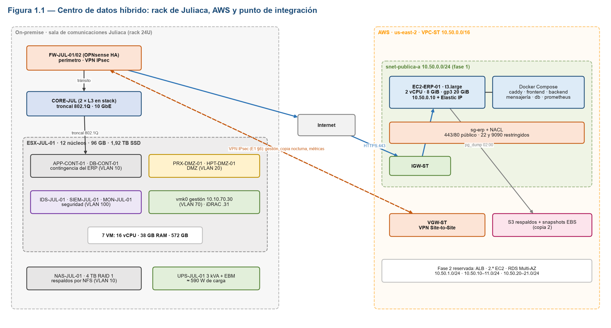
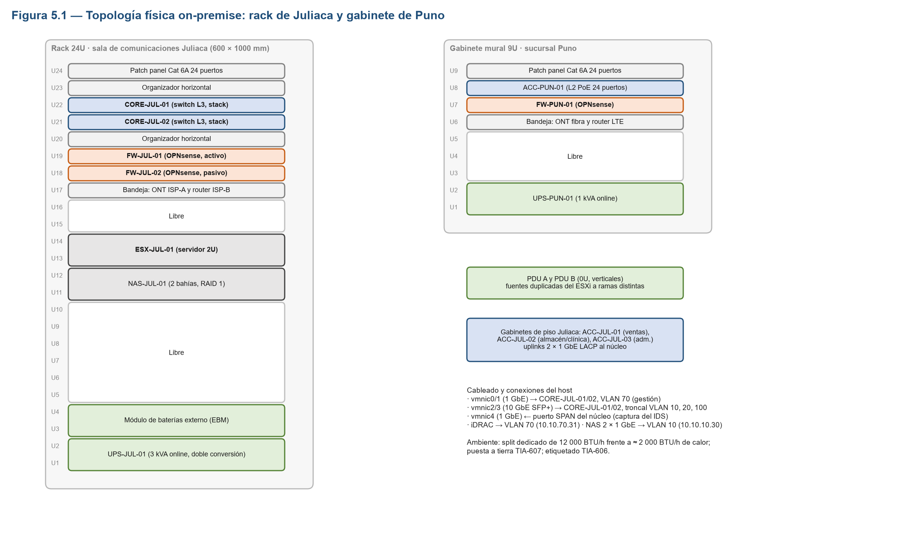
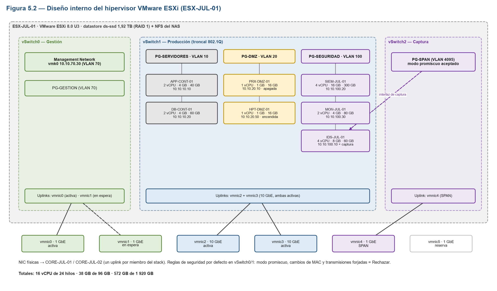
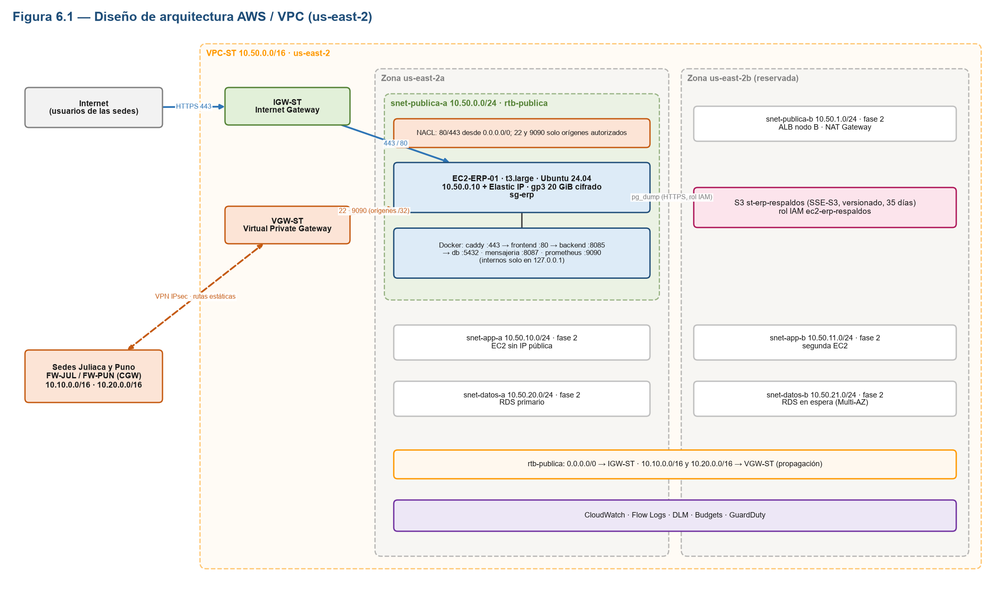

# CE0331 - S1 - E2: Análisis y Diseño de Centro de Datos Híbrido

**UNIVERSIDAD PERUANA UNIÓN**

Facultad de Ingeniería y Arquitectura · Escuela Profesional de Ingeniería de Sistemas

**ENTREGABLE 2 · SEMESTRE 1**

**Análisis y Diseño de Centro de Datos Híbrido**

*(CE0331 · Línea de Infraestructura Tecnológica — CE03)*

**On-premise (VMware ESXi) + AWS para el ERP «Articulos» — Salud Total SAC  
(cadena de farmacias y clínica ambulatoria · Juliaca y Puno)**

| **Campo**       | **Detalle**                                                                                          |
|-----------------|------------------------------------------------------------------------------------------------------|
| Proyecto        | Infraestructura híbrida AWS + on-premise (VMware ESXi) con seguridad perimetral y SGSI ISO/IEC 27001 |
| Organización    | Salud Total SAC — sede central Juliaca y sucursal Puno                                               |
| Responsables    | Jhosef Anthony Quispe Huarilloclla · Jose Samuel Turpo Cauna · Yesenia Alejandra Gutierrez Anco      |
| Curso           | CE0331 — Análisis y Diseño de Centro de Datos Híbrido                                                |
| Versión y fecha | v2.0 — 19 de noviembre de 2026 (alineada con el E1 v2.1, CE02 y el código del ERP)                   |

## Control de versiones

| **Versión** | **Fecha**     | **Cambios**                                                                                                                                                                                                               |
|-------------|---------------|---------------------------------------------------------------------------------------------------------------------------------------------------------------------------------------------------------------------------|
| 1.0         | Julio de 2026 | Primera versión (archivo «Entregable3_Diseno_Centro_Datos»)                                                                                                                                                               |
| 2.0         | 19/11/2026    | Rehecha según la plantilla S1-E2 y la rúbrica: rack, hipervisor, VPC, integración, dimensionamiento con la carga medida, matriz de componentes y continuidad. Alineada con el E1 v2.1, el resumen de la línea y el código |

Productos que acompañan a este informe (exigidos por la rúbrica): los diagramas editables de la carpeta Diagramas (.drawio de diagrams.net y .png) y la matriz de componentes y dimensionamiento (Anexos/Matriz_Componentes_Dimensionamiento_E2.xlsx). Las tablas del informe, la hoja de cálculo y los diagramas se generan desde la misma fuente de datos, que a su vez lee las redes, la VPN y las IP del E1, por lo que ambos entregables coinciden.

## 1. Resumen ejecutivo del diseño del centro de datos híbrido

Proyecto y organización. Centro de datos híbrido para Salud Total SAC, cadena de farmacias con clínica ambulatoria (sede central en Juliaca y sucursal en Puno, unos 66 usuarios), cuya operación —ventas y caja, inventario por lotes con FEFO, compras y reabastecimiento, historia clínica y notificaciones— corre sobre el ERP web «Articulos».

Problema que se resuelve. El ERP ya funciona en AWS sobre una sola EC2, pero sin un diseño que diga cuánta capacidad necesita, cómo se respalda, qué pasa si se cae y qué queda en las sedes. Hoy no hay respaldo fuera de la nube, ni infraestructura local para la seguridad (IDS, SIEM, monitoreo) ni para seguir vendiendo si AWS o los enlaces fallan.

Tecnología on-premise: VMware ESXi 8.0 en un solo servidor 2U en la sala de comunicaciones de Juliaca (12 núcleos, 96 GB, 1,92 TB SSD en RAID 1), con 7 máquinas virtuales de contingencia del ERP, DMZ y seguridad, más un NAS de respaldos y una UPS de 3 kVA. Se elige ESXi porque es el hipervisor que exige la línea, tiene vSwitches con VLAN y NIC teaming suficientes para segmentar las zonas del E1, y un solo host basta porque no ejecuta la producción.

Tecnología cloud: AWS en us-east-2 (Ohio), donde ya está desplegada la fase 1. Una instancia EC2 t3.large con Ubuntu 24.04 y Elastic IP ejecuta el ERP completo con Docker Compose en la subred pública 10.50.0.0/24 de la VPC 10.50.0.0/16, protegida por Security Group y NACL; los respaldos van a S3 y a snapshots de EBS. Se elige AWS porque CE01 y CE02 ya la definieron (ADR-07) y porque permite crecer a la arquitectura objetivo de CE02 (ALB, dos EC2, RDS Multi-AZ) sin renumerar, usando subredes que este diseño deja reservadas.

Dimensionamiento. On-premise: 16 vCPU sobre 24 hilos, 38 GB de 96 GB de RAM y 572 GB de 1 920 GB de disco (≈ 40 % de RAM con margen para +50 % de crecimiento). AWS: el stack medido usa 1,3 GiB en reposo; con IDS y agente de seguridad en el host se elige t3.large (8 GiB, ≈ 45 % de uso) y un volumen gp3 de 20 GiB (≈ 62 % de uso previsto). Red: 10 GbE entre el host y el núcleo; integración por la VPN IPsec del E1.

Resultados esperados y siguientes pasos: siete objetivos medibles (sección 4), RTO ≤ 4 h y RPO ≤ 24 h para el ERP, respaldo 3-2-1 y una hoja de ruta para el entregable «Implementación, gestión y control de centro de datos» del Semestre 2.

*Figura 1.1 — Topología ejecutiva simplificada del centro de datos híbrido*

## 2. Descripción de la organización y necesidades de infraestructura

Organización: Salud Total SAC, rubro farmacéutico y de salud ambulatoria; vende medicamentos con control de lotes y vencimientos (DIGEMID) y atiende consultas. La sede central concentra almacén, clínica, administración y la sala de comunicaciones; Puno es una sucursal de venta con consultorio.

Servicios TI que requieren cómputo, almacenamiento o base de datos:

| **Servicio**                                           | **Componente**                                              | **Recurso que consume**             | **Dónde se aloja**                  |
|--------------------------------------------------------|-------------------------------------------------------------|-------------------------------------|-------------------------------------|
| ERP «Articulos» (ventas, inventario, compras, clínica) | frontend Nginx + backend Spring Boot 3.5 / Java 21          | CPU y RAM (JVM); 1 GiB en reposo    | AWS (fase 1) · contingencia en ESXi |
| Base de datos clinica_db                               | PostgreSQL 17 (eventos Outbox con LISTEN/NOTIFY, sin Kafka) | Disco y E/S; hoy 0,3 MB en respaldo | AWS (contenedor) · copia en ESXi    |
| Mensajería con pacientes y proveedores                 | mensajeria-api (Gmail SMTP, WhatsApp Business)              | Poca RAM; salida a Internet         | AWS                                 |
| Monitoreo del ERP                                      | Prometheus con 6 reglas de alerta                           | Disco para 15 días de métricas      | AWS · federado en ESXi              |
| Seguridad: IDS, SIEM, honeypot                         | Suricata, Wazuh, OpenCanary                                 | CPU (IDS) y disco (SIEM, 90 días)   | ESXi (Juliaca)                      |
| Respaldos                                              | pg_dump, snapshots EBS, copias de VM                        | Almacenamiento externo              | S3 · NAS de Juliaca                 |

Criterio de reparto entre nube y local: va a AWS lo que deben usar ambas sedes y necesita disponibilidad (el ERP y su base); queda en local lo que mira o protege la red de las sedes (IDS por SPAN, SIEM, honeypot, monitoreo de enlaces) y lo que debe existir si AWS no responde (contingencia del ERP y tercera copia de los datos).

Necesidades actuales y crecimiento: unos 66 usuarios y 50 cajeros concurrentes en el pico (prueba de carga de CE02 E4: p95 de 1,37 s). El plan de CE01 prevé nuevas sucursales; se estima +50 % de usuarios y datos a mediano plazo, que es el margen con el que se dimensiona la sección 9.

Importancia de la información por entorno:

| **Entorno**             | **Información**                                                    | **C-I-D**            | **Clasificación**      |
|-------------------------|--------------------------------------------------------------------|----------------------|------------------------|
| AWS — contenedor db     | Ventas, inventario por lote, compras, historia clínica (Ley 29733) | Alta · Alta · Alta   | Confidencial / crítica |
| AWS — EC2 y S3          | Aplicación, llaves JWT (secrets/), respaldos                       | Alta · Alta · Alta   | Confidencial           |
| ESXi — DB-CONT-01 y NAS | Copia de la base (hasta 24 h de antigüedad)                        | Alta · Alta · Media  | Confidencial           |
| ESXi — SIEM y monitoreo | Registros de seguridad y métricas                                  | Media · Alta · Media | Uso interno            |

## 3. Alcance del diseño de centro de datos híbrido

### 3.1 Declaración de alcance

El diseño comprende la infraestructura virtualizada VMware ESXi del centro de datos local de Juliaca (rack, servidor, almacenamiento, energía, vSwitches, port groups y máquinas virtuales), el gabinete de Puno, y los recursos de AWS en us-east-2 (VPC, subredes, tablas de rutas, Internet Gateway, Virtual Private Gateway, EC2, Security Group, NACL, S3, IAM y servicios de gestión), incluyendo su dimensionamiento, sus respaldos y los mecanismos para administrarlos.

### 3.2 Límites

- **Físicos:** sala de comunicaciones de Juliaca (rack 24U, servidor ESX-JUL-01, NAS, UPS y PDU) y gabinete mural de Puno.

- **Tecnológicos:** ESXi 8.0 U3, tres vSwitches, seis port groups, siete VM; en AWS: VPC-ST, seis subredes (una en uso), IGW, VGW, EC2-ERP-01, sg-erp, NACL, S3, rol IAM, Data Lifecycle Manager, CloudWatch y Flow Logs.

- **Organizacionales:** quién administra cada componente (tabla siguiente).

| **Componente**                                  | **Administra**                   | **Observación**                                    |
|-------------------------------------------------|----------------------------------|----------------------------------------------------|
| Rack, energía y servidor ESXi                   | Administrador de TI              | Mantenimiento físico con el proveedor del hardware |
| Máquinas virtuales de contingencia (APP/DB/PRX) | Administrador de TI              | Activa la contingencia con aprobación de gerencia  |
| VM de seguridad (IDS, SIEM, honeypot)           | Responsable de seguridad         | El administrador de TI opera la plataforma         |
| Cuenta AWS, VPC y EC2                           | Responsable de nube (Jefe de TI) | Usuarios IAM con MFA; la cuenta root no se usa     |
| Contenedores del ERP y despliegues              | Equipo de desarrollo             | Por el pipeline CI/CD de CE02 E4                   |

### 3.3 Exclusiones

| **Exclusión**                                         | **Justificación**                                                                                    |
|-------------------------------------------------------|------------------------------------------------------------------------------------------------------|
| Equipos de usuario final (PC, POS, impresoras)        | No forman parte del centro de datos; se tratan en el E1 como dispositivos de las VLAN                |
| Red de las sedes (VLAN, firewall, VPN)                | Diseñada en el E1; aquí solo se referencia su coherencia (sección 7)                                 |
| Obra civil y climatización completa de la sala        | Solo se dimensiona la carga térmica y eléctrica; la obra queda a cargo del proveedor                 |
| Arquitectura objetivo de CE02 (ALB, 2 EC2, RDS)       | Es la fase 2: se reservan sus subredes y se fijan sus disparadores, pero no se dimensiona en detalle |
| Facturación electrónica SUNAT/OSE y pasarela de pagos | Fase 2 del ERP (RF-31 de CE02)                                                                       |

## 4. Objetivos del diseño de centro de datos

Objetivos medibles orientados a capacidad y disponibilidad; cada uno se verificará en el Semestre 2:

| **ID** | **Objetivo**                         | **Indicador**                                            | **Meta**                                                             | **Responsable** |
|--------|--------------------------------------|----------------------------------------------------------|----------------------------------------------------------------------|-----------------|
| OC-01  | Dimensionar el host ESXi con margen  | RAM y vCPU asignadas frente a capacidad                  | ≤ 60 % de RAM hoy; ≤ 80 % con +50 % de crecimiento                   | Infraestructura |
| OC-02  | Dimensionar la EC2 con la carga real | Memoria usada en pico / memoria de la instancia          | ≤ 70 % (medida base: 1,3 GiB del stack en reposo)                    | Cloud           |
| OC-03  | Arquitectura AWS costo-eficiente     | Servicios de la fase 1 justificados y con costo estimado | 100 %; ≤ USD 150/mes en la fase 1 con VPN                            | Cloud           |
| OC-04  | Disponibilidad del ERP               | Disponibilidad medida en horario operativo               | ≥ 99,5 % (RNF-15 de CE02)                                            | Infraestructura |
| OC-05  | Recuperación ante desastres          | RTO y RPO de la base del ERP                             | RTO ≤ 4 h; RPO ≤ 24 h                                                | Infraestructura |
| OC-06  | Respaldo 3-2-1                       | Copias, medios y ubicaciones distintas de clinica_db     | 3 copias, 2 medios, 1 fuera de sitio; 1 restauración probada por mes | Infraestructura |
| OC-07  | Crecer sin rediseñar                 | Espacio libre en rack, host y VPC                        | ≥ 8 U libres; slots de RAM libres; subredes de fase 2 reservadas     | Infraestructura |

## 5. Arquitectura on-premise — diseño (VMware ESXi)

### 5.1 Topología física propuesta

El rack de 24U de la sala de comunicaciones de Juliaca reúne la red (patch panel, núcleo en stack, par de firewalls y bandeja de los ISP), el servidor ESXi, el NAS y la energía (UPS online con módulo de baterías y dos PDU verticales). Los equipos pesados van abajo y la red arriba, cerca de la llegada del cableado; quedan 8U libres, dos de ellas junto al servidor para un segundo host. Los switches de acceso viven en gabinetes de piso. Puno tiene un gabinete mural de 9U con firewall, switch PoE, ONT, router LTE y una UPS de 1 kVA.

*Figura 5.1 — Topología física propuesta del centro de datos on-premise*

| **U**   | **Equipo (rack Juliaca)**                   | **Observación**                                             |
|---------|---------------------------------------------|-------------------------------------------------------------|
| U24     | Patch panel Cat 6A 24 puertos               | Llegada del cableado horizontal y de los switches de acceso |
| U23     | Organizador horizontal                      |                                                             |
| U22     | CORE-JUL-01 (switch L3, stack)              | 10 GbE hacia ESXi y NAS                                     |
| U21     | CORE-JUL-02 (switch L3, stack)              | Segundo miembro del stack                                   |
| U20     | Organizador horizontal                      |                                                             |
| U19     | FW-JUL-01 (OPNsense, activo)                | WAN1 ISP-A, LAN tránsito, DMZ                               |
| U18     | FW-JUL-02 (OPNsense, pasivo)                | WAN2 ISP-B, cable SYNC al nodo activo                       |
| U17     | Bandeja: ONT ISP-A y router ISP-B           | Responsabilidad de los ISP hasta el CPE                     |
| U15–U16 | Libre                                       | Reserva para un segundo host ESXi                           |
| U13–U14 | ESX-JUL-01 (servidor 2U)                    | Host del centro de datos local                              |
| U11–U12 | NAS-JUL-01 (2 bahías, RAID 1)               | Respaldos locales (copia 3)                                 |
| U5–U10  | Libre                                       | Crecimiento                                                 |
| U3–U4   | Módulo de baterías externo (EBM)            | Autonomía extendida                                         |
| U1–U2   | UPS-JUL-01 (3 kVA online, doble conversión) | Alimenta la PDU A y la PDU B                                |

Carga eléctrica y térmica estimada:

| **Equipo**            | **Consumo** | **Nota**                                                            |
|-----------------------|-------------|---------------------------------------------------------------------|
| ESX-JUL-01            | 350 W       | Consumo típico con 7 VM                                             |
| NAS-JUL-01            | 40 W        |                                                                     |
| FW-JUL-01 y FW-JUL-02 | 2 × 30 W    |                                                                     |
| CORE-JUL (2 switches) | 2 × 60 W    |                                                                     |
| ONT y router ISP      | 20 W        |                                                                     |
| **Total Juliaca**     | **≈ 590 W** | **≈ 22 % de los 2,7 kW de la UPS de 3 kVA; ≈ 2 000 BTU/h de calor** |

### 5.2 Diseño del hipervisor

Servidor físico y versión del hipervisor:

| **Elemento**         | **Especificación**                                                                                         |
|----------------------|------------------------------------------------------------------------------------------------------------|
| Equipo               | Servidor de rack 2U (clase Dell PowerEdge R550 / HPE DL380 Gen11)                                          |
| Procesador           | 1 × Intel Xeon Silver de 12 núcleos / 24 hilos (2,0 GHz); segundo zócalo libre                             |
| Memoria              | 96 GB DDR5 RDIMM (6 × 16 GB); ampliable a 256 GB con ranuras libres                                        |
| Almacenamiento local | 2 × SSD SATA 1,92 TB en RAID 1 (controladora hardware con caché) → datastore «ds-ssd» de 1,92 TB útiles    |
| Arranque             | 2 × M.2 480 GB en RAID 1 (tarjeta BOSS) para ESXi y su partición de sistema                                |
| Red                  | 2 × 1 GbE integradas (vmnic0–1), 2 × 10 GbE SFP+ (vmnic2–3), 2 × 1 GbE PCIe (vmnic4–5), iDRAC/iLO dedicado |
| Energía              | 2 fuentes redundantes 800 W, cada una a una rama distinta de la PDU                                        |
| Hipervisor           | VMware ESXi 8.0 U3, host independiente sin vCenter (licencia según la oferta vigente de Broadcom)          |

Redes virtuales. Tres vSwitches estándar separan funciones: vSwitch0 lleva la gestión del host (VLAN 70) con dos NIC de 1 GbE en activo/espera; vSwitch1 es la troncal 802.1Q de producción sobre dos NIC de 10 GbE activas, cada una conectada a un miembro distinto del stack del núcleo, con un port group por zona del E1 (servidores VLAN 10, DMZ VLAN 20, seguridad VLAN 100); vSwitch2 recibe la copia SPAN del núcleo en una NIC dedicada y solo allí se acepta el modo promiscuo. La DMZ comparte uplinks pero no subred ni gateway: su puerta de enlace es el firewall (E1 §7.2).

| **vSwitch**           | **Port group**            | **VLAN**        | **Uplinks y política**                                                          | **Conectado**                                       |
|-----------------------|---------------------------|-----------------|---------------------------------------------------------------------------------|-----------------------------------------------------|
| vSwitch0 — Gestión    | Management Network (vmk0) | 70              | vmnic0 activa / vmnic1 en espera (failover explícito)                           | vmk0 10.10.70.30 — interfaz de gestión del host     |
| vSwitch0 — Gestión    | PG-GESTION                | 70              | Igual que vmk0                                                                  | Interfaces de administración de las VM de seguridad |
| vSwitch1 — Producción | PG-SERVIDORES             | 10              | vmnic2 + vmnic3 activas (10 GbE); balanceo por puerto virtual de origen         | APP-CONT-01, DB-CONT-01, NAS (acceso NFS)           |
| vSwitch1 — Producción | PG-DMZ                    | 20              | Igual; reglas de seguridad: modo promiscuo rechazado, cambios de MAC rechazados | PRX-DMZ-01, HPT-DMZ-01                              |
| vSwitch1 — Producción | PG-SEGURIDAD              | 100             | Igual                                                                           | IDS-JUL-01 (gestión), SIEM-JUL-01, MON-JUL-01       |
| vSwitch2 — Captura    | PG-SPAN                   | Sin VLAN (4095) | vmnic4 recibe el puerto SPAN del núcleo; modo promiscuo aceptado solo aquí      | IDS-JUL-01 (interfaz de captura sin IP)             |

Máquinas virtuales previstas (IP y VLAN tomadas de la matriz de componentes del E1):

| **ID** | **VM**      | **vCPU** | **RAM GB** | **Disco GB** | **SO**                            | **Función**                                                                          | **IP**                 | **Estado**                     |
|--------|-------------|----------|------------|--------------|-----------------------------------|--------------------------------------------------------------------------------------|------------------------|--------------------------------|
| VM01   | APP-CONT-01 | 2        | 4          | 40           | Ubuntu 24.04 + Docker             | ERP de contingencia: mismo docker-compose que la EC2 (frontend, backend, mensajería) | 10.10.10.10            | Encendida, servicios detenidos |
| VM02   | DB-CONT-01  | 2        | 4          | 60           | Ubuntu 24.04 + PostgreSQL 17      | Restaura cada noche el pg_dump de la EC2 (copia de contingencia)                     | 10.10.10.20            | Encendida                      |
| VM03   | PRX-DMZ-01  | 1        | 1          | 16           | Ubuntu 24.04 + Nginx              | Publica APP-CONT-01 solo en modo contingencia                                        | 10.10.20.10            | Apagada                        |
| VM04   | HPT-DMZ-01  | 1        | 1          | 16           | Ubuntu 24.04 + OpenCanary         | Honeypot de baja interacción                                                         | 10.10.20.50            | Encendida                      |
| VM05   | IDS-JUL-01  | 4        | 8          | 60           | Ubuntu 24.04 + Suricata           | IDS este-oeste sobre la copia SPAN del núcleo                                        | 10.10.100.10 + captura | Encendida                      |
| VM06   | SIEM-JUL-01 | 4        | 16         | 300          | Wazuh 4.x (todo en uno)           | SIEM: firewalls, IDS, honeypot, EC2 y Flow Logs; retención 90 días                   | 10.10.100.20           | Encendida                      |
| VM07   | MON-JUL-01  | 2        | 4          | 80           | Ubuntu 24.04 + Prometheus/Grafana | Monitoreo de red y federación del Prometheus de la EC2                               | 10.10.100.30           | Encendida                      |
|        | **Total**   | **16**   | **38**     | **572**      |                                   |                                                                                      |                        |                                |

*Figura 5.2 — Diseño interno del hipervisor VMware ESXi*

## 6. Arquitectura AWS — diseño

### 6.1 Selección de región y justificación

| **Región**                 | **Latencia desde Juliaca**                                                     | **Costo**                                                 | **Servicios**                                                                            | **Decisión**                                                                  |
|----------------------------|--------------------------------------------------------------------------------|-----------------------------------------------------------|------------------------------------------------------------------------------------------|-------------------------------------------------------------------------------|
| us-east-2 (Ohio) — elegida | ≈ 120–150 ms desde Juliaca (estimada; a medir con OD-06 del E1: p95 \< 150 ms) | Precio de referencia de EC2, EBS y S3 entre los más bajos | Todos los servicios del diseño (EC2, VPN, S3, CloudWatch, GuardDuty, RDS para la fase 2) | Es donde ya se desplegó la fase 1 en S2                                       |
| sa-east-1 (São Paulo)      | ≈ 60–90 ms (estimada; la más cercana)                                          | ≈ 40–60 % más cara en EC2 y transferencia                 | Todos los del diseño                                                                     | Plan B si la latencia medida desde las sedes incumple OD-06                   |
| us-east-1 (N. Virginia)    | Similar a Ohio                                                                 | Igual que Ohio                                            | Todos                                                                                    | Descartada: no mejora costo ni latencia frente a Ohio, que ya aloja la fase 1 |

Cumplimiento normativo: la Ley 29733 permite el flujo transfronterizo de datos personales si el destino ofrece protección adecuada o con consentimiento del titular; AWS opera con ISO/IEC 27001 y cifrado en reposo y en tránsito, y el SGSI (S2-E1) documenta la transferencia. La disponibilidad de servicios no limita la elección: las tres regiones ofrecen todos los del diseño.

### 6.2 Diseño de VPC

VPC-ST usa 10.50.0.0/16 (no 10.20.0.0/16, que es Puno en el E1), con una /24 por capa y zona. La fase 1 usa solo snet-publica-a; las demás quedan reservadas para la arquitectura objetivo de CE02. No hay NAT Gateway en la fase 1: la única instancia está en la subred pública, sale por el IGW y su egreso lo limita el Security Group; el NAT entra con las subredes privadas de la fase 2. El despliegue inicial diagnosticado (As-Is) se ejecutó en la VPC por defecto (172.31.0.0/16); la migración formal a la VPC-ST dedicada (10.50.0.0/16) forma parte del plan de endurecimiento e implementación.

| **Subred**     | **CIDR**      | **Zona**   | **Tipo**                          | **Tabla de rutas**                                      | **Recursos**                                                |
|----------------|---------------|------------|-----------------------------------|---------------------------------------------------------|-------------------------------------------------------------|
| snet-publica-a | 10.50.0.0/24  | us-east-2a | Pública (fase 1)                  | rtb-publica: 0.0.0.0/0 → IGW; 10.10/16 y 10.20/16 → VGW | EC2-ERP-01 con Elastic IP (fase 1); nodo A del ALB (fase 2) |
| snet-publica-b | 10.50.1.0/24  | us-east-2b | Pública (reservada)               | rtb-publica                                             | Fase 2: nodo B del ALB y NAT Gateway                        |
| snet-app-a     | 10.50.10.0/24 | us-east-2a | Privada de aplicación (reservada) | Fase 2: rtb-app-a → NAT; sedes → VGW                    | Fase 2: EC2 del ERP sin IP pública                          |
| snet-app-b     | 10.50.11.0/24 | us-east-2b | Privada de aplicación (reservada) | Fase 2: rtb-app-b → NAT; sedes → VGW                    | Fase 2: segunda EC2 del ERP                                 |
| snet-datos-a   | 10.50.20.0/24 | us-east-2a | Privada de datos (reservada)      | Fase 2: rtb-datos sin Internet                          | Fase 2: RDS PostgreSQL primario                             |
| snet-datos-b   | 10.50.21.0/24 | us-east-2b | Privada de datos (reservada)      | Fase 2: rtb-datos sin Internet                          | Fase 2: RDS en espera (Multi-AZ)                            |

*Figura 6.1 — Diseño de arquitectura AWS / VPC*

### 6.3 Servicios EC2 planeados

| **Instancia**            | **Tipo**                                                           | **AMI**                 | **Almacenamiento**                                | **Subred / IP**                          | **Función**                                                                                                        |
|--------------------------|--------------------------------------------------------------------|-------------------------|---------------------------------------------------|------------------------------------------|--------------------------------------------------------------------------------------------------------------------|
| EC2-ERP-01               | t3.large (2 vCPU, 8 GiB; mínimo viable t3.medium de 4 GiB sin IDS) | Ubuntu Server 24.04 LTS | gp3 20 GiB cifrado (3 000 IOPS, 125 MB/s de base) | snet-publica-a · 10.50.0.10 + Elastic IP | Docker Compose: caddy, frontend, backend, mensajeria, db, prometheus; Suricata, fail2ban y agente Wazuh en el host |
| Fase 2 · EC2 del ERP × 2 | t3.large                                                           | Ubuntu Server 24.04 LTS | gp3 20 GiB                                        | snet-app-a / snet-app-b (sin IP pública) | Frontend + backend detrás del ALB; la base pasa a RDS                                                              |
| Fase 2 · RDS PostgreSQL  | db.t4g.medium Multi-AZ                                             | PostgreSQL 17           | gp3 20 GiB con autoescalado                       | snet-datos-a / snet-datos-b              | clinica_db y eventos Outbox                                                                                        |

Servicios complementarios de la fase 1:

| **Servicio**                                      | **Configuración**                                                                                                              | **Fase**        |
|---------------------------------------------------|--------------------------------------------------------------------------------------------------------------------------------|-----------------|
| Elastic IP                                        | Dirección pública fija de EC2-ERP-01 (línea base inicial: IP elástica pública documentada como 198.51.100.50\*)                | Fase 1          |
| Rol IAM «ec2-erp-respaldos» (perfil de instancia) | Solo s3:PutObject/ListBucket sobre el bucket de respaldos; sin llaves de acceso en el disco                                    | Fase 1          |
| S3 «st-erp-respaldos-\<cuenta\>»                  | Bloqueo de acceso público, cifrado SSE-S3, versionado, ciclo de vida: borrar a los 35 días                                     | Fase 1          |
| Data Lifecycle Manager                            | Snapshot diario del volumen gp3 a las 03:00, retención 7                                                                       | Fase 1          |
| CloudWatch                                        | Alarmas: StatusCheckFailed_System → recuperación automática; CPU \> 70 % 15 min; disco \> 80 % (agente); TunnelState de la VPN | Fase 1          |
| VPC Flow Logs → CloudWatch Logs                   | Rechazos y aceptaciones de la subred pública; retención 30 días                                                                | Fase 1          |
| AWS Budgets                                       | Alerta al 80 % y 100 % del presupuesto mensual                                                                                 | Fase 1          |
| GuardDuty                                         | Detección gestionada de amenazas (recomendado)                                                                                 | Fase 1 opcional |

### 6.4 Security Groups y NACL planeados

| **Nombre**                     | **Alcance**            | **Entrada**                                                                                                                                             | **Salida**                                                                |
|--------------------------------|------------------------|---------------------------------------------------------------------------------------------------------------------------------------------------------|---------------------------------------------------------------------------|
| sg-erp                         | Instancia EC2-ERP-01   | 443 y 80 desde 0.0.0.0/0; 22 desde la IP pública fija del administrador y desde 10.10.70.50/32 y 10.10.10.20/32 (VPN); 9090 desde 10.10.100.30/32 (VPN) | 443 y 587 a 0.0.0.0/0; UDP 53 y 123; 1514–1515 a 10.10.100.20/32          |
| NACL de snet-publica-a         | Subred                 | Permite 80/443 de Internet; 22 y 9090 solo de los mismos orígenes; puertos efímeros de retorno; deniega el resto (regla \*)                             | Permite los puertos de salida anteriores y los efímeros; deniega el resto |
| Publicación en el host         | docker-compose.yml     | Solo caddy en 0.0.0.0:443/80; frontend, backend, mensajería, Prometheus y db en 127.0.0.1                                                               | —                                                                         |
| sg-alb, sg-app, sg-db (fase 2) | ALB, EC2 privadas, RDS | Cadena ALB → app → db (solo desde el grupo anterior)                                                                                                    | Mínima                                                                    |

## 7. Mecanismo de integración híbrida

La integración es la VPN IPsec Site-to-Site diseñada en el E1 v2.1 (sección 6 y figura 5.4): extremos FW-JUL y FW-PUN on-premise y VGW-ST en AWS, con rutas estáticas. Las tablas siguientes se leen del mismo archivo de datos que el E1, de modo que las redes anunciadas y los extremos son idénticos en ambos entregables.

| **Parámetro**                      | **Extremo on-premise**                                                                             | **Extremo AWS**                                                 |
|------------------------------------|----------------------------------------------------------------------------------------------------|-----------------------------------------------------------------|
| Tipo de túnel                      | IPsec Site-to-Site basado en rutas (VTI) con rutas estáticas                                       | AWS Site-to-Site VPN (2 túneles por conexión)                   |
| Dispositivo                        | FW-JUL-01/02 (OPNsense, strongSwan) · FW-PUN-01                                                    | VGW-ST asociado a VPC-ST                                        |
| IP pública                         | Juliaca: 203.0.113.10 (ISP-A)\* · Puno: 203.0.113.20 (fibra)\*                                     | Dos IP públicas por conexión, asignadas por AWS                 |
| Customer Gateway                   | CGW-JUL (IP fija de ISP-A) y CGW-PUN (IP fija de la fibra)                                         | —                                                               |
| Redes anunciadas (rutas estáticas) | Juliaca 10.10.0.0/16 · Puno 10.20.0.0/16                                                           | 10.50.0.0/16                                                    |
| Enrutamiento                       | Ruta estática 10.50.0.0/16 → interfaz del túnel; los dos túneles con monitoreo de puerta de enlace | Rutas estáticas por conexión y propagación a rtb-publica        |
| Fase 1 (IKE)                       | IKEv2 · AES-256 · SHA-256 · DH 14 mínimo (20 preferido) · vida 28 800 s                            | Igual (propuesta restringida en la configuración del túnel)     |
| Fase 2 (ESP)                       | AES-256 · SHA-256 · PFS DH 14 o superior · vida 3 600 s                                            | Igual                                                           |
| Autenticación                      | Clave precompartida por túnel                                                                      | —                                                               |
| Detección de caída                 | DPD 10 s, acción reiniciar; el firewall conmuta al otro túnel                                      | DPD timeout 30 s, acción restart; alarma CloudWatch TunnelState |
| Custodia de secretos               | Gestor de contraseñas del área de TI; nunca en el informe ni en git                                | Configuración del túnel en AWS (no se exporta)                  |

| **Conexión**       | **Extremos**            | **Túneles** | **Rol**                                                                            |
|--------------------|-------------------------|-------------|------------------------------------------------------------------------------------|
| VPN-JUL            | FW-JUL (ISP-A) ↔ VGW-ST | 2 túneles   | Gestión, copia nocturna, métricas y registros de Juliaca                           |
| VPN-PUN            | FW-PUN (fibra) ↔ VGW-ST | 2 túneles   | Gestión y registros de Puno                                                        |
| VPN-JUL-B (fase 2) | FW-JUL (ISP-B) ↔ VGW-ST | 2 túneles   | Respaldo por el segundo ISP con BGP, cuando la VPN deje de ser solo administrativa |

Uso desde el centro de datos: DB-CONT-01 trae por SSH el pg_dump nocturno de la EC2, MON-JUL-01 federa el Prometheus de la EC2 por el 9090, la EC2 envía sus eventos al SIEM (1514/1515) y la estación de administración entra por SSH. Ese tráfico es el que justifica las reglas /32 de sg-erp (sección 6.4).

## 8. Matriz de componentes del centro de datos

Todo elemento dibujado en las figuras 1.1, 5.1, 5.2 y 6.1 aparece en esta tabla (también en la hoja «Componentes» del XLSX, con los recursos asignados):

| **ID** | **Componente**                                                  | **Entorno** | **Tipo**       | **Función**                                | **Recursos**                                     | **Crit.** | **Fig.**      |
|--------|-----------------------------------------------------------------|-------------|----------------|--------------------------------------------|--------------------------------------------------|-----------|---------------|
| D01    | Rack 24U (sala de comunicaciones Juliaca)                       | On-premise  | Físico         | Aloja red, servidores y energía            | 600 × 1000 mm, 2 PDU                             | Alta      | 5.1           |
| D02    | UPS-JUL-01 + EBM                                                | On-premise  | Energía        | Respaldo eléctrico del rack                | 3 kVA / 2,7 kW online; ≥ 30 min con 590 W        | Crítica   | 5.1           |
| D03    | FW-JUL-01 / FW-JUL-02 (OPNsense HA)                             | On-premise  | Seguridad      | Perímetro, VPN IPsec, IPS                  | Appliances 1U, 4 × 2,5 GbE (E1 C03–C04)          | Crítica   | 1.1, 5.1      |
| D04    | CORE-JUL (2 switches L3 en stack)                               | On-premise  | Red            | Ruteo entre VLAN; troncal al ESXi          | 48 × 1 GbE + 4 × 10 GbE SFP+ (E1 C06)            | Crítica   | 5.1           |
| D05    | ESX-JUL-01                                                      | On-premise  | Hipervisor     | Virtualización del centro de datos local   | 12 núcleos, 96 GB, 1,92 TB SSD RAID 1            | Alta      | 1.1, 5.1, 5.2 |
| D06    | Datastore ds-ssd                                                | On-premise  | Almacenamiento | Discos de las 7 VM                         | 1,92 TB útiles (RAID 1)                          | Alta      | 5.2           |
| D07    | NAS-JUL-01                                                      | On-premise  | Almacenamiento | Respaldos locales y archivo del SIEM       | 2 × 4 TB RAID 1 = 4 TB útiles; NFS en VLAN 10    | Alta      | 5.1, 5.2      |
| D08    | vSwitch0 (gestión) / vSwitch1 (producción) / vSwitch2 (captura) | On-premise  | Red virtual    | Port groups por VLAN                       | Ver sección 5.2                                  | Alta      | 5.2           |
| D09    | APP-CONT-01                                                     | On-premise  | VM             | ERP de contingencia                        | 2 vCPU · 4 GB · 40 GB                            | Alta      | 5.2           |
| D10    | DB-CONT-01                                                      | On-premise  | VM             | Base de contingencia                       | 2 vCPU · 4 GB · 60 GB                            | Alta      | 5.2           |
| D11    | PRX-DMZ-01                                                      | On-premise  | VM             | Proxy de contingencia                      | 1 vCPU · 1 GB · 16 GB                            | Media     | 5.2           |
| D12    | HPT-DMZ-01                                                      | On-premise  | VM             | Honeypot                                   | 1 vCPU · 1 GB · 16 GB                            | Media     | 5.2           |
| D13    | IDS-JUL-01                                                      | On-premise  | VM             | IDS este-oeste                             | 4 vCPU · 8 GB · 60 GB                            | Alta      | 5.2           |
| D14    | SIEM-JUL-01                                                     | On-premise  | VM             | SIEM Wazuh                                 | 4 vCPU · 16 GB · 300 GB                          | Alta      | 5.2           |
| D15    | MON-JUL-01                                                      | On-premise  | VM             | Monitoreo                                  | 2 vCPU · 4 GB · 80 GB                            | Media     | 5.2           |
| D16    | Gabinete Puno 9U + UPS-PUN-01                                   | On-premise  | Físico         | Firewall, switch y enlaces de la sucursal  | UPS 1 kVA online                                 | Alta      | 5.1           |
| D17    | VPC-ST                                                          | AWS         | Red virtual    | Aislamiento del ERP en la nube             | 10.50.0.0/16, us-east-2                          | Crítica   | 1.1, 6.1      |
| D18    | snet-publica-a + rtb-publica + IGW-ST                           | AWS         | Red virtual    | Subred de la fase 1 y su salida a Internet | 10.50.0.0/24 (us-east-2a)                        | Crítica   | 6.1           |
| D19    | Subredes reservadas de la fase 2                                | AWS         | Red virtual    | Crecimiento sin renumerar                  | 10.50.1.0/24, 10.50.10–11.0/24, 10.50.20–21.0/24 | Media     | 6.1           |
| D20    | VGW-ST + VPN Site-to-Site                                       | AWS         | Integración    | Túneles IPsec con las sedes (E1 §6)        | 2 conexiones × 2 túneles, rutas estáticas        | Alta      | 1.1, 6.1      |
| D21    | EC2-ERP-01 + Elastic IP                                         | AWS         | Cómputo        | Ejecuta el ERP con Docker Compose          | t3.large · 2 vCPU · 8 GiB · gp3 20 GiB           | Crítica   | 1.1, 6.1      |
| D22    | sg-erp + NACL de snet-publica-a                                 | AWS         | Seguridad      | Filtrado de instancia y subred             | Ver sección 6.4                                  | Crítica   | 6.1           |
| D23    | S3 de respaldos + snapshots EBS (DLM)                           | AWS         | Almacenamiento | Copia 2 de la base y del disco             | pg_dump diario (35 días); snapshot diario (7)    | Alta      | 6.1           |
| D24    | Rol IAM ec2-erp-respaldos                                       | AWS         | Identidad      | Permiso mínimo para subir respaldos        | s3:PutObject y s3:ListBucket en un solo bucket   | Alta      | 6.1           |
| D25    | CloudWatch, Flow Logs, Budgets y GuardDuty                      | AWS         | Gestión        | Alarmas, registros, costos y detección     | Ver sección 6.3                                  | Alta      | 6.1           |

## 9. Dimensionamiento y capacidad

### 9.1 Carga medida del ERP

El dimensionamiento parte de la medición del stack real (docker stats y docker images, 19/11/2026), no de supuestos:

| **Contenedor**                        | **RAM en reposo** | **Imagen**    | **Observación**                                                                        |
|---------------------------------------|-------------------|---------------|----------------------------------------------------------------------------------------|
| backend (Spring Boot 3.5, Java 21)    | 1 009 MiB         | 654 MB        | Arranque ≈ 35 s; p95 de ventas 1,37 s con 50 cajeros (CE02 E4)                         |
| mensajeria (Spring Boot 3.2, Java 17) | 195 MiB           | 475 MB        | Uso esporádico (envío de comprobantes)                                                 |
| db (PostgreSQL 17)                    | 69 MiB            | 424 MB        | Respaldo pg_dump actual: 0,3 MB (restaura en 2,8 s)                                    |
| prometheus (v3.1.0)                   | 31 MiB            | 414 MB        | Retención 15 días                                                                      |
| frontend (Nginx + SPA Angular)        | 12 MiB            | 86 MB         | Archivos estáticos y proxy                                                             |
| **Total del stack**                   | **≈ 1,3 GiB**     | **≈ 2,05 GB** | **La caché de construcción de Docker llegó a 22,9 GB: no se construye en el servidor** |

### 9.2 Host ESXi

| **Recurso** | **Requerido por las VM**                         | **Capacidad del host**        | **Uso**              | **Con +50 % de crecimiento**              |
|-------------|--------------------------------------------------|-------------------------------|----------------------|-------------------------------------------|
| vCPU        | 16 vCPU                                          | 12 núcleos / 24 hilos         | 1.33 vCPU por núcleo | 2.0 vCPU por núcleo (límite práctico 4:1) |
| RAM         | 38 GB + 4 GB del hipervisor                      | 96 GB                         | 44%                  | 64%                                       |
| Disco       | 572 GB + 38 GB de swap de VM                     | 1 920 GB (ds-ssd)             | 32%                  | 48%                                       |
| Red         | Picos de IDS ≤ 1 Gb/s por SPAN; copias nocturnas | 2 × 10 GbE + 1 GbE de captura | \< 15 %              | \< 25 %                                   |

Justificación: el SIEM es la VM más exigente (Wazuh todo en uno pide al menos 4 vCPU y 8 GB; se asignan 16 GB por los 90 días de retención) y Suricata necesita núcleos para inspeccionar el tráfico espejado. Con 96 GB el host queda en 44% de RAM y en 64% tras el crecimiento previsto, con ranuras libres para llegar a 256 GB. Para el disco del SIEM, la guía de Wazuh estima unos 50 GB por 90 días con hasta 25 agentes; aquí se suman los eventos EVE de Suricata y el syslog de los firewalls, mucho más voluminosos, por eso se asignan 300 GB y el archivo más antiguo va al NAS (4 TB).

### 9.3 Instancia AWS

| **Recurso** | **Cálculo**                                                                                          | **Requerido**    | **t3.medium (4 GiB)** | **t3.large (8 GiB) — elegida** |
|-------------|------------------------------------------------------------------------------------------------------|------------------|-----------------------|--------------------------------|
| RAM         | Stack 1,3 GiB + JVM bajo carga ≈ 0,8 GiB + Suricata ≈ 0,8 GiB + Wazuh/fail2ban 0,1 GiB + SO 0,5 GiB  | ≈ 3,5 GiB        | ≈ 88 % (sin margen)   | ≈ 45 %                         |
| CPU         | Carga media baja; picos en ventas concurrentes y arranque (35 s)                                     | 2 vCPU en ráfaga | Línea base 20 %       | Línea base 30 % + créditos     |
| Disco       | SO 5 GB + imágenes 2,1 GB × 2 (versión anterior para rollback) + datos y logs 3 GB + Prometheus 1 GB | ≈ 12,5 GB        | gp3 20 GiB → 62 %     | gp3 20 GiB → 62 %              |

Las imágenes se construyen en el pipeline de CE02 y se descargan ya hechas: construirlas en la instancia llenaría el disco (la caché de construcción llegó a 22,9 GB). Si el uso de disco pasa el 80 %, el volumen gp3 se amplía en caliente; si la CPU supera el 70 % sostenido o el p95 de ventas pasa de 2 s, se aplica el escalado vertical o la fase 2.

Costo de referencia de la fase 1 (us-east-2, bajo demanda, USD por mes):

| **Concepto**                                | **USD/mes**      |
|---------------------------------------------|------------------|
| EC2 t3.large (730 h)                        | ≈ 60,74          |
| EBS gp3 20 GiB                              | ≈ 1,60           |
| Snapshots EBS (≈ 10 GiB incrementales)      | ≈ 0,50           |
| S3 respaldos (\< 1 GiB)                     | \< 0,10          |
| Elastic IP asociada (IPv4 pública)          | ≈ 3,65           |
| AWS Site-to-Site VPN (2 conexiones × 730 h) | ≈ 73,00          |
| CloudWatch y Flow Logs (volumen bajo)       | ≈ 3,00           |
| **Total fase 1 sin VPN / con VPN**          | **≈ 70 / ≈ 143** |

## 10. Consideraciones de disponibilidad y continuidad en el diseño

Redundancia prevista y riesgos aceptados:

| **Ámbito**              | **Mecanismo**                                                                 | **Efecto**                                                                        |
|-------------------------|-------------------------------------------------------------------------------|-----------------------------------------------------------------------------------|
| Almacenamiento del host | RAID 1 SSD (datastore) y RAID 1 M.2 (arranque)                                | Un disco puede fallar sin perder VM ni el sistema                                 |
| Energía                 | Fuentes duplicadas del servidor a dos PDU; UPS online + EBM                   | Cortes de hasta 30 min sin apagar el rack                                         |
| Red del host            | Dos uplinks por vSwitch a miembros distintos del stack                        | Falla de un puerto, cable o switch sin corte                                      |
| Host único              | No hay segundo host (riesgo aceptado): el ESXi es contingencia, no producción | Si cae, el ERP sigue en AWS; se reserva 2U para un segundo host                   |
| Nube                    | Instancia única en la fase 1 con recuperación automática y snapshots          | Minutos de corte ante fallo de hardware; fase 2 agrega segunda EC2 y RDS Multi-AZ |

Estrategia de respaldo 3-2-1 de clinica_db (tres copias, dos medios, una fuera de la nube):

| **Copia**                  | **Qué**                                                     | **Dónde**                              | **Retención**                     |
|----------------------------|-------------------------------------------------------------|----------------------------------------|-----------------------------------|
| Copia 1 — producción       | Volumen gp3 de EC2-ERP-01 (pgdata)                          | EBS (AWS us-east-2a)                   | Continua                          |
| Copia 2 — nube             | pg_dump diario 02:00 + snapshot EBS 03:00                   | S3 y snapshots (AWS, región us-east-2) | 35 días (S3) y 7 días (snapshots) |
| Copia 3 — fuera de la nube | Restauración nocturna en DB-CONT-01 + archivo en NAS-JUL-01 | Disco SSD del ESXi y NAS (Juliaca)     | 7 copias diarias en el NAS        |

RTO y RPO objetivo preliminares por servicio (se validan con simulacros en el Semestre 2; el de la base ya tiene una primera prueba: respaldo y restauración verificados en CE02 E4):

| **Servicio**                           | **Criticidad** | **RTO**  | **RPO** | **Mecanismo**                                                                                                                  |
|----------------------------------------|----------------|----------|---------|--------------------------------------------------------------------------------------------------------------------------------|
| ERP (frontend y backend en EC2-ERP-01) | Crítica        | 4 h      | 24 h    | Política restart de los contenedores; recuperación automática de EC2; nueva EC2 desde el snapshot; contingencia en APP-CONT-01 |
| Base clinica_db (contenedor db)        | Crítica        | 4 h      | 24 h    | pg_dump diario a S3 y a DB-CONT-01; snapshot EBS diario; restauración probada en 2,8 s con la base actual (CE02 E4)            |
| VPN Site-to-Site                       | Alta           | 1 h      | —       | Dos túneles por conexión; reconexión automática (DPD)                                                                          |
| Mensajería (WhatsApp y correo)         | Media          | 8 h      | —       | Sin estado propio; se recrea el contenedor                                                                                     |
| SIEM y monitoreo (VM del ESXi)         | Alta           | 24 h     | 24 h    | Respaldo nocturno de las VM al NAS                                                                                             |
| Red de sedes (firewall, núcleo)        | Crítica        | Segundos | —       | Firewall en HA (CARP) y núcleo en stack (E1 §9)                                                                                |

## 11. Conclusiones y hoja de ruta hacia la implementación

El diseño reparte la infraestructura según su función: la producción del ERP vive en una EC2 de AWS dimensionada con la carga medida, y el centro de datos de Juliaca aloja en un solo host ESXi la seguridad, el monitoreo, la contingencia y la tercera copia de los datos. Ambos entornos se unen por la VPN del E1, con las mismas redes y extremos. El crecimiento está trazado: más memoria y un segundo host en el rack, y en AWS la arquitectura objetivo de CE02 sobre subredes ya reservadas.

Pendiente para «Implementación, gestión y control de centro de datos» (Semestre 2):

- Instalar ESXi en el servidor (o la equivalencia técnica que acepta la línea: VMware Workstation o VirtualBox con red segmentada, justificándola) y crear los vSwitches, port groups y VM de las tablas 5.2.

- Crear VPC-ST con sus subredes, sg-erp y la NACL, y mover la EC2 desde la VPC por defecto; activar la recuperación automática y las alarmas de CloudWatch.

- Publicar los puertos internos del docker-compose.yml en 127.0.0.1 y poner Caddy con TLS en 443 (riesgos R1 y R6 del SGSI).

- Configurar el rol IAM, el bucket S3 y Data Lifecycle Manager; programar el pg_dump de las 02:00 y la restauración nocturna en DB-CONT-01.

- Ejecutar un simulacro de recuperación y medir RTO y RPO reales frente a la tabla de la sección 10.

- Medir el uso real de CPU, RAM y disco del host y de la EC2 durante una semana y compararlo con la sección 9.

## 12. Referencias

\[1\] VMware by Broadcom, "vSphere Networking — ESXi 8.0", 2025. \[En línea\]. Disponible: https://docs.vmware.com/

\[2\] VMware by Broadcom, "vSphere Storage — ESXi 8.0", 2025.

\[3\] VMware by Broadcom, "Performance Best Practices for VMware vSphere 8.0", 2023.

\[4\] Amazon Web Services, "Amazon VPC User Guide", 2026. \[En línea\]. Disponible: https://docs.aws.amazon.com/vpc/latest/userguide/

\[5\] Amazon Web Services, "Amazon EC2 User Guide — Burstable performance instances", 2026.

\[6\] Amazon Web Services, "Amazon EBS User Guide — Data Lifecycle Manager", 2026.

\[7\] Amazon Web Services, "IAM User Guide — Security best practices", 2026.

\[8\] Amazon Web Services, "AWS Site-to-Site VPN User Guide", 2026.

\[9\] Amazon Web Services, "AWS Well-Architected Framework — Reliability and Cost Optimization Pillars", 2025.

\[10\] ISO/IEC 27001:2022 e ISO/IEC 27002:2022, ISO, Ginebra, 2022.

\[11\] Wazuh Inc., "Wazuh documentation — Installation requirements", 2026. \[En línea\]. Disponible: https://documentation.wazuh.com/

\[12\] OISF, "Suricata User Guide — Performance / Hardware", 2026.

\[13\] TIA-942-B, "Telecommunications Infrastructure Standard for Data Centers", TIA, 2017.

\[14\] Congreso de la República del Perú, "Ley N.° 29733, Ley de Protección de Datos Personales", 2011, y su reglamento (D.S. 016-2024-JUS).

## Anexo A. Coherencia con el E1, CE01, CE02 y el sistema real

| **Fuente**                          | **Qué dice**                                                                                                                           | **Cómo queda en este diseño**                                                                                                                                                 |
|-------------------------------------|----------------------------------------------------------------------------------------------------------------------------------------|-------------------------------------------------------------------------------------------------------------------------------------------------------------------------------|
| E1 v2.1 (Análisis y Diseño de Red)  | VLAN 10, 20, 70, 100 en Juliaca; VPC 10.50.0.0/16; EC2-ERP-01 10.50.0.10; VPN con rutas estáticas; NAS 10.10.10.30                     | Port groups, IP de las VM, subredes y la tabla de integración (§7) se leen del mismo archivo de datos del E1                                                                  |
| Resumen de la línea CE03            | Un host ESXi con firewall, switches y UPS; vSwitch de producción y de gestión con NIC teaming; EC2 Ubuntu 24.04, 4 GB o más, gp3 20 GB | Se mantiene. El firewall es un appliance OPNsense (E1 §7.1) y en el laboratorio de S2 puede emularse como VM del ESXi; la EC2 se dimensiona en t3.large por el IDS en el host |
| CE01 · E5 (Solución TIC)            | Clúster de 3 ESXi en producción                                                                                                        | Reducido a un host de contingencia, como decidió CE02 E1 (ADR-07): la producción está en AWS                                                                                  |
| CE02 · E1 (arquitectura objetivo)   | ALB, dos EC2, RDS Multi-AZ, NAT Gateway                                                                                                | Fase 2 de este diseño, con disparadores y subredes reservadas                                                                                                                 |
| CE02 · E1 (ADR-04)                  | Eventos por Outbox en PostgreSQL, sin Kafka                                                                                            | No se dimensiona ningún broker de mensajería                                                                                                                                  |
| CE02 · E2 y E4                      | clinica_db, rol st_app, respaldo y restauración verificados (0,3 MB, 2,8 s)                                                            | Base del RPO/RTO y del tamaño de los respaldos                                                                                                                                |
| Código real (docker-compose.yml)    | 6 servicios con healthcheck; imágenes de 2,05 GB; 1,3 GiB de RAM en reposo                                                             | Base del dimensionamiento de la EC2 y de APP-CONT-01                                                                                                                          |
| Versión anterior de este entregable | Mencionaba Kafka, RDS en producción y 3 hosts ESXi                                                                                     | Reemplazada: ninguno de esos elementos existe en el sistema real ni en la fase 1                                                                                              |

## Anexo B. Productos entregados

| **Producto**                             | **Archivo**                                         | **Contenido**                                               |
|------------------------------------------|-----------------------------------------------------|-------------------------------------------------------------|
| Informe                                  | Entregable2_Diseno_Centro_Datos_Hibrido.docx y .pdf | Este documento (v2.0)                                       |
| Diagramas                                | Diagramas/F1_1, F5_1, F5_2 y F6_1 (.drawio y .png)  | Ejecutiva, física (rack), hipervisor ESXi y VPC             |
| Matriz de componentes y dimensionamiento | Anexos/Matriz_Componentes_Dimensionamiento_E2.xlsx  | 25 componentes con recursos; VM; capacidad; RTO/RPO; costos |

---

### Archivos del entregable

- [:material-file-word: Descargar documento original (.docx)](Entregable2_Diseno_Centro_Datos_Hibrido.docx)

**Anexos**

- [:material-file-excel: Matriz_Componentes_Dimensionamiento_E2.xlsx](archivos/Anexos/Matriz_Componentes_Dimensionamiento_E2.xlsx)

**Diagramas**

- [:material-file: F1_1_ejecutiva_centro_datos.drawio](archivos/Diagramas/F1_1_ejecutiva_centro_datos.drawio)
- [:material-image: F1_1_ejecutiva_centro_datos.png](archivos/Diagramas/F1_1_ejecutiva_centro_datos.png)
- [:material-file: F5_1_topologia_fisica.drawio](archivos/Diagramas/F5_1_topologia_fisica.drawio)
- [:material-image: F5_1_topologia_fisica.png](archivos/Diagramas/F5_1_topologia_fisica.png)
- [:material-file: F5_2_hipervisor_esxi.drawio](archivos/Diagramas/F5_2_hipervisor_esxi.drawio)
- [:material-image: F5_2_hipervisor_esxi.png](archivos/Diagramas/F5_2_hipervisor_esxi.png)
- [:material-file: F6_1_arquitectura_aws_vpc.drawio](archivos/Diagramas/F6_1_arquitectura_aws_vpc.drawio)
- [:material-image: F6_1_arquitectura_aws_vpc.png](archivos/Diagramas/F6_1_arquitectura_aws_vpc.png)
